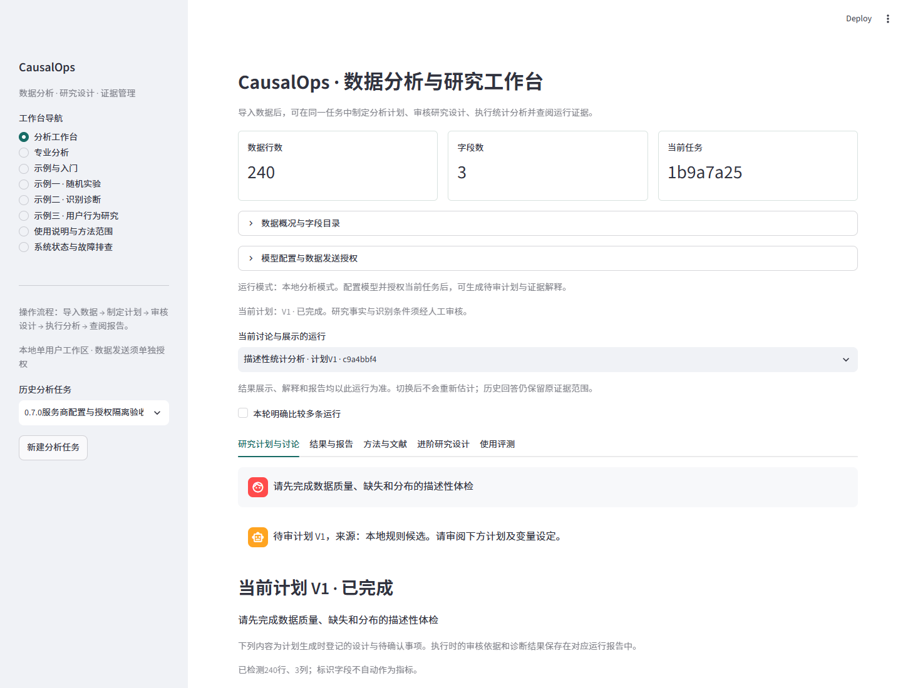
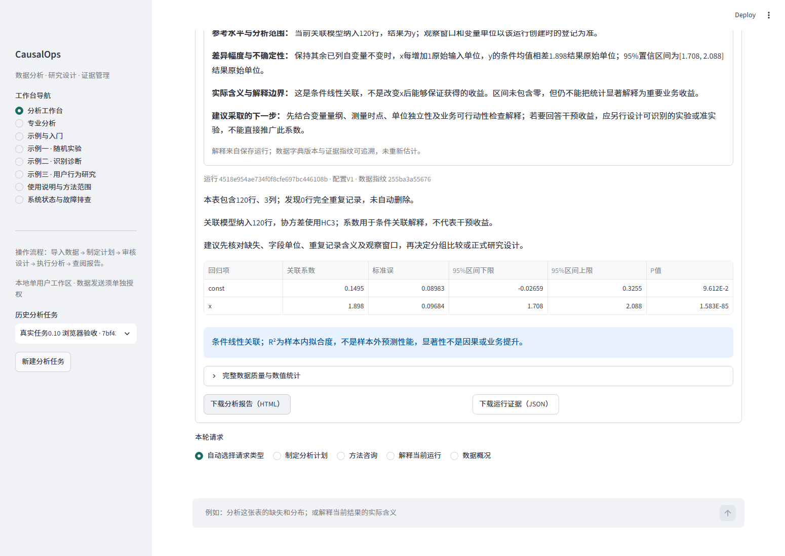

<!-- release: 0.7.0 -->
# CausalOps · 数据分析与研究工作台

**将数据检查、研究设计、统计分析和证据解释组织在同一任务中。**

当前为 **0.7.0 私有验证版本**，面向本机单用户。原始数据在本地处理；可选模型提出待审计划和解释，统计计算由本地工具完成。

> 当前主流程采用自建状态编排，尚未使用LangChain或LangGraph。下面分别展示当前实现和建议目标；目标设计不作为已完成能力或简历成果。

[快速开始](#快速开始) · [当前架构](#当前架构) · [目标架构](#目标架构建议尚未接入) · [完整功能与边界](docs/IMPLEMENTATION_0.7.0.md) · [迁移实施方案](docs/LANGGRAPH_MIGRATION_PLAN.md) · [三份参考项目核查](docs/REFERENCE_PROJECT_REVIEW.md)

## 适合解决什么问题

- **陌生表格体检**：检查缺失、分布、重复与候选字段角色，再提出分析步骤。
- **实验与观察性研究**：按数据结构、分配机制和识别依据制定研究计划，由使用者审核后执行。
- **围绕结果继续讨论**：解释幅度、区间、实际意义及限制；回答绑定选定运行，保留来源和数值依据。

**操作路径：上传表格 → 本地检查 → 提出待审计划 → 人工审核 → 本地计算 → 图文报告与持续问答。**

## 当前架构


| 层 | 当前实现 | 责任 |
|---|---|---|
| 交互 | Streamlit | 导入、讨论、审核、图表和报告 |
| 应用与编排 | AssistantWorkspace、TaskRuntime、EvidenceLoop | 版本、检查点、限次恢复与有界观察 |
| 模型 | 多服务商HTTP网关 | 接收配置授权、结构化输出与本地校验 |
| 知识 | TF-IDF方法卡与章节检索 | 方法条件、来源位置、知识库版本 |
| 统计 | 17项方法、三类执行器、ToolResult | 设计检查、计算、诊断与运行归属 |
| 存储 | SQLite、Parquet、JSON/HTML | 研究版本、数据副本、证据和成果 |
| 协议 | MCP与A2A | 明确导出的只读方法/证据查询与规则审阅 |

代码与职责映射见[架构核查](docs/ARCHITECTURE_REVIEW_0.7.0.md)；详细研究合同见[方法注册表](docs/METHOD_CONTRACTS.md)及[执行边界](docs/ARCHITECTURE.md)。

## 当前能力与验证状态

| 能力 | 已实现范围 | 说明 |
|---|---|---|
| 数据导入 | CSV/Parquet；50MB、10万行、200列，解码内存上限256MB | 原文件不改写；更大原始日志需先整理 |
| 探索性分析 | 描述、相关、OLS、Logit、Poisson | 相关/回归不等于因果；缺失、单位和暴露需核对 |
| 实验与研究 | A/B、CUPED、关联回归、PSM、IPW、DML、AIPW、共同日期DID | 方法有各自数据与识别条件 |
| 进阶设计 | 2SLS、清晰/模糊RD、限定条件的交错DID | 非任意IV/RDD/DID自动研究，见方法边界 |
| 方法RAG | 20张卡、27条来源、120个原创摘要章节 | 有出处与核对范围；不是全文向量库 |
| 结果问答 | 指定运行的事实、引用、解释等级与来源快照 | 单运行与明确多运行比较分开 |
| 多模型 | DeepSeek、OpenAI、Anthropic、百炼、Gemini及HTTPS兼容接口 | DeepSeek真实API验收通过；其他预设为协议合同测试 |
| MCP | 五项只读工具 | 不提供批准或统计执行权限 |
| A2A | 独立本地规则审阅服务 | 不是第二个自主研究大模型，不验证因果假设 |
| LangGraph / LangChain | 已形成目标架构与迁移方案 | 尚未安装或接入正式流程 |

0.7.0上轮验收：源码与独立已安装wheel环境分别 **401项测试通过**，浏览器及MCP/A2A实际协议调用通过。测试数不等于开放任务准确率；独立用户效率与完成率仍待评测。[测试工作流](https://github.com/JiamWei624/CausalOps/actions)

## 页面示例

以下截图使用固定合成任务，不包含真实微博数据或密钥。





## 快速开始

验收平台：Windows x64、Python 3.11。默认离线模式不需要模型密钥。建议较短的E盘工作区路径，缓存、日志和产物均留在该盘。

已有安装环境启动：

```powershell
python -m causalops.launch --workspace "E:/my-causalops-workspace" --port 8510
```

从源码安装可按[固定运行依赖](requirements-runtime-win-py311.txt)与[第三方许可说明](THIRD_PARTY_NOTICES.md)准备环境：

```powershell
$env:TEMP = "E:/project-temp"
$env:TMP = "E:/project-temp"
$env:PIP_CACHE_DIR = "E:/project-cache/pip"
python -m venv "E:/causalops-venv"
& "E:/causalops-venv/Scripts/python.exe" -m pip install -r requirements-runtime-win-py311.txt
& "E:/causalops-venv/Scripts/python.exe" -m pip install --no-deps .
& "E:/causalops-venv/Scripts/python.exe" -m causalops.launch --workspace "E:/causalops-work" --port 8510
```

以上从项目根目录执行，E盘目录需存在。离线发行包另附匹配wheel与安装脚本；Git仓库不包含大型依赖包。模型配置方法见[多模型接入说明](docs/PROVIDERS_PROTOCOLS_0.7.0.md)。密钥只在界面内存使用，不提交到Git。

只读MCP服务由宿主启动：

```powershell
python -m causalops.protocols.readonly_server --workspace "E:/my-causalops-workspace"
```

先在任务中明确导出证据；宿主仅读取该导出范围。宿主配置与权限由使用者确认，不自动继承工作台外发授权。

## 目标架构（建议，尚未接入）


建议采用 **ResearchService统一入口 + LangGraph结构化Supervisor与有界子图 + LangChain检索/工具适配 + 现有统计与证据内核**。ToolGateway统一检查工具效果、调用范围与授权；MCP/A2A保留明确协议边界。

已通过口令读取三份授权参考文档并核对至末尾，具体比较见[阅读核查](docs/REFERENCE_PROJECT_REVIEW.md)。借鉴主流程、主管路由和工具连接，同时区分图状态、人工研究事实和运行证据。出行示例明确未使用RAG/Milvus；参考项目完整源码未运行，不直接采用其生产能力宣称。

先保留Streamlit、SQLite与现有统计运行时。迁移顺序为服务解耦、结构化路由、检索子图、审核中断、真实进度与结果解释。框架尚未接入，不在当前环境直接升级依赖。

- [当前问题、参考模式与职责分工](docs/ARCHITECTURE_REVIEW_0.7.0.md)
- [逐阶段迁移、输入输出与验收标准](docs/LANGGRAPH_MIGRATION_PLAN.md)
- [研究工作流图](docs/assets/research-workflow-target.svg)
- [知识与证据双通道图](docs/assets/rag-evidence-target.svg)
- [Mermaid图源](docs/diagrams/)
- [工具权限入口图](docs/assets/tool-gateway-target.svg)
- [记忆与研究事实职责图](docs/assets/memory-boundaries-target.svg)
- [来源与飞书阅读范围](docs/architecture-sources.json)

## 数据、研究与发布边界

模型不能从表格确认随机化、无混杂或平行趋势。批准绑定具体计划与数据版本；方法条件不满足时停止、询问或降低解释等级。数值结论按“基线—幅度—实际含义—行动建议”组织，没有合适分母、成本或单位时不编造相对增长与ROI。

原始微博数据、用户/帖子ID、完整论文、密钥、个人对话和本地数据库不进入仓库。知识卡区分原创提炼、摘要及已核对全文页；不分发所参考商业文档或论文全文。代码MIT不替代第三方数据与软件许可。

当前无多租户鉴权，不直接部署公网。仓库在最终确认前持续保持私有。

## 开发与贡献

```powershell
python -m pytest --basetemp "E:/causalops-test"
```

贡献流程：问题与最小复现 → 研究假设/数据条件 → 数值参照与失败用例 → 实现 → 回归 → 安装与界面验收。新框架接入后增加路由、中断恢复、批准绑定与重放去重检查，不用框架名称或测试数量替代实际效果。

[参与贡献](CONTRIBUTING.md) · [安全与隐私](SECURITY.md) · [第三方许可](THIRD_PARTY_NOTICES.md) · [完整实现说明](docs/IMPLEMENTATION_0.7.0.md)
