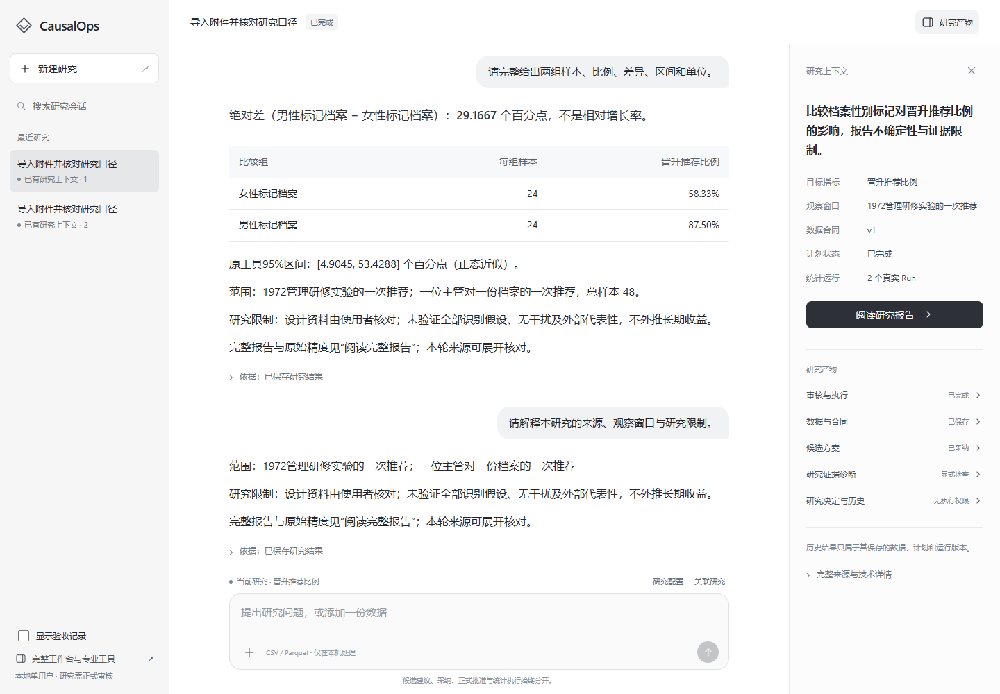

<!-- release: 0.21.0b2 -->
# CausalOps 0.21.0b2 可信交付维护候选

**可审核、可追溯的 AI 数据科学研究工作台。React 默认入口，Streamlit 完整兼容入口。**

Windows x64 · Python 3.11 · 本地单用户 · 单表双组二元受控研究。本文对应本地候选；是否正式公开以经过授权的Beta分支与完整SHA为准，main源码与独立Beta可能不同。

0.21.0b1为已公开Beta；0.21.0b2为本地维护候选，尚未公开推送。修复报告方法说明、采纳状态、聊天估计方法和控制竞态回执，明确100000行上传限制。旧诊断升级后可能需要显式重新核验，历史统计结果与研究决定保留。

[维护版说明与升级](docs/releases/react-workspace-021b2/RELEASE_NOTES.md)

以下工作台总览沿用b1真实截图；本版升级截图见维护说明。



提出问题 → 导入CSV/Parquet → 确认数据合同 → 生成确定性候选 → 显式采纳 → 正式人工批准 → 单独开始 → 真实统计与报告 → 显式证据诊断 → 保存研究决定。

聊天、候选、批准、执行和报告是不同状态。系统不会因为一句“同意”而取得统计执行权限。

## 安装与启动

建议在独立Python 3.11环境使用本版本附带的Windows锁定依赖。发行包已包含React生产资源，**运行不需要Node.js或npm**。

```powershell
python -m venv .venv
.\.venv\Scripts\python.exe -m pip install -r requirements-windows-py311.lock.txt
.\.venv\Scripts\python.exe -m pip install --no-deps .\causalops_agent-0.21.0b2-py3-none-any.whl
.\.venv\Scripts\python.exe -m pip check
.\.venv\Scripts\causalops-workbench.exe --workspace .\causalops-workspace
```

标准命令会核验资源、启动两个受管理本地服务，然后打开React。默认React为`http://127.0.0.1:8790`，完整兼容工作台为`http://127.0.0.1:8791`。两者共用明确指定的`CAUSALOPS_HOME`，不复制第二套统计结果。

从React左下角“完整工作台与专业工具”访问Streamlit。也可使用`causalops-streamlit --workspace .\causalops-workspace`打开同一受管理服务对。保持启动窗口运行；Ctrl+C停止两个服务，研究数据保留。运行中请先请求暂停；重启后通过原服务核查恢复，不直接重算。

```powershell
# 端口冲突时，选择两个不同的空闲端口；不会关闭别的程序
causalops-workbench --workspace .\causalops-workspace --port 8890 --streamlit-port 8891
# 不打开浏览器 / 检查依赖、资源、端口与工作区
causalops-workbench --workspace .\causalops-workspace --no-browser
causalops-workbench --workspace .\causalops-workspace --diagnose
```

不要同时把不同版本的源码与安装包混入一个运行环境。升级保留历史只读记录；旧源码批准不自动获得新版执行权限。升级前请等待或暂停研究并停止原服务。

[完整安装说明](docs/current/INSTALLATION.md) · [React完整使用教程](docs/current/REACT_WORKSPACE_GUIDE.md) · [覆盖矩阵](docs/releases/react-workspace-beta/COVERAGE.md) · [候选验收](docs/releases/react-workspace-021b2/ACCEPTANCE.md) · [限制与安全](docs/releases/react-workspace-beta/SECURITY_AND_LIMITS.md)

## 实际能力

|能力|当前范围|
|---|---|
|React对话工作台|持久化会话、搜索、历史恢复、每轮冻结研究引用、真实结果追问；当前为本地确定性回复|
|用户自有数据|CSV/Parquet、本地字段与版本化合同确认；单表、双组、二元指标、独立观察单位|
|受限候选与研究|未知随机化只做4步描述性路径；符合已登记条件时5步、descriptive与ab_test各一次|
|正式安全|采纳、批准、单独开始分离；原审批、步骤级授权、预算、暂停、取消终态和核查恢复|
|结果与证据|真实Run、ReportManifest、单位/百分点/原工具区间、完整报告和证据导出|
|研究诊断|用户显式触发，六项确定性规则、五种检查状态、三层报告及有限后续建议|
|研究决定|显式采纳/暂缓/拒绝或自主备注、保存原因、追加修订、同任务确定性历史提醒；无执行权限|
|完整兼容工作台|原单次研究、17项专业工具、模型连接/授权、原受约束模型候选及研究需求草案仍通过Streamlit|

React并未迁移全部专业工具和模型规划界面。模型建议只是候选，模型关闭不影响确定性路径；API密钥不进入浏览器或安装包，启动器不自动启用外部模型或追踪。原始研究数据不会默认外发。

## 准确的能力边界

- 六项已实现诊断：证据身份、随机化依据声明、观察窗口、双Run一致性、指标与单位链、报告来源。其余八项未实现；没有总体可信度分数。
- 随机化未知不根据组名或均衡推断。描述性结果没有虚构A/B效应或区间。实验设计仍需可靠来源与用户确认，程序不证明全部识别假设。
- React当前不提供开放式模型研究；Streamlit的模型候选仅覆盖已受限路径，需明确授权、预算与结构化校验。
- 不支持任意自然语言自主研究、多表自动连接、跨任务语义记忆、持续后台主动诊断或生产级公网多人协作。
- 工程回归与自动浏览器测试不是真人使用验证。**目前尚无真人独立使用的正式验收数据。**
- 历史模型辅助规划只有已记录的少量真实调用，不是大规模能力评测；未核实费用不宣称具体金额。

[自动化教程](docs/current/AUTOMATION_GUIDE.md) · [诊断教程](docs/current/DIAGNOSTICS_GUIDE.md) · [决定记忆教程](docs/current/DECISION_MEMORY_GUIDE.md) · [可配置研究与原模型路径](docs/current/CONFIGURABLE_RESEARCH_GUIDE.md) · [历史评测说明](docs/evaluation/v23/PUBLIC_SUMMARY.md)

## 源码与前端构建

清洁源码包同样携带经过校验的前端资源，可直接`python -m pip install --no-deps .`，无需npm。只有修改前端的开发人员需要Node；实际验证使用Node 24。依赖由`frontend/package-lock.json`锁定：

```powershell
python scripts/build_frontend.py
python -m pip wheel --no-deps . --wheel-dir dist
```

构建脚本执行`npm ci`和TypeScript/Vite生产构建，再写入包内静态资源与SHA-256清单。文件缺失、内容变化或版本不一致时，启动器会停止并说明原因，不回退到工作目录中的未知前端。
