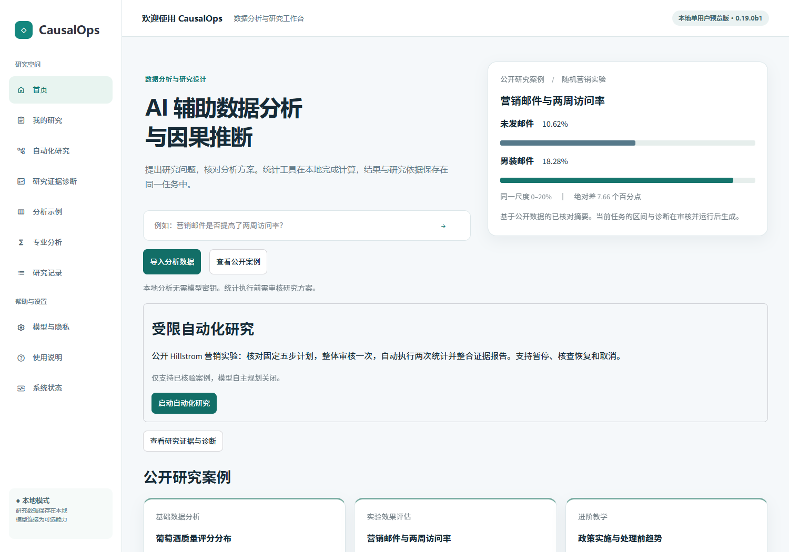
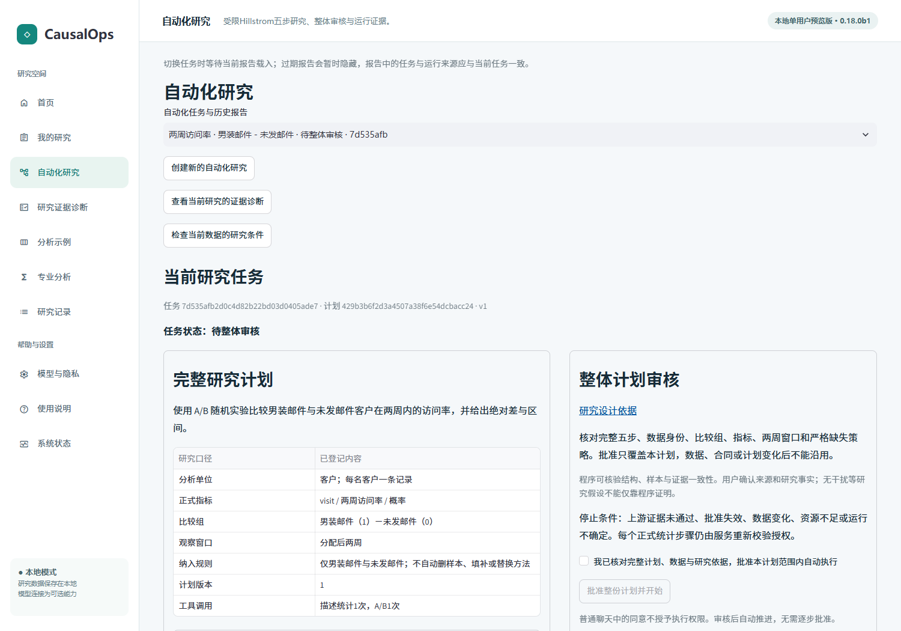
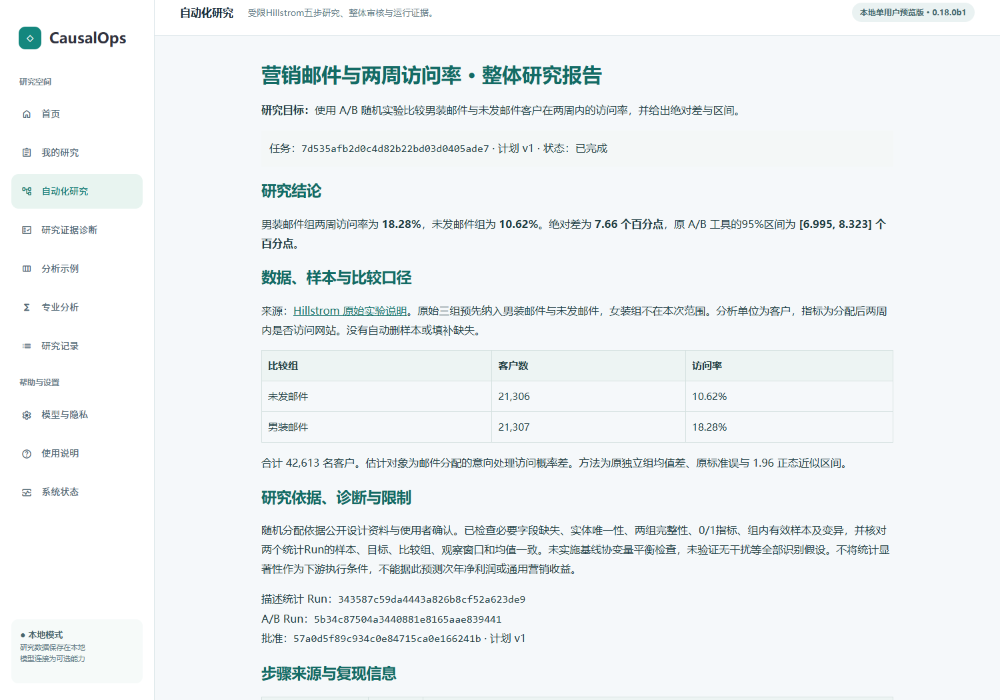

<!-- release: 0.19.0b1 -->
# CausalOps Beta

**面向科研与业务分析的可审核、可追溯 AI 数据科学 Agent。**

`0.19.0b1` · Windows x64 / Python 3.11 · 本地单用户 · 研究决策记忆受限首版候选

CausalOps 将研究问题、版本化数据合同、方法建议、人工审核、本地统计与运行证据连接起来。使用者可以从单表数据提出问题，审核方案后执行注册工具，并按具体运行查看报告。自动化入口只支持已核验的 Hillstrom 营销实验：一次整体审核，按固定五步推进两次真实统计计算。

**当前不是通用自主研究系统。** 不支持任意自然语言目标的自动多步骤规划、通用多表研究、完整主动诊断或云端多人协作。当前诊断是用户显式触发的确定性检查，不是后台持续监控或模型自主推理。开放式方法建议和研究解释仍有已记录的准确性限制。没有真人完成率、提效或生产可靠性数据。

[研究决策记忆教程](docs/current/DECISION_MEMORY_GUIDE.md) · [诊断教程](docs/current/DIAGNOSTICS_GUIDE.md) · [自动化使用教程](docs/current/AUTOMATION_GUIDE.md) · [安装](docs/current/INSTALLATION.md) · [本候选验收](docs/releases/research-decision-memory-beta/ACCEPTANCE.md) · [已知限制](docs/releases/research-decision-memory-beta/LIMITATIONS.md) · [架构](docs/current/ARCHITECTURE.md)



*图1：0.19.0b1候选独立安装后的实际首页。研究决策记忆在诊断报告内；营销实验成果预览不等于本任务已执行。*

## 已实现与验证范围

|能力|实际行为与边界|
|---|---|
|单表分析|CSV / Parquet 导入，字段与缺失预览，版本化 DataContract；预览字段不自动改变正式指标。|
|研究方案与方法依据|LangGraph 组织意图、方法检索、结构化方案、审核中断与结果问答；DeepSeek 为可选辅助，模型不能授予执行权限。|
|人工审核与本地统计|17 个注册方法入口；批准绑定数据、合同、方案及执行范围。各方法验证深度不同。|
|运行证据与报告|统计结果来自实际工具，关联 Run、计划和数据版本；可导出 HTML 与证据。|
|受限五步自动化|审计→分组描述→真实上游证据核验→A/B→报告整合。描述与A/B各自生成Run，门禁失败停止下游。|
|研究决策记忆|显式决定及原因、不可变任务历史、追加修订、确定性历史提醒；不授予统计执行权限。|
|研究诊断|显式预诊断／执行后诊断、六项规则、同源三层报告、有限建议、无执行权限草案和历史版本。|
|执行控制|持久预算、步骤边界暂停、取消终态、恢复前调和、异常人工核查；不承诺任意进程故障下物理恰好一次。|

## 新增：研究决策记忆

在诊断报告内，对真实建议显式选择采纳、暂缓或拒绝并保存原因；无建议时也可记录自主研究决定。历史按任务、报告和证据版本绑定；修改追加修订，不覆盖原文。后续报告只对能够可靠对应的同任务、同规则和兼容范围作确定性提醒。

**所有决定均由用户主动提交，不是模型代替用户作出的决定。** 历史决定不是研究事实证明，没有统计执行权限，也不会自动生成草案或批准。不同任务不模糊匹配，自由文本备注不做语义理解；证据或口径改变时要求人工核对。没有持续后台监控，模型解释默认关闭。[实际使用流程与截图](docs/current/DECISION_MEMORY_GUIDE.md)

## 新增：研究证据诊断

- 运行前：选择已登记数据，点击“检查研究条件”；无正式Run也能核对合同与分组事实，设计依据不足就显示未知。
- 运行后：从已完成Hillstrom任务进入“研究证据诊断”，点击“检查研究证据”，核对本任务双Run、计划、批准及来源。
- 三层报告：真实研究结果→证据质量→最多三条有依据建议。六项规则已实现，八项规则未实现；五种检查状态分别展示，不提供总可信度分数。
- 需求草案：用户显式确认后保存；重复提交幂等，来源过期拒绝。草案没有执行权限，不是正式计划或批准。
- 历史查询：刷新不重新计算，冲突时不借用其他任务的旧成功数字。

模型解释关闭，本诊断路径不发送收费模型请求。部分检查满足不代表全部识别假设成立；随机化依据需要来源，不从两组名称推断。[教程和实际页面](docs/current/DIAGNOSTICS_GUIDE.md)

## 快速安装与启动

在仓库根目录打开 PowerShell，先确认 `py -3.11 --version`。下列相对路径可替换为数据盘上的短目录；不要提交个人工作区。

```powershell
py -3.11 -m venv .venv
& ./.venv/Scripts/python.exe -m pip install -r requirements-runtime-win-py311.txt
& ./.venv/Scripts/python.exe -m pip install --no-deps .
& ./.venv/Scripts/python.exe -m pip check
& ./.venv/Scripts/python.exe -m causalops.launch --workspace ./causalops-workspace --port 8513
```

打开启动器显示的地址。软件包版本与地址中的构建指纹共同辨识候选，旧 `0.16.0` 安装不会自动升级。独立验收使用新虚拟环境、离线公开依赖缓存和新构建 wheel；未声称测试了从互联网重新下载全部依赖。[详细安装与缓存设置](docs/current/INSTALLATION.md)

## 首要演示：Hillstrom 固定五步研究

1. 首页点击 **启动自动化研究**，下载页面指定的原始公开压缩包并上传；也可在启动前设置 `CAUSALOPS_HILLSTROM_ARCHIVE`。仓库不分发客户原始表。
2. 阅读发布者设计资料，核对客户单位、男装邮件/未发邮件、分配后两周访问定义。确认后 **生成五步研究计划**；这一步没有批准或统计。
3. 核对完整五步、两次工具调用、数据合同、严格缺失策略及预算；勾选审核声明，点击 **批准整份计划并开始**。
4. 自动执行审计、分组描述、上游Run核验、A/B及整合。每个统计步骤重新校验授权；失败不会自动改方法、删样本或填补数据。
5. 查看整体报告、两个Run、风险说明及预算。导出报告或证据；刷新和重开历史任务不会重新计算。



*图2：沿用0.18.0b1已验证页面截图。预览、正式计划、批准与执行分别记录。普通聊天中的“同意”不授予执行权限。*

公开原始表预先取两组共42,613名客户：未发邮件2,262/21,306（10.62%），男装邮件3,894/21,307（18.28%）。差值约7.66个百分点，原A/B工具95%区间约[6.995,8.323]个百分点。每次安装必须实际运行产生自己的证据，不将这些公开参考数值冒充新计算。随机分配依据原发布者资料与用户确认，不能仅凭有两组推断。[发布者说明](https://blog.minethatdata.com/2008/03/minethatdata-e-mail-analytics-and-data.html)



*图3：沿用0.18.0b1已验证页面截图。报告数值由持久化结构化证据生成。模型自主规划关闭，本固定链无真实模型请求。*

## 其他现有路径

- **单次营销研究**：保留“查看营销实验→生成待审方案→人工审核→计算→报告”的原路径。[单次教程](docs/current/PUBLIC_TUTORIAL.md)
- **基础示例**：内置UCI红葡萄酒，1,599行、12字段；质量分布仅描述样本，不能解释配方因果效应。
- **政策教学**：明确标记的合成面板，展示双重差分假设与限制，不是真实政策成果。

## 统计方法

描述统计、Pearson/Spearman相关、OLS、Logit、Poisson、A/B、CUPED、回归调整、PSM、IPW、AIPW、DoubleML、共同/交错时点DID、2SLS与清晰/模糊断点由17个注册入口管理。方法名称与注册别名以实际注册表为准。存在工具不代表其识别假设或所有场景已经全面验证。[方法合同](docs/METHOD_CONTRACTS.md) · [统计核查](docs/current/STATISTICAL_AUDIT.md)

## 质量记录与能力限制

P2开发版32da3fb工程回归1067项通过、固定浏览器最终4/4；这是开发版历史成绩。本候选独立安装及发布验证结果另见本次验收，不把工程通过率或固定脚本结果解释为真人效率或通用Agent准确率。

- 自动化三个阶段的工程与固定浏览器证据按版本保存；本候选的实际安装、测试数、四条自动化流程及旧流程结果见[本次验收](docs/releases/proactive-diagnostics-beta/ACCEPTANCE.md)，不能沿用旧成绩代替新测。
- Eval V2.2固定流程8/8，但最后N06自由探索3次未完整完成；固定脚本不代表自主导航或真人效率。
- Eval V2.3最终开发集为本地9/30、DeepSeek15/30。保留集每模式实际执行13题，已确认正确0/13，另7题未执行；模型6项评分争议仍保留。不能合并成50题通用准确率。[归档汇总](docs/evaluation/v23/PUBLIC_SUMMARY.md)
- PSM等方法有统计推断限制；高风险研究与业务决策须专业复核。部分复杂只读问题、指标与统计解释仍不可靠。两周访问率不支持推算次年净利润。

## 架构、数据与权限

Streamlit→ResearchService。单次研究走LangGraph与本地方法知识检索；受限自动化走BoundedCoordinator、PlanV2及步骤证据门禁，复用原统计工具与审批。SQLite保存任务/批准/预算/Run元数据，Parquet与结果文件保存数据和统计证据。恢复先校验所有权及既有Run，不盲目重算。[实现与边界](docs/current/ARCHITECTURE.md)

模型为可选服务。连接凭据与数据外发授权分别管理；固定自动化计划不调用DeepSeek。公开源码、个人工作区和模型数据发送是不同权限。论文、私人研究和微博数据、数据库、密钥、隐藏评测答案不随快照分发。[安全](SECURITY.md) · [模型与隐私](docs/current/PROVIDERS.md)

## 完整文档

|用途|文档|
|---|---|
|第一次运行|[安装](docs/current/INSTALLATION.md) · [自动化教程](docs/current/AUTOMATION_GUIDE.md) · [日常操作](docs/current/USER_GUIDE.md)|
|理解结果|[方法合同](docs/METHOD_CONTRACTS.md) · [研究质量](docs/current/RESEARCH_QUALITY.md) · [运行核验](docs/current/VALIDATION.md)|
|理解代码|[架构](docs/current/ARCHITECTURE.md) · [五步设计与历史](docs/product/automation-v2/README.md) · [完整功能手册](docs/current/COMPLETE_MANUAL.md)|
|本次候选|[变更与范围](docs/releases/proactive-diagnostics-beta/README.md) · [验收](docs/releases/proactive-diagnostics-beta/ACCEPTANCE.md) · [限制](docs/releases/proactive-diagnostics-beta/LIMITATIONS.md)|
|贡献与许可|[贡献](CONTRIBUTING.md) · [MIT许可](LICENSE) · [第三方许可](THIRD_PARTY_NOTICES.md) · [全部索引](docs/README.md)|

未来规划包括有界自然语言规划、更完整的诊断规则与决策记忆、多表指标管理和RAG专项优化，均不作为当前能力。[版本历史](docs/HISTORY.md)
