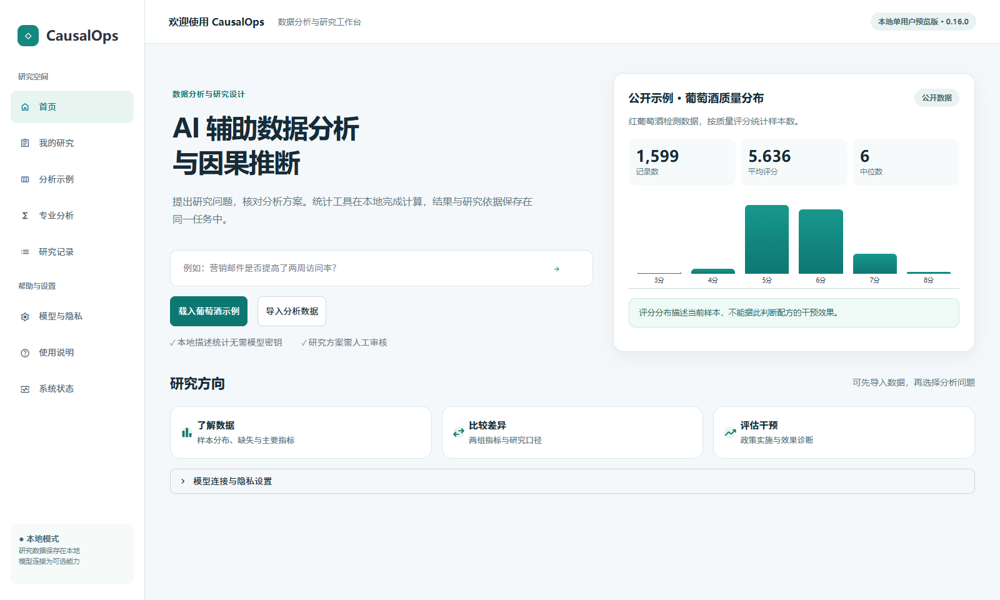
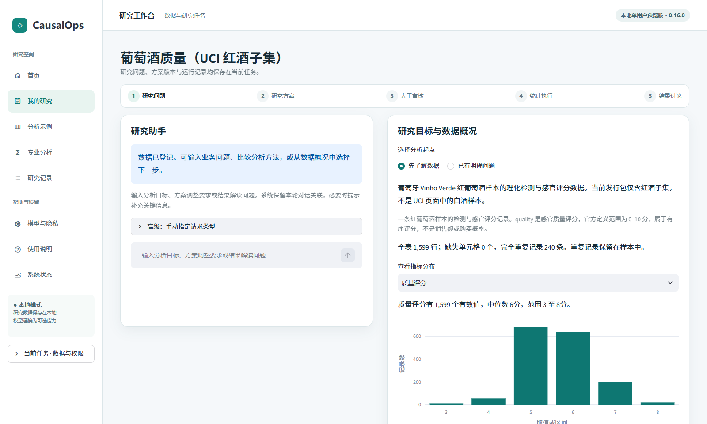
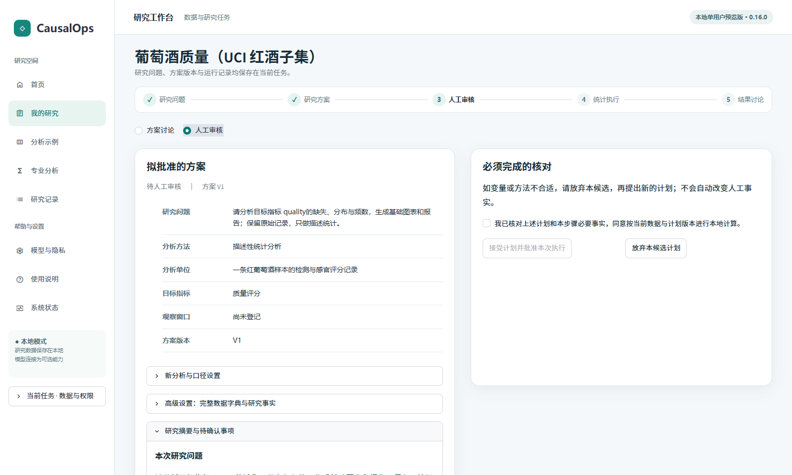
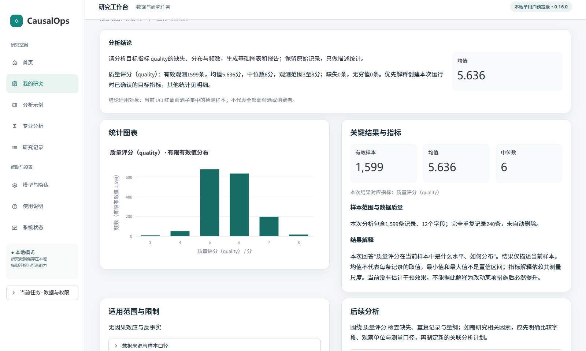
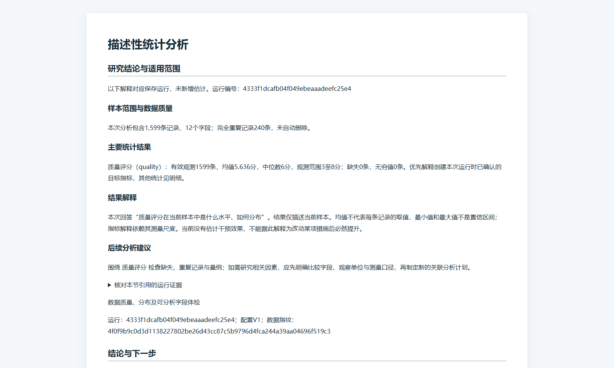

<!-- release: 0.16.0 -->
# CausalOps

**AI 辅助数据分析与因果推断** · 0.16.0 公开预览 · Windows x64 / Python 3.11

CausalOps 是本地单用户研究工作台。业务分析人员可以导入一张表，从样本分布开始提出问题，也可以直接输入研究目标。助手协助制定和修订方案；使用者核对字段与研究条件后，由本地统计工具计算。每份报告关联一次具体运行，可据此复核数字、诊断和解释范围。

[快速安装](#快速安装) · [首次使用教程](docs/current/PUBLIC_TUTORIAL.md)



**图 1　工作台首页。** 左侧问题框可将问题带入数据导入页。右侧评分分布依据随包提供的公开样本计算；首页的本地示例无需模型密钥。

## 核心功能

| 任务 | 操作与产出 |
|---|---|
| 理解数据 | 导入 CSV 或 Parquet，核对每行代表的对象，查看字段类型、缺失、重复和分布。 |
| 制定与修订方案 | 用自然语言说明指标、观察期和目标。工作台检索方法依据，列出待确认事项；候选修订可比较修改前后的内容。 |
| 审核与计算 | 在人工审核视图中核对拟批准的方案与执行条件。批准绑定具体版本；普通对话不会触发批准。 |
| 解读与复核 | 查看样本、指标、估计值及其不确定性；通过研究记录选回对应运行，追问结果或导出 HTML 报告。 |

## 真实使用示例

**分析问题：公开红葡萄酒样本的质量评分如何分布？** 此例采用 UCI Wine Quality 的红酒子集。一行是一条检测与评分记录，`quality` 为感官评分，单位为分。[UCI 数据说明与许可](https://archive.ics.uci.edu/dataset/186/wine+quality)

1. 首页点击 **载入葡萄酒示例**。工作台载入 **1,599 行、12 个字段**，评分的含义已按数据来源预填。
2. 保留 **先了解数据**，查看评分分布，再点击 **生成完整描述统计报告**。若要体验方案审核，另载入一个示例任务，选择 **已有明确问题 → 使用示例说明并生成分析计划 → 人工审核**，核对后批准执行。
3. 在结果区核对指标。该样本的平均评分为 **5.636 分**，中位数为 **6 分**，观测范围为 **3–8 分**。原表有 **240 行完全重复记录**，系统保留这些记录。这个分布描述已观测样本，无法回答调整某项配方会让评分提高多少。
4. 展开 **研究报告预览** 或点击 **导出本次分析报告**。后续可在 **研究记录** 找回任务和运行证据。改问酒精含量与评分的关系时，应建立关联分析计划。

## 界面截图

以下为同一公开示例在本地运行的界面。点击图片可查看原尺寸。

| 工作台与研究方案 | 人工审核 |
|---|---|
| [](docs/assets/review-workspace.png) | [](docs/assets/review-approval.png) |
| **图 2　研究工作台。** 左侧讨论问题，右侧查看研究目标、方案或数据概况。 | **图 3　人工审核。** 左侧核对方案，右侧确认方法所需条件。 |

| 分析结果 | 导出的研究报告 |
|---|---|
| [](docs/assets/review-result.png) | [](docs/assets/review-report.png) |
| **图 4　本次分析结果。** 先读结论，再核对图表、有效样本和适用范围。 | **图 5　离线 HTML 报告。** 导出文件保留本次计算结果、诊断及其证据。 |

## 研究流程


**图 6　分析任务与人工审核。** 已有结果的追问读取指定运行。更改指标、样本或观察期时，工作台检查信息是否齐备，并按新的分析口径处理。

## 技术架构


**图 7　组件与调用关系。** Streamlit 提供交互界面，ResearchService 管理任务与版本，LangGraph 组织路由、检索和审核中断。方法资料用于解释研究设计；运行结果由本地统计执行器产生，报告通过运行记录引用数值。模型连接与任务外发许可分别配置。[架构与源码职责](docs/current/ARCHITECTURE.md)

## 快速安装

在 Windows x64 上安装 Python 3.11，将仓库下载并解压到较短的路径（如 `E:\CausalOps`）。在**仓库根目录**打开 PowerShell 执行：

```powershell
py -3.11 -m venv E:/causalops-venv
& E:/causalops-venv/Scripts/python.exe -m pip install -r requirements-runtime-win-py311.txt
& E:/causalops-venv/Scripts/python.exe -m pip install --no-deps .
& E:/causalops-venv/Scripts/python.exe -m pip check
& E:/causalops-venv/Scripts/python.exe -m causalops.launch --workspace E:/causalops-work --port 8513
```

打开启动器显示的本机地址。E 盘路径可替换。Windows 环境建议同时使用较短的工作区与测试临时目录；路径过深时，报告写入可能失败。若系统使用 `python` 而非 `py`，先用 `python --version` 确认是 3.11，再用该解释器创建虚拟环境。缓存目录设置、离线安装与端口故障处理见[安装说明](docs/current/INSTALLATION.md)。

## 统计方法与验证情况

| 分析范围 | 已实现的方法及解释边界 |
|---|---|
| 描述与关联 | 描述统计、Pearson / Spearman 相关、OLS、Logit、Poisson。两变量相关以成对有效观测为分母；关联系数不能直接解释为干预收益。 |
| 实验与观察性比较 | A/B、CUPED、回归调整、PSM、IPW、AIPW、DoubleML。随机分配、协变量测量时点和重叠条件须按设计核对。 |
| 面板、工具变量与断点 | 共同或交错处理时点 DID、2SLS、清晰与模糊断点。适用面板结构、工具变量论证与局部解释限制见[方法合同](docs/METHOD_CONTRACTS.md)。 |

- **软件与界面。** 本次界面改造通过 630 项回归测试，浏览器实测了公开示例的导入、审核、执行和报告下载。独立用户的完成率及用时仍待测量。
- **统计复算。** 固定种子重新拟合 90 次；其中 PSM 的 6 次模拟有 4 次区间覆盖设定真值。该结果提示需要进一步核查匹配推断，不足以估计长期覆盖率。[统计核查](docs/current/STATISTICAL_AUDIT.md)
- **业务解释。** Hillstrom 公开实验中，男装邮件组两周访问率为 18.28%，未发邮件组为 10.62%。绝对差约 **7.66 个百分点**，相对增幅约 **72.14%**；这份报告不能据以估算下一年度净利润。[组间比较图](docs/assets/hillstrom-visit-rates.svg) · [计算与问答验收](docs/current/VALIDATION.md)

## 安全与使用限制

工作区用于本地单用户分析。上传限制为单文件 50 MB、10 万行、200 列，解码后上限 256 MB。模型为可选服务；配置密钥后，仍须针对具体任务授权数据发送。使用者负责确认业务事实与识别条件。字段存在、程序成功运行或统计显著，都不能单独证明因果关系。[模型与隐私](docs/current/PROVIDERS.md) · [安全说明](SECURITY.md)

## 完整文档

| 读者 | 文档 |
|---|---|
| 首次使用 | [逐步图文教程](docs/current/PUBLIC_TUTORIAL.md) · [用户指南](docs/current/USER_GUIDE.md) · [完整功能手册](docs/current/COMPLETE_MANUAL.md) |
| 研究与复核 | [研究质量检查](docs/current/RESEARCH_QUALITY.md) · [五类真实数据体验](docs/current/REAL_DATA_EXPERIENCE.md) · [验证记录与限制](docs/current/VALIDATION.md) |
| 开发与贡献 | [系统架构](docs/current/ARCHITECTURE.md) · [流程与技术图集](docs/current/FIGURES.md) · [版本记录](docs/HISTORY.md) · [贡献说明](CONTRIBUTING.md) |
| 评审与许可 | [界面与安全复核](docs/current/DESIGN_REVIEW.md) · [项目对比评审](docs/current/PROJECT_REVIEW_2026-11-03.md) · [代码许可](LICENSE) · [第三方许可](THIRD_PARTY_NOTICES.md) |
