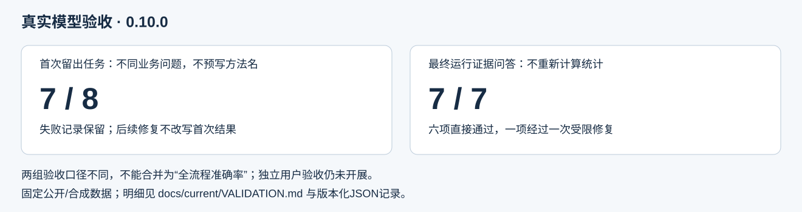

<!-- release: 0.10.0 -->
# CausalOps · 数据分析与研究工作台

**从业务问题出发，组织数据口径、研究计划、统计计算和可追溯的结果讨论。**

当前版本：**0.10.0 私有验证版**。本机单用户运行；统计计算留在本地。模型在明确授权后理解字段、提出待审计划和解释已有证据，不能自行确认研究事实、批准计划或执行分析。

[操作说明](docs/current/USER_GUIDE.md) · [当前架构](docs/current/ARCHITECTURE.md) · [真实任务验收](docs/current/VALIDATION.md) · [模型配置](docs/current/PROVIDERS.md) · [后续边界](docs/current/ROADMAP.md) · [版本历史](docs/HISTORY.md)

## 一次任务如何完成

1. 上传CSV或Parquet，检查数据结构。
2. 登记已知字段含义、单位、时间和分组依据；不知道的内容保持未知。
3. 用业务语言提问。系统根据安全元数据选择主要分析，检索方法条件；缺少依据时补检或澄清。
4. 查看候选与具体缺项。口径完整后，由使用者审核本次计划。
5. 本地后台执行统计并保存证据；完成后默认展示主要分析。
6. 阅读量化结论、继续追问或导出含图表与来源的报告。追问不自动重跑。


## 当前实际架构


| 层 | 实现 | 责任与边界 |
|---|---|---|
| 交互 | Streamlit | 显示当前任务、下一步、具体缺项、审核和主要结果 |
| 应用服务 | ResearchService | 统一数据、字典、候选、审批、执行和证据入口 |
| 编排 | LangGraph主图与方法研究子图 | 结构化路由、有限补检、SQLite检查点、审核中断 |
| 口径 | DataContract与就绪检查 | 冻结登记版本；声明不是已验证假设，模型不能修改事实 |
| 知识 | LangChain Core BaseRetriever + 字符TF-IDF | 20张规则/案例卡、27条来源；按方法定向补检，不编造引用 |
| 统计 | 三类执行器、17项注册方法 | 设计检查、官方包计算、数值诊断与主张降级 |
| 后台 | 单工作线程、四项本地队列 | 真实进度、协作停止与检查点恢复；不是分布式平台 |
| 结果 | ToolResult、运行事实、冻结来源口径 | 区分参考水平、差异幅度、实际含义和下一步；不补写ROI |
| 模型 | 六类服务预设与HTTPS协议适配 | DeepSeek做真实调用验收；其他服务目前仍以协议测试为主 |
| 扩展 | MCP只读查询、A2A本地规则审阅 | 不赋予批准权或统计执行权；不宣称多模型自主科研 |


## 可执行方法与限制

- 探索：描述、相关、OLS、Logit、Poisson。
- 实验与研究：A/B、CUPED、观察性关联回归、PSM、IPW、DoubleML、AIPW、共同处理时点DID。
- 进阶：2SLS、清晰/模糊RD、限定条件的交错DID。

[方法合同](docs/METHOD_CONTRACTS.md)由注册表生成。具备接口不等于适用于任意数据；工具外生性、无混杂、平行趋势等不能由表格或模型自动证明。

上传限制仍为50MB、10万行、200列，解码后内存上限256MB。当前没有通用预测训练/样本外评估流水线；会话中的条件关联结果不能冒充预测准确率。

## 本轮验收如何解读

本轮固定12个不指定方法的自然语言任务，分为4个开发任务、8个保留任务；来自真实公开数据与固定种子模拟。问题、数据指纹、审核依据和验收规则在开发前保存。报告分别列出首次结果、开发后重测、有限修复、本地兜底与未完成情况。

自动化脚本替用户执行预先授权的测试审核，不是独立用户研究；测试数量、接口成功次数和这组固定任务的表现，都不是开放任务准确率或节省工时的证据。实际结果见[当前验收说明](docs/current/VALIDATION.md)。最终源码与独立离线安装包均为493项测试通过、零跳过；首次留出7/8，最终保存运行问答7/7（其中一项受限修复），不同口径不合并为一个成功率。



## 页面示例

截图仅使用固定合成数据，不包含原始微博数据或密钥。


## 安装与启动

已验收平台为Windows x64、Python 3.11。依赖版本保持固定，本轮没有为新增功能安装新的框架。

```powershell
$env:TEMP = "E:/project-temp"
$env:TMP = "E:/project-temp"
$env:PIP_CACHE_DIR = "E:/project-cache/pip"
$env:MPLCONFIGDIR = "E:/project-cache/matplotlib"
python -m venv "E:/causalops-venv"
& "E:/causalops-venv/Scripts/python.exe" -m pip install -r requirements-runtime-win-py311.txt
& "E:/causalops-venv/Scripts/python.exe" -m pip install --no-deps .
& "E:/causalops-venv/Scripts/python.exe" -m causalops.launch --workspace "E:/causalops-work" --port 8513
```

从源码根目录执行。项目已有环境可使用启动脚本；离线包另附固定wheel、哈希锁和安装程序，Git源码仓库不含大型依赖包。模型可选，不配置时仍可使用本地分析入口。

## 数据与发布边界

原始微博数据、用户/帖子ID值、论文全文、模型密钥、私有对话和工作区数据库不进入Git。新任务的模型发送授权单独控制；仅发送已授权元数据、汇总及有限上下文。密钥仅存内存，重启后重新输入。

知识卡区分方法规则与实证案例，并保留来源和阅读范围；不是全文向量数据库。文献中的结果不作为当前数据或本工具已经创造收益的证据。代码许可不替代第三方数据与软件许可。

当前无多用户鉴权，不直接部署公网；仓库在最终确认前保持私有。

## 开发与复现

```powershell
python -m pytest --basetemp "E:/causalops-tests"
```

[真实API验收脚本](scripts/evaluate_natural_tasks.py)要求事先固定基准文件，密钥通过进程环境传入；不得放入配置或提交。公开数据下载使用[scripts/download_validation_data.py](scripts/download_validation_data.py)，数据目录应放在源码仓库外。

[贡献说明](CONTRIBUTING.md) · [安全说明](SECURITY.md) · [第三方许可](THIRD_PARTY_NOTICES.md) · [文档索引](docs/README.md)
