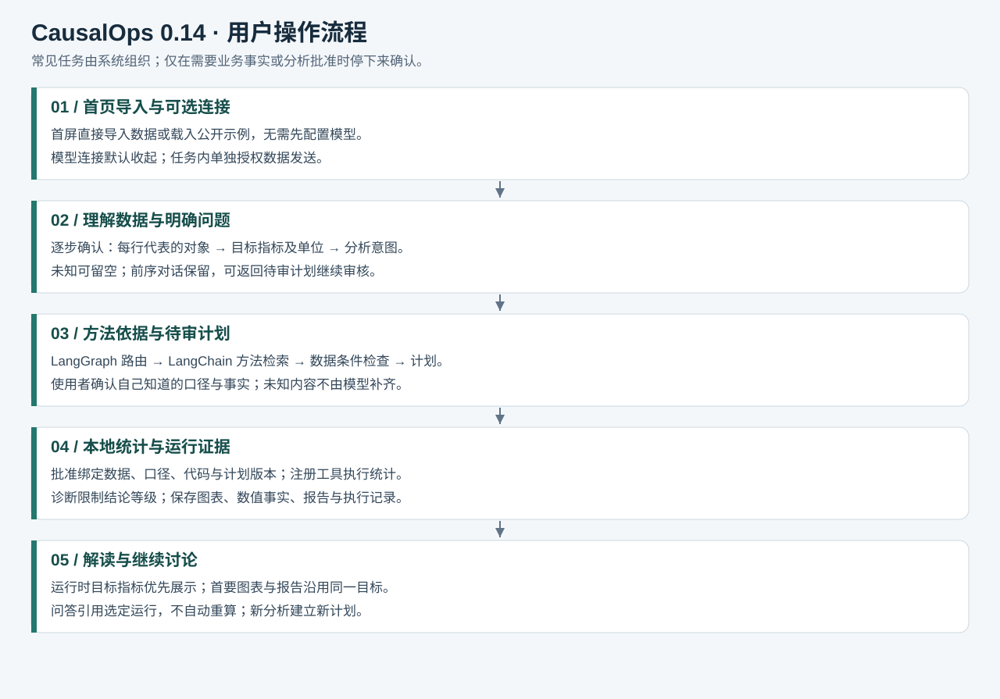
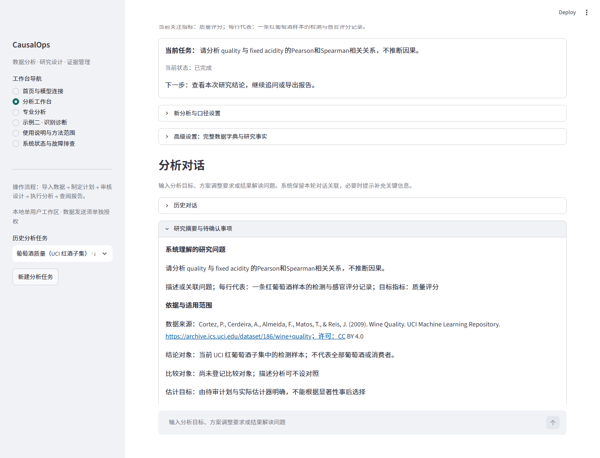
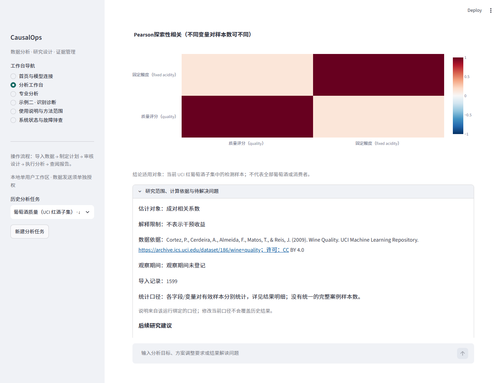
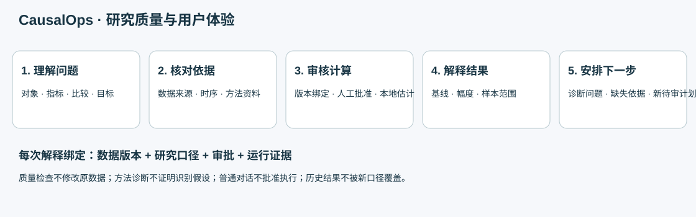
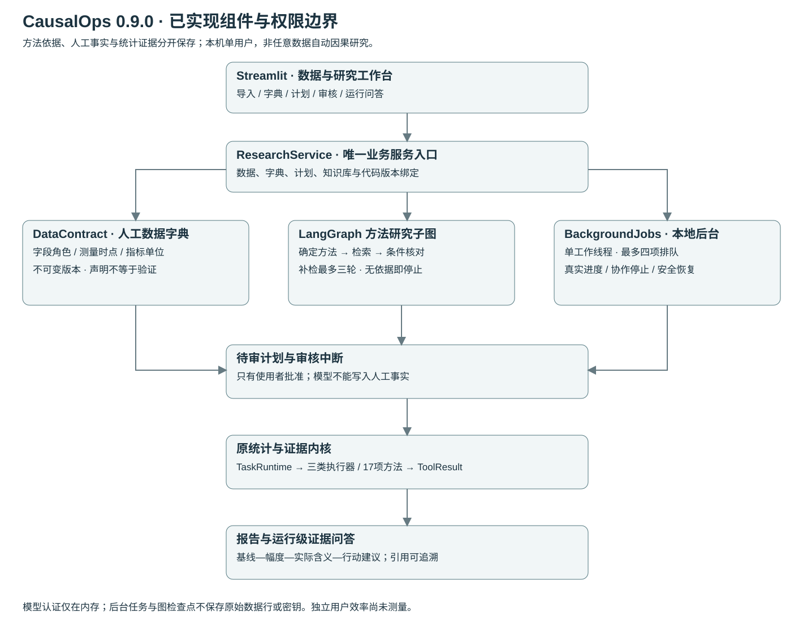
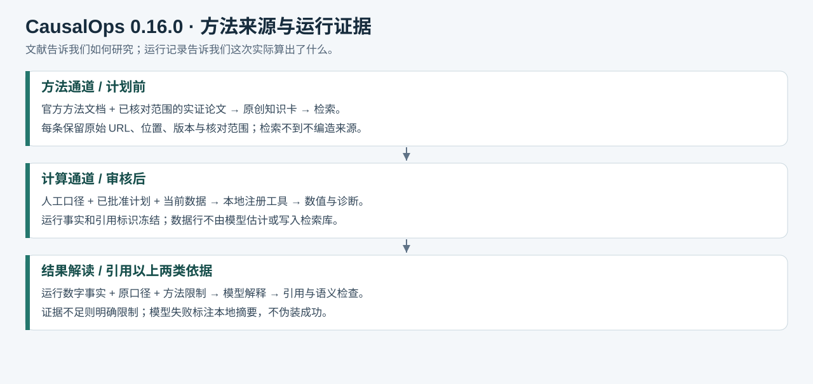

<!-- release: 0.16.0 -->
# CausalOps

### 数据分析与研究工作台

CausalOps 是本地运行的数据分析助手。它帮助使用者理解表格、明确问题、制定分析计划，并调用统计工具生成可追溯的图表、结论和报告。模型负责建议与解释，数值计算由本地统计内核完成。

**当前版本 0.16.0 · Windows x64 / Python 3.11 · 本地单用户。** 代码开放范围与数据发送许可相互独立；本地工作区不随源码分发。它不是能从任意表自动证明因果关系的系统。

[完整项目介绍与功能手册](docs/current/COMPLETE_MANUAL.md) · [完整示例教程](docs/current/PUBLIC_TUTORIAL.md) · [安装与故障排查](docs/current/INSTALLATION.md) · [使用说明](docs/current/USER_GUIDE.md) · [系统架构](docs/current/ARCHITECTURE.md) · [模型与隐私](docs/current/PROVIDERS.md) · [验收与限制](docs/current/VALIDATION.md) · [版本历史](docs/HISTORY.md) · [五类真实数据体验](docs/current/REAL_DATA_EXPERIENCE.md)



**图 1**　用户操作流程。首页可导入自己的表，也可直接载入示例。

## 公开预览与首次试用

本版面向在 Windows 上本地运行的试用者。打开侧栏 **分析示例**，可以直接选择葡萄酒质量分布（真实公开数据）或政策实施效果（合成教学数据）。首页也提供两个入口。**我的分析** 用于继续任务，其下方的 **专业分析** 可显式选择方法。本地示例不需要填写模型密钥。

首次试用请任选一份示例，提出一个问题，导出报告，再用自己的话写下一项发现及其限制。欢迎在 Issues 反馈版本、示例、首次卡住的步骤、完成时间和是否需要帮助。请只提交公开示例的复现步骤，截图时遮住密钥、个人信息及私有数据。

## 适用任务与操作入口

| 使用场景 | 操作入口 | 系统处理 |
|---|---|---|
| 需要了解样本结构与特征 | 上传 → 生成基础报告 | 本地计算缺失、分布、频数，生成图表与报告 |
| 分析目标尚未明确 | 上传后查看初步建议，或生成分析建议 | 根据安全字段摘要提出问题、列出待补信息；不编造研究发现 |
| 业务问题已明确，分析方法待定 | 直接在分析对话中提问 | 检索方法条件、拟定候选计划，在需要的地方要求确认 |
| 需要解读已有分析结果 | 继续问“幅度意味着什么”“有什么限制” | 读取选定运行的证据，核对引用，不重新估计 |

内置示例已提供可核对的说明和预填。导入自己的表后，只需依次说明一行代表什么、关注哪个指标、希望回答哪类问题。未知可留空。无需先懂所有方法名。描述统计可以一键启动；回归或因果研究仍需确认分析单位、字段口径以及与方法相关的事实。未知的事实可以保留未知，系统不得替人勾选。

## 交互界面

[0.16.0 实际操作录屏](docs/assets/research-016-demo.webm)：本地模式，公开葡萄酒数据，涵盖示例导入、明确审核、结果解读、下一轮关联计划与刷新恢复。无配音；研究质量面板见下方图文。

[逐步图文教程](docs/current/PUBLIC_TUTORIAL.md)



**图 2**　研究摘要。根据公开葡萄酒数据核对研究对象、指标与待确认事项。

## 首次使用与连续任务

1. 首页载入示例或导入自己的表。
2. 内置示例可直接使用有来源的预填说明；自己的表依次确认 **每行代表的对象 → 关注指标及单位 → 分析目标**，日期可选。未知可留空，不自动认定随机实验。
3. 阅读待审计划；可先询问适用条件，再通过 **返回待审计划** 继续审核。
4. 明确核对后批准本次执行；普通聊天中的“同意”不能执行。
5. 阅读目标结论与图表，点击 **导出本次分析报告**，或继续追问限制。

## 连续任务与结果呈现

- 首页模型连接为可选折叠区，已配置的模型连接默认收起，并区分“已配置”与“连接已验证”；未知认证状态不显示为连接成功。
- 数据导入后自动展示规模、主要字段、缺失与重复情况，以及基于字段结构的初步建议。该步骤不发送数据、不执行估计、不修改原始记录。
- 选择建议或输入“采用第一项建议”时，系统核对同一任务、数据和口径版本，再建立待审方案。后续请求保留上文问题和方案引用，历史说明不构成当前批准权限。
- 结果优先展示分析结论。描述报告优先解释该次运行确认的目标指标，使用保存的统计量与证据引用；图表、诊断、完整方案和运行记录按需展开。
- 结果追问引用选定运行，不重复计算。模型连接失败可明确使用本地模式，研究条件不足可直接打开本任务口径设置并重建待审计划。“同意”等普通对话文字不替代审核按钮。

## 研究质量与用户体验升级（0.16.0）

新增研究范围登记、四层数据质量检查、方法合同、运行绑定的研究报告，以及诊断后的具体下一步建议。用户可以核对系统理解、资料依据、实际计算、适用对象与未解决问题。



**图 3**　分析结果。先读目标指标的结论，再核对适用范围与后续建议。

[本轮功能与操作](docs/current/RESEARCH_QUALITY.md) · [统计核查与限制](docs/current/STATISTICAL_AUDIT.md)



**图 4**　研究质量检查。每一步分别记录业务口径、方法依据和运行证据。

## 安装与启动

Windows 安装时建议使用较短的项目和工作目录，例如 `E:\CausalOps` 和 `E:\co-work`。部分系统限制完整路径长度，过深的目录可能导致报告文件写入失败。

已验证环境：Windows x64、Python 3.11。下面从仓库根目录执行；所有环境、缓存和工作区均可放在 E 盘。

```powershell
New-Item -ItemType Directory -Force -Path "E:/project-temp", "E:/project-cache/pip", "E:/project-cache/matplotlib"
$env:TEMP = "E:/project-temp"
$env:TMP = "E:/project-temp"
$env:PIP_CACHE_DIR = "E:/project-cache/pip"
$env:MPLCONFIGDIR = "E:/project-cache/matplotlib"
python -m venv "E:/causalops-venv"
& "E:/causalops-venv/Scripts/python.exe" -m pip install -r requirements-runtime-win-py311.txt
& "E:/causalops-venv/Scripts/python.exe" -m pip install --no-deps .
& "E:/causalops-venv/Scripts/python.exe" -m causalops.launch --workspace "E:/causalops-work" --port 8513
```

打开启动器给出的本机地址。首页可直接载入示例或导入 CSV / Parquet。模型连接为可选折叠区，每个数据任务分别控制外发许可。离线发行包另含固定 wheel、SHA-256 锁和安装器；Git 不存储大型依赖包。

## 架构与职责



**图 5**　系统架构。模型提出计划与解释，本地统计内核负责计算。

| 层 | 实现与职责 |
|---|---|
| 用户交互 | Streamlit 首页连接、引导动作、问题卡片、待审计划、报告与追问 |
| 应用服务 | ResearchService 绑定数据、口径、计划、批准、运行与版本 |
| 工作流 | LangGraph 主图 + 方法研究子图；有限检索、检查点和人工中断 |
| 方法知识 | LangChain Core BaseRetriever + 字符 TF-IDF；20 张方法/实证卡、29 条来源 |
| 计算内核 | 三类执行器、17 项注册方法；本地统计、诊断与解释范围限制 |
| 证据 | SQLite 保存运行与工作流；结论绑定实际运行、口径及引用 |
| 模型连接 | 六类服务预设与结构化协议适配；密钥仅存内存，无静默换服务 |
| 扩展接口 | MCP 只读方法/证据查询；A2A 本机规则审阅，不授予执行或审批权 |



**图 6**　方法来源与运行证据。方法文献支持设计选择，每次估计的数值追溯到具体运行。

## 可执行范围

- 描述与关联：描述统计、相关、OLS、Logit、Poisson。
- 实验与观察性研究：A/B、CUPED、回归调整、PSM、IPW、DoubleML、AIPW、共同处理时点 DID。
- 进阶研究：2SLS、清晰/模糊 RD，以及受限定数据条件约束的交错 DID。

接口支持不代表任意表均适用。工具外生性、无未观测混杂、平行趋势、无干扰等需要研究设计依据，不能只靠显著性或模型回答确认。完整限制见[方法合同](docs/METHOD_CONTRACTS.md)。

## 报告里有什么

报告按“参考水平 → 差异幅度与不确定性 → 实际含义与限制 → 后续建议”组织，附图表、样本口径、方法、诊断和证据。基础分布报告不假装回答了因果问题；没有成本与规模依据时不补写 ROI、收入或总体收益。

## 验收口径

[当前验收](docs/current/VALIDATION.md)分别报告回归测试、首次使用浏览器链路、真实模型任务和独立用户研究，不能互相替代。首次使用测试从无字段口径开始，不再把“已提供全部参数的任务能运行”当作新用户能上手。

本地后台为一个工作线程、最多四项排队；上传上限 50MB、10 万行、200 列，解码后上限 256MB。暂不提供多用户鉴权、分布式任务执行或通用预测训练/样本外评测流水线。

## 隐私与贡献

原始研究数据、用户/帖子 ID 值、论文全文、密钥、工作区数据库与私人对话不进入仓库。知识库保留来源与核对范围，原创摘要不冒充逐字引文；第三方数据许可独立于代码许可。当前不得直接作为公网多租户服务部署。

[贡献说明](CONTRIBUTING.md) · [安全说明](SECURITY.md) · [第三方许可](THIRD_PARTY_NOTICES.md) · [文档索引](docs/README.md) · [后续计划](docs/current/ROADMAP.md)

```powershell
python -m pytest --basetemp "E:/causalops-tests"
```

[公开数据下载](scripts/download_validation_data.py)将数据保存到源码仓库外；[真实任务评测](scripts/evaluate_natural_tasks.py)要求预先固定任务和审核依据。独立外部用户验收尚未完成，不能宣称已证明节省工时或通用研究准确率。
