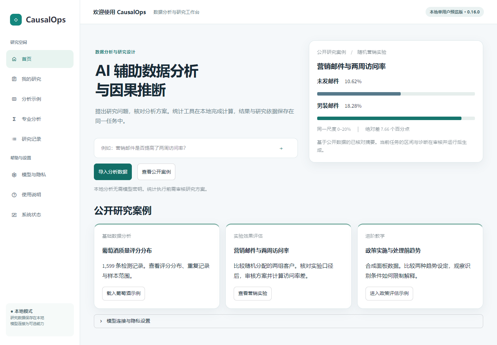
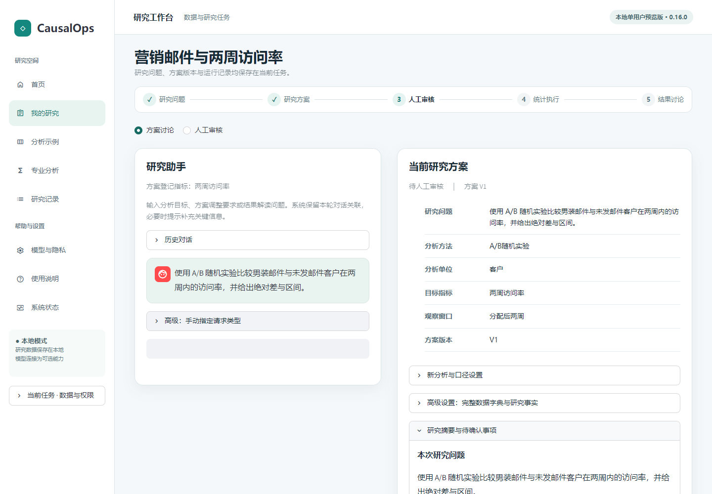
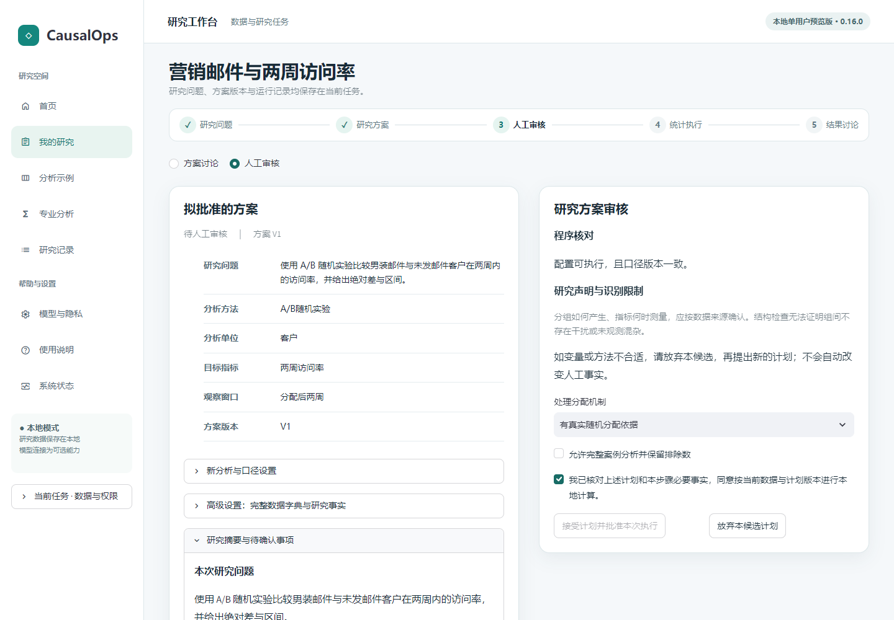
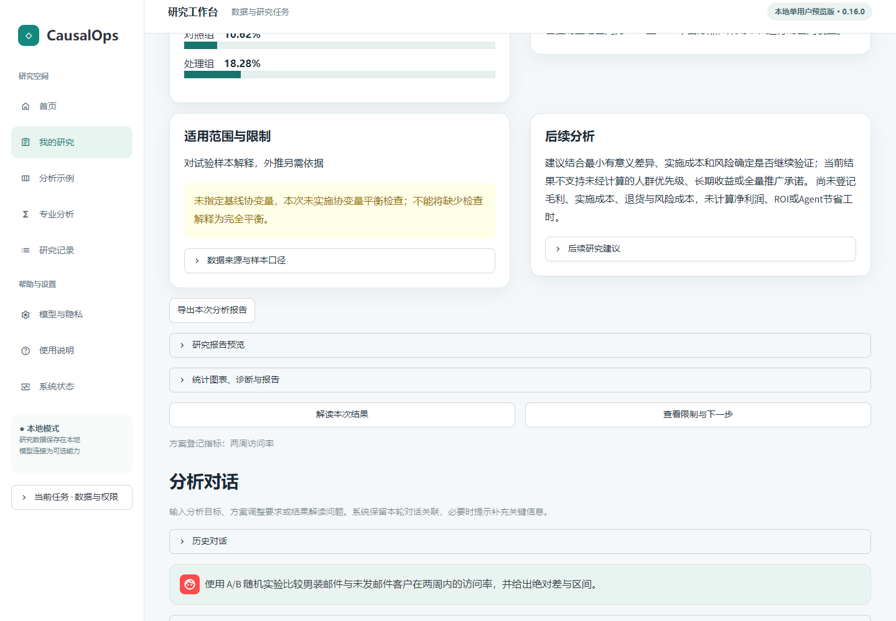
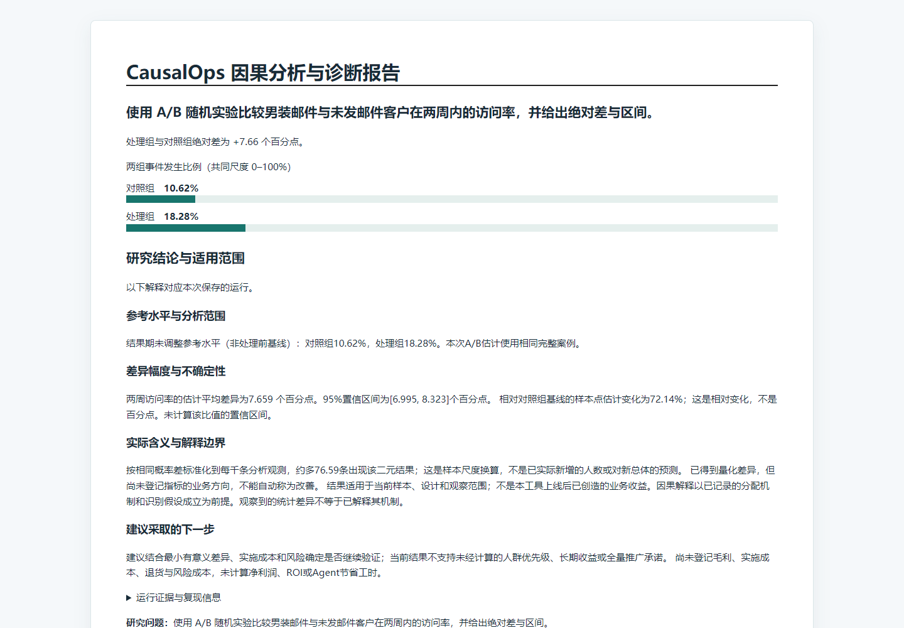
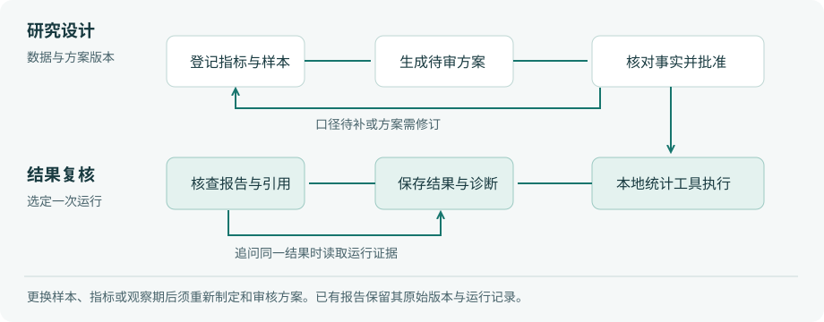

<!-- release: 0.16.0 -->
# CausalOps Beta

**CausalOps Beta——面向科研与业务分析的可验证 AI 数据科学 Agent。**

公开测试版候选 · 0.16.0 软件包 · Windows x64 / Python 3.11

CausalOps 是本地单用户研究工作台。业务分析人员可以导入一张表，从样本分布开始提出问题，也可以直接输入研究目标。助手协助制定和修订方案；使用者核对字段与研究条件后，由本地统计工具计算。每份报告关联一次具体运行，可据此复核数字、诊断和解释范围。

复杂只读请求偶尔会生成待审计划，部分指标需补充口径或返回原报告核查。尚无真人用户完成率或效率测量。用于高风险科研或业务决策前，应由专业人员独立复核。多表自主研究与云端多人协作属于后续规划。历史评测报告中的提交号对应本地开发档案，详细运行库不随快照分发。

[阶段冻结与风险登记](docs/stage/验收与整合.md) · [技术与成果总结](docs/stage/技术与成果总结.md) · [营销实验历史验收](docs/current/PHASE2_ACCEPTANCE.md) · [快速安装](#快速安装) · [首次使用教程](docs/current/PUBLIC_TUTORIAL.md)



**图 1　首页。** 右侧按同一尺度比较两组访问率；下方三个入口分别面向描述统计、随机实验和政策评估教学。

## 本次测试版的使用范围

| 状态 | 功能与条件 |
|---|---|
| 已验证 | 公开营销实验从导入、制定方案、核查版本化数据合同、人工批准、本地执行，到报告导出及按运行追问。LangGraph 组织步骤，方法检索提供依据，17 个注册入口分派计算。DeepSeek 官方接口已完成一次最终产品冒烟；本地案例可以离线分析。 |
| 有条件可用 | 观察性解释依赖分配机制和变量测量时点。某些只读问题会进入待审，或在证据充分时漏答目标数值。最后封存的十题首次为 3 项完整、2 项部分、5 项失败。CausalOps Eval 的模拟操作与程序回归不能代替真人试用。 |
| 后续规划 | Eval V2.2 将测量导航、操作成本和故障恢复，V2.3 计划扩大任务集。多表指标管理、自主研究规划与云端多用户协作尚属后续方向。 |

## 核心功能

| 任务 | 操作与产出 |
|---|---|
| 理解数据 | 导入 CSV 或 Parquet，核对每行代表的对象，查看字段类型、缺失、重复和分布。 |
| 制定与修订方案 | 用自然语言说明指标、观察期和目标。工作台检索方法依据，列出待确认事项；候选修订可比较修改前后的内容。 |
| 审核与计算 | 在人工审核视图中核对拟批准的方案与执行条件。批准绑定具体版本；普通对话不会触发批准。 |
| 解读与复核 | 查看样本、指标、估计值及其不确定性；通过研究记录选回对应运行，追问结果或导出 HTML 报告。 |

## 真实研究案例 · 营销邮件与两周访问率

Hillstrom 将 64,000 名客户随机分配到男装邮件、女装邮件和未发邮件三组。此处预先选定男装邮件与未发邮件，结果为两周内是否访问。未发邮件组 2,262 / 21,306（10.62%），男装邮件组 3,894 / 21,307（18.28%）。绝对差为 **7.66 个百分点**。分母为各自分配组中的客户数；该指标无法回答次年净利润问题。[实验发布说明](https://blog.minethatdata.com/2008/03/minethatdata-e-mail-analytics-and-data.html) · [同期实验资料](https://stochasticsolutions.com/pdf/HillstromChallenge.pdf)

1. 首页选择 **查看营销实验**，在案例页下载链接取得原始压缩包，直接上传。也可将环境变量 `CAUSALOPS_HILLSTROM_ARCHIVE` 指向同一文件，再启动应用。仓库仅附公开汇总。
2. 核对来源和两周指标，点击 **创建研究任务并生成待审方案**。系统核对文件指纹，筛选预先指定的两臂，保留分组及访问指标，登记行标识。
3. 打开 **人工审核**，查看绑定的数据与方案、分配依据和阻断项。确认后批准本次计算。在结果页核对两组比例和差值区间，导出 HTML 报告。后续追问应引用本次保存的运行。

## 基础与进阶示例

**进阶教学 · 合成政策面板。** 从首页进入政策评估示例，切换处理前趋势相同或不同的设定，再检查趋势诊断怎样限制结论。参数和结果仅描述模拟情形。


**分析问题：公开红葡萄酒样本的质量评分如何分布？** 此例采用 UCI Wine Quality 的红酒子集。一行是一条检测与评分记录，`quality` 为感官评分，单位为分。[UCI 数据说明与许可](https://archive.ics.uci.edu/dataset/186/wine+quality)

1. 首页点击 **载入葡萄酒示例**。工作台载入 **1,599 行、12 个字段**，评分的含义已按数据来源预填。
2. 保留 **先了解数据**，查看评分分布，再点击 **生成完整描述统计报告**。若要体验方案审核，另载入一个示例任务，选择 **已有明确问题 → 使用示例说明并生成分析计划 → 人工审核**，核对后批准执行。
3. 在结果区核对指标。该样本的平均评分为 **5.636 分**，中位数为 **6 分**，观测范围为 **3–8 分**。原表有 **240 行完全重复记录**，系统保留这些记录。这个分布描述已观测样本，无法回答调整某项配方会让评分提高多少。
4. 展开 **研究报告预览** 或点击 **导出本次分析报告**。后续可在 **研究记录** 找回任务和运行证据。改问酒精含量与评分的关系时，应建立关联分析计划。

## 界面截图

下列截图取自营销实验的本地浏览器验收，包含实际审核控件与导出的文件。

| 研究方案 | 人工审核 |
|---|---|
|  |  |
| 图 2　研究工作台 | 图 3　审核当前版本 |

| 本次分析结果 | 离线报告 |
|---|---|
|  |  |
| 图 4　运行结果 | 图 5　研究报告 |

## 研究流程



**图 6　研究设计与结果复核。** 设计调整回到待审计划；同一运行的追问直接核查结果与诊断。[可编辑关系定义](docs/diagrams/phase2-research-cycle.mmd)

## 技术架构


**图 7　组件与调用关系。** Streamlit 提供交互界面，ResearchService 管理任务与版本，LangGraph 组织路由、检索和审核中断。方法资料用于解释研究设计；运行结果由本地统计执行器产生，报告通过运行记录引用数值。模型连接与任务外发许可分别配置。[架构与源码职责](docs/current/ARCHITECTURE.md)

## 快速安装

在 Windows x64 上安装 Python 3.11，将仓库下载并解压到较短的路径（如 `E:\CausalOps`）。在**仓库根目录**打开 PowerShell 执行：

```powershell
py -3.11 -m venv E:/causalops-venv
& E:/causalops-venv/Scripts/python.exe -m pip install -r requirements-runtime-win-py311.txt
& E:/causalops-venv/Scripts/python.exe -m pip install --no-deps .
& E:/causalops-venv/Scripts/python.exe -m pip check
& E:/causalops-venv/Scripts/python.exe -m causalops.launch --workspace E:/causalops-work --port 8513
```

打开启动器显示的本机地址。更新已有安装时，在最新源码目录重新执行安装步骤并重启服务；本次沿用 0.16.0，请通过 Git 标签、源码提交与启动地址中的构建指纹辨识本次候选。本次公开快照保留软件包版本，使用 Beta 分支的提交号区分构建。远程 main 和旧离线包对应各自构建；辨别候选应核对 Git 提交。E 盘路径可替换。Windows 环境建议同时使用较短的工作区与测试临时目录；路径过深时，报告写入可能失败。若系统使用 `python` 而非 `py`，先用 `python --version` 确认是 3.11，再用该解释器创建虚拟环境。缓存目录设置、离线安装与端口故障处理见[安装说明](docs/current/INSTALLATION.md)。

## 统计方法与验证情况

| 分析范围 | 已实现的方法及解释边界 |
|---|---|
| 描述与关联 | 描述统计、Pearson / Spearman 相关、OLS、Logit、Poisson。两变量相关以成对有效观测为分母；关联系数不能直接解释为干预收益。 |
| 实验与观察性比较 | A/B、CUPED、回归调整、PSM、IPW、AIPW、DoubleML。随机分配、协变量测量时点和重叠条件须按设计核对。 |
| 面板、工具变量与断点 | 共同或交错处理时点 DID、2SLS、清晰与模糊断点。适用面板结构、工具变量论证与局部解释限制见[方法合同](docs/METHOD_CONTRACTS.md)。 |

- **早期界面验收。** 本地配置指定原始压缩包后，633 项回归测试通过。另以浏览器完成营销实验文件上传、审核、计算、报告下载与基于同一运行的追问。独立试用者完成率与用时仍待测量。[验收条件和记录](docs/current/PHASE2_ACCEPTANCE.md)
- **阶段冻结。** 产品提交 `b8fbc75`，完整工程回归 755 项通过。最终十道陌生服务任务首次 3 项完整、2 项部分、5 项失败；其中两项只读追问进入待审。使用限制与实际测量范围见[冻结记录](docs/stage/验收与整合.md)。
- **统计复算。** 固定种子重新拟合 90 次；其中 PSM 的 6 次模拟有 4 次区间覆盖设定真值。该结果提示需要进一步核查匹配推断，不足以估计长期覆盖率。[统计核查](docs/current/STATISTICAL_AUDIT.md)
- **业务解释。** Hillstrom 公开实验中，男装邮件组两周访问率为 18.28%，未发邮件组为 10.62%。绝对差约 **7.66 个百分点**，相对增幅约 **72.14%**；这份报告不能据以估算下一年度净利润。[组间比较图](docs/assets/hillstrom-visit-rates.svg) · [计算与问答验收](docs/current/VALIDATION.md)

## 安全与使用限制

工作区用于本地单用户分析。上传限制为单文件 50 MB、10 万行、200 列，解码后上限 256 MB。模型为可选服务；配置密钥后，仍须针对具体任务授权数据发送。使用者负责确认业务事实与识别条件。字段存在、程序成功运行或统计显著，都不能单独证明因果关系。[模型与隐私](docs/current/PROVIDERS.md) · [安全说明](SECURITY.md)

## 完整文档

| 使用场景 | 推荐阅读 |
|---|---|
| 第一次运行 | [安装与更新](docs/current/INSTALLATION.md) → [营销实验图文教程](docs/current/PUBLIC_TUTORIAL.md) → [日常操作与故障恢复](docs/current/USER_GUIDE.md) |
| 核对样本与结论 | [实验来源、筛选与复算](docs/current/PHASE2_ACCEPTANCE.md) · [研究质量与声明核对](docs/current/RESEARCH_QUALITY.md) · [真实数据测试范围](docs/current/REAL_DATA_EXPERIENCE.md) |
| 核对发布与限制 | [阶段验收记录](docs/stage/验收与整合.md) · [界面与权限复核](docs/current/DESIGN_REVIEW.md) · [统计方法与限制](docs/METHOD_CONTRACTS.md) |
| 理解实现 | [系统架构与代码职责](docs/current/ARCHITECTURE.md) · [研究流程、证据与权限图集](docs/current/FIGURES.md) · [完整功能手册](docs/current/COMPLETE_MANUAL.md) |
| 参与开发或复用 | [贡献步骤](CONTRIBUTING.md) · [代码许可](LICENSE) · [公共数据与第三方许可](THIRD_PARTY_NOTICES.md) |

[版本历史](docs/HISTORY.md) · [项目对比评审（含评审时的源码基线）](docs/current/PROJECT_REVIEW_2026-11-03.md) · [全部文档索引](docs/README.md)
