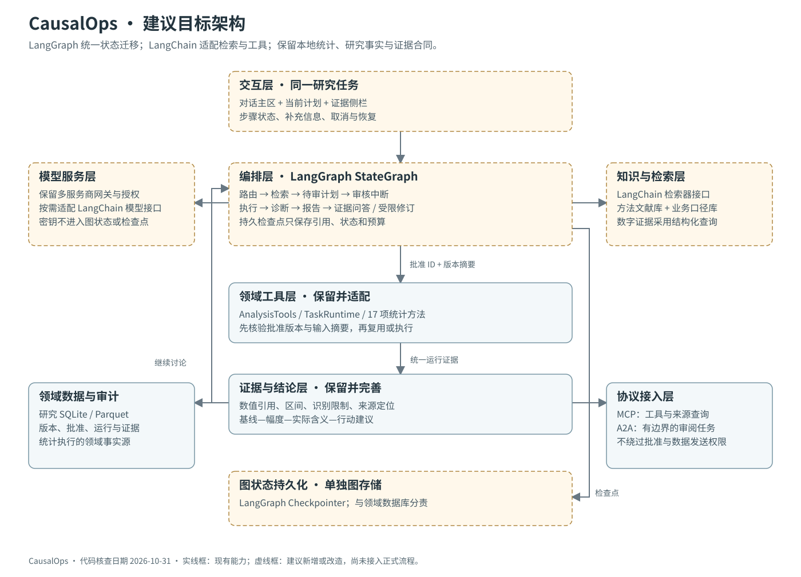
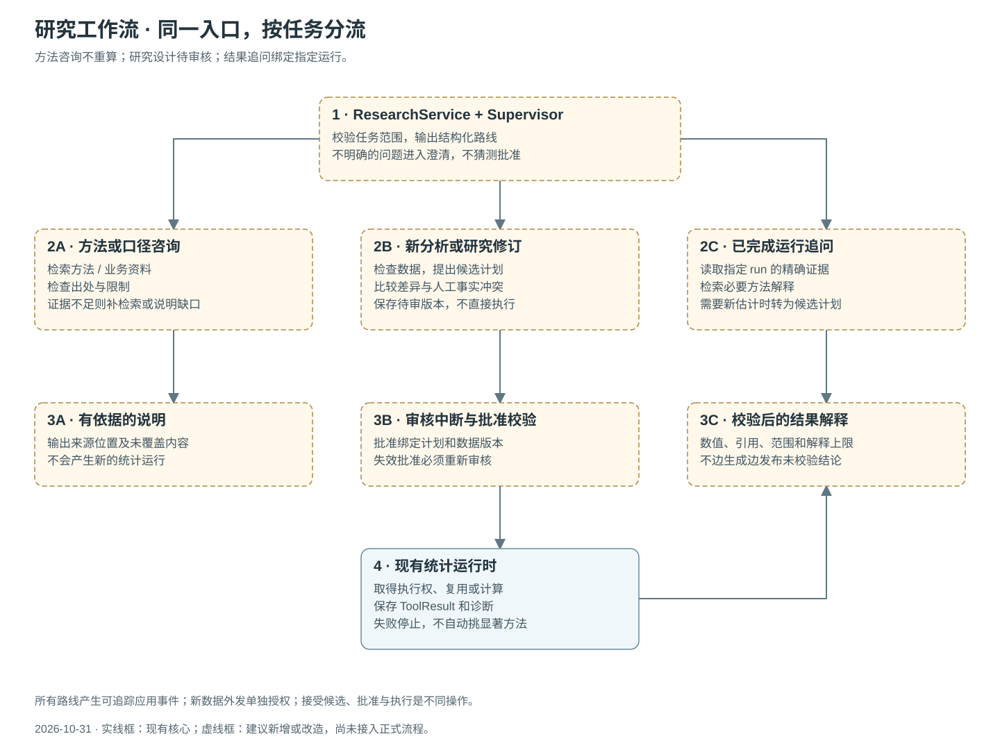
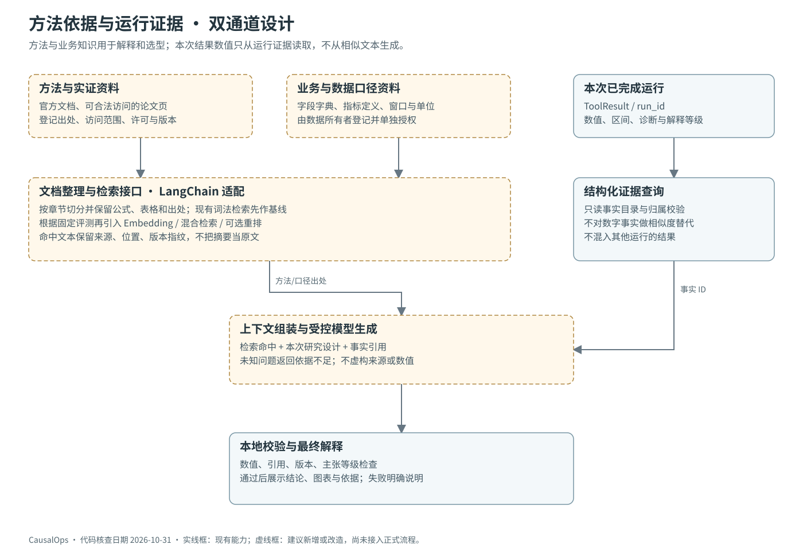

# 0.7.0架构核查基线与目标设计

后续进展：首个迁移闭环已在0.8.0实现，见[实际实现范围](LANGGRAPH_IMPLEMENTATION_0.8.0.md)。本页保留迁移前核查，不能将其“尚未接入”描述当作最新版本状态。

核查对象：0.7.0 已实现代码。本文中的目标图和迁移条目是建议，尚未构成 LangChain / LangGraph 已接入的声明。本轮只整理文档与图示，不改变统计执行或既有数据。

## 1. 为什么目前不容易看懂

从代码核查，当前能力已经形成闭环，问题集中在职责与呈现方式：

- `ui/assistant_app.py` 同时处理模型配置、同意记录、对话、计划编辑、事实表单、执行和结果展示，当前361行，后续交互增加会继续扩大。
- `assistant/service.py` 的 AssistantWorkspace 同时承担持久化、模型调用、计划、问答与执行协调，当前442行。并非行数本身说明设计错误，但职责集中会让迁移与验收难以分开。
- TaskRuntime、EvidenceLoop、领域统计路由分别有自己的状态与停止条件，缺少一个清楚展示整体研究阶段的主工作流。
- 主界面按功能区排列，用户不容易知道“现在处理到哪里、为什么暂停、下一步需要什么”。
- 方法RAG与运行证据已经分开，但入口和文档未充分解释二者差异；没有 Embedding 或全文索引，不能包装成已建成向量知识库。
- MCP目前主要把内部方法和证据提供给宿主；A2A是独立规则服务。它们是协议边界，不是当前主流程的统一编排器。

因此建议同时做结构调整与交互调整，而非仅安装框架或改名称。

## 2. 已实现架构

| 层 | 当前组件 | 核查代码 |
|---|---|---|
| 界面 | Streamlit任务、讨论、表单和结果 | `src/causalops/ui/assistant_app.py` |
| 应用编排 | AssistantWorkspace、Plan、GroundedReply、EvidenceLoop | `src/causalops/assistant/service.py`、`observation.py` |
| 执行控制 | 检查点、进程身份、执行令牌、调和 | `src/causalops/assistant/runtime.py` |
| 工具与统计 | AnalysisTools、17项方法、三类执行器 | `src/causalops/assistant/contracts.py`、`general/`、`advanced/` |
| 模型接入 | ProviderConfig、StructuredModelClient、接收配置授权 | `src/causalops/llm/providers.py` |
| 知识 | 方法卡、章节TF-IDF、来源与指纹 | `src/causalops/knowledge/retrieval.py`、`catalog.json` |
| 存储 | SQLite领域记录、Parquet副本、JSON/HTML产物 | `src/causalops/general/service.py` |
| 协议 | 五项只读MCP工具；A2A独立规则审阅 | `src/causalops/protocols/` |

当前主调用可以概括为：

`Streamlit → AssistantWorkspace → Plan与人工审核 → TaskRuntime → AnalysisTools → 统计引擎 → ToolResult → 报告与运行级问答`

自建状态机是一种有效实现，并不因没使用框架而自动失效。但它与本项目日益增加的暂停、恢复、路由、流式交互需求之间，已经需要更明确的工作流表示。

## 3. 建议目标：六层架构

| 层 | 责任 | 改造动作 |
|---|---|---|
| 交互层 | 同一任务中的对话、进度、计划、结果和依据 | 拆出ChatPanel、PlanReview、EvidencePanel等展示组件，先保留Streamlit |
| 工作流层 | 决定研究阶段、路由、暂停、恢复和有界循环 | 新增LangGraph StateGraph，逐步接管应用层状态迁移 |
| 模型与知识适配层 | 模型配置、检索器、工具对象、上下文组装 | 保留网关；用LangChain的文档/检索/工具接口适配现有能力 |
| 领域执行层 | 数据检查、统计适用性、批准核验、执行与去重 | 保留AnalysisTools、TaskRuntime和原统计引擎，不由模型自由编程替代 |
| 数据与证据层 | 数据副本、研究版本、批准、运行、数值事实和来源 | SQLite/Parquet继续作为领域事实来源；图检查点另行分责 |
| 协议层 | 对宿主提供工具，对独立服务交接任务 | MCP与A2A作为外部适配器，不让内部调用全部绕远程协议 |

推荐让LangGraph承担“研究工作流”，让LangChain承担“组件适配”。不再叠加另一个无边界的通用Agent循环，让它绕过既有审核。LangGraph可以独立于LangChain使用；这里选择两者分工是本项目的设计取舍，而非框架硬性要求。[官方概览](https://docs.langchain.com/oss/python/langgraph/overview)。

## 4. 参考页面已完成正文核对

本轮已在本地浏览器解锁三份授权文档并滚动核对至末尾。两个转发名称与实际标题相反：第一份为办公协同，第二份为问诊客服；出行项目明确未使用RAG或Milvus。

[详细阅读核查与架构决策](REFERENCE_PROJECT_REVIEW.md)区分正文展示、代码片段与本项目建议。借鉴主流程与补充检索、Supervisor路由、MCP连接及记忆分工，同时增加统一工具权限入口、真实事件和研究事实保护。未获得或运行参考项目完整源码，不为其生产能力背书。

目标调整为：**ResearchService统一入口 → LangGraph结构化Supervisor与有界子图 → ToolGateway → 现有TaskRuntime/统计/证据内核**。LangChain适配检索和工具，多模型网关继续独立负责接收配置与授权。

## 5. 用户应该看到的过程

目标交互示例：“分析这张表，判断优惠方案是否提高转化率。”

1. 系统自动检查列、样本、缺失、重复与候选分析单位；显示检查进度。
2. AI用现有字段解释候选研究设计，并检索相应方法依据。
3. 将不能从表判断的问题集中成少量必答项，如是否真实随机分配、同一用户是否多行、转化窗口是否一致。
4. 展示计划、指标与需确认的事实；使用者完成一次版本绑定审核。统计设计变更仍需新审核。
5. 本地工具计算并保存结果。界面按步骤显示完成、失败、待补充或取消，而不只等待一段最终文字。
6. 结论解释绝对幅度、可用时的相对幅度、不确定性与实际意义；缺少成本、基线或单位时说明缺口。
7. 同一页面继续追问；仅查询结果不重新计算，需要新分析时创建待审修订。

这会减少无意义的往返，但不承诺单凭任意表格自动完成因果识别。

## 6. RAG应当怎样组织

- 方法库：官方实现文档、统计方法依据、合法可访问论文的已核对部分。
- 业务口径库：数据字典、指标定义、单位、窗口、处理分配说明。由数据所有者提供，权限与任务绑定。
- 运行证据目录：结构化查询本次run_id的数值、区间和诊断，不用向量相似度替代精确数值。

方法库与业务库可以使用统一检索接口，但保留不同来源、用途与权限。先包装现有词法基线，再以固定问题集比较Embedding、混合检索与可选重排，达到实际改善后才切换默认。检索与生成必须有出处和不足依据分支；不能仅因使用LangChain就声称检索质量提升。[官方检索文档](https://docs.langchain.com/oss/python/deepagents/retrieval)。

## 7. 本轮已做与尚未做

已做：代码与环境核查；三份飞书正文与展示片段核对；当前/目标架构图；工作流、检索、工具与记忆图；模块映射、迁移合同和验收标准；GitHub说明整理。

未做：安装LangChain/LangGraph、迁移正式编排、启用Embedding/重排、增加新模型账户验证、开展独立用户效率实验。这些条目在目标图中均为建议状态。

上一轮0.7.0源码与独立安装环境均通过401项测试；该数字不是本轮新框架迁移的验证，也不表示开放任务成功率。
