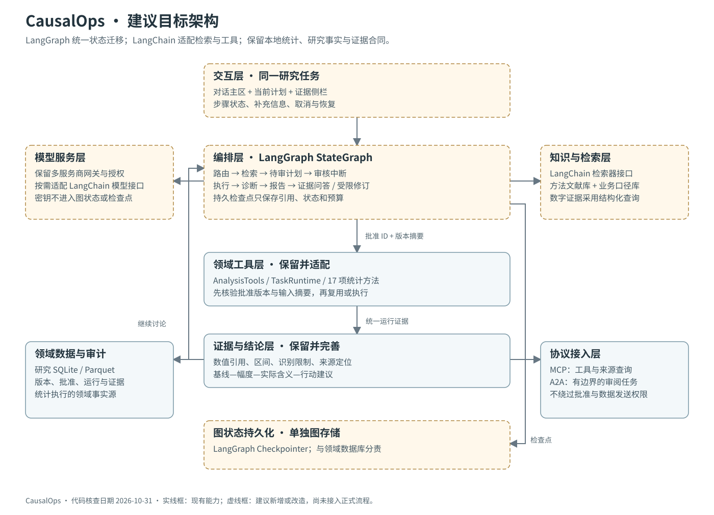
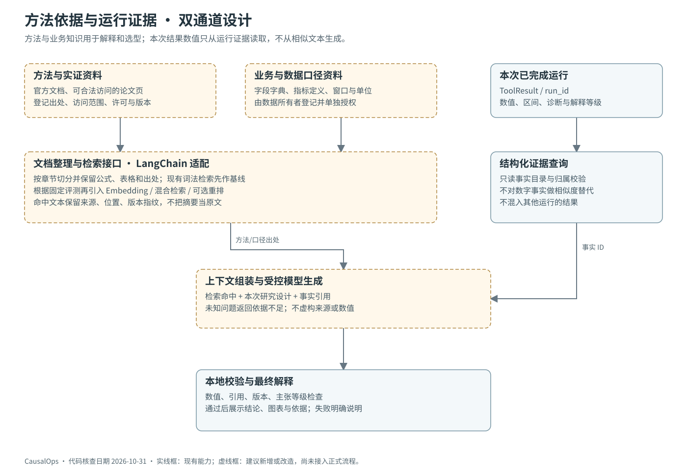
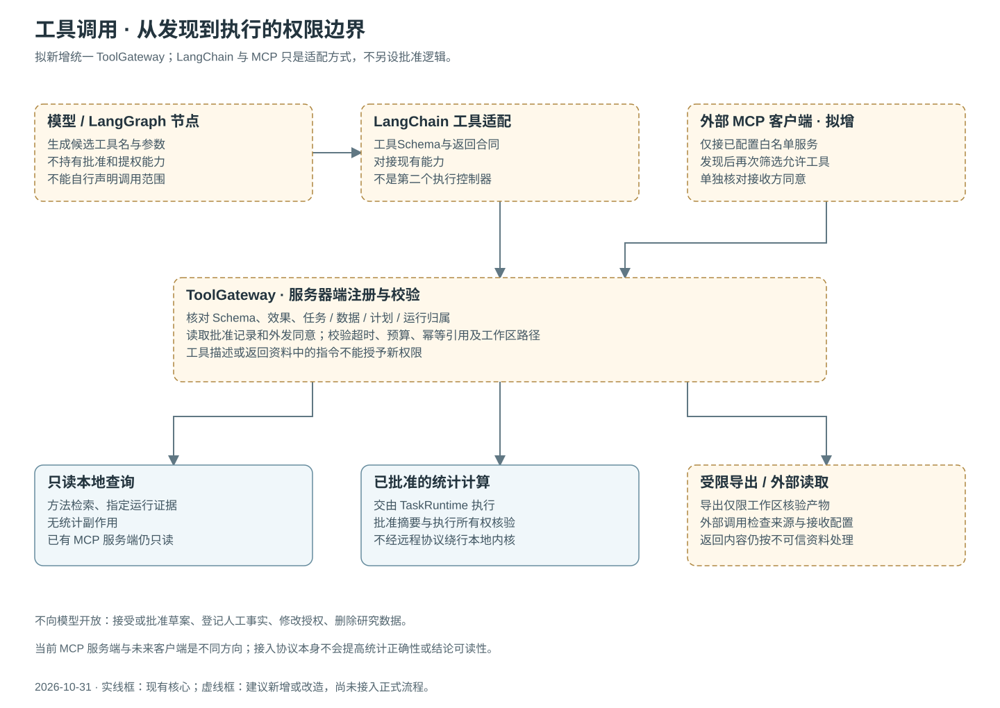
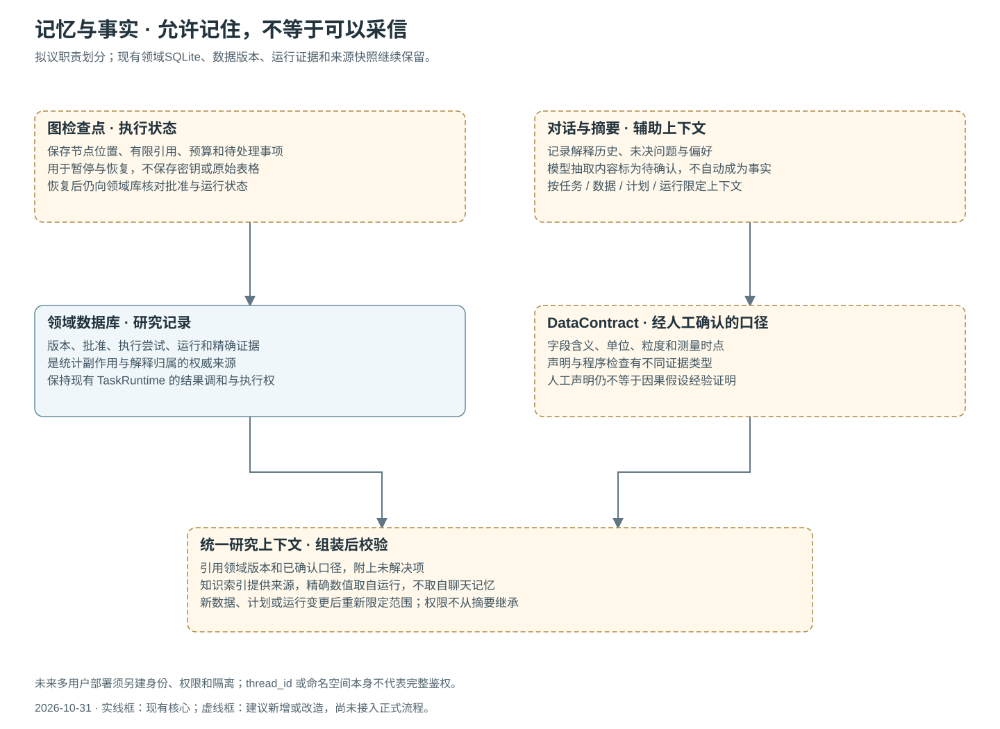

# 三份参考项目阅读核查与架构决策

核查日期：2026-10-31。对象为用户授权的三个飞书页面及其展示的架构、说明和代码片段；已逐页滚动至末尾。未获得或运行这些项目的完整源码，不能据此证明其生产稳定性、安全性或性能。以下是原创比较与设计判断，不转载原文、源代码或原图。

## 1. 先纠正两个链接的名称

| 用户转发时的名称 | 本次页面实际标题 | 核对范围 |
|---|---|---|
| AI客服助手 | [滴云智能办公丨多Agent协同系统](https://dqej47nflyz.feishu.cn/wiki/Sjedw0wDSiFj6Dk3rc5c1Ioontf) | 办公任务主流程、补充检索子流程、工具、记忆、架构图及接口片段 |
| AI办公助手 | [多Agent项目实战：智能问诊AI客服系统](https://dqej47nflyz.feishu.cn/wiki/W87YwmTsSim3lxkxSXicRHcrnbp) | Supervisor路由、角色状态、会话存储、长短期记忆及接口片段 |
| 智能出行助手 | [实战智能出行Agent助手](https://dqej47nflyz.feishu.cn/wiki/PenqwX3LMiQrVrkaka2c39Vwnvd) | ReAct、MCP客户端、多工具连接、生命周期、接口与运行说明 |

前一轮遇到空白页面，本轮已在本地浏览器通过口令解锁并完成正文核对。访问状态已更新；口令、阅读副本和原图不进入Git仓库。

## 2. 各项目真正可借鉴的部分

### 办公：主流程、补充检索与业务工具分层

正文展示Vue3、FastAPI、LangGraph主图与检索补充子流程；LangChain封装业务工具，MySQL保存业务记录，Redis承担检查点/存储。可借鉴的是职责拆分、节点工厂和上下文组织。CausalOps不需同时引入这些数据库和前端框架，现有本地存储可继续使用。

需区别对待展示代码：SSE片段先等待graph.invoke完成，再分段发送最终文字，因此该片段说明的是完成后的文字展示，不证明实时节点进度或模型生成流。JSON提取片段使用文本正则，不能替代CausalOps的结构和权限校验。办公审批工具属于它的业务场景，不能据此向研究模型开放批准权限。

### 问诊：Supervisor与记忆职责

正文展示主管路由到专门角色，并划分会话检查点与长期存储。CausalOps可以借鉴结构化路由和上下文分工，但不照搬医疗角色。

展示图代码中，角色执行后连接END；这不足以证明文案所述的多轮自主协作循环。路由片段按自由文本包含的角色名判断，也不适合作为本项目的可靠分派规则。示例异步接口直接调用同步图执行，提醒我们长统计任务应由任务运行时处理，不能阻塞请求。完整鉴权实现未获得，不能因存在user_id或命名空间便认定已实现多租户隔离。

### 出行：MCP工具适配与连接管理

正文展示LangGraph Agent、模型、内存检查点、MCP客户端和多工具连接，并提供CLI/HTTP入口。适合借鉴配置分离、工具说明与连接生命周期管理。

该文明确说明示例未使用RAG和Milvus，不能把相关介绍当作已经集成的系统。内存Saver也不等于重启持久化。文件写入工具在研究场景必须限制工作区和用途；发现工具不等于获得调用授权。教程SDK和传输示例须按官方当前接口重新核对。

## 3. 对CausalOps的架构判断

**保留“LangGraph主编排＋LangChain检索与工具适配＋现有统计与证据内核”，再明确应用服务、工具权限和记忆三个边界。** 这三项是本项目设计建议，不是声称教程已实现这些治理机制。

| 决策 | 借鉴的模式 | 本项目具体处理 |
|---|---|---|
| 统一任务入口 | 办公主流程 | Streamlit先调用ResearchService；未来HTTP入口复用服务，不重写研究逻辑 |
| Supervisor结构化路由 | 问诊主管分派 | 使用枚举、当前阶段和范围校验；歧义转澄清，禁止文本包含判断决定执行 |
| 子图明确停止条件 | 办公补充检索 | 检索—检查—补充—回答；按次数、预算、证据增量停止，不用自评分代替真实性 |
| 统一ToolGateway | 出行工具适配 | 工具Schema、效果类型、任务归属、授权、批准、超时和审计集中检查 |
| 区分流程记忆与研究事实 | 检查点与长期存储 | 图状态、聊天摘要、人工确认口径、数值证据分别管理，不能互相覆盖 |
| 真实任务事件 | SSE入口 | 发布实际节点/工具开始、完成和失败；不以切分最终文字冒充进度 |
| 保留统计执行内核 | 三例均非统计系统 | 模型提出设计；TaskRuntime核验批准、执行、调和，ToolResult保存运行事实 |
| 双向MCP职责不同 | 出行作为客户端 | 当前是只读服务端；未来客户端须经白名单和外发授权，不自动开放全部工具 |

## 4. RAG需要比参考项目更严格的地方

方法资料回答“为什么用这个方法、需要什么条件”，业务资料回答“字段和指标是什么意思”，运行证据回答“这一次到底算出了什么”。三者可以共同进入解释，但不能互相替代。方法文献不能证明本数据已随机化，语义检索不能产生精确运行数值，聊天摘要不能自动改写变量口径。

建议检索环节输出来源位置、适用条件、失败情形和未覆盖问题；补充检索有预算，找不到依据明确说明。合法全文按已核对章节纳入，表格公式须保留语境。Embedding或重排是否采用，由固定对照集决定，不能因为使用框架就宣称效果提高。

## 5. 工具与记忆是下一轮的关键边界

ToolGateway是拟新增适配层。只读方法/证据查询、经批准的统计计算、工作区导出和外部资料读取分成不同效果类型。每次调用核验任务、数据、计划和运行引用；外部接收方另核同意记录。工具介绍、检索文档和模型输出都不能增加权限。研究批准、人工事实登记、数据删除不作为模型可调用工具。

图检查点保存执行位置和引用；领域库保存具有权威性的计划、批准与运行；人工确认的数据合同保存字段、单位、测量时点；聊天摘要只辅助上下文。长期存储不是“让模型记住什么就相信什么”。本机单用户范围先保证任务隔离，公网多租户认证仍是另外的工程任务。

## 6. 官方接口核对与版本差异

- [LangGraph概览](https://docs.langchain.com/oss/python/langgraph/overview)：可组织确定性和Agent步骤；LangChain不是其硬依赖。本项目采用分层组合。
- [中断](https://docs.langchain.com/oss/python/langgraph/interrupts)与[持久化](https://docs.langchain.com/oss/python/langgraph/persistence)：恢复可能重新进入节点，副作用与批准必须由领域服务核验，不能把resume值直接当批准。
- [结构化输出](https://docs.langchain.com/oss/python/langchain/structured-output)：接口和提供方能力不同，仍需本地Schema、数值引用和权限检查。
- [LangChain MCP](https://docs.langchain.com/oss/python/langchain/mcp)：核对当日文档中的MCPAdapter要求langchain[mcp]>=1.4.0，且标注beta；旧教程的langchain-mcp-adapters用法不能直接视为当前接口。
- [MCP传输规范](https://modelcontextprotocol.io/specification/latest/basic/transports)：当前列出stdio与Streamable HTTP；教程的远程SSE示例应单独做兼容验证，不能把SSE理解为全部HTTP接入方式。

不在现有稳定环境直接升级依赖。迁移采用E盘独立环境、版本与哈希锁、受控接口和回滚路径。追踪服务默认关闭，避免未经授权发送研究信息。

## 7. 交付与事实边界

阅读核查轮完成了架构细化、迁移合同及原创图示。当时尚未安装框架；随后0.8.0已实现[首个迁移闭环](LANGGRAPH_IMPLEMENTATION_0.8.0.md)，原统计数值实现保持不变。完整目标中的后续扩展仍按迁移合同逐项验收。

下一轮最小切片：统一服务入口 → 结构化Supervisor → 方法检索子图 → 待审计划中断 → 批准校验 → 现有统计运行 → 证据报告和追问。首次切片先用本地工具，不同时引入新前端、向量数据库和远程协作。
