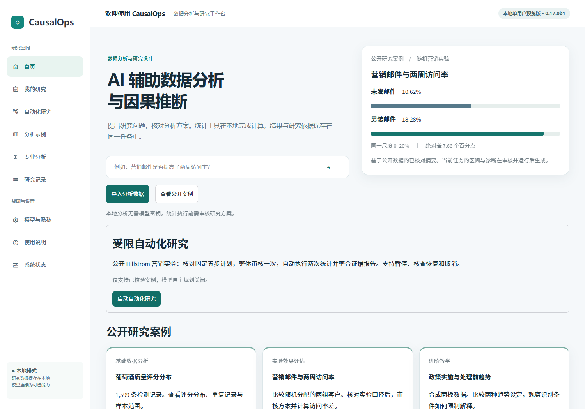
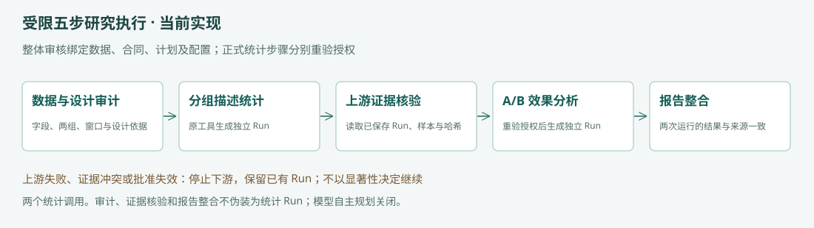
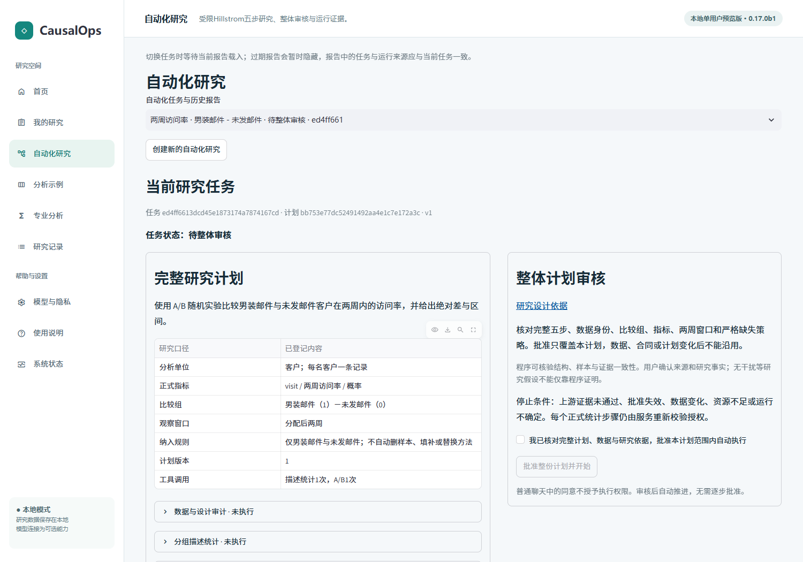
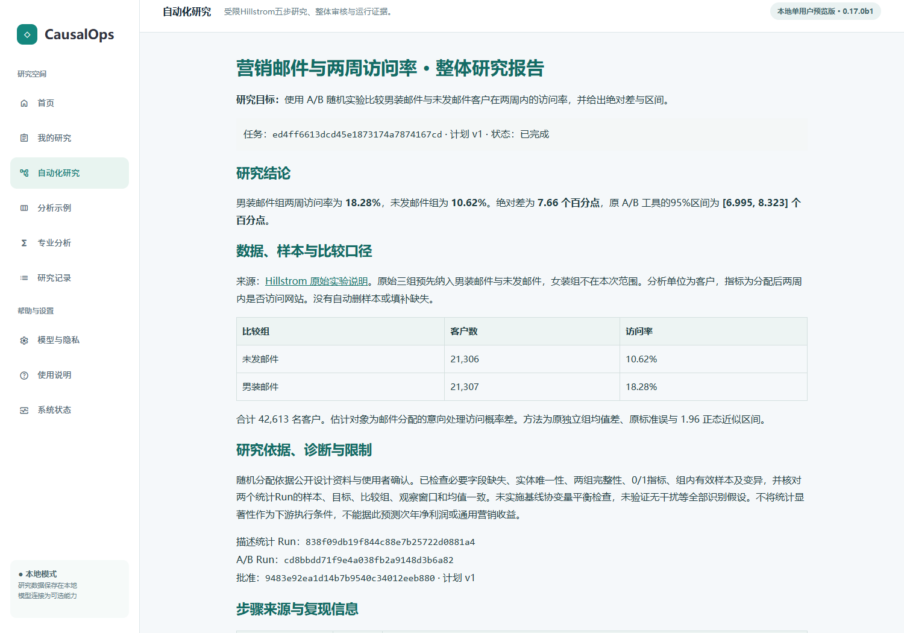
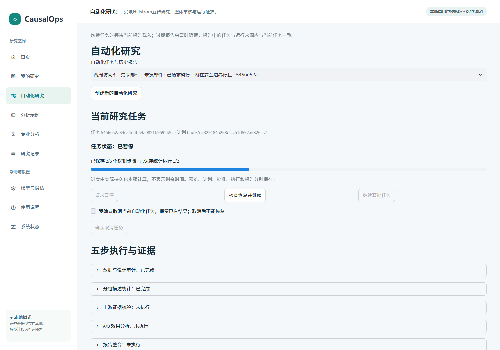
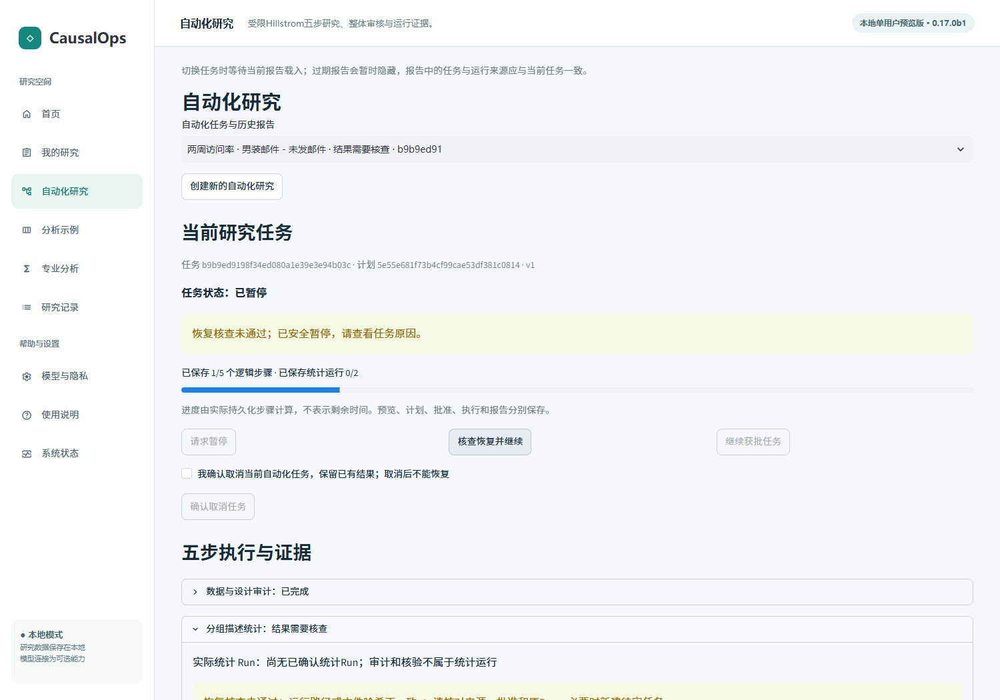

# 受限自动化研究使用教程 · 0.17.0b1

这是固定Hillstrom场景，不是任意目标自主规划。全程本地，无需模型密钥。先按[安装说明](INSTALLATION.md)启动，使用新工作区保留个人研究隔离。

## 1. 数据与入口
首页点击“启动自动化研究”。阅读发布者说明；通过页内链接下载固定版本公开.gz文件并上传。使用者核对随机分配依据、客户单位、男装邮件/未发邮件两组和分配后两周访问指标。来源事实由资料核查与用户确认，程序不从组间均衡证明随机化。

可在启动前设置环境变量 `CAUSALOPS_HILLSTROM_ARCHIVE` 指向下载文件。不要将原始包、个人数据或工作区加入Git。指纹不符时停止，不替换成任意营销表。

[可编辑流程定义](../releases/automation-v2-beta/diagrams/fixed-chain.mmd)

## 2. 生成与审核
确认来源后点击“生成五步研究计划”。计划明确：数据与设计审计；分组描述统计；上游证据核验；A/B效果分析；报告整合。其中只有描述和A/B为两次统计工具调用。

核对目标、数据合同、计划版本、两组与窗口、依赖、预算和停止条件。勾选完整审核声明，再点击“批准整份计划并开始”。不得用聊天“同意”代替正式审核。计划或数据变化后旧批准失效。

## 3. 查看进度与报告
状态来自持久记录，进度不是预测时间。S03读取真实S02输出与内容哈希，检查样本和有效记录，再允许A/B执行；不以显著性放行。缺失必要字段、证据或批准时停止下游，不自动删样本、补值或换方法。

核对两组访问率、百分点差、原95%区间、客户数与独立描述/A/B Run。点击“导出整体研究报告”保存HTML，或“导出步骤与运行证据”保存JSON。未完成任务只能导出部分完成说明。

## 4. 暂停、取消与核查恢复
“请求暂停”是在安全边界停止，不会立即杀死统计工具。刷新后重新读取相同任务。

“核查恢复并继续”由服务验证批准、输入、所有权、已有Run、依赖和预算；成功步骤不重算。证据不确定时进入核查，不提供绕过按钮。“确认取消任务”为终态，保留已有Run，继续研究需新任务重新审核。

## 5. 历史与限制
通过“自动化任务与历史报告”选回任务，核对当前任务ID与报告自身ID、两个Run和窗口。切换或刷新不触发计算。选择器状态摘要可能短暂滞后，不能当作执行依据；报告正文必须自带一致的任务、计划及运行来源。

预算显示物理请求、修订、工具尝试及未知用量。固定计划授权模型调用为0；不能将未用额度写成真实DeepSeek调用或精确人民币硬截断。报告不验证全部因果假设，不预测长期净利润。[本次验收](../releases/automation-v2-beta/ACCEPTANCE.md) · [已知限制](../releases/automation-v2-beta/LIMITATIONS.md)
