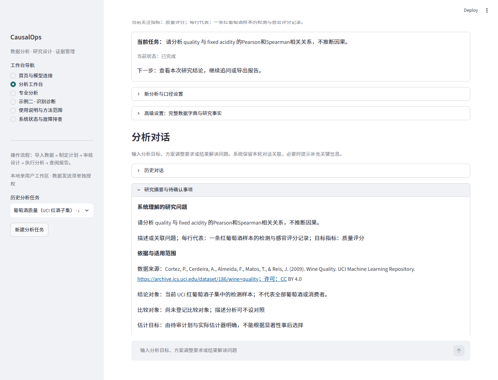
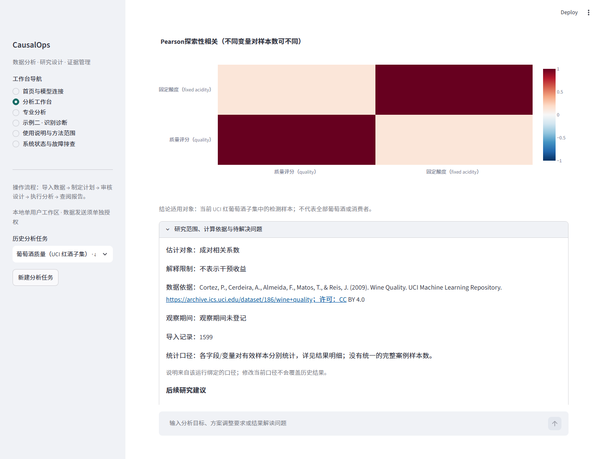
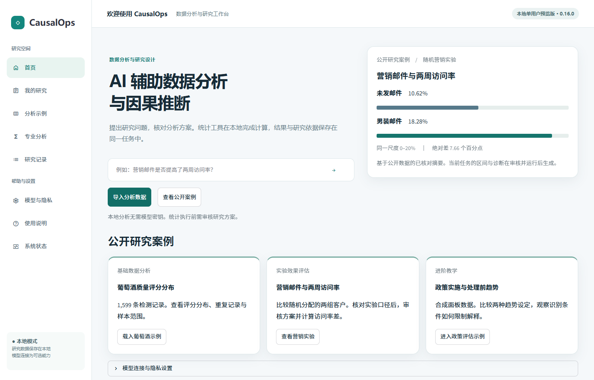
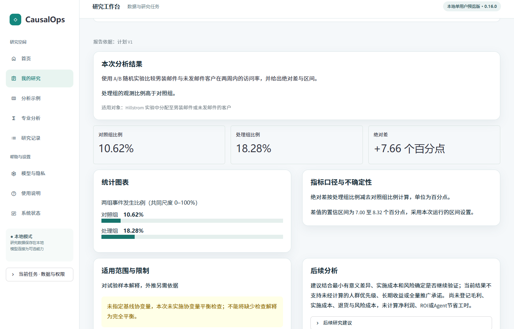
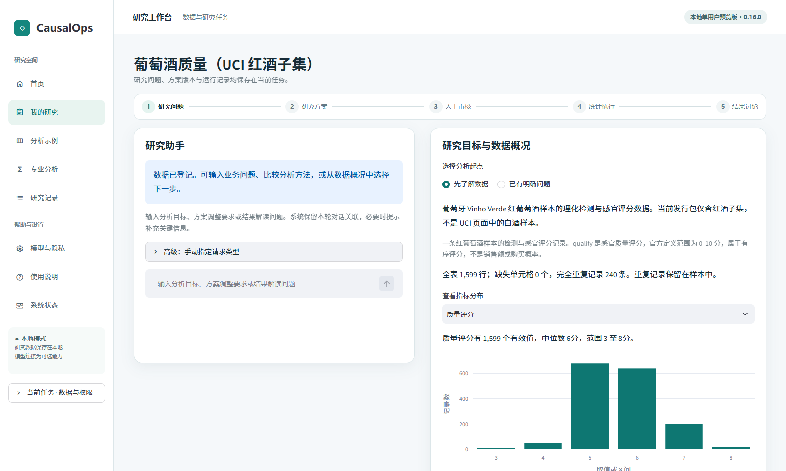
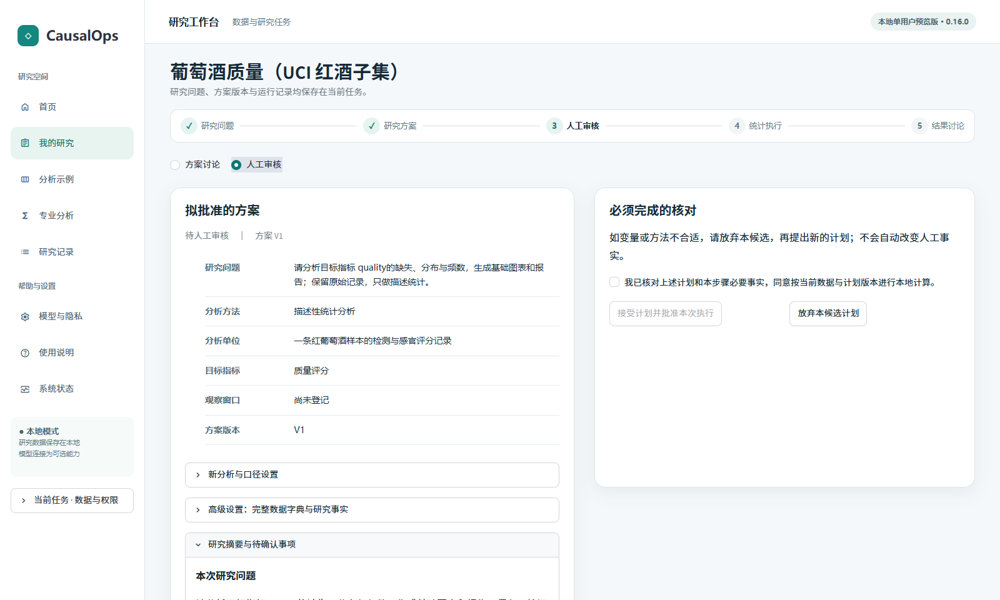
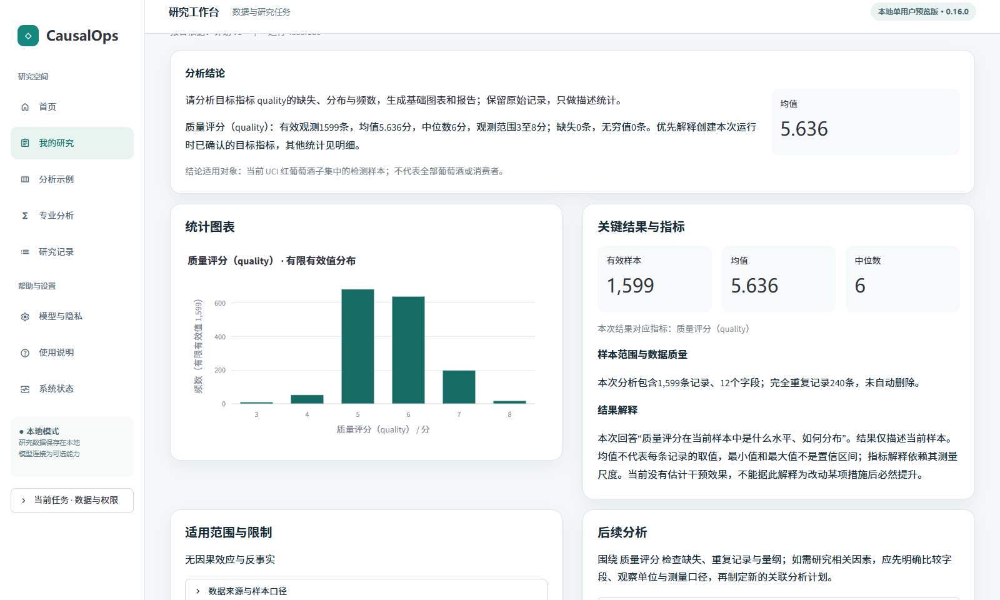
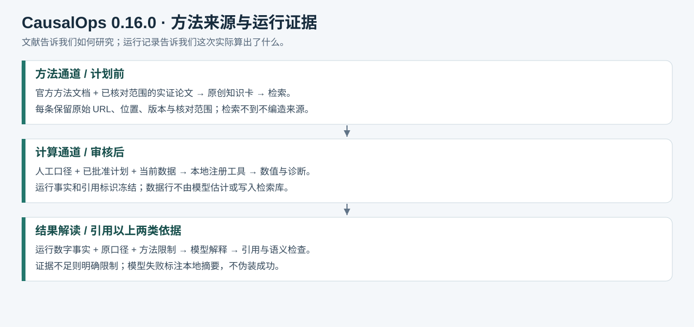

# CausalOps 项目介绍与功能手册

**第二轮界面更新**　首页展示营销邮件两周访问率，并提供葡萄酒分布、营销实验、合成政策面板三个入口。输入研究问题或导入自己的表也可建任务。公开实验从原始压缩包建立待审方案，身份与字段核验、人工批准、报告导出及后续追问见[案例与验收](PHASE2_ACCEPTANCE.md)。两变量相关及多变量热图沿用已有统计输出。


版本 0.16.0　核对日期 2026年11月3日

本手册覆盖 CausalOps 数据分析与研究工作台。它帮助使用者从一张表明确一个可回答的问题，制定分析计划，经过必要审核后调用本地统计工具，并围绕保存的结果持续提问。本文同时面向试用者、项目维护者和需要解释项目实现的作者。用户行为预测项目另行维护。

当前定位为 Windows x64、Python 3.11 的本地单用户预览版。界面操作、统计执行和模型解释是三个独立层次；模型辅助是可选项。因果解释需要具体设计依据，无法由表格或模型自行确认。本地研究任务与模型发送许可独立于源码仓库的可见性。

0.16.0新增内容请先阅读[研究质量与用户体验升级](RESEARCH_QUALITY.md)和[统计核查与限制](STATISTICAL_AUDIT.md)。本手册后续章节说明基础流程；历史版本测试数量不代表当前版。

## 1 项目解决什么问题

普通分析往往分散在表格查看器、脚本、统计软件、笔记和报告之间。使用者需要反复解释列名、决定方法、复制结果，又难以确定某段结论来自哪次计算。CausalOps 将这些步骤组织在同一数据任务中，保留数据版本、口径、候选计划、明确批准、工具运行和引用记录。

项目的实际价值在于减少操作与解释之间的断点：导入后先说明数据；没有明确问题时给出候选；选择问题后生成实际字段配置；计算前列出必要确认；结果先回答已登记的目标；追问读取同一次运行，而不是每问一次就重新计算。是否节省时间、节省多少，仍需独立使用者任务研究，当前没有可信的提效百分比。

适合使用的人包括业务分析人员、社会科学或管理研究者，以及正在学习数据分析的学生。基础分布分析可以从公开示例开始，不必预先知道全部方法名。涉及干预效果、工具变量或断点设计时，使用者应能说明处理机制和研究背景，必要时请有经验的研究者审核。

### 能自动处理和需要确认的事项

| 环节 | 系统承担 | 使用者需要提供或确认 |
|---|---|---|
| 读取数据 | 检查格式、规模、类型、实际空值和完全重复行 | 文件是否为需要分析的范围，编码是否正确 |
| 理解字段 | 提供结构概览；内置红酒有经过内容校验的来源说明 | 外来表中每行、指标、单位、日期和特殊编码的含义 |
| 明确问题 | 推荐两三个由现有字段支持的问题，或理解自然语言请求 | 选择真正关心的问题，保留不确定的信息 |
| 制定计划 | 检索方法依据，映射字段，检查缺项和角色冲突 | 核对字段、样本、时序以及必要的研究事实 |
| 执行分析 | 按已批准版本调用注册工具，保存结果与诊断 | 明确批准；聊天中的“同意”不能代替审核 |
| 解读与报告 | 按保存证据解释幅度、区间、边界，生成图表和报告 | 判断业务阈值、成本和场景是否支持行动 |

## 2 本轮优化清单核对

### 0.16.0 研究质量与用户体验升级

本轮按A—D阶段完成研究定义、统计核查、研究协作和交付验证。系统理解的问题、依据、实际计算、适用对象和缺项分别展示。首次使用仍可从公共示例开始，无需填写完整研究设计。

| 阶段 | 使用者实际看到的内容 | 解释边界 |
|---|---|---|
| A 研究定义 | 问题、单位、目标、来源、适用范围；结构、统计、关系、研究四层质量清单 | 类型和数值不能代替业务事实；最多先呈现三项需确认问题 |
| B 统计核查 | 方法合同、实际样本与诊断；PSM、DoubleML及A/B输入与推断修正 | 17个注册方法并非均完成独立统计认证；PSM推断仍有限制 |
| C 研究协作 | 结果先回答目标，随后列适用对象、保存配置、来源与后续建议 | 建议不会自行批准或执行；新研究范围不重写历史报告 |
| D 文档与验收 | 五类真实公开数据页面回归，源码与安装包测试，离线手册 | 开发者脚本不等于独立用户验收，本轮没有新模型API实测 |

### 如何理解研究摘要

确认葡萄酒示例说明后，UCI来源、当前红酒子集的适用范围和保留原始记录的口径会自动登记。其他上传数据不套用这些含义。打开“研究摘要与待确认事项”，核对系统理解的具体问题；点“补充研究范围与字段口径”可以填写对象、比较、估计目标、期间、来源与限制。填写筛选说明不会自动筛选原表。



### 如何阅读运行结果

先看目标结论与主图，再展开“研究范围、计算依据与待解决问题”。实际样本来自本次保存结果；描述统计逐字段计数，不能混为共同回归样本。原始问题、计划配置、方法来源和运行版本会随HTML报告保存。新计划仍需重新审核。



### 本轮统计证据的含义

共完成90次固定真值模拟：A/B30次、CUPED30次、DID12次、DML6次、PSM6次、IPW6次。PSM区间仅4/6覆盖真值，提示当前条件配对标准误不应包装为已充分校准；其他方法的小样本高覆盖也不是普遍保证。完整逐次记录在仓库docs/validation/v0160/statistical-benchmark.json，单独运行代码在tests/test_statistical_benchmark_v016.py。

### 原有使用体验清单（0.15.1 已完成，继续保持）


| 原清单 | 当前状态 | 实际实现与证据 |
|---|---|---|
| 首页突出开始入口 | 已实现 | 上传和公开示例先显示；模型配置为可选折叠区；首屏浏览器检查 |
| 补充信息逐步询问 | 已实现 | 每行含义、目标及单位、分析意图三步；可留空；日期可选；完整表单位于高级设置 |
| 同一任务连续对话 | 已实现 | 展示当前问题、状态、前序记录、待审方案差异和所选结果；明确区分旧结果与未执行的新计划 |
| 结论对应用户目标 | 已实现 | 从运行绑定的口径读取目标，主结论、主图、问答事实和报告使用同一目标 |
| 错误后有下一步操作 | 本轮补齐 | 模型失败可显式改用本地模式；条件不足可直接打开口径设置并重建待审计划；旧成功状态失效 |
| 独立用户验收 | 按约定暂缓 | 已准备本手册及验收任务、记录项目；程序验收不能替代真实使用者研究 |

这里的“已实现”是代码与固定任务验收的结论，不等于所有新用户或所有表格都能成功。最终测试数和本轮浏览器记录见《验收与限制》。

## 3 系统架构与职责


从输入到输出的主线为：Streamlit 界面 → ResearchService 应用服务 → 数据和 DataContract 口径版本 → 结构化请求路由 → LangGraph 方法研究子图 → 待审 Plan 与就绪检查 → 人工审核中断 → 注册统计工具 → 运行证据 → 目标结论、问答与报告。

| 层次 | 主要实现 | 实际职责 |
|---|---|---|
| 用户交互 | Streamlit，ui 目录 | 首页连接、上传、引导、对话、口径编辑、审核、图表、导出与故障恢复 |
| 应用服务 | application/research_service.py | 创建任务，绑定版本，调用工作流，处理审核和恢复请求 |
| 流程编排 | LangGraph，orchestration | 显式节点、分支、检查点、中断、继续；图记录保存引用 |
| 方法检索 | LangChain Core BaseRetriever，字符 TF-IDF | 检索本地方法卡和实证案例，返回可校验来源；有限补检 |
| 统计工具 | exploration、research、advanced 三类执行器 | 使用确定的输入合同和本地程序计算，模型不自行输出计算结果 |
| 证据与报告 | assistant、results、reporting | 运行级事实、引用校验、解释等级、量化模板与图文报告 |
| 持久化 | SQLite、Parquet、本地结果文件 | 保存任务、字典、计划、批准、运行、对话和检查点；保留上传副本 |
| 外部模型 | ProviderConfig 与 StructuredModelClient | 对接多种协议，生成受本地结构校验的建议和解释 |
| 扩展协作 | MCP 只读服务器、本地 A2A 审阅进程 | 提供方法和导出证据查询，进行受限规则审阅 |

LangGraph 的中断与持久化适合把等待审核表示为实际流程状态，而不是在最终回答里模拟“正在研究”。本项目另外保存领域批准记录；收到图的继续信号本身不代表获得计算权限。[LangGraph 中断文档](https://docs.langchain.com/oss/python/langgraph/interrupts)与[持久化文档](https://docs.langchain.com/oss/python/langgraph/persistence)说明这些框架机制。

### 每一类对象是什么

| 对象 | 用户可以怎样理解 | 为什么分开保存 |
|---|---|---|
| 数据任务 | 围绕一张已登记表开展的一组工作 | 避免将不同文件的分析和问答混在一起 |
| 数据版本和指纹 | 文件内容与处理后表格身份的校验依据 | 文件同名不代表内容相同 |
| DataContract | 人工确认的行含义、字段角色、单位、时序和研究声明 | 列类型不能代替业务含义，声明也不等于经验验证 |
| Flow | 一次问题理解、咨询、计划或结果解释流程 | 一项任务内可以有多轮，追问不一定需要新估计 |
| Plan | 拟执行的方法、字段、步骤和需要补充的事项 | 计划属于候选，尚未获得执行批准 |
| Approval | 对某一具体版本作出的明确批准 | 数据、口径、代码等变化后，旧批准不能自动迁移 |
| Run | 一次实际统计计算及其证据 | 结果解释必须知道依据哪次运行 |
| Evidence | 保存的数值、诊断、来源和运行归属 | 回答中的引用可以追溯，不靠模型回忆数字 |

## 4 安装和启动

已经能打开工作台的使用者无需再次安装环境。当前作者机器的正式入口使用 E 盘现有 .venv-orchestration 和原工作区，最新版独立测试环境保留为 E:/cops015-clean。不要为了每次更新建立一套新环境。

新使用者需要 Windows 64 位、Python 3.11 和能访问本机地址的浏览器。基础模式不需要模型密钥。无需为本项目另装 Hive、Spark、Java、MySQL、Power BI 或本地大模型。

### 从源码在线安装

先从仓库下载或克隆完整源码，在项目根目录打开 PowerShell。以下路径是可替换的示例；不要把已有数据目录用作虚拟环境目录。

```powershell
New-Item -ItemType Directory -Force -Path "E:/causalops-temp", "E:/causalops-cache/pip", "E:/causalops-cache/matplotlib"
$env:TEMP = "E:/causalops-temp"
$env:TMP = "E:/causalops-temp"
$env:PIP_CACHE_DIR = "E:/causalops-cache/pip"
$env:MPLCONFIGDIR = "E:/causalops-cache/matplotlib"
python -m venv "E:/causalops-env"
& "E:/causalops-env/Scripts/python.exe" -m pip install -r requirements-runtime-win-py311.txt
& "E:/causalops-env/Scripts/python.exe" -m pip install --no-deps .
& "E:/causalops-env/Scripts/python.exe" -m causalops.launch --workspace "E:/causalops-work" --port 8513
```

requirements-runtime-win-py311.txt 是已固定的环境清单；pyproject.toml 描述包和可选依赖。接口兼容、操作系统支持和真实账户验证是不同问题，不应认为换一个 Python 主版本仍已得到同等验证。

### 从离线发行包安装

解压完整离线包，其中应有 wheelhouse、requirements-win-py311-offline.lock、application-wheel.json 和 install_offline.py。源码 ZIP 本身不带完整依赖。

```powershell
python install_offline.py --destination "E:/causalops-env-new"
```

目标目录必须尚不存在。安装器核对解释器版本、依赖哈希和应用 wheel 哈希，并执行依赖一致性及隔离导入检查。需要空间时可以按维护清单清理已完成的旧验收环境和安装下载缓存；保留当前环境、数据和一份最新版发行包。不要累计多份重复独立环境。

### 启动和更新

启动后使用终端输出的完整地址。顶部可看到实际版本和构建号。不要只依据浏览器旧书签的版本参数判断正在使用哪份程序。

更新前等待任务结束，或在页面发出停止请求。保留原工作区，再运行同一入口。--restart 只会处理身份核实为本项目且无未结束任务的已登记进程，不关闭其他程序。

```powershell
& "E:/causalops-env/Scripts/python.exe" -m causalops.launch --workspace "E:/causalops-work" --port 8513 --diagnose
& "E:/causalops-env/Scripts/python.exe" -m causalops.launch --workspace "E:/causalops-work" --port 8513 --restart
```

## 5 首页和工作台导航

首页提供“导入分析数据”和“查看公开案例”。三个案例入口分别为“载入葡萄酒示例”“查看营销实验”和“进入政策评估示例”。模型连接位于可选折叠区，已填写的服务和模型显示为摘要。填写密钥只说明已配置；通过固定测试后才标记为连接已验证。

侧栏提供首页、我的研究、分析示例、专业分析、研究记录、模型与隐私、使用说明和系统状态。分析工作台是推荐的连续任务入口；专业分析保留较完整的显式表单，适合已经知道方法和字段角色的人。

任务名称用于识别工作内容，不用内部编码作为唯一提示。每个任务内可以选择历史对话与历史运行；用户应留意当前正在讨论的问题、所选运行和来源计划。



## 6 模型连接和本地模式

| 状态 | 实际含义 | 下一步 |
|---|---|---|
| 未配置模型 | 本地分析可用；没有可调用的外部模型凭据 | 先体验公开示例，或配置服务 |
| 已配置 尚未验证 | 字段完整，但尚不能确认服务可调用 | 使用固定连接测试 |
| 连接已验证 | 该配置与该凭据的测试通过 | 进入任务，单独决定数据摘要发送许可 |
| 连接测试未完成 | 本轮测试失败，旧成功状态已失效 | 修改配置后测试，或点击“使用本地模式继续” |
| 显式本地模式 | 后续请求不调用模型，配置和任务许可保留 | 继续本地任务；需要时明确恢复模型辅助 |

支持的页面预设包括 DeepSeek、OpenAI、Anthropic、阿里云百炼/千问、Gemini 官方兼容接口和自定义 HTTPS 兼容服务。实际可用的 API 模型 ID、账号权限和参数应按服务商账户核实。桌面应用里的模型名称不能直接替代 API 模型 ID。

配置步骤为：选择服务商 → 填写模型 ID → 填写密钥 → 核对基础地址与协议 → 保存 → 可选运行连接测试。不要把完整接口路径填入 Base URL，不要把密钥填到模型名。结构化输出根据服务支持选择；输出仍需通过本地校验。

当前 DeepSeek 官方固定任务有实际账户测试记录；其他预设主要完成请求合同和错误路径测试，不应声称全部服务商均有真实账户端到端验收。旧专业表单的历史 DeepSeek 接入与统一分析工作台的多服务配置应分别核对。

### 本地模式的具体作用

点击“使用本地模式继续”后，后续问题使用本地规则、方法检索和统计流程。保留已输入的连接配置，方便恢复；不改变已保存数据、许可、计划或批准。已经启动的后台模型请求不会因为切换按钮而被追溯取消，需要用停止按钮单独处理。

切换模式后，原本绑定模型配置的中断流程不能被静默改成本地执行。若需要新的本地分析，重新制定待审计划并审核。恢复模型辅助后，每个任务仍按原有授权合同判断能否发送摘要。

## 7 导入自己的表

支持 CSV、Parquet 和 .pq。交互导入上限为 50 MB、100,000 行、200 列，解码后的内存占用上限为 256 MB。限制是当前交互产品边界，不代表底层研究脚本不能处理更大数据。超限时应在本地先构造有明确样本口径的分析表，不能悄悄抽样再声称全量分析。

CSV 默认保守识别逗号、分号或制表符。若多个解释都可能成立，要求明确选择；不会静默更改数据。编码可选 UTF-8 或 GB18030。表头必须为非空、不重复的字符串，不能上传脚本、宏、Pickle 或嵌套对象列。

上传后先显示行列数、类型、实际空值、完全重复记录和字段概览。这些是结构信息。unknown、-1、999 等业务代码不自动算作空值；完全重复也不自动算错误。程序不会自动去重、补零或删除异常值。

导入失败时，页面说明当前未完成的检查，保留原文件和已有任务。请先核对编码、分隔符、表头和规模，然后重新创建任务；不应为了继续运行删除历史数据库。

## 8 三步明确本次分析

### 第一步说明每一行

填写“一条客户记录”“一次访问会话”“某位用户的一天”等含义。不确定可以留空。每行代表一个对象，并不能证明记录彼此独立；同一用户反复出现时，后续可能需要聚类推断或面板设计。

### 第二步确认目标和单位

选择事先关心的目标字段，可填写可读名称和单位。例如 quality → 质量评分 → 分；Revenue → 是否购买 → 0/1。字段为数值不代表应计算均值；编码为0/1时，1究竟代表什么仍要按来源确认。

有日期候选时，可指定日期用于时间图；不确定就跳过。年号、序号或金额不能直接当日期。季度日期应按实际频率明确构造；当前时间图展示已观测时期，不填补缺期、不进行预测。

### 第三步选择分析目标

可以先了解分布、探索变量关系、评估干预效果，或保留问题尚不明确的状态。分布路径形成待审计划；关系路径先推荐具体问题；效果评估先核对研究条件。完整字典和研究声明位于高级设置。

更换目标或日期会建立新的口径版本，并清除新口径中不能继续沿用的研究声明。历史运行仍绑定旧口径，不能因为新目标而改写旧结论。

## 9 营销实验与葡萄酒示例

### 真实营销实验

营销实验从原始三组文件选取男装邮件与未发邮件两组。打开首页“查看营销实验”，上传指定压缩包，核对随机分配依据和两周指标，再创建待审方案。人工批准后查看两组访问率与差值区间，导出报告或针对该次运行继续提问。 [逐步操作与实机图](PUBLIC_TUTORIAL.md)



### 葡萄酒描述统计

示例来自 UCI Wine Quality 红酒子集，1,599行、12列。每行是一条红葡萄酒样本的检测与感官评分记录；quality 的官方定义范围是0—10分，属于有序评分。UCI还提供白酒数据，不要把网站总览中的白酒行数混用为本例样本量。[UCI原始说明](https://archive.ics.uci.edu/dataset/186/wine+quality)。

在示例页先阅读行含义、目标、单位、建议问题、字段说明和限制，再点击“使用示例说明并生成分析计划”。预填仅在数据内容匹配已核对示例时使用；把自己的文件改成相同名称不会套用含义。点击只确认可见元数据和生成计划，不批准执行，也不授予模型发送许可。



出现待审计划后，核对目标quality、描述性方法及字段，再明确勾选并点击“接受计划并批准本次执行”。如果不理解计划，可以先问方法条件，再返回原待审计划。普通聊天里回复“同意”没有批准权。



当前公开红酒样本质量评分均值约5.636分，中位数6分，观察范围3—8分，有效记录1,599个，实际空值0。完全重复行240条未自动删除。评分主图显示实际整数档位，而不是小数分箱。以上数值来自本地已保存的固定示例统计，不是某种措施带来的提升。



可以接着问“围绕质量评分，我还可以研究什么？”；选择一个关联问题后，新计划保留所选建议的具体字段。旧描述结果会标注为先前结果，相关计划需要重新审核。两个变量时展示成对有效样本与相关系数，多个变量时可查看相关矩阵，解释共同变化，不能推出调整某配方一定提高评分。

[查看早期葡萄酒操作录屏（0.15）](../assets/example-015-guide.webm)。视频来自实际浏览器操作，字幕只是步骤说明，未展示真实密钥。

## 10 如何提问以及系统会怎样处理

| 想完成的事 | 可复制的问法 | 预期产出 |
|---|---|---|
| 了解表格 | 请说明当前表的规模、缺失、重复记录，以及还需要确认什么。 | 本地数据概况；不等同于已经计算研究结果 |
| 找问题 | 根据已登记的目标，我还可以研究什么？请列出两个具体问题及限制。 | 由现有字段支持的建议，附字段与待确认事项 |
| 制定描述计划 | 请描述质量评分的分布、有效样本和缺失，保留原始记录。 | 待审描述计划；审核后才形成运行 |
| 制定关联计划 | 请分析quality与alcohol的关联，解释样本范围与不确定性。 | 使用已登记字段，必要时澄清或要求确认；不能自动变成因果 |
| 方法咨询 | 什么条件下可以用DID？我的面板还需要检查哪些问题？ | 有来源的方法说明，不自动执行分析 |
| 比较方法 | 在当前研究设计下比较PSM与IPW的适用条件，不执行分析。 | 设计层比较，不伪称两者均已计算 |
| 调整方案 | 保留研究问题，把相关分析的字段改为quality和alcohol，生成新计划。 | 检查与人工口径是否冲突，形成候选或要求先更新字典 |
| 解释结果 | 解释当前选中运行的幅度、单位和限制，不要重新计算。 | 引用所选运行的事实，不重新估计 |
| 讨论行动 | 根据本次结果，我还需要什么依据才能决定是否上线？不要编造收益。 | 说明所缺设计、成本与风险，不补写ROI |

自然语言路由可能不符合预期。先检查当前问题、请求产出和所选运行；必要时展开“高级：手动指定请求类型”。“方法咨询”回答条件，“制定分析计划”准备新计算，“解释当前运行”读取已有证据。不要用反复输入同一句话替代核对任务状态。

## 11 计划审核和连续对话

待审计划包括实际方法、输入字段、分析步骤、需要补充的信息和完整配置。调整时可查看与前序方案的真实差异；未变化也不代表旧批准仍有效。计划的版本号只是记录顺序，不能用更大的编号判断更正确。

本轮需补充信息时，系统应说明哪里未完成、哪些内容保留及可点击的操作。“补充字段与研究口径”会打开本任务实际的字典编辑器；保存后点击“按当前口径重新制定待审计划”。这只建立新候选，不批准、不执行，也不沿用旧批准。

高级设置中的研究声明必须有依据后确认。例如“有随机分配依据”“协变量严格在处理前测量”“存在足够共同支撑”。勾选只记录使用者声明，不能证明这些条件成立。统计执行后仍会检查可以诊断的部分，并可能降低解释等级。

历史对话和历史结果分别选择。前序咨询帮助理解当前要求，但不能带来批准权限。新字典与新方案用于新分析，已有回答与运行保留来源版本。若当前讨论某次旧运行，请先明确切换到该运行，不把新表的口径解释到旧结果上。

## 12 支持哪些方法

下面解释当前注册方法的用途与输入。准确可执行合同由统一注册表生成，见《方法合同》。方法数量不代表每项都适用于当前数据。

### 描述与关联分析

| 方法 | 需要什么 | 能得到什么 | 常见限制 |
|---|---|---|---|
| 描述统计 | 可统计的数值或分类字段；可选分组与日期 | 缺失、频数、均值、分位数、分布图和时间汇总 | 不推断干预；ID不作为普通指标；实际空值与特殊编码分开 |
| Pearson和Spearman相关 | 至少两个明确的数值字段 | 成对样本数、线性或秩相关、热图 | 变量对可能使用不同有效样本；常数列不可正常相关；不证明原因 |
| OLS关联回归 | 连续结果、自变量、缺失规则、独立或聚类口径 | 条件线性系数、标准误与区间 | 控制变量后仍是条件关联；不能自动转成政策效果 |
| 二元Logit关联 | 0/1结果与自变量；确认1的含义 | 链接尺度系数和OR等已保存结果 | OR不是概率差，也不是百分点；不能将OR直接说成转化率提升 |
| Poisson计数关联 | 非负整数结果、可比暴露与自变量 | 计数均值关系及相应尺度结果 | 暴露时间不等会误导；检查过度离散；不自动改成另一模型 |

### 实验与观察性效果研究

| 方法 | 必要背景和输入 | 解释重点 |
|---|---|---|
| A/B随机实验 | 真实随机分配依据、两个组别、每分析单位一行、结果窗口 | 组间差异及区间；有随机分组列不等于分配真实随机 |
| CUPED | A/B条件，以及合适、已核对时点的处理前协变量 | 利用处理前信息调整精度；不能用处理后的活跃度当基线 |
| 观察性关联调整 | 明确处理、结果和协变量；核对测量时点 | 条件关联；不可仅靠控制变量称为因果 |
| PSM | 处理前协变量、条件可交换性论证、共同支撑和匹配后平衡 | 匹配后的具体样本与估计对象；不能把匹配样本效应外推为全部人群效果 |
| IPW | 处理前协变量、倾向得分与权重支持条件 | 权重和极端值诊断；大权重会使估计不稳定 |
| DML | 明确模型结构、处理前协变量、样本切分和识别论证 | 机器学习拟合辅助函数不等于解决未观测混杂；保留模型与估计对象 |
| AIPW | 二元处理、交叉拟合、处理前协变量和共同支撑 | 增强逆概率估计及其条件；双重稳健不等于任意设定都正确 |
| 共同处理时点DID | 日级面板、实体、日期、首次处理日、前后窗口和有效对照 | 差分与动态诊断；处理前不显著不能证明平行趋势 |

DML与AIPW不能混用名称：当前实现分别保留各自的估计结构和合同，具体解释应读取运行记录。DoubleML官方文档区分PLR、IRM等模型，不能把任一软件输出都笼统叫总体ATE。[DoubleML模型说明](https://docs.doubleml.org/stable/guide/models.html)。

### IV 断点和交错DID

| 方法 | 当前输入与限制 | 输出的含义 |
|---|---|---|
| 2SLS工具变量 | 结果、处理、工具、可选控制，具体外生性和排除限制依据；重复单位要明确聚类 | 线性IV参数与第一阶段诊断；局部解释需要额外条件，不自动等于总体ATE |
| 清晰RD | 数值运行变量、明确阈值、阈值规则、连续性和无精确操纵论证 | 阈值附近局部跳跃；不外推为全体用户平均效果 |
| 模糊RD | RD条件之外，处理跳跃、排除限制及单调性依据 | 依赖明确第一阶段跳跃的局部解释；支持不足时限制主张 |
| 交错DID | 实体、连续整数期、首次处理期；从未处理为空值；平衡面板 | ATT(g,t)、事件时间和聚合结果，保留批次时间结构 |

当前交错DID首版限定5—30期、最多10,000实体；至少两个处理批次，每批及从未处理组至少20实体；每批需要规定的前后支持；协变量仅开放已核对处理前的时间不变项；聚类限定实体层。采用differences.ATTgt的既定配置，不是所有交错设计的通用实现。区间为当前实现的解析逐点区间，不能冒充同时置信带。

当前IV和RD选择聚类推断时有至少30簇等实现门槛；具体方法、有效带宽内支持和诊断会影响是否输出。RD使用rdrobust的局部拟合和偏差修正推断，不能把全局多项式曲线当作同一方法。[rdrobust官方项目](https://github.com/rdpackages/rdrobust)。

## 13 如何阅读结论

结论层按“参考水平 → 幅度与不确定性 → 实际含义 → 行动建议”组织。描述性任务只有样本水平与分布，没有凭空产生的干预提升。缺少基线、分母或成本时会说明不能计算的内容。

假设一个已保存随机实验运行显示对照访问率20%、处理访问率23%，则绝对差为3个百分点，相对差为15%；若同一样本量下换算，每千名符合该实验范围的对象约对应30次访问概率差。这里是算术说明，不是本项目某次真实数据结果；是否能外推到未来1,000人，需要实验设计和总体适用性依据。

区间表示估计不确定性，观察最小值到最大值不是置信区间。统计显著不等于有足够业务价值。面对不显著结果，不能直接说没有效果；需要考虑区间是否排除了有意义的幅度，以及设计和功效。

| 页面出现的表达 | 应怎样理解 |
|---|---|
| 描述性统计 | 当前样本的分布和水平，不说明干预原因 |
| 条件相关 | 在当前已控制变量或模型设定下的关联，仍可能存在混杂 |
| 受限的准实验解释 | 在已声明的设计条件及实际诊断范围内解释，条件并非被模型证明 |
| 因果主张被限制 | 诊断失败、证据不足或设计不支持；仍可保留透明的统计描述 |
| P值数值舍入为0 | 显示精度或数值下溢，不是真实概率严格为0 |

行动建议应与证据强度匹配。相关分析可以形成下一轮假设；随机实验可支持在实验适用范围内讨论策略；成本、风险和长期效果尚缺时，不生成“必然提高收入”或虚构ROI。

## 14 图表 报告与证据问答

主图按任务选取：目标分布、相关热图、已保存回归系数区间图或已登记日期的时间图。完整字段统计保留在详情。分类图提供水平标签与完整悬停说明；低基数整数保留实际档位；0/1结果报告有效观测中1的比例，不能混称相对提升。

时间图只减少拥挤的轴文字，不丢弃实际观测点；单位较长时显示水平副标题。时间汇总并不是预测，季度缺期也不会自动补值。

导出“本次分析报告”得到可离线打开的HTML，先解释本次目标，再附方法、表格、图、诊断和边界。运行证据JSON、流程记录JSON用于复核和程序处理；它们可能含数据字典或研究问题，不能因为没有原始表就认为可以随意公开。

结果问答先核对所选运行，再选择有限事实。短引用需要恢复成属于该运行的完整证据标识；不存在的引用不能当作依据。模型不重新计算，也不能修改原运行。引用校验能检查归属与数字，不能证明自由文本中的所有科学推理正确。

如果需要新增统计量或换样本、变量、窗口，应该生成新计划。若当前问题其实只是在问同一次运行的限制或含义，直接解释已有证据即可。用户可以在“历史分析结果”切换运行，切换本身不触发重算。

## 15 方法RAG具体包含什么



本项目存在两条不同的依据通道。方法检索提供适用条件与诊断依据。运行证据保存本次计算的数值、样本范围和诊断结果。论文里曾经发现的效果不能替代当前数据的估计，方法卡也不是当前识别条件已成立的证明。

当前本地目录包含方法规则卡与实证案例卡。每条来源保留标题、URL、版本或日期、定位和实际核对范围。每张方法卡围绕适用问题、数据要求、识别条件、诊断方法、失败情形和结果解释组织。使用LangChain Core检索接口及字符TF-IDF，不声称已部署大规模全文向量库。

方法研究子图必要时定向补检，最多三轮；覆盖齐备、没有新增依据、达到预算或方法不支持时停止。没有可信条目时说明不足，不编造论文标题、DOI或页码。带页码也不能自动理解为已经通读整篇论文，必须看来源的access_scope与定位。

学术使用应把研究设计与作者原文对应，商业使用还应补充业务指标口径、成本、污染和部署环境。UTD期刊中的实证设计可以提供研究思路，不能因为期刊排名就跳过当前数据条件。

## 16 MCP和A2A当前能做什么

MCP为支持该协议的外部宿主提供标准化的只读方法和证据工具。本项目的五项工具分别为search_methods、read_method_source、list_analysis_capabilities、read_run_evidence、check_evidence_citations。查询运行证据前要先明确导出，不能任意读本机文件或直接执行统计。MCP提高工具接入一致性，报告可读性仍由指标口径、结论模板和表达验证承担。

A2A本地服务提供独立进程的任务审阅，使用Agent Card、JSON-RPC、任务状态与Artifact。它当前是确定性规则审阅器，不是第二个大模型。可检查已导出事实的运行归属、有限值、已识别P值、标准误和区间等；不能确认无混杂、平行趋势或外生性，也不批准或执行研究。

已有MCP客户端工具发现和调用测试、本地A2A合同测试。另一个外部宿主的完整真实会话、自主跨模型研究、任意远程Agent发现和多租户鉴权仍未作为已完成能力。扩展配置和启动方法见《模型接入与只读协作》。

## 17 数据权限和存储

原始上传副本、任务和研究记录保存在使用者指定的本地工作区。SQLite保存版本和流程状态；Parquet及运行文件保存本地数据和证据。API密钥只存当前会话服务端内存，重连或停止后可能需要重新填写；不进入数据库、Git或报告。

填写密钥、测试连接、任务数据发送许可是独立动作。每项任务针对具体服务地址、模型和协议决定是否允许发送字段元数据、研究问题、汇总及有限上下文。默认不发送原始数据行、用户/帖子ID值或完整论文。过滤规则不能等同于正式匿名化证明；敏感字段名和研究问题本身也需要使用者判断。

切换服务商后重新核对许可，不静默把内容转发到另一服务。模型仅建议和解释，不能自行接受候选、登记人工事实或触发执行。自定义服务必须由使用者明确选择可信的外部HTTPS地址；本版不直接连接本机HTTP模型服务。

源码开放和工作区开放是不同事项。源码包只分发明确许可的红酒样本及出处；私人研究数据、其他下载数据集、对话和密钥不随源码分发。备份应复制完整工作区并核对文件，不能只保存某个报告而认为保留了全部研究状态。

## 18 停止 恢复和故障处理

| 现象 | 未完成什么 | 已保留什么 | 下一步 |
|---|---|---|---|
| 模型测试失败 | 认证、协议或结构化测试 | 连接配置、已有任务；未发送研究数据 | 修正配置后测试，或明确使用本地模式 |
| 上传乱码或只有一列 | 数据解析 | 原文件与已有任务 | 核对编码和分隔符；原表头有歧义时先修正分析表 |
| 超过规模限制 | 当前交互导入 | 原文件 | 在本地准备可解释的分析队列，不默默抽样 |
| 目标尚不明确 | 问题与字段口径 | 已登记数据和前序说明 | 留空并先看分布，或选择一项建议 |
| 批准按钮不可用 | 字段、版本或必要配置 | 候选和已有结果 | 打开本任务口径设置，保存后重建计划 |
| 研究事实未知 | 识别依据 | 数据、候选和问题 | 补充设计来源；未知保持未知，不随意勾选 |
| 已发停止请求 | 正在运行步骤可能尚未结束 | 已提交的完整结果和流程记录 | 等待安全边界；不强杀计算、不并行重算 |
| 中断后继续 | 需要复核原批准和版本 | 已完成步骤及检查点 | 使用“检查批准并继续流程”；条件变化则新计划 |
| 追问找不到结果 | 尚无选中或可解释运行 | 方法说明和候选可能仍存在 | 先完成分析，或明确选择当前任务的历史运行 |
| 看到旧标题 | 页面或服务版本未同步 | 历史记录 | 核对实际版本与构建号，使用启动器当前完整URL |
| localhost拒绝连接 | 本机服务未监听该地址 | 磁盘工作区 | 保留启动进程，核对端口，运行diagnose |
| 组件导入错误 | 当前安装版本不一致 | 原工作区 | 按完整版本安装；不要混拷旧模块 |

本地后台是单个工作线程、最多四项排队；停止为协作式，不承诺底层统计函数立即中断。恢复时不能仅按界面上的状态文字放行，仍要核对数据、口径、计划、代码、模型绑定及批准。不要通过删除数据库或把识别声明全部勾选来“修复”按钮。

## 19 五类真实数据体验范围

| 数据 | 本次使用范围 | 已验证体验 | 保留的解释边界 |
|---|---|---|---|
| UCI红酒 | 1,599行12列 | 来源预填、描述、目标建议、新相关计划、热图、问答、导出和恢复 | 不含成本或随机配方干预，不能推算生产收益 |
| UCI银行营销 | 网页原始45,211行17列 | 分号CSV识别、类别目标和水平频数图 | unknown和-1等编码仍需来源解释 |
| UCI电商会话 | 12,330行18列 | 二元Revenue、实际占比、图表和报告 | 布尔转0/1为已记录准备步骤，不等于干预实验 |
| Hillstrom邮件 | 男装邮件与无邮件42,613行14列子集 | 二元visit分布与解释边界；其他已有实验路径另有记录 | 原始挑战为64,000名客户三组，本行不是原始全样本 |
| statsmodels宏观 | 203行，原始14列加季度首日派生列 | 日期登记、realgdp时间图、报告和恢复 | 日期明确由year/quarter构造，不预测和不插补缺期 |

除内置红酒外，行含义和目标语义由测试者按官方说明输入，不能将脚本通过说成AI从任意表自主理解业务。测试使用记录范围的全量行，没有暗中取小样本冒充全量。

## 20 怎么评估项目完成程度

工程验收包括源码回归、隔离安装的同套测试、真实浏览器操作、模型固定任务、发行文件哈希与隐私检查。它们分别验证不同合同，不能用总测试数量替代统计正确性或用户可用性。

本轮前一版本有五类真实数据浏览器5/5、源码和独立安装版各570项测试、全新离线安装及固定DeepSeek任务记录。本轮追加错误恢复控件测试并对最终代码重新回归；准确数量、安装方式与完成时间以最终验收文件为准。旧版验收不自动证明新版新增交互。

### 独立用户验收方案

此项按约定尚未开展。开展时招募未参与开发的人，记录其数据分析经验，提供同一版本、同一任务和公开数据说明。先做一次不计时的熟悉任务，再分开记录正式任务，不把熟悉时间混入比较。

| 任务 | 成功条件 | 需要记录 |
|---|---|---|
| 首次示例 | 无开发者逐步指导，完成导入、问题、审核与报告 | 是否完成、帮助次数、首份有效报告耗时 |
| 外来表 | 能说明行、目标和单位，识别需要补充的信息 | 误填字段、返工次数、数据理解错误 |
| 结果解释 | 能区分样本均值、关联与干预差异 | 解读是否正确、引用是否能找到 |
| 故障恢复 | 在预设连接失败或口径缺项后继续安全任务 | 恢复用时、错误重试、是否绕过未知事实 |

若比较人工与Agent效率，应尽可能使用等价任务、交叉安排顺序，并记录学习效应与结果质量。不能只询问“感觉快不快”，不能把无效报告作为完成，也不能删去失败任务后计算成功率。独立审阅者最好在不知道使用方式时判断结果是否有效。

## 21 使用者和开发者可以怎样继续优化

优先记录实际失败：用户在哪一步不知道该做什么、推荐问题是否贴近目标、模型是否重复建议已有输出、图表是否符合单位、恢复是否真的有出口。每次改进应有触发条件、预期行为、实际记录和失败边界。

当前值得继续研究的方向包括外来表的数据字典导入、特殊编码提示、运行输出清单帮助模型避免重复建议，以及独立用户研究。增加估计方法、全文文献库或远程Agent前，应先有具体数据条件、来源、授权与验收需求。

尚未提供通用预测训练和样本外评测流水线、公网多租户鉴权、分布式任务队列、任意表自动证明因果、所有服务商账户实测、无限联网文献检索或完整论文全文分发。当前可描述为本地单用户、版本化审核与运行证据约束的数据分析Agent预览版。

## 22 项目讲解与简历表述

可以这样解释产品主线：我把数据分析拆成任务定义、方法依据、方案审核、工具执行和运行解释五个环节；用LangGraph保存流程与审核中断，用LangChain检索适用条件，本地统计内核给出数值，模型只能建议与解释。结果绑定原数据、口径和计划，追问不自动重算。

可以陈述已经实现并有对应证据的能力，例如17项方法注册、三类执行器、多模型协议适配、版本化审核、运行级引用、真实数据演示和自动测试。涉及独立用户提效、全部模型成功率、商业上线、用户规模或研究效果时，必须有对应实测；当前不得填入虚构百分比。

被问到“为什么不直接让模型写Python运行”时，可以说明本产品采用有限方法与工具合同，便于核对输入、诊断和证据；这是当前实现的取舍。它不表示自由代码分析没有价值，也不意味着受控工具能自动保证研究识别正确。

## 23 常用名词

| 名词 | 在本项目中的含义 |
|---|---|
| Agent | 接收目标、选择受限流程、调用注册工具并保存状态的分析系统；不是无限权限自动研究者 |
| Prompt | 给模型的任务和输出约束；需要结构校验，提示词本身不保证遵守 |
| RAG | 先检索已有材料，再以可核对的条目辅助回答 |
| 工具调用 | 通过明确参数合同请求本地功能；不能绕过工具自己的执行门禁 |
| Schema | 对结构、字段和类型的约束；结构正确仍可能存在语义错误 |
| 数据口径 | 样本、字段、单位、窗口和角色的具体定义 |
| 混杂 | 同时影响处理和结果的因素；机器学习不自动消除未测混杂 |
| 共同支撑 | 在可比特征范围内有处理与对照；范围相交不等于完整证明 |
| 信息泄漏 | 把未来或处理后信息当成可提前使用的输入 |
| 聚类推断 | 考虑同一实体等簇内相关性的标准误处理；不能任意选层级 |
| 幂等与恢复 | 防止重复请求产生重复副作用，复用已提交结果；恢复不代表不检查版本 |

## 24 参考资料和核对原则

本手册以当前源码、方法合同、实际验收记录和下列官方资料为依据。框架文档支持技术机制，统计资料支持方法条件；它们不证明本次使用者的数据已经满足这些条件。以下是原创说明和链接，不收录第三方网页或论文全文。

- [LangGraph审核中断](https://docs.langchain.com/oss/python/langgraph/interrupts)及[状态持久化](https://docs.langchain.com/oss/python/langgraph/persistence)
- [LangChain检索器接口](https://reference.langchain.com/python/langchain-core/retrievers/)
- [Streamlit官方文档](https://docs.streamlit.io/)
- [pandas统计描述](https://pandas.pydata.org/docs/reference/api/pandas.DataFrame.describe.html)
- [statsmodels官方文档](https://www.statsmodels.org/stable/index.html)
- [DoubleML模型定义](https://docs.doubleml.org/stable/guide/models.html)
- [rdrobust官方仓库](https://github.com/rdpackages/rdrobust)
- [differences官方文档](https://bernardodionisi.github.io/differences/latest/)
- [linearmodels工具变量文档](https://bashtage.github.io/linearmodels/iv/index.html)
- [MCP架构](https://modelcontextprotocol.io/docs/learn/architecture)
- [A2A规范](https://a2a-protocol.org/latest/specification/)
- [UCI红酒](https://archive.ics.uci.edu/dataset/186/wine+quality)、[银行营销](https://archive.ics.uci.edu/dataset/222/bank+marketing)、[电商会话](https://archive.ics.uci.edu/dataset/468/online+shoppers+purchasing+intention+dataset)
- [Hillstrom原始挑战说明](https://blog.minethatdata.com/2008/03/minethatdata-e-mail-analytics-and-data.html)
- [statsmodels宏观数据说明](https://www.statsmodels.org/stable/datasets/generated/macrodata.html)

模型服务接入应使用各服务商当前文档和账户允许的模型，不用本手册的示例名称代替实际可用性核查。

## 25 当前知识库来源目录

下表来自本版本实际catalog。核对日期和访问范围是条目的记录，不代表本轮重新阅读全文。方法卡内容是原创提炼，引用到当前研究仍需核对适用性。

| 来源 | 类型 | 定位或范围 | 核对日期 |
|---|---|---|---|
| [DataFrame.describe](https://pandas.pydata.org/docs/reference/api/pandas.DataFrame.describe.html) | official_documentation | 统计描述 API；public_documentation | 2026-10-31 |
| [scipy.stats.pearsonr](https://docs.scipy.org/doc/scipy/reference/generated/scipy.stats.pearsonr.html) | official_documentation | Pearson 相关及常量输入限制；public_documentation | 2026-10-31 |
| [statsmodels OLS](https://www.statsmodels.org/stable/generated/statsmodels.regression.linear_model.OLS.html) | official_documentation | 线性模型，需自行加入截距；public_documentation | 2026-10-31 |
| [statsmodels Generalized Linear Models](https://www.statsmodels.org/stable/examples/notebooks/generated/glm.html) | official_documentation | Binomial/Poisson 建模实例；public_documentation | 2026-10-31 |
| [statsmodels Logit](https://www.statsmodels.org/stable/generated/statsmodels.discrete.discrete_model.Logit.html) | official_documentation | 二元响应模型；public_documentation | 2026-10-31 |
| [scipy.stats.ttest_ind](https://docs.scipy.org/doc/scipy/reference/generated/scipy.stats.ttest_ind.html) | official_documentation | 独立样本均值差；public_documentation | 2026-10-31 |
| [Improving the Sensitivity of Online Controlled Experiments by Utilizing Pre-Experiment Data](https://robotics.stanford.edu/~ronnyk/2013-02CUPEDImprovingSensitivityOfControlledExperiments.pdf) | method_paper | Deng, Xu, Kohavi, Walker; WSDM 2013; DOI 10.1145/2433396.2433413；不是 UTD 期刊；public_documentation | 2026-10-31 |
| [DoubleML models](https://docs.doubleml.org/stable/guide/models.html) | official_documentation | PLR 与 IRM 模型及识别条件；public_documentation | 2026-10-31 |
| [DoubleML sample splitting](https://docs.doubleml.org/stable/guide/resampling.html) | official_documentation | 样本切分和交叉拟合；public_documentation | 2026-10-31 |
| [linearmodels panel examples](https://bashtage.github.io/linearmodels/panel/examples/examples.html) | official_documentation | 固定效应与聚类推断；API 本身不证明 DID 识别；public_documentation | 2026-10-31 |
| [Patterns of Trustworthy Experimentation: Pre-Experiment Stage](https://www.microsoft.com/en-us/research/articles/patterns-of-trustworthy-experimentation-pre-experiment-stage/) | official_documentation | 微软研究，实验设计与指标；public_documentation | 2026-10-31 |
| [Reducing Interference Bias in Online Marketplace Experiments Using Cluster Randomization: Evidence from a Pricing Meta-experiment on Airbnb](https://pubsonline.informs.org/doi/10.1287/mnsc.2020.01157) | utd_empirical_abstract | Management Science; online 2024-04-05; 摘要范围；DOI 10.1287/mnsc.2020.01157；abstract_only | 2026-10-31 |
| [Engaging Customers with AI in Online Chats: Evidence from a Randomized Field Experiment](https://pubsonline.informs.org/doi/10.1287/mnsc.2022.03920) | utd_empirical_abstract | Zhang & Narayandas; Management Science; online 2025-10-01；摘要范围；abstract_only | 2026-10-31 |
| [Human-Centered Artificial Intelligence: A Field Experiment](https://pubsonline.informs.org/doi/10.1287/mnsc.2022.03849) | utd_empirical_abstract | Management Science; online 2025-06-09；摘要范围；abstract_only | 2026-10-31 |
| [UT Dallas List of Journals](https://jsom.utdallas.edu/the-utd-top-100-business-school-research-rankings/list-of-journals) | journal_scope | 仅用于核对 Management Science 属于该期刊清单，不作为方法证据；public_documentation | 2026-10-31 |
| [Official MCP Python SDK](https://github.com/modelcontextprotocol/python-sdk) | official_repository | 可选只读 stdio 服务；实现以实际安装 SDK 为准；public_documentation | 2026-10-31 |
| [DeepSeek JSON Output](https://api-docs.deepseek.com/guides/json_mode/) | official_documentation | JSON 输出后仍须本地结构和权限检查；public_documentation | 2026-10-31 |
| [did package: Getting Started with the did Package](https://bcallaway11.github.io/did/articles/did-basics.html) | official_documentation | Callaway/SantAnna did 官方教程；组别-时间ATT与异质处理时点；public_documentation | 2026-10-31 |
| [linearmodels IV 官方示例与第一阶段诊断](https://bashtage.github.io/linearmodels/iv/examples/advanced-examples.html) | official_documentation | Just identified 2SLS / covariance / first-stage diagnostics；public_documentation | 2026-10-31 |
| [rdrobust 作者官方仓库与 Python 接口](https://github.com/rdpackages/rdrobust) | official_documentation | Python rdrobust.py：Robust行、带宽、核与cluster参数；public_documentation | 2026-10-31 |
| [differences 官方 ATTgt 文档](https://bernardodionisi.github.io/differences/latest/) | official_documentation | ATTgt.fit / aggregate；与Callaway-Sant’Anna作者did文档交叉核对；public_documentation | 2026-10-31 |
| [Baker, Larcker & Wang (2022), Journal of Financial Economics 144:370–395](https://andrew-charles-baker.github.io/research/articles/staggered_did/did.pdf) | author_or_university_fulltext | PDF查看器第14–15、24–25页；第4节、第6节；已下载全文，核对所列完整页面；full_text_selected_method_pages | 2026-10-31 |
| [Li & Wang (2024), Regulating Powerful Platforms, Information Systems Research](https://udspace.udel.edu/server/api/core/bitstreams/e77c77fc-33e7-4159-8575-9c72d390f8b0/content) | author_or_university_fulltext | PDF查看器第6–7、9、13页；3.3节、4.3节、6节；不包括在线附录；full_text_selected_method_pages | 2026-10-31 |
| [Flammer (2015), Does CSR Lead to Superior Financial Performance? Management Science 61:2549–2568](https://sites.bu.edu/cflammer/files/2018/09/Flammer_MgtSci2015-1.pdf) | author_or_university_fulltext | PDF查看器第5–6、9页，视觉核对；3.2节、图2与表4；未声称复现论文；full_text_selected_method_pages_visual | 2026-10-31 |
| [statsmodels：线性约束联合检验](https://www.statsmodels.org/stable/generated/statsmodels.regression.linear_model.RegressionResults.wald_test.html) | official_documentation | wald_test：限制矩阵、cov_p、use_f=False与渐近卡方分布；public_documentation | 2026-10-31 |
| [statsmodels：稳健协方差估计](https://www.statsmodels.org/stable/generated/statsmodels.regression.linear_model.RegressionResults.get_robustcov_results.html) | official_documentation | HC1与单向cluster参数、use_correction及渐近条件；public_documentation | 2026-10-31 |
| [Mikusheva & Sun：Weak Identification with Many Instruments](https://economics.mit.edu/sites/default/files/2023-08/paper.pdf) | author_method_paper | 仅核对第4.1节Robust AR关于Y−beta0*D与工具的矩条件；本实现限少量固定工具，不实现论文的多工具jackknife扩展；public_selected_section | 2026-10-31 |
| [DoubleML：样本分割与交叉拟合](https://docs.doubleml.org/stable/guide/resampling.html) |  | 9. Sample-splitting；set_sample_splitting；official_documentation_selected_sections | 2026-11-02 |
| [MatchIt：匹配后效应与解释对象](https://kosukeimai.github.io/MatchIt/articles/estimating-effects.html) |  | Identifying the estimand；matched sample and uncertainty；official_documentation_selected_sections | 2026-11-02 |

知识目录版本：2026-11-02.1。共29条来源。内部检索得分用于相关性排序，不是因果可信度评分。
