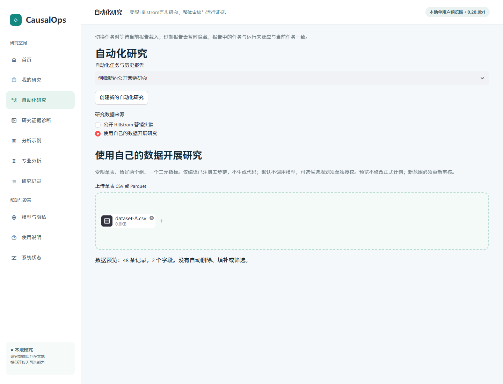
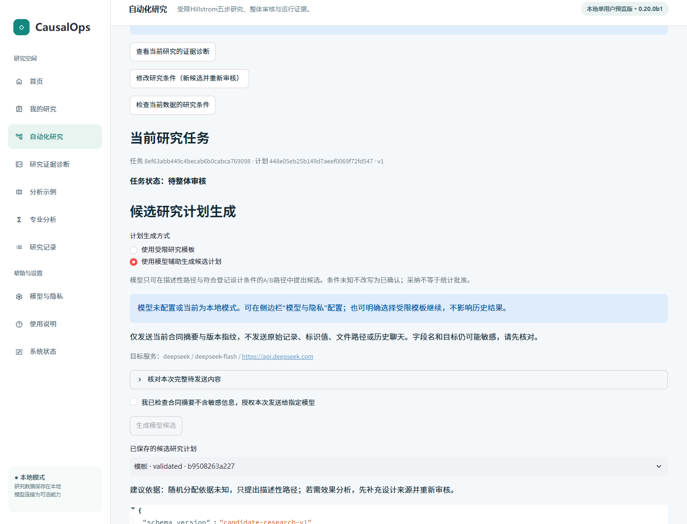
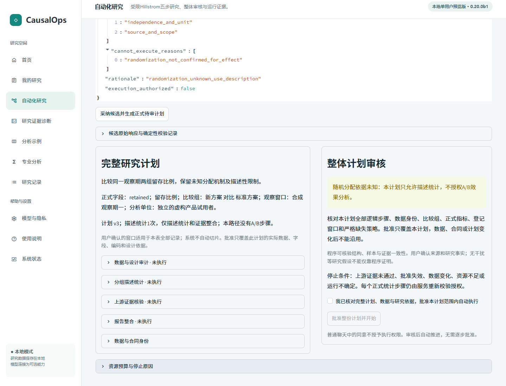
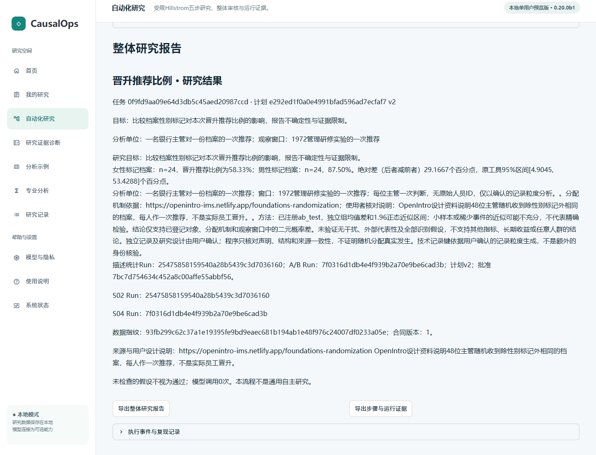
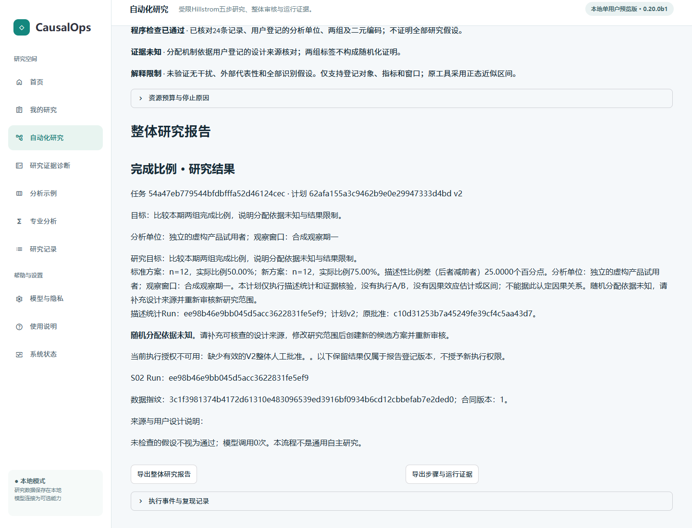
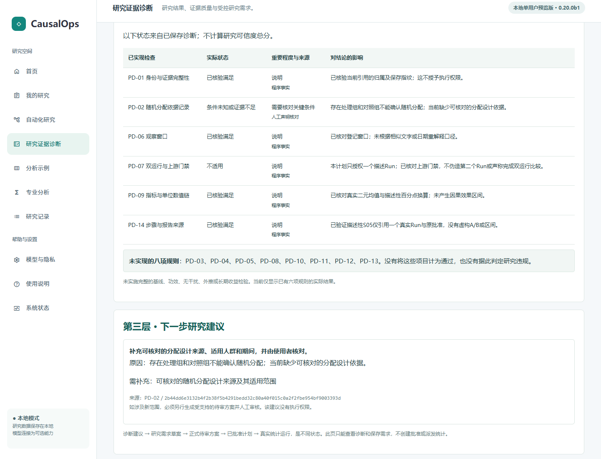
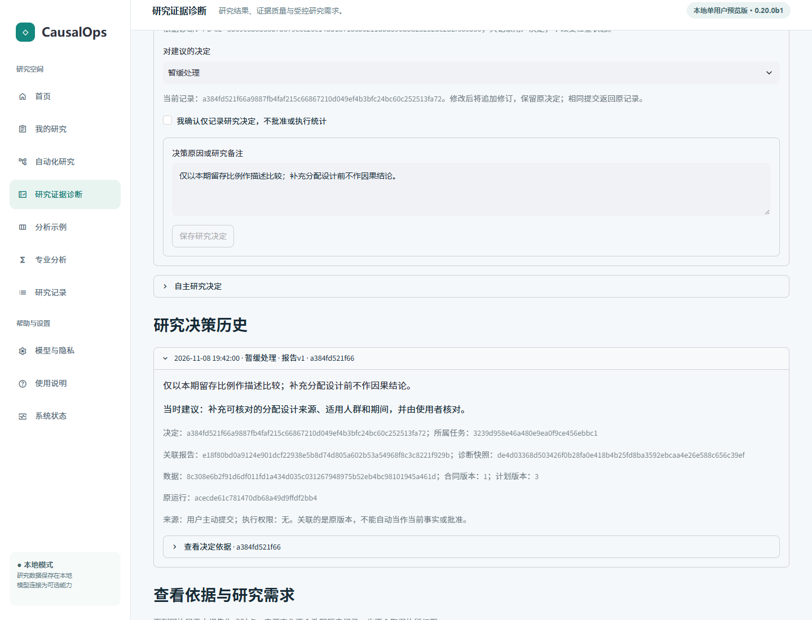

# 0.20.0b1 可配置受控研究教程

适用于本快照本地单用户工作台。仅单表、双组、二元指标、两条受限路径，不支持任意自主研究。**目前尚无真人独立使用的正式验收数据。**本页截图来自本轮安装包的固定浏览器验收。

## 准备与导入

按[安装说明](INSTALLATION.md)启动，核对0.20.0b1和构建指纹。初试用新工作区及合法公开/合成数据，不复制私人研究库。模板不需要模型或API密钥。

公开示例：[OpenIntro数据](https://www.openintro.org/data/index.php?data=gender_discrimination)和[设计资料](https://openintro-ims.netlify.app/foundations-randomization)。48位主管随机收到档案性别标记，每人给一次推荐，不是真实员工晋升记录。上游包GPL-3，快照不捆绑原始表。

CSV下载不可用时可取[上游R数据](https://raw.githubusercontent.com/OpenIntroStat/openintro/main/data/gender_discrimination.rda)，用独立R/Python转换环境转CSV或Parquet；不按预期结果手造记录。原R文件SHA-256为`582a1d3311f6a5e7ee06e94d31e96c76c9cb7182d45912ba59682c0e1782de65`，验收转换CSV为`7d5a3a8b0f87b44aead0e312d960653482ea62f744fc390fe3364c64a7f39988`。该指纹只核对示例版本，不限制你的合法数据。

首页“使用自己的数据开展研究”，选择CSV或Parquet。查看预览、类型、缺失数；上传不是方案批准或统计Run。单文件限20MB，沿用原读入器行/列限制，不接受脚本、宏或Pickle；不自动删样本、插补或排除第三组。

## 确认数据与研究合同

核对目标、每行分析单位、记录粒度、唯一标识（如有）。重复测量不适用；自动技术行号不证明人员身份或独立性。

选择比较组字段、两个真实组值及业务名称；指定正式二元结果和否定/肯定编码（映射0/1）、指标名及单位。不会把连续值自动二分。

登记整表观察窗口及设计来源。窗口不是日期筛选器。unknown只允许描述；randomized必须有具体来源、适用说明及显式核对。两组或均衡不是随机化证明。确认合同生成待审方案，但不产生执行批准。

## 模板与可选模型候选

模板根据当前合同编译允许步骤，可看方法、依赖、限制。显式采纳形成独立待审版本，仍需正式审核。

模型先在“模型与隐私”配置自己的服务和凭据，核对本次完整待发摘要，再单独授权发送。目标、字段名和组别也可能敏感；默认不发送原始行、人员标识值、文件路径或聊天。仓库不提供凭据。

模型不能改写编码、窗口、分配机制或目标，不能添加方法或授予执行权。非法候选被确定性拒绝，不静默换方法。未配置、接口失败、无效输出或超预算时保留记录，可明确选择模板继续，不恢复旧批准或重置请求额度。

历史真实DeepSeek验收只有2次、6036令牌、费用未核实，不是通用规划能力或低成本证明。

## 审核与执行

查看完整目标、合同、指标/单位、组别、窗口、工具参数、依赖、版本、预算和停止条件。通过正式整体批准入口执行；聊天“同意”、候选采纳和研究决定不批准统计。

描述路径4逻辑步/1次descriptive；A/B路径5逻辑步/descriptive与ab_test各一次。审计、门禁与报告不是新估计器。S03读取真实持久化S02证据，核对样本/口径/哈希，通过且授权有效才执行S04；显著性不决定放行。

图为本轮留存指标的描述路径待审页：四个逻辑步骤、一次描述统计；未知设计不授权A/B。公开随机化路径则为五步、两个统计Run。

进度来自保存记录。暂停在安全边界生效；取消终态；恢复先核对已有Run、所有权、数据、计划、批准和预算，不盲目重算。

## 报告、数值与来源

核对任务/版本、字段、比较组、窗口、样本、比例、差异、单位、区间和Run。百分点不是相对增长百分比；原工具区间是1.96正态近似，不代表小样本精确检验或所有研究假设成立。

图中数字只属于该Run；每个任务须实际计算。来源声明一致不证明随机化真实发生，不支持任意总体或长期收益外推。未知设计只有描述Run、比例和描述差，没有第二个A/B或因果区间。

这张补拍图来自指标修订后重新打开的旧报告：原执行批准已撤销，页面仍保留原Run及数值，并明确提示不授予新执行权。这是历史只读状态。

导出报告及运行证据。刷新只读同一任务；历史选择器显示指标、组别、窗口和状态。等待切换完成，核对正文同源，不把执行中的部分结果当完整报告。

## 诊断、三层报告与决定

选择“查看当前研究的证据诊断”，显式“检查研究证据”。三层为真实结果、六规则实际状态及最多三项有据建议。未知、不适用、未检查不算通过，八规则仍未实现，无总体可信度分数。单Run不伪造第二个Run。

对建议选择采纳、暂缓或拒绝，或记录自主决定；填写原因并确认无执行权后保存。类型未选、未确认或来源过期时保存不可用，不反复提交。刷新可看决定、报告和证据版本。

决定不是批准或研究事实，不跨任务模糊迁移；历史备注不替代当前设计依据。来源变化后保留原历史，必要时限制保存并请求人工核对。

## 修订与恢复

通过“修改研究条件（新候选并重新审核）”更换指标、组别或窗口。新计划重新审批，不原地覆盖旧Run；旧批准失效不等于删除历史。新窗口需不同且真实覆盖该范围的表。

哈希、指标、窗口或跨任务引用冲突时限制结论，不拼接其他Run数字；已保存证据可只读保留。不确定运行先调和，预算不足不直接重算。工作区、上传表、凭据和真人记录不要加入Git。[试用材料](../product/configurable-research/usability/README.md)供后续招募，不是用户收益证明。
