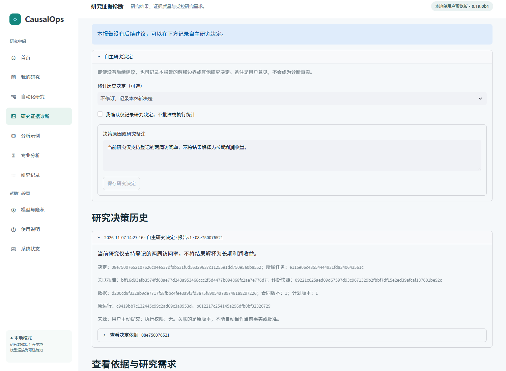
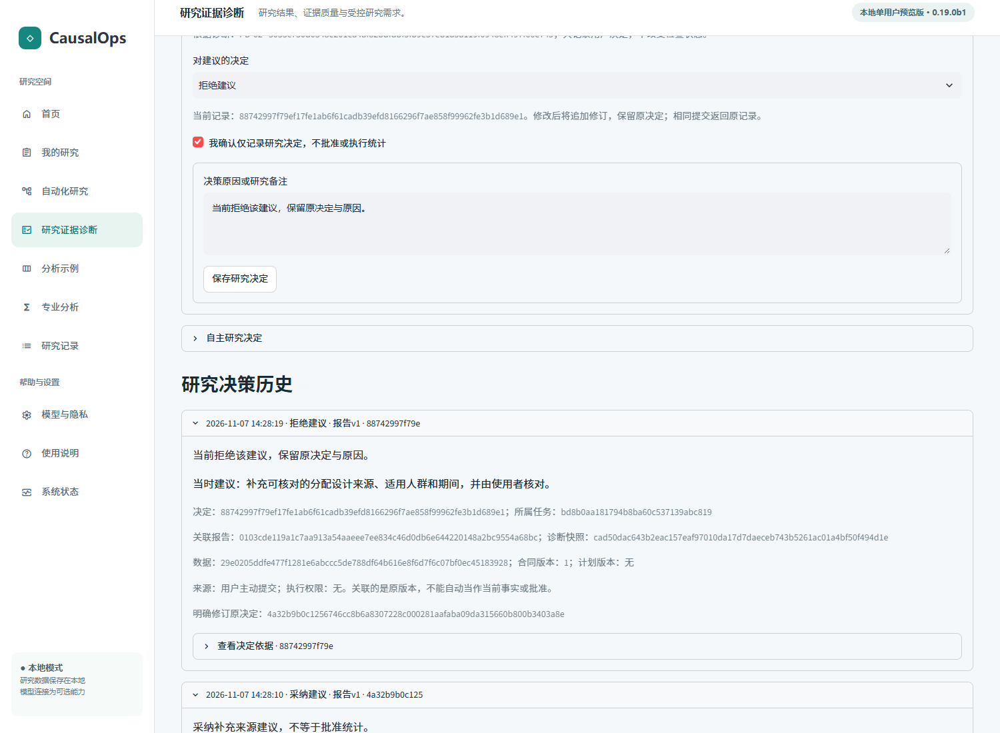
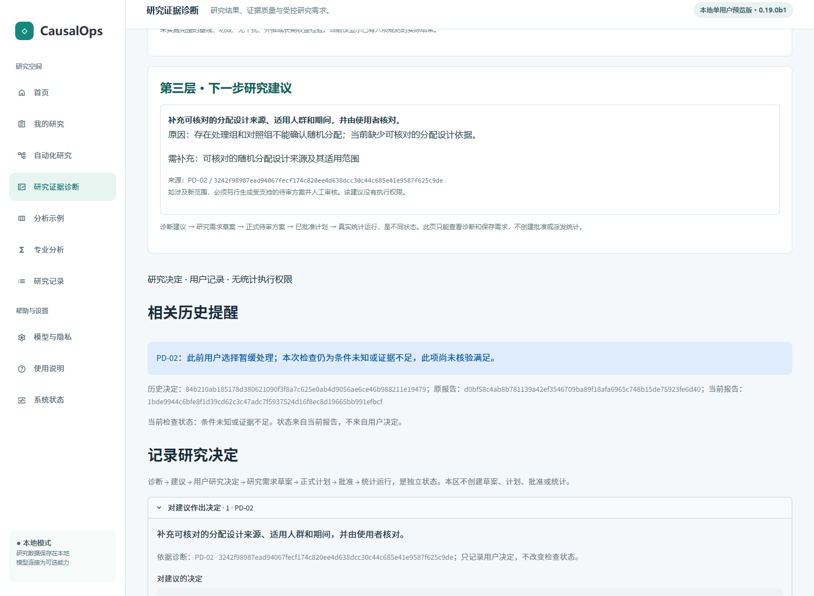
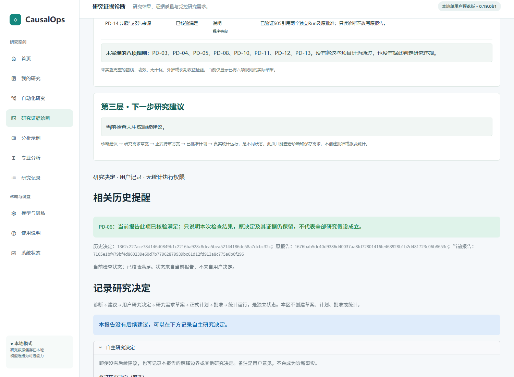
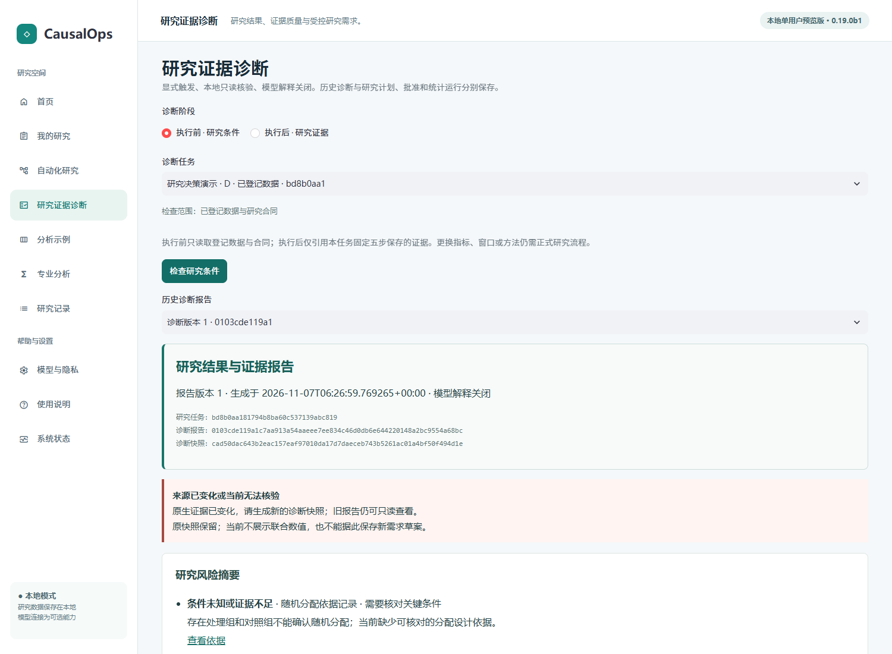
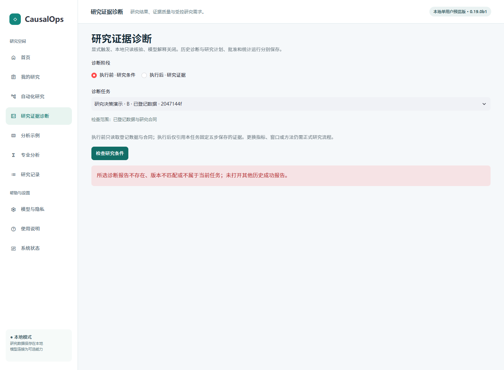

# 研究决策记忆使用教程 · 0.19.0b1

本教程对应0.19.0b1受限Beta快照；本次发布准备时尚未推送，0.18.0b1是此前公开版本。后续公开状态请核对GitHub对应分支及精确提交。以下截图已在候选独立安装验收中实际采集，均为公开Hillstrom或独立合成／受控测试数据；不是私人研究或真人使用记录。

## 1. 打开诊断报告

启动应用，从侧栏“研究证据诊断”进入。明确选择执行前或执行后诊断、所属任务和已保存报告；没有报告时，显式点击“检查研究条件”或“检查研究证据”。诊断本身不执行统计。Hillstrom完整任务可从原[自动化教程](AUTOMATION_GUIDE.md)开始。

先核对报告标题、任务、数据合同和Run。没有建议是正常状态，不需要为了记录决定强行产生风险或新的分析。

## 2. 对实际建议记录决定

在三层诊断报告下方“记录研究决定”区域，找到本报告真实建议，选择“采纳建议”“暂缓处理”或“拒绝建议”，可填写原因（最多2000字）。

当前Streamlit下拉框支持点击右侧展开或使用键盘方向键后选择。勾选“我确认仅记录研究决定，不批准或执行统计”，再点击“保存研究决定”。没有显式确认时不能保存。

**采纳不等于问题已解决，也不等于批准新研究。** 决定不会自动生成研究需求草案、Plan或Approval，也不会调用统计工具。已有独立的“保存研究需求草案”入口保持原权限规则，不能把两个动作混为一谈。

## 3. 没有建议也能记录自主决定

展开“自主研究决定”，填写解释边界或其他研究备注，明确确认并保存。例如限制报告只能解释登记窗口的访问率，不能推断长期利润。自主备注必须有内容；它是用户意见，不是新的数据或研究事实。

*实际独立安装验收截图。示例备注由固定浏览器流程显式提交，不是模型自动决策。*

## 4. 查看依据、修订和历史

“研究决策历史”显示决定、原因、原建议、关联报告版本、数据和合同、计划、Run与证据详情。刷新后从同一任务／报告重新打开，历史仍保留。

修改同一建议时保存新内容会追加一条修订，明确关联原决定；不会覆盖原文。可在允许的兼容范围内显式选择修订历史决定。相同来源和内容重复提交返回原记录。若其他提交已经修订原决定，应刷新核对，不能创建冲突分支。

## 5. 阅读相关历史提醒

用户显式打开／生成较新的诊断报告后，系统只按确定性条件比较历史：同任务、同规则和方法版本、可靠的数据与计划引用、兼容的字段／指标／单位／比较组／窗口。

- **仍存在**：本次结构化检查仍然未知或有问题，并与原问题一致，显示此前的用户选择。
- **当前已核验**：只说明本项当前检查结果，原决定保留；不等于全部识别假设成立。
- **结果已变化**：要求阅读当前证据，不把旧决定当成新事实。
- **需要人工核对**：来源或范围无法可靠对应，不强行合并问题。

*前者采用无随机化依据的独立合成任务；后者为隔离测试副本修复报告窗口后重新诊断，未重算或覆盖原统计Run。不是用户自动修复数据的效果证明。*

自定义自由文本备注只展示关联历史，不做语义理解。不同任务不召回；换数据或换计划后通常要求人工核对，而不是自动继续沿用旧结论。

## 6. 来源过期或冲突怎么办

报告来源已变化时，历史仍可只读，新决定保存禁用；先明确重新核查当前证据，不能直接用旧报告保存新决定。跨任务、非法报告或建议关联会被拒绝，不用其他任务的旧成功内容填充。

## 7. 能力与权限边界

所有决定由用户主动提交；无模型代决策、跨任务模糊匹配、任意备注语义理解、持续后台监控或通用自主研究。模型解释默认关闭。历史决定不是研究事实证明，决策ID不能用于批准或执行。当前为单用户本地Beta，没有认证签名、多人权限平台或真人效率验证。

[本候选验收](../releases/research-decision-memory-beta/ACCEPTANCE.md) · [已知限制](../releases/research-decision-memory-beta/LIMITATIONS.md) · [安装](INSTALLATION.md) · [诊断教程](DIAGNOSTICS_GUIDE.md)
