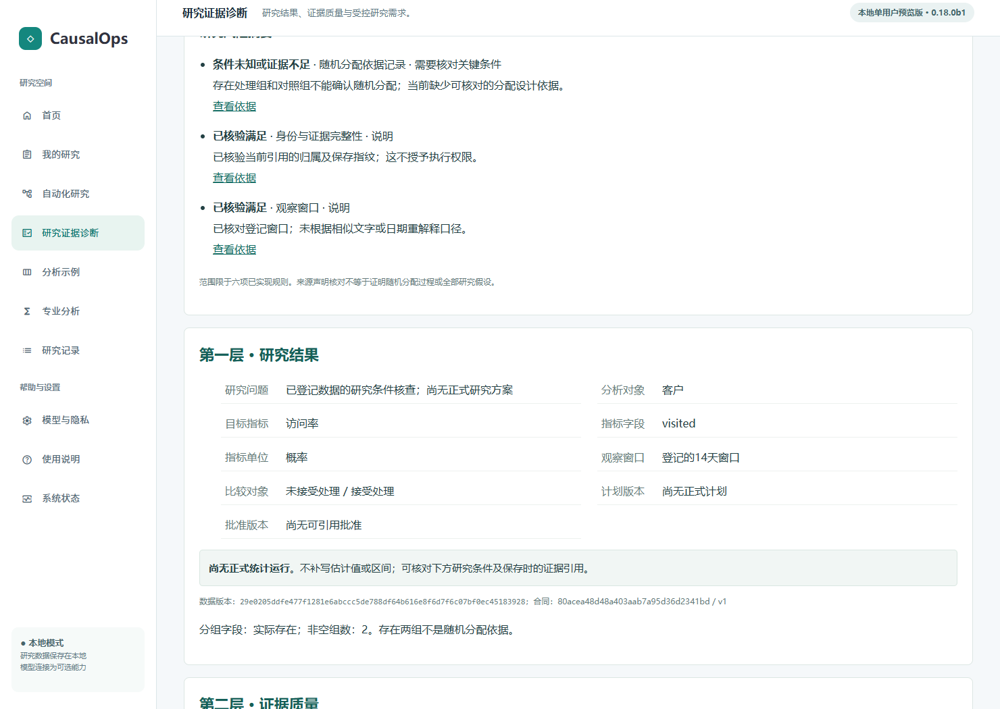
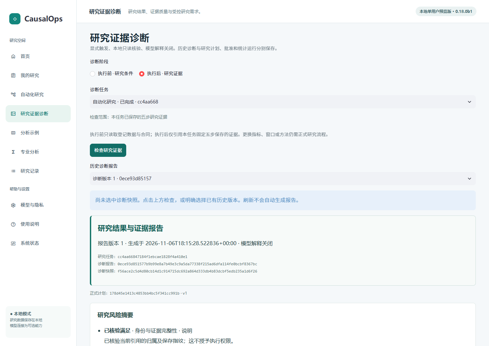
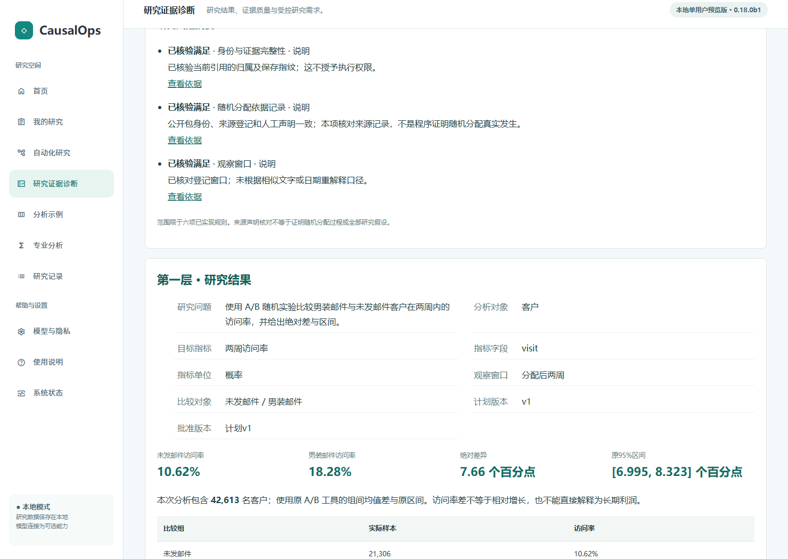
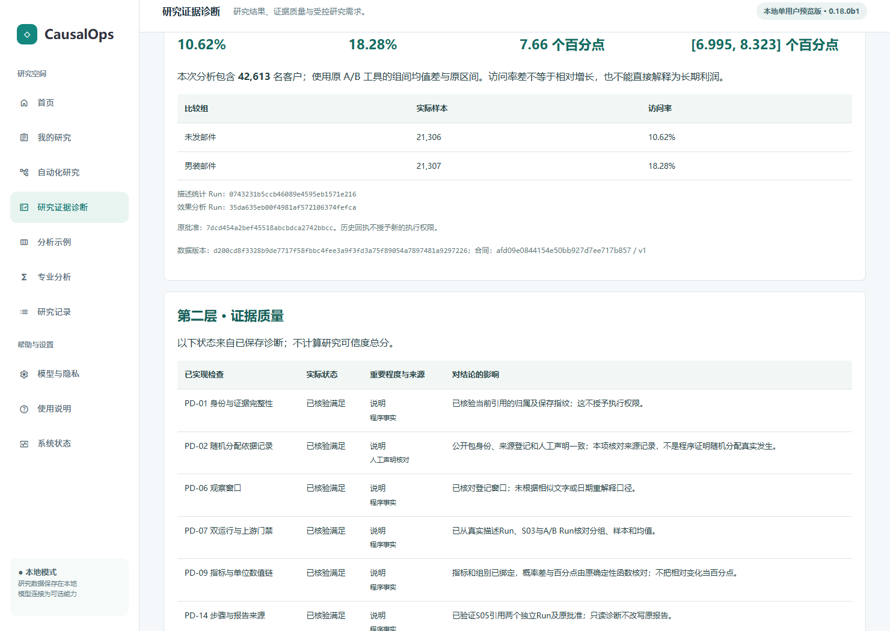
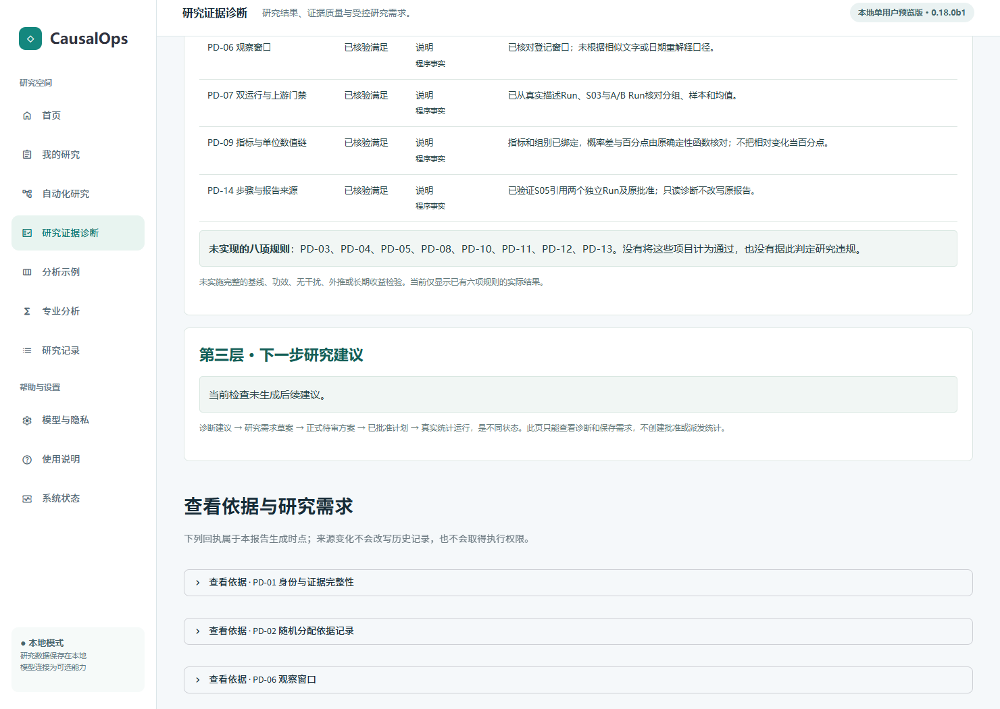
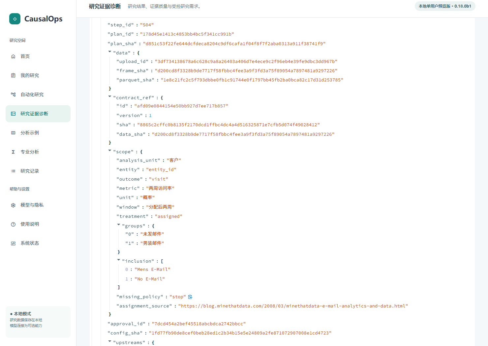
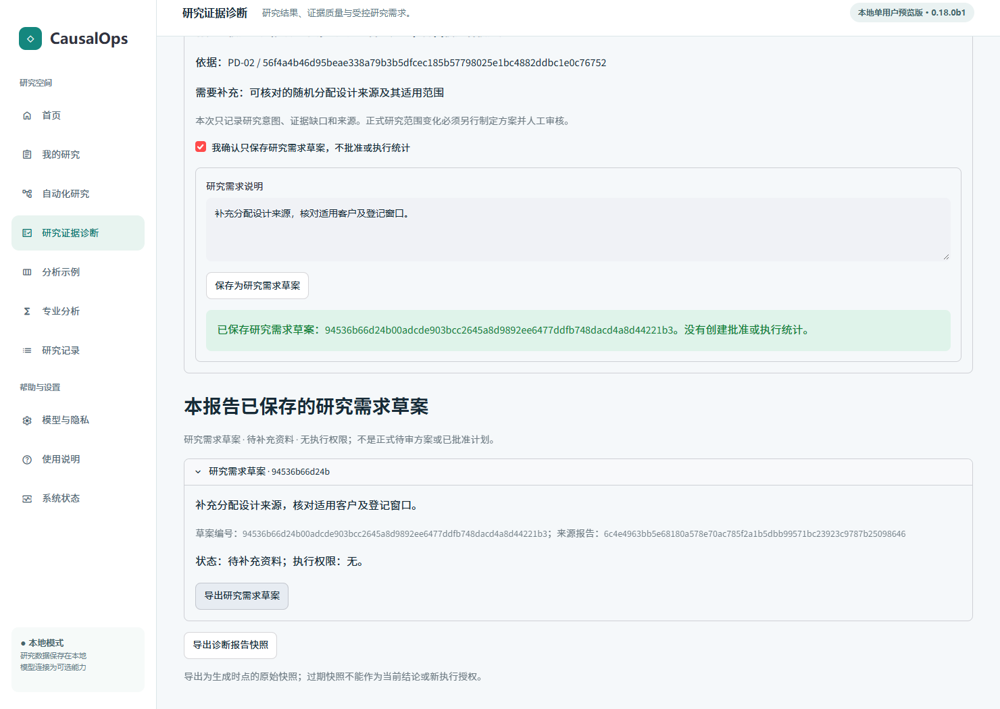
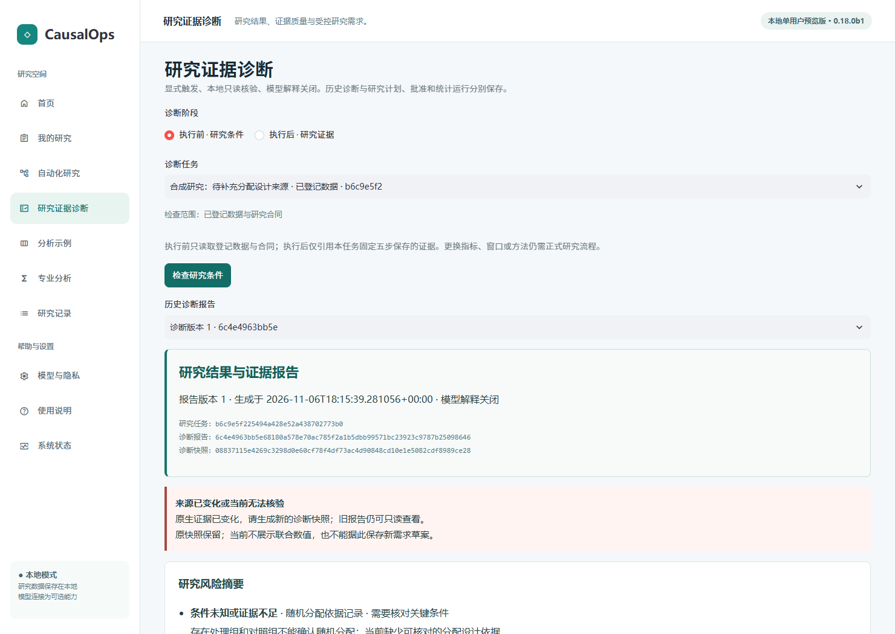
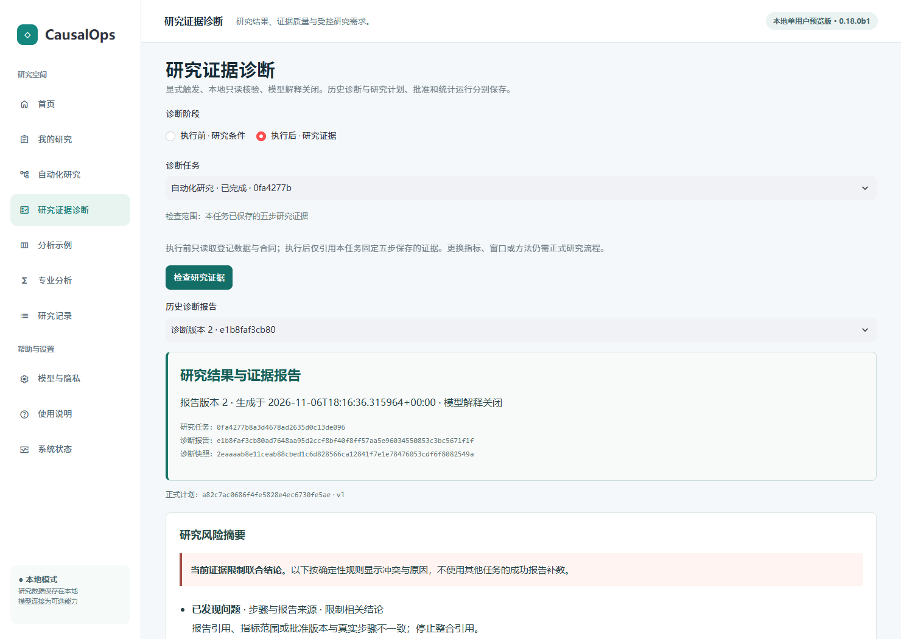

# 研究证据诊断使用教程 · 0.18.0b1

对应真实Streamlit工作台。演示只使用公开Hillstrom和独立合成数据；以下截图来自本候选0.18.0b1新环境安装包的真实页面，非原型。模型解释关闭，诊断不是大模型自主推理。

## 1. 进入工作台

首页“查看研究证据与诊断”或侧栏“研究证据诊断”。已有自动化研究提供“查看当前研究的证据诊断”和“检查当前数据的研究条件”。明确选择诊断阶段、任务和历史报告，不自动选其他研究的最近成功结果。

## 2. 执行前：检查研究条件

*合成数据：两组实际存在，但随机化设计来源未知；无正式Run。*

选择“执行前 · 研究条件”及已登记数据，点击“检查研究条件”。没有正式Run也可读取数据、DataContract与已确认事实。缺少合同或随机化来源时显示具体未知项，不创建正式Plan、Approval或统计Run；有两组不等于随机化。

## 3. 执行后：检查研究证据

*公开Hillstrom已有研究，明确选择任务和报告身份。*

按[五步教程](AUTOMATION_GUIDE.md)完成Hillstrom研究，得到自己的描述和A/B Run。选择该任务，点击“检查研究证据”。原服务核验任务、合同、计划、批准、双Run、S03、S05；不能跨研究拼接事实。

## 4. 第一层：研究结果

*本候选两个真实Run的访问率、百分点差和原工具区间。*

核对目标、客户单位、两组、分配后两周窗口、样本、计划与批准、访问率、绝对差和原工具区间。访问率为百分比，概率差为百分点，不是相对增幅。数值必须来自所选研究的真实保存结果。

## 5. 第二层：证据质量

*实际六项状态及来源；不代表所有研究条件已经验证。*

六项检查分别展示五态：已核验满足、已发现问题、条件未知或证据不足、不适用、尚未检查。严重程度是独立字段。其余八项规则标未实现，不能当通过；没有总体可信度分数。

## 6. 第三层：下一步建议

*证据完整场景无适用建议，页面不会为了填充而编造。*

读取最多三条已保存建议，包含原因、对应诊断、来源、需补事实及是否需新范围审核。没有适用问题时显示“当前检查未生成后续建议”，不会为填页面编造问题。

## 7. 查看依据与两个Run

*读取保存的步骤证据，查看不授予执行权限。*

风险摘要“查看依据”链接至对应规则，展开原检查回执、原因码与缺项。完整双Run报告可点“查看两个 Run 与原报告的运行证据”。只读查看不取得执行授权。

## 8. 显式保存研究需求草案

*合成设计依据不足场景的显式草案保存与无权限说明。*

先阅读建议和来源，勾选“我确认只保存研究需求草案，不批准或执行统计”，输入需求后点击“保存为研究需求草案”。重复同一请求返回同一有效草案；刷新可回读和导出。修改需求文本是新的请求。

草案只记录意图、诊断来源和证据缺口，不是正式待审方案、批准或完成统计。正式研究变更仍须通过正常方案审核流程，不能直接执行建议。

## 9. 历史与来源变化

*受控修改来源后，拒绝使用旧建议保存新需求。*

在“历史诊断报告”重开旧版本。刷新不重新计算。来源变化时旧报告保留但不作为当前联合结论，不能据旧建议新建草案；请核对事实后显式重新检查。

## 10. 异常处理

*独立测试副本注入窗口冲突，限制联合结论。*

- 无任务：先登记数据；无正式Run可做预诊断，不能当统计效果。
- 设计依据未知：补充可信来源，不自动勾选假设。
- Run／指标／窗口／单位／哈希冲突：查看实际依据，停止受影响结论，核对原生工件，不借用其他成功数值。
- 历史或回执读取失败：保留错误和工作区核对来源，页面不回退到别的成功报告。
- 建议过期：重新检查；旧草案只读保留，无执行权限。
