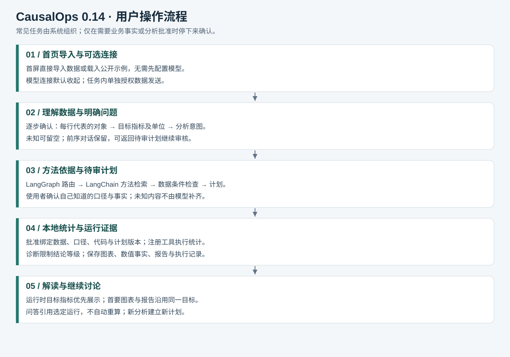
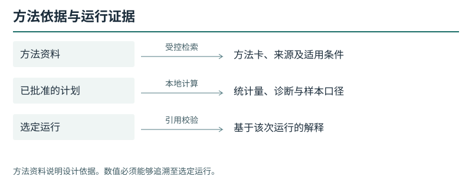
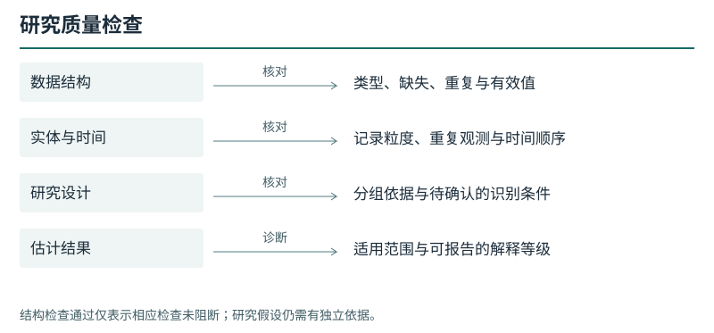
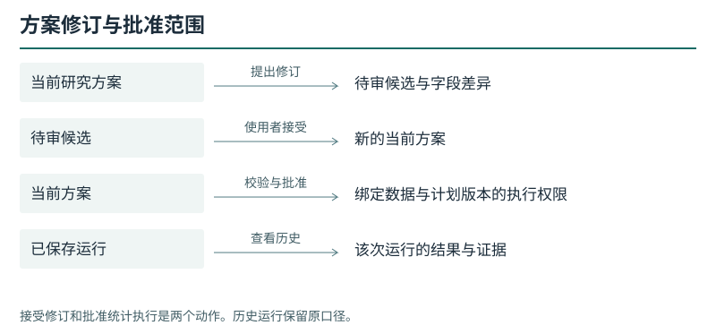
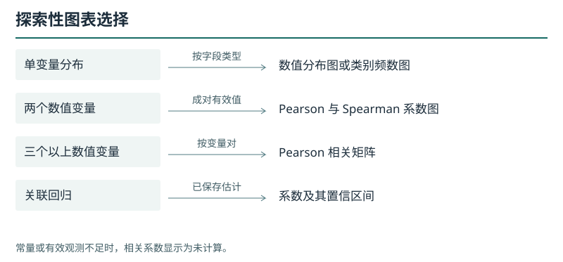
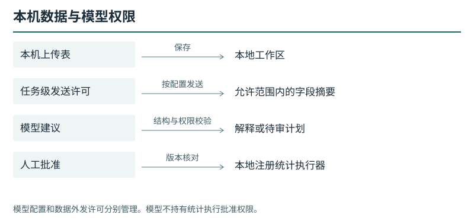
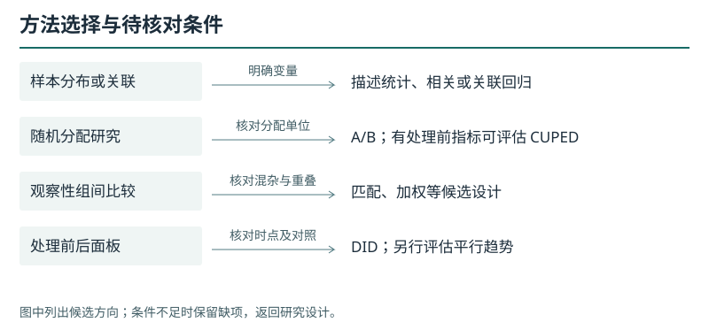
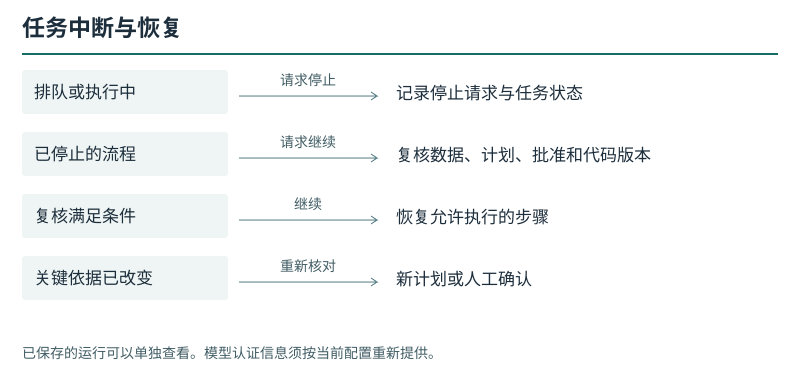
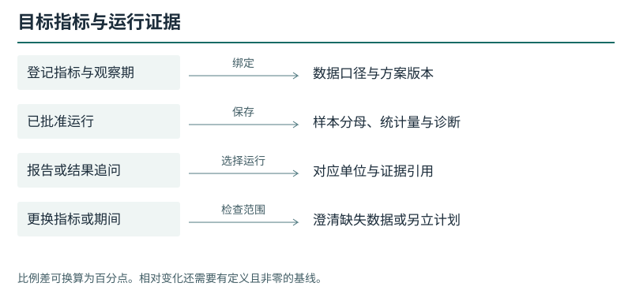
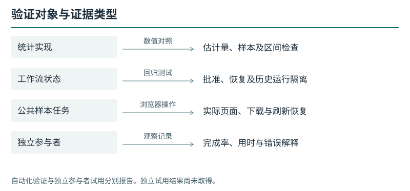

# 研究工作台图示索引

版本 0.16.0。本页展示源码中的操作、边界与统计输出。每张图可查看矢量文件、PNG 或可编辑的关系定义。

## 分析任务与人工审核

[PNG](../assets/task-workflow-current.png) · [图源](../diagrams/task-workflow-current.mmd)

## 组件与调用关系

[PNG](../assets/architecture-current.png) · [图源](../diagrams/current-architecture.mmd)

## 方法依据与运行证据

[PNG](../assets/review-evidence.png) · [图源](../diagrams/review-evidence.mmd)

## 研究质量检查

[PNG](../assets/review-quality.png) · [图源](../diagrams/review-quality.mmd)

## 方案修订与批准范围

[PNG](../assets/review-versions.png) · [图源](../diagrams/review-versions.mmd)

## 探索性图表选择

[PNG](../assets/review-charts.png) · [图源](../diagrams/review-charts.mmd)

## 本机数据与模型权限

[PNG](../assets/review-permissions.png) · [图源](../diagrams/review-permissions.mmd)

## 方法选择与待核对条件

[PNG](../assets/review-design.png) · [图源](../diagrams/review-design.mmd)

## 任务中断与恢复

[PNG](../assets/review-recovery.png) · [图源](../diagrams/review-recovery.mmd)

## 目标指标与运行证据

[PNG](../assets/review-lineage.png) · [图源](../diagrams/review-lineage.mmd)

## 验证对象与证据类型

[PNG](../assets/review-acceptance.png) · [图源](../diagrams/review-acceptance.mmd)
