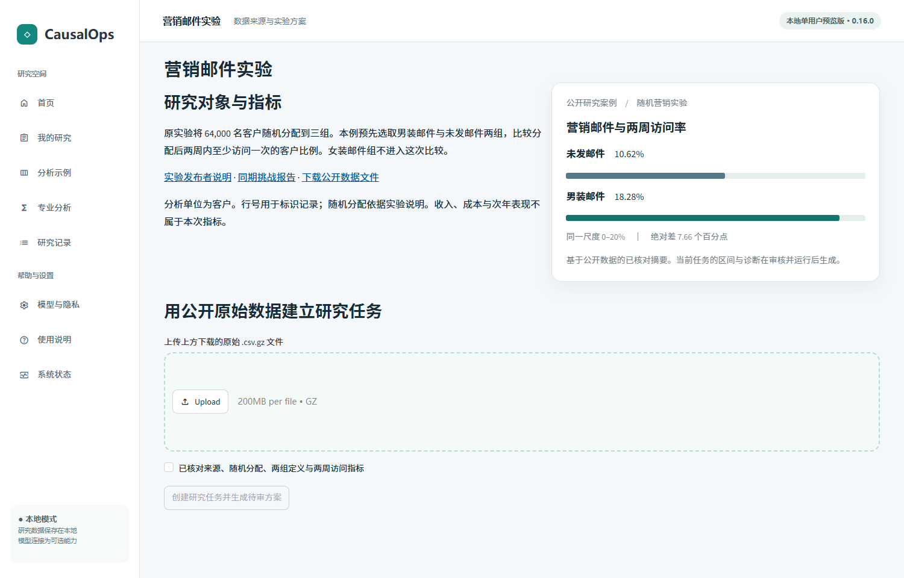

# 第二轮界面与公开实验验收

2026-11-03 · CausalOps 0.16.0 · 本地发布工作树 · 修改基线 `adb59c5`。本轮沿用版本号；仅凭 0.16.0 无法区分旧安装与本次工作树。打开本次启动器给出的地址，首页右侧应显示营销实验，下方应有三张案例卡。

## 从原始文件到报告

1. 首页选择 **查看营销实验**。核对实验对象、组别、时间与指标。先看图时无需模型、文件或发送数据许可。
2. 从[公开压缩包](https://hillstorm1.s3.us-east-2.amazonaws.com/hillstorm_no_indices.csv.gz)取得文件，保留 gzip 格式，直接在案例页上传。已经下载的文件也可以通过环境变量 `CAUSALOPS_HILLSTROM_ARCHIVE` 配置。文件名不作为数据身份；只接受 SHA-256 为 `bab6578f60db5d792f1c2372c502f029152a5249cf5ea84390f3b7f885d7234f` 的原始压缩包。重新压缩会改变指纹。其他营销表请使用普通导入入口并自行登记事实。
3. 对照来源确认随机分配、两组定义和两周窗口，再点击 **创建研究任务并生成待审方案**。数据和方案此时已保存。该操作本身不计算统计结果。
4. 在 **人工审核** 中核对方案版本、样本、指标和分配声明。程序检查字段、配置与绑定版本；研究者确认实验口径。勾选确认后点击 **接受计划并批准本次执行**。
5. 在 **本次分析结果** 核对两组比例、差值和区间；按 **导出本次分析报告** 保存离线 HTML。可问「两周访问率绝对差是多少个百分点？」。已有结果按运行引用；更换指标或窗口需重新确认资料与计划。

## 来源、样本与计算

研究说明见 [Hillstrom 发布页](https://blog.minethatdata.com/2008/03/minethatdata-e-mail-analytics-and-data.html) 和[同期挑战分析报告](https://stochasticsolutions.com/pdf/HillstromChallenge.pdf)。原发布页本轮访问超时；同期报告提供三组随机分配和两周响应的设计背景。两组计数另外从哈希固定的数据文件复算。

| 原始分组编码 | 记录 | 两周内访问 | 用途 |
|---|---:|---:|---|
| No E-Mail | 21,306 | 2,262 | 对照 |
| Mens E-Mail | 21,307 | 3,894 | 处理 |
| Womens E-Mail | 21,387 | 3,238 | 不进入预先指定的比较 |

比较样本共 **42,613** 人。以分配组为分母，处理组减对照组得到 **+7.659 个百分点**，本次运行的 **95% 置信区间为 6.995 至 8.323 个百分点**。相对增幅约 72.14%，上述区间仅适用于绝对差。记录行号用于本机分析中的记录标识。随机分配依据外部实验记录；数值本身不能验证分配过程。报告不估算利润、个体购买概率或次年表现。压缩包及逐行数据不随本次变更分发。

## 本轮检查与发现

| 检查 | 实际结果 |
|---|---|
| 完整回归 | Python 3.11，`python -m pytest -o addopts= -q --tb=short`，原始案例文件已配置，633 项通过。 |
| 文件与统计 | `python -m pytest tests/test_hillstrom_case.py` 覆盖拒绝错包、两组计数、独立复算点估计和标准误、报告数值、问答与运行绑定。无原始包时两项真实数据测试显式跳过。 |
| 浏览器操作 | 在全新 Streamlit 进程和单独测试工作区中，分别通过本机文件配置、浏览器上传完成营销实验。未知压缩包被拒绝；真实文件生成待审方案，未确认时批准按钮不可用。实际点击批准、保存 HTML 并通过对话引用该次结果。 |
| 基础与教学 | 葡萄酒描述统计从公开样本运行到导出入口。合成政策页分别操作趋势相同与趋势不同的情形，核对报告和运行证据。390 像素视口检查首页未产生页面级横向溢出。 |
| 首次失败与修复 | 首轮误写邮件组名，多了撇号，导致只导入对照组，原内核拒绝估计。修正后在导入时同时验证两组样本数与事件数，避免错误样本流入待审方案。 |
| 延续既有功能 | 已有方案差异、审批绑定、恢复历史运行、模型发送许可、两变量相关系数图和多变量相关矩阵继续使用原模块。没有新增模型执行权限。 |

## 交付范围

本次正式截图来自上述实际页面。首页使用附件的左右分栏与三级卡片，审核页保留可编辑确认控件。报告中的条形长度由运行比例决定；固定共同尺度能如实显示比例，差值区间单独列出。组间比例图未添加未经计算的组别置信区间。研究流程采用[双循环图](../assets/phase2-research-cycle.svg)及[可编辑图源](../diagrams/phase2-research-cycle.mmd)。组件、权限、运行证据和版本转换仍分别见[图集](FIGURES.md)。

验收为自动化实机操作，未纳入独立受试者。本轮使用本地模式，没有调用收费模型或重新验证所有外部提供商。PSM 区间覆盖等既有统计限制见[统计核查](STATISTICAL_AUDIT.md)。未测量营销邮件对利润的效果，合成政策结果也不能用作真实政策证据。
