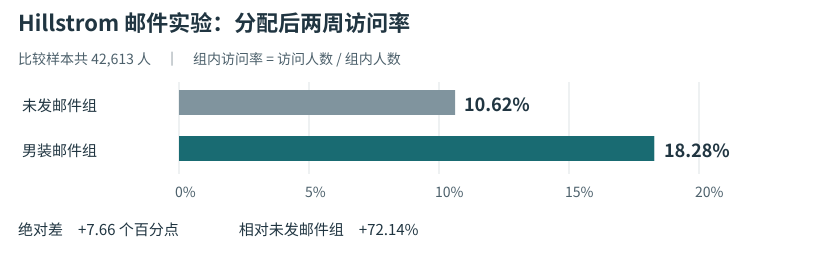

# CausalOps 项目评审：营销实验结果的复核与解释

2026 年 11 月 3 日（北京时间） · 评审对象为公开源码 0.16.0，功能基线 [5f40dac](https://github.com/JiamWei624/CausalOps/tree/5f40dac3105c87f21cd664c9bb94ecc682003511)。

## 01　是否值得继续做

**值得继续，优先服务需要向同事解释一次实验结果的业务分析人员。** 对这个人，最费判断的环节出现在拿到数字之后：访问率提高了多少？百分比的分母是谁？换成购买率还成立吗？报告能支持投入预算吗？CausalOps 已有两件可以拿给他验证的东西：按批准口径计算的报告，以及会指出当前报告答不了什么的追问入口。

上传表格、对话制图、生成报告都已有强替代品。DB-GPT 在本窗口加入了可追溯报告，WrenAI 更新了业务规则如何进入模型提示，GrowthBook 把指标定义与实验结果展示继续做深。只用“数据分析 Agent＋17 种方法”定义本项目，很难回答别人为什么要换工具。对需要企业数仓连接、持续分流、线上开关或多人治理的团队，现有项目的覆盖面也更广。[DB-GPT 报告改动](https://github.com/eosphoros-ai/DB-GPT/pull/3295) · [WrenAI 业务规则改动](https://github.com/Canner/WrenAI/commit/5476670547) · [GrowthBook 指标配置改动](https://github.com/growthbook/growthbook/commit/b73ffdb3e8)

**价值分三层判断。** 作为数科与 AI 产品作品集，已有公开数据、可运行产品和具体失败案例，能讲清一个模型如何与统计程序协作。作为专业分析辅助工具，营销实验复核值得进入真实试用。作为通用商业产品，当前证据还回答不了团队是否愿意采用、是否比原工作流省时、能否降低交付错误。这些判断需要使用者和对照任务；星数、测试数与方法数均不能替代。

## 02　比较范围和证据

观察窗口为北京时间 2026-09-03 至 2026-11-03 检索时。使用 GitHub REST API 的仓库元数据读取累计 stars，按默认分支、起止时间核对提交；用项目 README、提交或 PR、官方方法文档核对设计。选择与本项目实际决策相邻的产品，高星对照采用超过 5,000 stars 的门槛。窗口内有提交与窗口内新创建分别标示。提交日按 UTC。这里没有估算两个月新增 stars，也没有将项目宣传当作效果对照实验。

| 对照项目 | 检索时累计 stars | 窗口内可复查的变化 | 在评审中的用途 |
|---|---:|---|---|
| DB-GPT | 20,244 | 10-19 合入结构化可追溯报告；10-30 修补路径遍历与 SQL 注入 | 与自然语言分析和报告直接重叠。[报告 PR](https://github.com/eosphoros-ai/DB-GPT/pull/3295) · [安全修复](https://github.com/eosphoros-ai/DB-GPT/commit/697195d95c) |
| WrenAI | 18,041 | 10-27 改善日期和 decimal 的工具返回序列化；11-02 将业务规则加入 Agent 提示 | 比较指标语义和模型上下文。[工具改动](https://github.com/Canner/WrenAI/commit/0612c3e737) · [规则改动](https://github.com/Canner/WrenAI/commit/5476670547) |
| GrowthBook | 8,558 | 10-29 重构实验页；10-30 在日期提示中显示运行时长；11-02 统一事实指标配置流程 | 营销实验场景最直接的专业参照。[实验页](https://github.com/growthbook/growthbook/commit/ed4e827b97) · [时长](https://github.com/growthbook/growthbook/commit/6edbd66b1d) |
| DoWhy | 8,385 | 11-02 修复前门与中介识别对象中的结果名，也修正子样本反驳检验的模拟次数 | 统计语义与推断层的技术参照。[识别对象](https://github.com/py-why/dowhy/commit/7cec31989c) · [反驳检验](https://github.com/py-why/dowhy/commit/9f849ddf2b) |
| Microsoft Data Formulator | 17,649 | 此窗口查询未发现默认分支提交；可核对的上一版为 08-15 的 0.8b1 | 仅作交互设计对照。[固定版本源码](https://github.com/microsoft/data-formulator/tree/5477f0e236426dc8f74a498ec400414fba7fbc0f) · [版本记录](https://github.com/microsoft/data-formulator/releases/tag/0.8b1) |

另查窗口内新建项目。以 GitHub 仓库描述中的英文词组 “data analysis”＋agent 或 “data analyst” 及超过 100 stars 为窄筛选，发现 09-23 新建的 EasyPlot（111 stars）。它说明科研作图流程也可以封装成轻量 Skill；这组搜索受命名和语言限制，不能据此推断市场上所有新项目的数量。[EasyPlot 源码快照](https://github.com/Rimagination/easyplot/tree/d150e0167f15551cbfb5549076b99c43ad07272a) · [GitHub 仓库 API 口径](https://docs.github.com/en/rest/repos/repos#get-a-repository)

## 03　这些项目到底怎样工作

| 项目 | 用户从哪里开始、交付什么 | 架构与工具 | 大模型具体负责什么 | 对 CausalOps 的启示 |
|---|---|---|---|---|
| WrenAI | 从已有数据源和业务定义出发，以业务语言提问，得到受定义约束的 SQL 或可共享的分析产物 | 用 MDL 表达模型、指标与关联；YAML/Markdown 保存可审查定义；Apache DataFusion 执行，CLI、MCP、LangChain 供外部 Agent 接入 | 宿主 Agent 读取语义上下文、生成查询或构建展示。数据引擎按定义运行查询。README 单列开源核心及商业 UI 等能力 | 优先保存“谁进入分母、窗口如何截取”，让回答和计算共用一份定义。无需为证明这一点先支持 22 个数据源。[仓库与开源范围](https://github.com/Canner/WrenAI/tree/548eee3e864b11e7f11eee15ae82be178a295f22) |
| DB-GPT | 从跨数据源的开放问题开始，交付分析、看板和报告 | 连接器、可组合工作流 AWEL、Agent、RAG、Skills、SQL/代码执行和沙箱 | 模型可以拆任务、生成 SQL 或代码并迭代。工具负责执行，将中间分析组织成报告。允许动态代码带来更宽的任务覆盖，也增加隔离要求 | 学其报告如何解释中间产物；有限统计工具和显式批准是本项目能够集中验证的范围。不要把“有引用”当作独家能力。[固定版本说明](https://github.com/eosphoros-ai/DB-GPT/tree/0cf4ebf26dd4d9026cdea34f5806a3f2f574603b) |
| GrowthBook | 从分流与指标配置开始，读取实验组表现并决定继续、停止或推广 | SDK、特性开关、数仓查询和统计引擎；官方文档分列 CUPED、序贯检验、集群实验及统计引擎选择 | 核心实验估计由统计引擎完成。外部 Agent 可通过 MCP 操作开放的功能；主流程不依赖聊天模型来计算实验效果 | 报告首屏同时交代样本、时长、主指标和决策限制。对于一次性 CSV 复核，先做好报告阅读，无须重建线上分流平台。[仓库](https://github.com/growthbook/growthbook/tree/b73ffdb3e8) · [官方统计说明](https://docs.growthbook.io/statistics/overview) |
| DoWhy | 研究者指定因果问题与假设，产生识别表达式、效应估计及反驳检验结果 | Python CausalModel/图、识别器、估计器、refuter 分层。每一步有独立对象 | 这条因果效应主链可以完全通过程序运行。无需大模型替研究者宣布识别条件成立 | 在计划页分别展示“要估的量、依据和仍待确认的假设”。把反驳检验与形式验证分开；可作为方法参考实现做对照。[官方四步工作流](https://www.pywhy.org/dowhy/v0.13/user_guide/causal_tasks/estimating_causal_effects/index.html) |
| Data Formulator | 从一张表与一个图开始，沿某个发现追问、分支和比较 | 连接器、统一 DataAgent、Data Thread、Flint 图表系统、LiteLLM 适配 | 模型协助数据转换、推荐分析、细化图表；用户在可见的探索轨迹中选择下一步 | 当前报告、前序问题、另开分析三者应在屏幕上可分辨。用一个返回旧报告的入口，代替展示更多版本编码。[微软项目介绍](https://labs.ai.azure.com/innovations/data-formulator/) · [项目快照](https://github.com/microsoft/data-formulator/tree/5477f0e236426dc8f74a498ec400414fba7fbc0f) |
| EasyPlot（补充） | 科研人员已有表或分析结果，目标是得到能用于论文的图 | 宿主 Agent 加作图规则与脚本，默认 R/ggplot2，也支持 Python，导出前检查字体、尺寸、对比度等 | 模型依照 Skill 组织图形任务，实际绘制与导出由工具完成 | 把“已保存数字能否正确上图”做成独立质量检查，尤其注意单位、分组和区间。小工具也能聚焦于一项可验证的交付。[项目说明](https://github.com/Rimagination/easyplot/tree/d150e0167f15551cbfb5549076b99c43ad07272a) |

**从它们的 README 能学到什么。** WrenAI 先让读者看到一条业务定义如何约束查询；DB-GPT 按探索、计划、运行、报告组织产品说明；Data Formulator 用问题分支解释用户为何需要保留探索历史；GrowthBook 使用实验和指标等业务对象作为入口。旧版 CausalOps 架构图把界面、队列、检索、执行和证据自上而下排成相同卡片，读者容易误认为每次问答都要重新检索和计算。当前 README 将操作顺序、组件调用和营销实验结果分别放在首次分析、系统架构和案例章节。

## 04　CausalOps 的实际架构与证据边界

1. **输入与口径。** 表留在本地。用户登记“一行是什么”、结果单位、期间和分组意义。这些信息形成带版本的数据口径，同一列在不同业务问题中可以有不同含义。
2. **问题与计划。** ResearchService 接收请求。LangGraph 将解释报告、了解方法和新建计划分流；方法检索使用 LangChain 适配。经用户授权，外部模型可以参与提案或解释。某方法的文献支持其选择理由，单次运行的数值证据来自统计程序。
3. **批准与执行。** 审核绑定数据、口径及计划等版本。本地执行器产生估计、区间和诊断；模型生成的文字不能充当批准记录。工作区持久化运行和对话关联。
4. **追问与改口径。** 选中报告后，系统读取该运行的目标和数值。对通过检查的二元 A/B 均值差，可引用原始概率差、百分点和相对变化。改问不同指标或期间时，已覆盖的规则会提示补资料；必要时另建计划。旧运行仍可复核。[架构索引](https://github.com/JiamWei624/CausalOps/blob/5f40dac/docs/current/ARCHITECTURE.md) · [换算实现](https://github.com/JiamWei624/CausalOps/blob/5f40dac/src/causalops/results/rate_units.py) · [结果范围实现](https://github.com/JiamWei624/CausalOps/blob/5f40dac/src/causalops/application/report_scope.py)

| 评审项 | 现有证据 | 风险与判断 |
|---|---|---|
| 数值解释 | 公开邮件实验两组共 42,613 人；两周访问率差 +7.66 个百分点、相对 +72.14%；购买率差 +0.68 个百分点 | 两组的相对变化分母不同于百分点换算。当前专门处理满足条件的二元 A/B，尚不能宣称所有模型输出都支持同一换算。 |
| 报告范围 | 6 条模拟路径均找到正确报告；同一跨指标跨期问题共 12/12 次澄清；155 项相关回归通过 | `report_scope.py` 显式识别访问率、购买率、净利润、明年等措辞。诸如“下季度每位客户毛利”并未由这些结果证明可稳定识别。 |
| 统计可信度 | A/B、CUPED 有参考公式核对；0.16.0 的固定模拟中 PSM 区间只在 6 次中覆盖真值 4 次 | 需要按估计对象、匹配、重叠和标准误拆开调查。六次样本太少，不宜以 66.7% 预测长期覆盖率。 |
| 用户价值 | 已有公开案例、可恢复工作流和可下载报告；6 条路径是自动化模拟 | 尚缺陌生分析人员自行完成任务时的错误率、时间和决策质量。当前不宜承诺企业提效比例。 |

来源：[验收表](https://github.com/JiamWei624/CausalOps/blob/5f40dac/docs/current/VALIDATION.md) · [统计审计与模拟明细](https://github.com/JiamWei624/CausalOps/blob/5f40dac/docs/current/STATISTICAL_AUDIT.md)。

## 05　后续优化顺序与验收

以下为建议的产品实验和工程门槛，均为待做事项。

| 顺序 | 要解决的问题与实现 | 如何验收、何时停下来 |
|---|---|---|
| P0 · 先观察使用者 | 让 5–8 名未参与开发的分析人员独立完成三题：解释访问率、切到购买率、回答明年净利润能否估算。主持人保管答案，记录首次误选、请求帮助、返工和最终解释。给每人相同入口与数据。 | 逐题报告分母、无需帮助完成人数、严重错误原话和完成时间。有人把访问率当利润，先修这一处再扩展方法。小样本用于找问题。 |
| P0 · 把指标和时间写成可比较的对象 | 先覆盖访问率、购买率、人均收入、毛利四类。每次运行保存指标 ID、别名、单位、分子分母、统计单位、起止时间与人群。候选解析可用模型；审批和范围比较由本地程序完成。旧报告缺少字段时提示补口径。 | 独立留出未参与规则设计的同义问法、季度、不同人群、零基线、多报告和预测问题。分别记录错答与过度拦截，特别检查合法的新计划仍可建立。关键误引须为 0，并报告样本量。 |
| P1 · 让结论有一个可用于决策的尺度 | 报告首页固定“哪两组、多久、每组原始水平、绝对差、相对差与区间”。成本、观察期或利润口径不足时给出具体缺项。仅在业务阈值事先登记时评价是否达到阈值。 | 对同一份公开数据分别给相对增长和绝对百分点题，盲评结论；独立公式复算；检查绝对区间不会被误标为相对区间，低基线不会被形容成高收益。 |
| P1 · 集中证明两三种方法 | 优先营销 A/B、CUPED、描述性分析；输入质量与单位检查共用。对参考实现、公认可审查公式和不同数据生成过程做对照。对观察性方法标方法级证据成熟度，先调查 PSM 区间。 | 固定种子和真值，报告偏差、覆盖、拒绝、失败和 Monte Carlo 标准误；覆盖率 95% 时若希望模拟标准误约 1 个百分点，每个条件约需 475 次独立重复。失败案例保留。 |
| P1 · 同模型对照评测 | 比较本地规则、同一模型直接回答、CausalOps 加同一模型。三者给相同聚合事实、相同任务预算；执行权限差异单独披露。冻结题集并对危险题复跑。 | 分开报告单位错误、跨报告错引、正确澄清、原可回答问题被拒绝、耗时、用量；至少公开一例“不如基线”的情况（如有）。不从六条模拟推出真人效率。 |
| P2 · 复用已有入口 | 现有 MCP 已提供只读方法和证据查询，A2A 提供本机规则审阅。若试用者反复需要在其他工具复核报告，先用真实外部宿主验证跨工具读取同一份结果；出现跨系统分工需求后再扩展 A2A。 | 先记录是哪项真实任务需要它；检查只读客户端无法批准或执行，以及不同工作区的报告不会串用。无人需要时延后。 |

**优先改一个界面。** 把报告顶部固定成“男装邮件 vs 未发邮件｜分配后两周｜访问率”，下方并列显示两个组的原始比例。用户改问利润时，在输入框上方保留这行上下文，给出“补充新指标”与“返回本报告”两个去向。比再增加一种模型选择器，更直接对应上轮暴露的错误。

**下一次评审的决定。** 若用户能独立选对报告，却普遍不能解释 7.66，应优先改结论表达；若他们会解读图但找不到对应运行，应优先改导航；若多数人会用但觉得手算更快，则用真实复杂任务测量批准、改口径和复核记录节省了哪一段工作。只有独立观察和同条件比较支持，才逐步扩大产品主张。

## 06　评审限制

本次核查了公开仓库、代表性改动、方法文档与 CausalOps 源码。未将各竞品在相同机器上部署并跑同一组统计任务，因此没有给出竞品准确率、速度或优劣排行榜。GitHub 元数据会变化。窗口内的改动用于判断工程方向；文档快照用于解释架构。报告中对产品价值、取舍以及路线顺序的判断属于评审意见。
