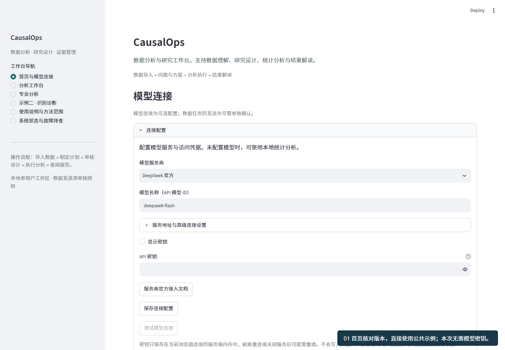
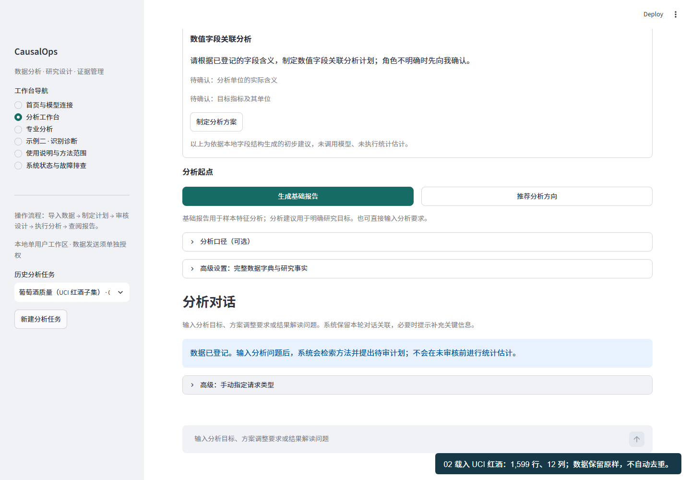
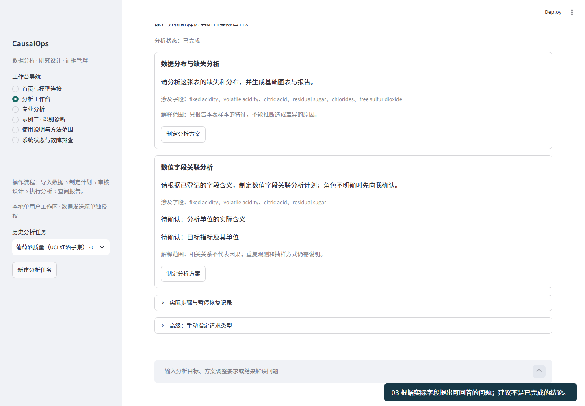
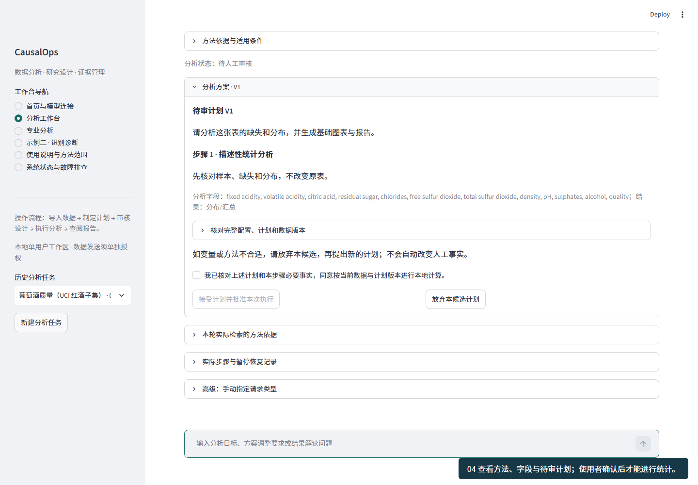
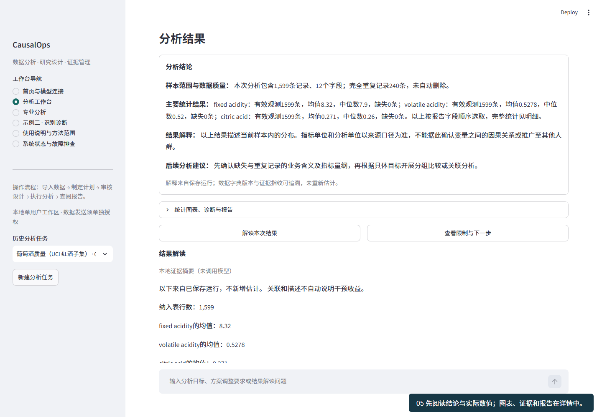
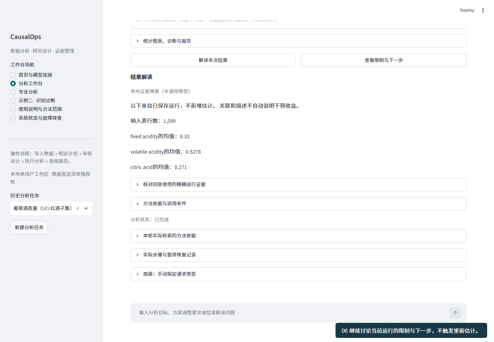
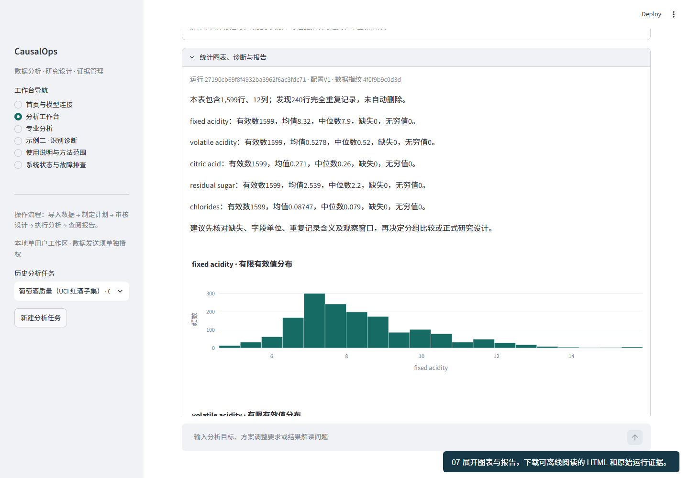

# 完整示例教程：葡萄酒质量数据 · 0.13.0

目标：从一张未经本产品配置的公开表，完成数据检查、问题选择、待审计划、实际统计、结果解读、报告下载与历史恢复。先用本地模式走通；模型模式是可选扩展。教程截图与录屏由真实浏览器连续操作生成，不用设计稿代替运行证据。

[连续操作录屏（WebM）](../assets/public-tutorial.webm) · [安装与故障排查](INSTALLATION.md) · [模型与隐私](PROVIDERS.md) · [方法范围](../../README.md#可执行范围)

## 0. 数据是什么，能说明什么

内置数据为 UCI Wine Quality 的**红酒子集**，1,599 行、12 列。每行是一个样本的理化检测与感官质量评分记录，不代表一个持续观察的客户。11 个理化特征包括 fixed acidity、volatile acidity、citric acid、residual sugar、chlorides、free sulfur dioxide、total sulfur dioxide、density、pH、sulphates、alcohol；quality 是 0–10 的有序质量评分。

来源：Cortez 等（2009），[UCI 官方数据页](https://archive.ics.uci.edu/dataset/186/wine+quality)，[DOI](https://doi.org/10.24432/C56S3T)。UCI 包含红、白两张表；本例只载入红酒，不能与页面显示的白酒记录数混用。原始 CSV 以分号分隔，原样分发，不改值、不去重；[CC BY 4.0](https://creativecommons.org/licenses/by/4.0/) 独立于代码 MIT 许可。

数据没有明确实验分配、处理时点、客户 ID 或生产成本。它可支持样本分布与关联问题；不能仅凭字段宣称“增加酒精含量会导致质量改善”或计算利润。多个样本可能恰好具有同样的数值，完全重复记录提示核查，不自动认定为采集错误。

## 1. 打开首页

按安装教程启动后，核对页面顶部 `CausalOps 0.13.0` 与构建号。首页主标题为 CausalOps，说明为“数据分析与研究工作台”。若仍是旧标题，使用终端本次显示的包含 release/build 的完整地址，不继续在旧截图对应页面操作。

首次体验无需密钥，保持本地模式即可。模型连接区可以跳过；不要把网盘、GitHub 或聊天平台密码填成 API 密钥。

## 2. 一键载入示例

在“公共示例”点击 **载入葡萄酒示例**。系统读取随包样本，校验 SHA-256，将副本登记在当前工作区，再建立新分析任务；没有调用外部模型，也没有执行估计。无需寻找作者 E 盘目录或另行下载数据。每次点击会创建新任务，历史任务保留。

应看到 1,599 行、12 列、缺失单元格 0、完全重复记录 240。后者不是要求删除 240 行。系统同时给出结构层面的初步方向；这些是待分析的问题，不是已证实的结论。

## 3. 路线 A：快速生成基础报告

点击 **生成基础报告**。这次点击明确授权本地描述统计，程序建立绑定版本的计划和批准记录，然后计算缺失、分布、频数与图表。此快捷入口不能运行回归、因果分析或任意代码。无需勾选随机化或无混杂等与描述统计无关的事实。

## 4. 路线 B：先选择问题并审核计划

点击 **推荐分析方向**。本地模式返回可复核的结构性建议；配置并授权模型后可得到模型建议。选择其中 **制定分析方案**，或明确输入 **采用第一项建议**。序号只引用当前任务实际展示的建议，不跨任务猜测。

待审计划显示目标、方法、字段、步骤和需要补充的信息。对描述统计，核对字段与输出即可；对回归或因果研究，要另外核对观测单位、变量含义、缺失规则与方法要求。如果某项不知道，不要随便勾选。可补充问题或放弃本候选。

确认计划后，勾选“我已核对上述计划和本步骤必要事实，同意按当前数据与计划版本进行本地计算”，再点击 **接受计划并批准本次执行**。只有明确按钮和绑定记录授权执行；聊天中单说“同意”不构成批准。计划、数据、口径或代码变化时，旧批准不直接沿用。

## 5. 阅读结果：发现、幅度、含义、限制

完成后首先显示 **分析结论**，再按需展开图表、诊断与报告。描述报告引用保存运行中的样本量、均值、中位数与数据质量，不依赖模型生成数值。当前前三个数值字段按固定顺序展示，不根据有利结果挑选。

本例可核对的参考统计：fixed acidity 均值约 8.320、中位数 7.9；volatile acidity 均值约 0.528、中位数 0.52；citric acid 均值约 0.271、中位数 0.26。每个指标有效记录均为 1,599。不同单位不能直接比较均值大小，未登记的量纲不由产品猜测。

这些数值描述当前样本，尚未回答“改变某理化特征是否提高质量”。要继续分析关联，可提出明确的字段与目标问题，并核对变量口径；不能从这张观测表直接设计一个假装存在的 A/B 实验。

## 6. 不知道问什么，可以直接点击

结果下有 **解读本次结果**、**查看限制与下一步** 两个入口。它们引用当前选定运行，不重新估计。也可以在底部对话输入：

- “请解释本次结果的主要发现、幅度和实际含义，不要重新计算。”
- “完全重复的记录说明了什么？在不知道采样过程时应该如何处理？”
- “如果想研究 alcohol 与 quality 的关联，我还需要说明哪些口径？”
- “这份结果能否说明提高某项理化指标会改善质量？请区分相关与因果。”

本地模式只使用确定性说明与证据摘要，不假装是真模型回答。模型模式下，输出仍需通过结构、数值引用和权限核验。没有当前运行时，系统应要求先完成分析，而不是编出结果。

## 7. 导出与恢复

展开 **统计图表、诊断与报告**。可下载 HTML 图文报告与 JSON 运行证据。HTML 用浏览器离线打开；内容含结论、图表、样本统计、方法与限制，不只是页面字段表。JSON 用于技术核查，包含运行绑定信息，不建议随意公开自己的私人任务证据。

刷新后任务与运行应仍可恢复；在侧栏历史分析任务中选择相应任务，历史对话与历史分析结果可展开。切换运行后，后续问答只依据当前选定运行，不把其他结果混在一起。服务停止后研究记录保留，但 API 密钥需重新输入。

## 8. 换成自己的 CSV / Parquet

首页点击 **导入分析数据**，选择文件，必要时调整编码与分隔符，填写可选任务名，点击 **创建任务并检查数据**。建议先准备分析表，一列一个变量、一行一个明确单位；不要上传合并表头、截图或包含个人隐私的无关字段。

| 想回答的问题 | 至少需要知道 | 系统可以自动完成 | 不能代替你确认 |
|---|---|---|---|
| 数据是什么分布 | 正确文件与字段 | 类型、缺失、频数、均值、图表 | 数值单位、重复是否错误 |
| 两个变量是否相关 | 变量含义、分析单位 | 相关/回归候选、统计计算 | 独立性、合理控制变量 |
| 干预是否有效 | 处理、结果、分配机制、时间 | 方法检索、待审设计、受控估计、诊断 | 随机化、外生性、未测混杂、平行趋势 |
| 已有结果意味着什么 | 选中当前任务的运行 | 证据查询、引用核对、报告解释 | 推广成本、业务决策与额外事实 |

不知道分析目标时，可以从“推荐分析方向”开始；不知道某个必要事实时，可继续做描述分析或补充数据来源说明，而不是通过勾选声明制造因果证据。

## 9. 模型模式：单独授权，逐步增加

回首页选服务、填官方 API 模型 ID 和密钥，测试连接。连接状态区分“已配置”与“连接已验证”。返回当前任务后，单独允许该任务发送字段摘要、问题、汇总与近期讨论。填密钥不自动允许发送数据；不发送原始行、用户或帖子 ID 值和完整论文。

本教程主录屏使用本地模式，不展示真实密钥，也不把本地模板标作模型输出。真实模型自然任务评测与本次安装/浏览器复现分别记录，不能把一条录屏称为模型通用成功率。

## 10. 验收时应检查什么

- 新环境无作者私有目录时，首页可直接载入公共示例。
- 待审计划不会在批准前执行；基础报告的明确快捷授权仅限描述统计。
- 数据质量问题有明示，原始记录不自动删除。
- 报告数值来自保存运行；追问前后运行数量不增加。
- 下载的 HTML 结论与网页属于同一次运行。
- 刷新后可恢复；旧页面或服务冲突有可执行处理说明。

这是自动化可复现教程，不是独立用户研究。开放发布前仍应单独安排未参与开发者完成同一任务，记录完成率、错误、返工与用时。
