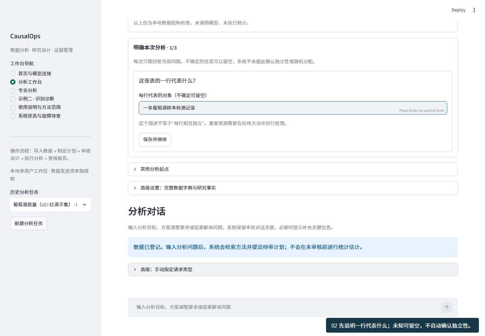
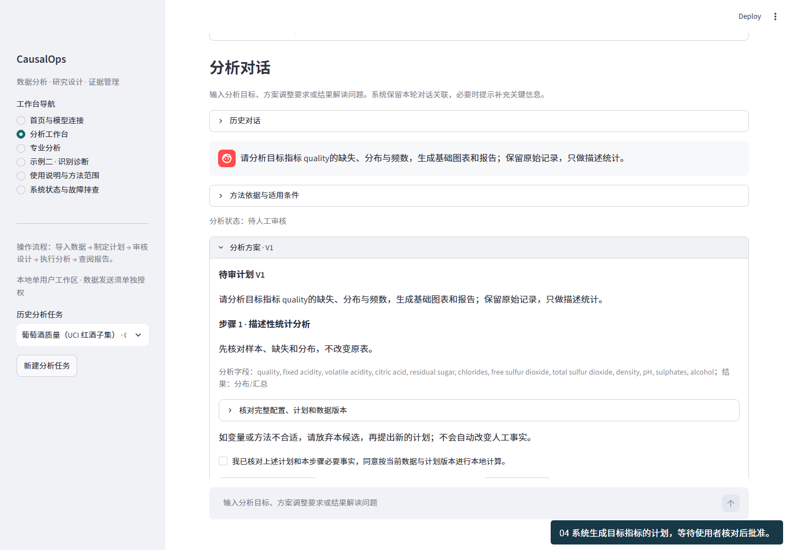
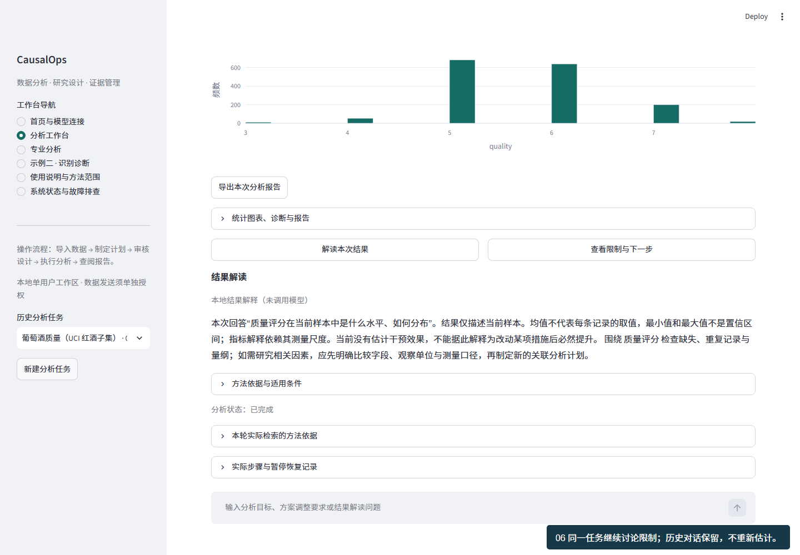

# 完整示例教程 · 0.14.0

从空白工作区开始，完成示例导入、目标定义、计划审核、统计计算、结果解释、报告导出和恢复。无需 API 密钥，无需预先编写 SQL 或选择统计模型。

[连续操作录屏](../assets/first-use-tutorial.webm) · [安装说明](INSTALLATION.md) · [模型与隐私](PROVIDERS.md) · [验收口径](VALIDATION.md)

## 1. 启动与首页

按安装说明启动，打开终端本次提供的本机地址，确认顶部显示 CausalOps 0.14.0 和构建号。首页“开始分析”提供 **导入分析数据** 与 **载入葡萄酒示例**；模型连接位于下方折叠区，可跳过。

载入示例会校验随包数据的 SHA-256，创建本地任务，只做数据结构检查，不执行统计、不发送模型。每次点击新建任务，旧记录保留。

## 2. 样本来源与边界

本例为 UCI Wine Quality 红酒子集，1,599 行、12 列，11 个理化特征及 quality 感官质量评分。原始分号分隔 CSV 未修改取值、未去重。缺失单元格 0 个、完全重复记录 240 条。重复不自动等于错误，是否删除须核对采样过程。

来源：Cortez 等（2009），[UCI 官方页](https://archive.ics.uci.edu/dataset/186/wine+quality)，[DOI](https://doi.org/10.24432/C56S3T)，[CC BY 4.0](https://creativecommons.org/licenses/by/4.0/)。数据许可独立于 MIT 代码许可。原始文件 SHA-256：`4a402cf041b025d4566d954c3b9ba8635a3a8a01e039005d97d6a710278cf05e`。

数据没有随机实验分配、处理时点或商业成本，可研究分布与关联，不能直接证明改变理化指标能提高质量，也不能据此计算利润。

## 3. 一行代表什么

在 **明确本次分析 · 1/3** 输入“一条葡萄酒样本检测记录”，点击 **保存并继续**。这来自公开数据说明，不代表已确认行之间独立。自己的表若不确定可留空；需要独立性的方法后续会另行核实。

## 4. 关注哪个指标

在 **明确本次分析 · 2/3**：

| 项目 | 本例输入 | 依据 |
|---|---|---|
| 本次关注的指标 | quality | 先了解质量评分分布 |
| 指标名称 | 质量评分 | 方便阅读，仍保留原字段名 |
| 指标单位 | 分 | 已核对公开字段说明 |

点击 **确认指标并继续**。不知道单位不要猜，可留空；目标未确定可选“尚不确定，先了解整体数据”。以后改变目标会建立新口径，历史结果仍按运行时目标解释。

## 5. 希望回答什么

在 **明确本次分析 · 3/3** 选择 **了解目标指标的分布**，点击 **确认目标并制定下一步**。系统检索依据并提出待审描述统计计划，不直接计算。

“分析指标之间的关系”先推荐具体问题；“了解措施或策略的效果”先核对处理、分配与时间等信息，不会把普通表当作 A/B 实验。目标未知可以保留未知。

## 6. 核对计划，必要时先提问

核对是否包含 quality 及需要的输出。最初批准按钮不可用，明确核对并勾选后才可点击 **接受计划并批准本次执行**。

可先问：“请说明当前方法的适用条件，不执行分析。”得到说明后，点击 **返回待审计划** 继续审核，无需新建任务。前序对话与计划会保留；调整方案时显示实际差异。普通聊天中的“同意”不构成执行批准，模型不能代替用户批准。

## 7. 阅读目标结论

完成后先显示 **分析结论** 与目标分布。本例 quality 有效值 1,599 个，均值约 5.636 分，中位数 6 分，最小值 3 分、最大值 8 分。

这些描述当前样本，不是措施实施后“提高了多少分”。最小/最大值不是置信区间，均值也不表示每条记录的评分。评分有有序量表含义，不应只凭均值判断所有质量特征。详细表格、其他字段与运行证据按需展开；主结论优先用户目标，不根据显著性挑字段。

## 8. 在同一任务继续追问

点击 **查看限制与下一步**，或问：

- 请解释质量评分的主要发现、实际含义和限制，不重新计算。
- 这些结果能否说明改变 alcohol 会提高质量？还需要哪些研究条件？

本地模式使用保存的统计与确定性解释，明确标记未调用模型；模型模式使用同一次运行证据并校验引用。结果解释不重新估计，新分析须生成新计划并审核。

## 9. 导出与恢复

点击直接可见的 **导出本次分析报告**。离线 HTML 首先解释目标，再附表格、图表、方法、范围、边界与证据。JSON 证据在详情区供技术核查。包含私人汇总的报告不应随意公开。

刷新后目标、对话、计划和结果应可恢复；侧栏可选择历史任务。停服务不删除工作区，重启后需重新填密钥。后续改目标不会改写旧结果。

## 10. 换成自己的数据

首页 **导入分析数据** → 选择 CSV / Parquet → 核对编码和分隔符 → 创建任务。一行一个明确对象，一列一个变量；不把截图、合并表头当分析表。当前限 50MB、10 万行、200 列，解码后限 256MB。

| 目标 | 至少要知道 | 系统自动处理 | 仍需核实 |
|---|---|---|---|
| 了解分布 | 正确文件，目标可未知 | 质量、分布、频数、图表 | 单位、重复的实际含义 |
| 分析关系 | 行含义、目标、候选变量 | 方法检索、待审方案、计算 | 独立性、合理控制变量 |
| 评估措施 | 处理、结果、分配、时间 | 方法匹配、门控、估计和诊断 | 随机化、外生性、无混杂、平行趋势 |
| 解释结果 | 当前任务选定运行 | 查询证据、解释幅度及边界 | 未提供的成本和市场规模 |

未知事实可留空，不通过随意勾选制造因果依据。关联模型不自动证明因果。

## 11. 可选模型连接

首页展开 **连接配置**，选服务、填 API 模型 ID 与密钥并测试；返回任务后单独授权发送字段摘要、问题、汇总及近期讨论。密钥只存内存，不发送原始行、用户/帖子 ID 值或论文全文。仅填写密钥不等于授权外发。

教程录屏为真实本地操作，不是所有模型的成功率，也不是独立用户完成率。外部独立用户验收仍待开展，见验收说明。
