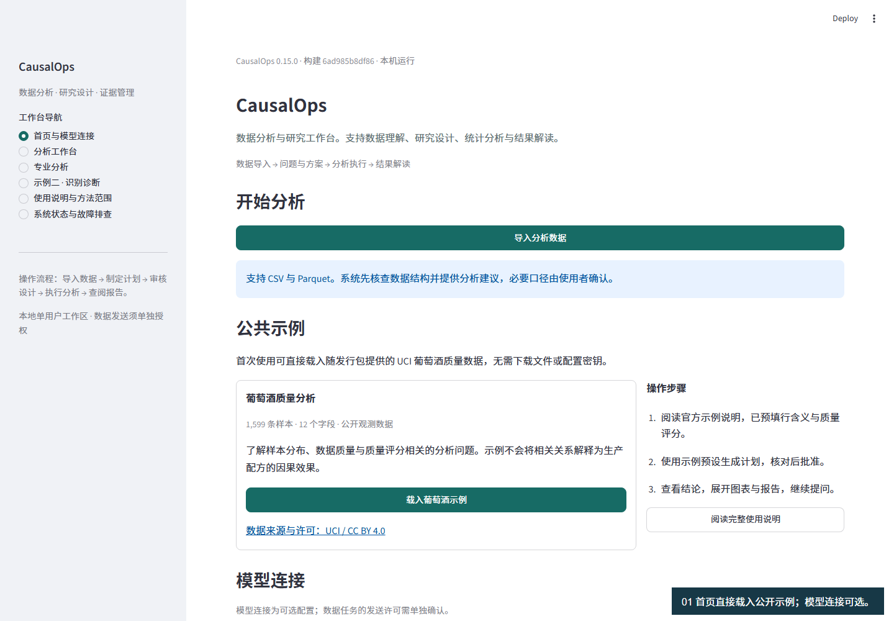
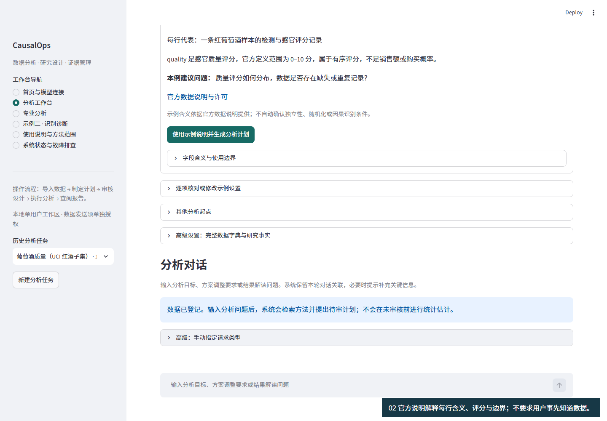
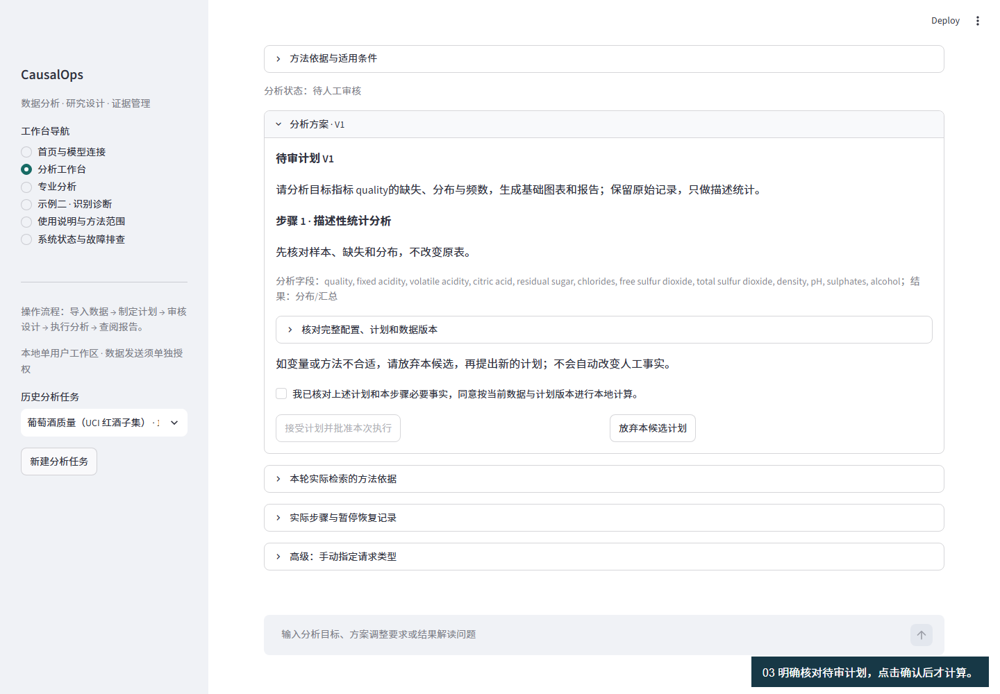
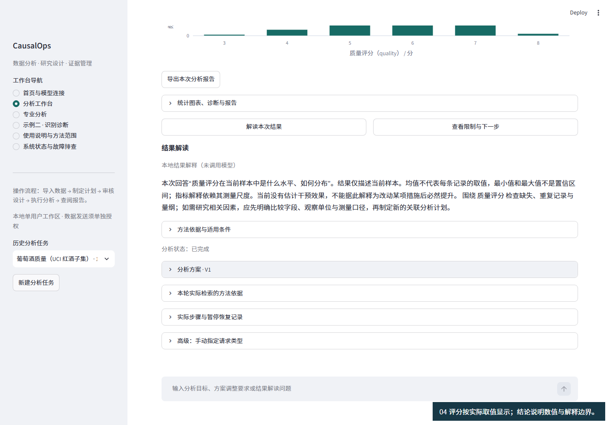
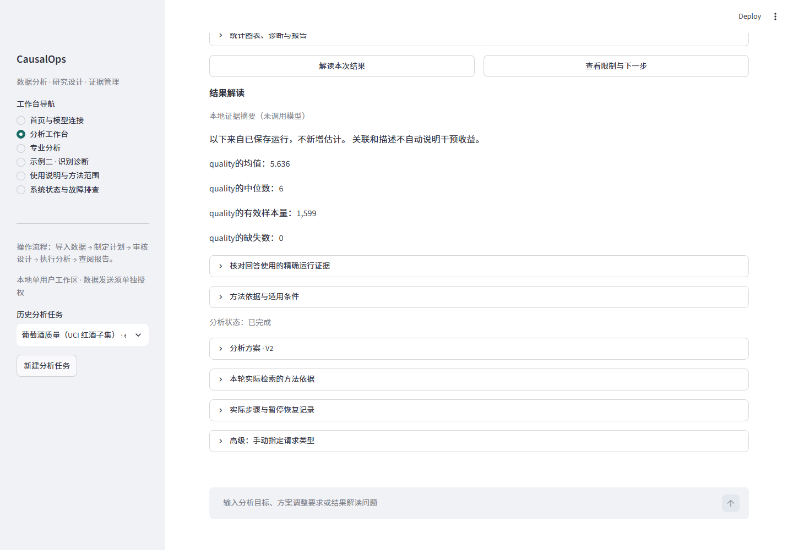

# 完整示例教程 · 0.16.0

**界面操作**　在首页载入葡萄酒示例，或在问题框填写问题后进入数据导入。新表的字段预览位于上传区右侧。工作台将研究讨论与计划分栏显示；已有待审计划时，切换到“人工审核”可并列核对方案和执行条件。结果页可展开研究报告预览并导出 HTML；侧栏“研究记录”提供本地任务与运行证据。手机点击顶栏菜单切换页面。

**当前工作区界面**　[首页](../assets/review-home.png) → [导入示例](../assets/review-workspace.png) → [审核计划](../assets/review-approval.png) → [分析结果](../assets/review-result.png) → [下载后的 HTML 报告](../assets/review-report.png)。

载入公开红葡萄酒样本后，“先了解数据”路径可以显式生成描述统计报告。“已有明确问题”路径先生成计划，核对并批准后才执行。点击“创建任务并检查数据”只登记上传表并核查结构。指标定义已知时，也可以在同一任务提出下一轮问题。

上方五张截图来自本次界面更新。下文按步骤保留 0.15.0 的历史演示和较早的 0.16.0 研究质量界面，用于核对操作含义；当前按钮位置请以上方截图为准。

首次体验不需要知道葡萄酒指标，不需要密钥，也不需要编写代码。公开数据说明、每行含义、质量评分和单位由经过内容校验的示例说明提供。

[0.15.0 基础流程录屏](../assets/example-015-guide.webm) · [安装说明](INSTALLATION.md) · [五类真实数据体验](REAL_DATA_EXPERIENCE.md) · [验收与边界](VALIDATION.md)

## 1. 载入示例

启动后核对页面版本为 CausalOps 0.16.0。首页点击 **载入葡萄酒示例**。这是 UCI Wine Quality 的红酒子集，1,599 行、12 列：每行是一条红葡萄酒样本的理化检测与感官评分记录。quality 为感官质量评分，官方定义范围 0–10 分，属于有序评分。

来源：[UCI 官方说明](https://archive.ics.uci.edu/dataset/186/wine+quality)、[DOI](https://doi.org/10.24432/C56S3T)，数据许可 [CC BY 4.0](https://creativecommons.org/licenses/by/4.0/) 独立于代码 MIT 许可。红酒原始文件 SHA-256：`4a402cf041b025d4566d954c3b9ba8635a3a8a01e039005d97d6a710278cf05e`。UCI 同时提供白酒文件，页面总览不应混用为本例行数。

## 2. 查看已准备的说明

示例页直接说明数据是什么、每行代表什么、quality 是什么，以及建议问题“质量评分如何分布，数据是否存在缺失或重复记录？”。字段说明包含中英文名称。没有成本、售价、品牌、处理时点或随机分配，不能据此计算利润或证明调整配方有效。

点击 **使用示例说明并生成分析计划**。这次点击确认采用可见的行含义、目标 quality、名称“质量评分”、单位“分”和描述性问题。只创建待审计划，不自动批准计算，不授予外部模型发送许可，也不确认独立性或因果假设。

如需改动，展开 **逐项核对或修改示例设置**。内容已预填，无需自己查找术语；自己的研究设置不会被示例快捷入口静默覆盖。系统按数据内容识别示例，不只看文件名；把其他文件改名为 winequality-red.csv 不会套用葡萄酒含义。

## 3. 审核与执行

查看待审计划的字段和输出。勾选“我已核对上述计划和本步骤必要事实，同意按当前数据与计划版本进行本地计算”，再点 **接受计划并批准本次执行**。聊天中只说“同意”不能授权执行。

如果还不理解，可以先问方法适用条件，再通过 **返回待审计划** 继续核对。修改数据、目标、日期或计划后需要按新版本审核；日期或目标改变时，新口径不会沿用旧研究声明。

## 4. 理解质量评分与图表

先显示目标结论和主图。当前红酒样本 quality 有效记录 1,599 个，均值约 5.636 分，中位数 6 分，实际出现的评分为 3–8 分。评分频数图按实际整数取值展示，不再以连续小数区间切割。

这些是本样本的分布，不是某项措施“提高了多少分”。观察范围不是置信区间，均值不代表每条记录。完全重复记录 240 条不自动等于错误，程序未删除；应结合采样过程判断。

## 5. 继续一个新问题

点击 **查看限制与下一步**，或问“我还可以研究什么？”。后者进入针对已登记目标的问题推荐，不再机械重复上一份均值结果。

选择“质量评分与其他指标的关联”下的 **制定分析方案**。系统会保存所选建议的序号、问题与两个字段，生成新的待审计划。先前结果会标明为旧结果，新计划未审核前不会计算。审核执行后，两个字段的主图展示 Pearson 和 Spearman 系数及成对有效样本数，三个及以上字段展示相关矩阵，结论说明目标变量对及实际系数。

相关只表示共同变化，不能证明增加某理化指标会改变评分。没有预设随机分配、处理前后或成本时，不能从这张表推算生产策略收益。

## 6. 报告与恢复

点击直接可见的 **导出本次分析报告**。HTML 先给本次问题的结论，再附图表、口径、数据质量和证据。刷新后任务、计划与结果仍可恢复；旧结果继续绑定原口径，不随新输入改写。JSON 证据位于详情中，私人报告不要随意公开。

## 7. 上传自己的表

首页 **导入分析数据** → 选 CSV / Parquet → 创建任务。CSV 默认保守识别逗号、分号、制表符；存在多个可能解释时要求手动确认，不猜测。可在“文件编码与分隔符设置”中指定编码及分隔符。原始记录不去重、不填零、不修改。

自己的表仍按三步确认行含义、目标字段及单位、分析意图。第二步发现日期候选时，可以选择 **日期字段（可选，用于时间图）**；不确定就跳过。year 等纯数值不是完整日期，不能直接当日期解析；季度数据需按实际来源构造并明确日期含义。

缺失统计指实际空值；unknown、-1 等业务代码不一定是空值，需按领域说明核实。字段名和数值编码不自动证明业务含义、独立性、随机化或处理前测量。

## 8. 模型连接与使用边界

首页可选连接模型，服务商、API 模型 ID 与密钥均需对应；每个任务单独控制摘要外发。密钥只存内存，不发送原始行、用户/帖子 ID 值或论文全文。视频使用本地模式，字幕为步骤说明，不是模拟任务进度。

当前支持本机单用户；上传限 50MB、10万行、200列，解码后限256MB。不能把脚本验收称为独立陌生用户成功率或工时节省。

## 9. 研究范围、质量检查与下一轮任务（0.16.0）

[0.16.0 实际操作录屏](../assets/research-016-demo.webm)：本地模式，公开葡萄酒数据，涵盖示例导入、明确审核、结果解读、下一轮关联计划与刷新恢复。无配音；研究质量面板见下方图文。

确认使用内置葡萄酒说明后，系统带入 UCI 来源、红酒子集的适用范围、保留原始记录的说明，以及观察性数据的解释限制。只有文件内容校验一致的内置示例才能使用这些预填值；其他数据仍需要自己的来源与口径。

打开 **研究摘要与待确认事项**：先核对系统理解的问题、目标和分析单位，再看来源、对象及待确认项。点选某项分析建议后，这里显示已经保存的具体计划目标，不以“采用第2项建议”代替研究问题。

若要补充适用对象或数据来源，点 **补充研究范围与字段口径**，在“研究范围”页填写已知信息，未知留空。这里只登记口径；填写纳入条件不会自动删除或筛选原数据。修改后另建计划、重新审核，旧结果仍对应原来的口径。

分析完成后，先阅读目标指标结论和图表，再打开 **研究范围、计算依据与待解决问题**。其中列出实际方法、样本口径、诊断问题和建议下一步。逐字段有效样本不同的描述统计不会被写成一个共同模型样本量。

报告下载包含相同的研究范围、计算设置、方法来源及版本信息。缺少价格和成本时，报告不会给出虚构收入或利润；有关联不代表改变某成分就会改善质量。后续建议只创建新的待审计划或方法咨询，不自动接受或执行。

上述操作由开发者脚本在真实公开数据上验收，尚不是独立用户研究。
