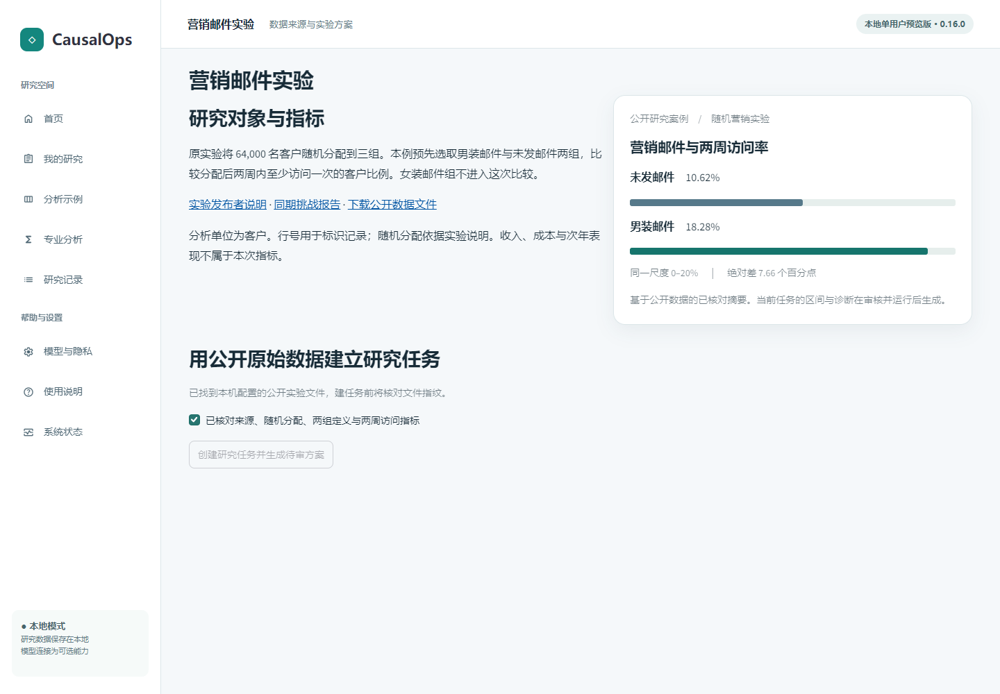

# 公开营销实验教程 · CausalOps 阶段性公开测试版

> 本页为旧版单次营销研究路径，截图保留历史日期；新增五步工作台请使用[当前自动化教程](AUTOMATION_GUIDE.md)。两条路径分别验收。

**已验证的操作**是用公开原始数据建立单用户任务，核对两组与两周窗口，批准后计算、下载报告并引用本次运行。**需要人工判断的部分**包括换指标、换观察窗口和因果解释；只读追问若打开待审页，请回到原报告核对来源。**后续规划**中的多表联合研究和多人审批不属于本教程。真实人类用户独立完成率尚未测量。

从首页开始，用 Hillstrom 公开实验回答“分配男装营销邮件后，客户两周内的访问率与未发邮件组相差多少？”全程可使用本地模式。本页截图采自 2026-11-05 的独立安装，使用本机配置的公开原始压缩包。首次使用前请先[安装并启动工作台](INSTALLATION.md)。

## 1. 在首页选择案例

点击 **查看营销实验**。右侧两条横条展示已核对的公开汇总。只有完成后面的计算，才会产生属于自己任务的报告。

## 2. 导入原始文件并确认指标

在案例页下载原始压缩包，将 **.csv.gz** 直接上传。也可在启动前将 `CAUSALOPS_HILLSTROM_ARCHIVE` 设置为本机已有文件的路径。文件指纹不一致时，重新使用案例页指定的压缩包；自己的营销表请走首页的 **导入分析数据**。

对照实验说明核对三项事实：一行对应一位客户，比较男装邮件和未发邮件两组，指标为分配后两周内是否访问。勾选确认，点击 **创建研究任务并生成待审方案**。此时可以核查计划，尚未产生统计估计。

## 3. 核对计划并批准

研究工作台显示当前问题与方案。在 **人工审核** 视图，左侧查看变量、目标和方法，右侧核对程序检查及需要研究者确认的声明。若样本或窗口有误，先修订方案；核对无误后，点击 **接受计划并批准本次执行**。

## 4. 读懂结果并导出

对照组访问率 10.62%，男装邮件组 18.28%，差值约 **7.66 个百分点**。以对照组访问率为分母，相对增幅约 **72.14%**；报告中的 95% 区间对应绝对差。点击 **导出本次分析报告**，可在本地浏览器打开 HTML。

## 5. 继续提问或恢复任务

可问“换算成每千名客户，差异约是多少？”并检查回答引用的运行。若问“明年的净利润增加多少？”，本次两周访问结果没有足够的收入、成本或时间信息支持回答。退出后从 **研究记录** 找回该任务。改变指标或观察期时，需要重新核对口径与方案。

### 复核本次答复

在对话框输入“请只读取本次已保存报告：男装邮件与未发邮件组的两周访问率相差多少个百分点？请给出来源。”本次实测回答引用了运行 `e86809a38196401995cf32b79c6f9196`，给出两组访问率、7.66 个百分点的绝对差和 7.00 至 8.32 个百分点的置信区间。你的运行编号会不同。核对答复末尾的运行来源、研究报告和指标窗口；若追问被送入待审页，可以返回原报告，检查当前选中的运行。切勿为阅读旧结果而批准新计算。

## 其他起点

| 目的 | 首页操作 | 先看什么 |
|---|---|---|
| 无需下载，了解数据分布 | **载入葡萄酒示例** | 质量评分分布与有效记录；需要完整报告时点击 **生成完整描述统计报告**。 |
| 学习识别假设 | **进入政策评估示例** | 切换两种合成趋势情形，核对处理前诊断及解释边界。 |
| 导入自有表 | **导入分析数据** | 选择 CSV 或 Parquet，先检查每行含义、指标与数据质量，再提出研究问题。 |

[样本、数据来源及数值核验](PHASE2_ACCEPTANCE.md) · [历史界面版离线教程](TUTORIAL.html) · [完整功能手册](COMPLETE_MANUAL.md)
