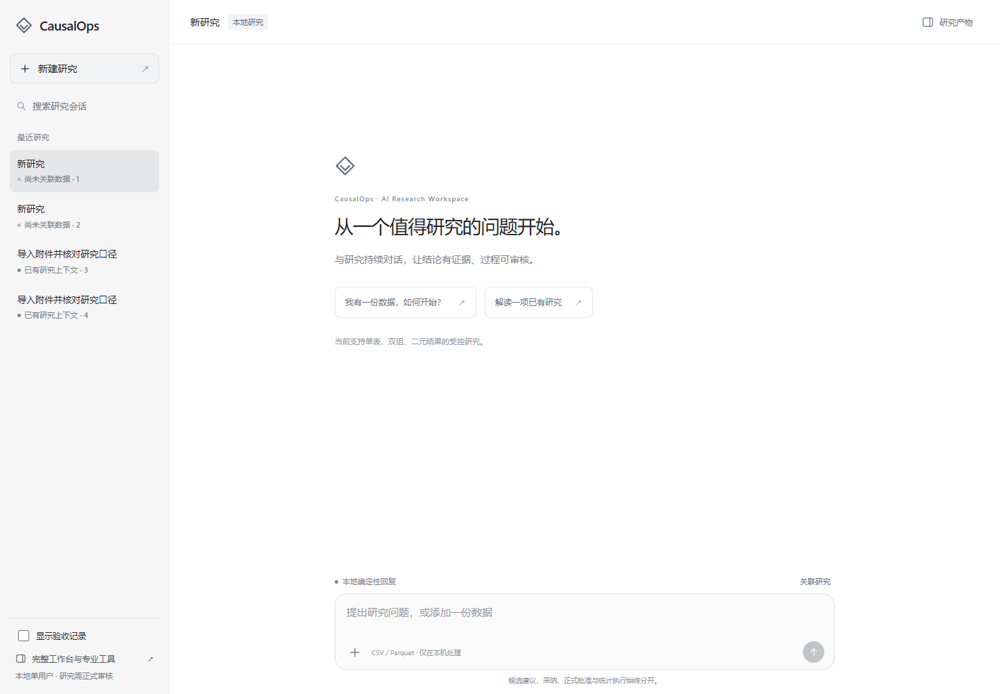
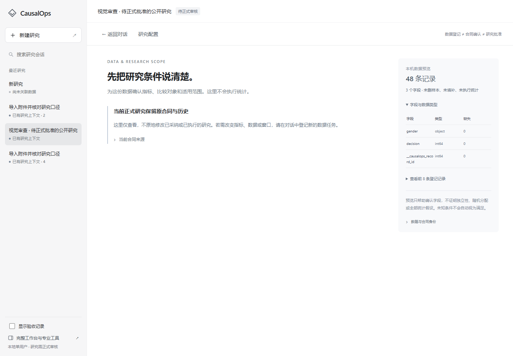
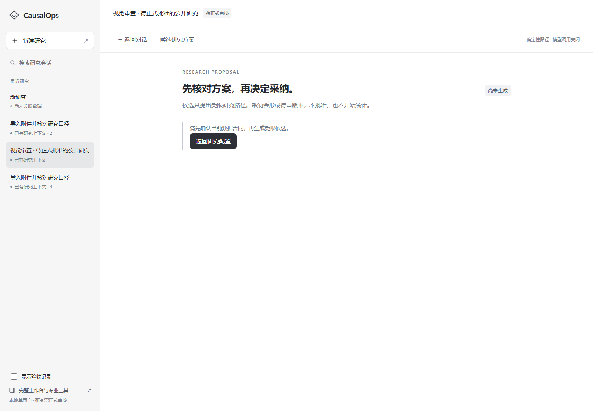
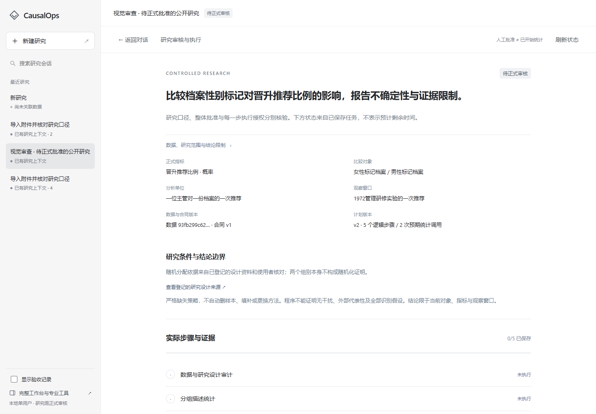
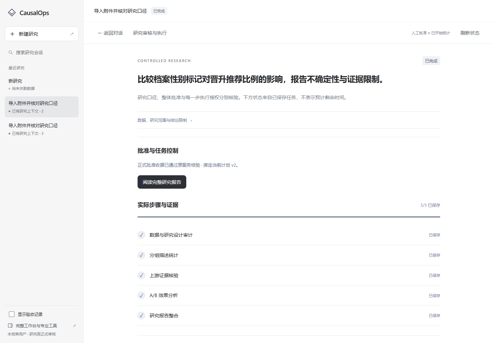
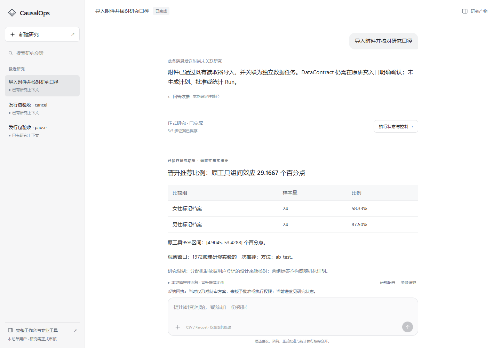
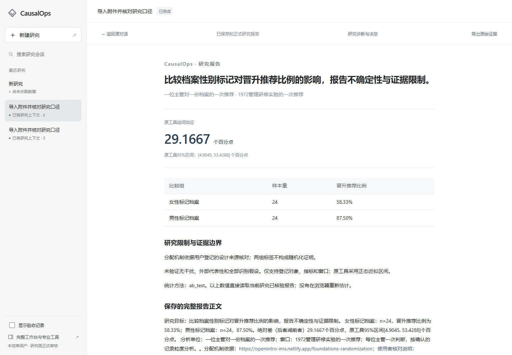
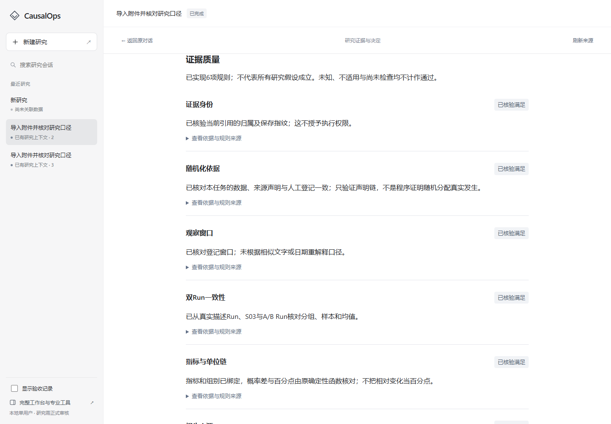
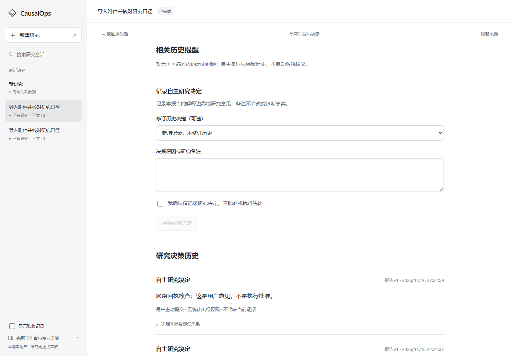
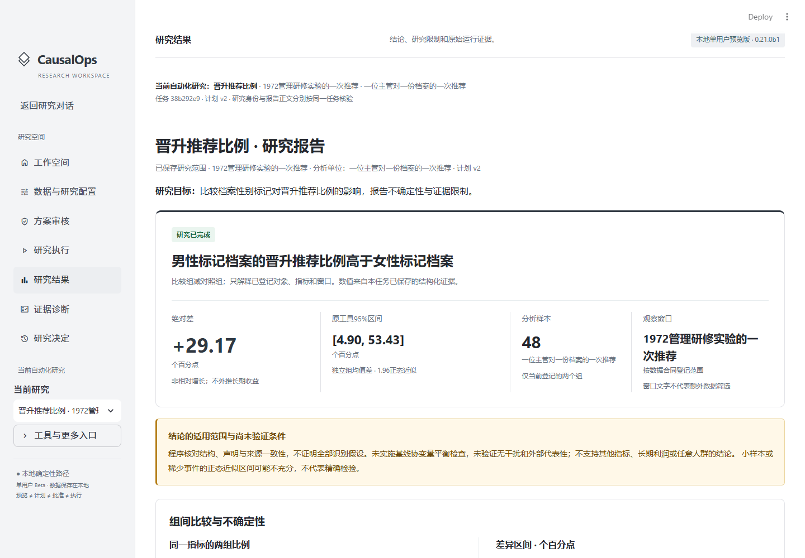

# CausalOps 0.21.0b1 · React研究工作台完整教程

本教程使用真实、脱敏的公开或合成任务截图。页面来自安装后的wheel，浏览器操作是自动化验收，不是真人使用研究。软件仅为本地单用户、单表双组二元受限研究，不能执行任意自然语言任务。

## 开始与恢复会话

按[安装说明](INSTALLATION.md)运行`causalops-workbench --workspace .\causalops-workspace`。默认打开React，左侧新建研究、搜索或选择已有会话。会话和研究任务是不同身份；切换标题不等于改变数据。空会话没有计划、批准或Run。

长对话在消息区独立滚动，底部输入保持可用。右上“研究产物”打开当前任务的正式数据、计划、状态与报告；窄屏使用可关闭面板。不要把历史消息的发送时上下文当作当前执行状态。

## 上传自己的数据

点击附件入口选择CSV或Parquet，再明确发送。仅选择文件尚未登记。文件上限20MB，默认本机处理。核对上传后的真实字段、记录数和示例；不要上传未授权私人数据。

## 确认数据合同

打开“配置研究”，选择分组字段、两组编码与含义、二元结果及正负编码。填写指标、分析单位、记录粒度、整表观察窗口及设计来源。确认项默认不勾选；独立观察单位和随机化设计依据是研究事实，不能由模型或两组均衡自动确认。

随机化依据缺失时保持未知。系统只允许描述路径，不自动删样本、填补、筛选日期或替换方法。更换指标、组别、窗口或数据需要新的候选与正式审核，旧研究不会被覆盖。

## 候选方案与采纳

React优先提供已验证的确定性路径：描述性4逻辑步/1次工具；符合登记条件的A/B五步/2次工具。查看完整步骤、依赖、口径、方法、预算和限制，再显式采纳。

采纳只形成待审方案，不创建批准或Run。React当前没有模型辅助候选配置入口；已有受约束模型路径通过完整Streamlit工作台使用，必须保留授权、预算及结构化校验。模型关闭不影响确定性模板。

## 正式审核与独立开始

审核数据版本、DataContract、目标指标、单位、比较组、窗口、计划版本、步骤、研究条件与预算。正式确认默认不勾选。明确提交批准后，再单独点击“开始已批准研究”。聊天中的“同意”“执行”不授予权限。

## 执行、暂停、取消和恢复

步骤进度来自后台持久化状态，不是倒计时。描述统计与A/B各有独立Run。上游证据门禁失败停止下游；统计显著性不是继续条件。

暂停在当前步骤安全边界生效，不会立即强行中断计算。取消是终态，保留已有Run，不能用旧恢复按钮复活。恢复由原服务核查数据、计划、批准、依赖、预算、作业所有权及已有Run；不确定结果先调和，不能盲目重算。页面刷新只读状态，不重复派发。

## 阅读结果与证据

返回原会话查看两组样本和比例、绝对差及百分点单位、原工具区间、研究范围和限制。完整报告逐层展示研究事实与来源，导出保留原始精度。

未知随机化的描述路径不包含A/B Run或推断区间。比例与百分点不同；档案推荐不等于实际晋升，两周访问不等于长期利润。来源冲突或缺失会限制结论，不用另一个任务的成功报告补数。

## 显式研究诊断

点击“查看研究诊断与决定”，首次只读取历史；明确点击检查才生成诊断。三层分别为研究结果、证据质量、下一步建议。六项确定性规则显示实际五态，未知、不适用、尚未检查不等于通过。其余八项未实现，没有总体可信度分数或后台持续监控。

## 研究决定与历史

对真实建议明确选择采纳、暂缓或拒绝，填写原因、勾选仅记录决定后保存；无建议时可保存自主研究决定。保存回执后可返回会话并刷新查看历史。修订追加新记录，不覆盖旧文；旧来源或跨任务关联被拒绝。确定性历史提醒仅针对可靠匹配的同任务问题，自由备注不作语义推断。

研究决定不是需求草案、正式计划、批准或执行。需要创建无权限需求草案、使用17项专业方法、原单次研究或配置模型时，从左侧底部“完整工作台与专业工具”进入Streamlit。两端共享同一工作区，返回React后刷新当前合法来源。

## 常见限制

- 源码、数据、合同或计划版本变化后旧批准可能失效；不能手工修改批准或Run。
- 模型/外部服务不可用时继续使用确定性路径；原始数据不会默认外发。
- 遇到端口或启动异常使用`--diagnose`与工作区runtime日志，不能连接未知服务冒充当前任务。
- 工程与浏览器验收不等于真人可用性验证。目前没有真人独立使用正式验收数据。

[安装与故障处理](INSTALLATION.md) · [功能覆盖与未迁移入口](../releases/react-workspace-beta/COVERAGE.md) · [限制和安全](../releases/react-workspace-beta/SECURITY_AND_LIMITS.md)
