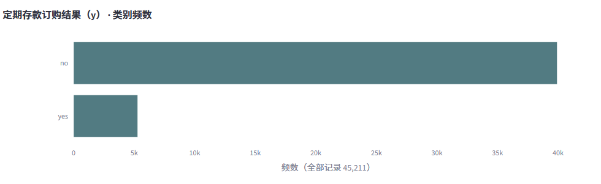
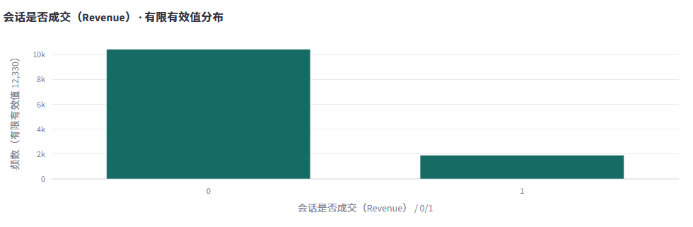
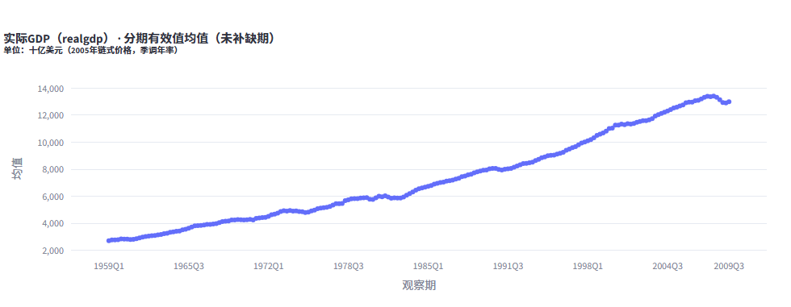

# 五类真实数据的体验检查 · 0.15.0

本轮以使用者的操作路径测试，记录失败后修复再重跑。它是开发者视角与实际浏览器自动化，不是独立用户研究。网页测试均从新任务导入，使用本地模式；外来表的行含义和目标语义由测试者按官方说明输入，没有预置科学假设。

| 数据 | 本次范围 | 实际体验路径 |
|---|---|---|
| [UCI 红酒](https://archive.ics.uci.edu/dataset/186/wine+quality) | 1,599行，12列 | 说明与预填 → 描述 → 追问 → 研究建议 → 新相关计划 → 审核 → 热图 |
| [UCI 银行营销](https://archive.ics.uci.edu/dataset/222/bank+marketing) | 网页使用原始 bank-full：45,211行，17列 | 分号CSV自动识别 → 分类目标 y → 水平频数图 → 报告 |
| [UCI 电商会话](https://archive.ics.uci.edu/dataset/468/online+shoppers+purchasing+intention+dataset) | 12,330行，18列 | Parquet → Revenue 二元编码 → 1取值比例 → 报告 |
| [Hillstrom 邮件实验](https://blog.minethatdata.com/2008/03/minethatdata-e-mail-analytics-and-data.html) | 42,613行，14列；男装邮件与不发邮件两组子集 | Parquet → visit 二元目标 → 分布与解释边界；本路径不自动批准 A/B |
| [statsmodels 宏观数据](https://www.statsmodels.org/stable/datasets/generated/macrodata.html) | 203行，原始14列加1个明确派生日期列 | 日期确认 → realgdp 分布与季度时间图 → 报告 |

所有数值计算使用上述范围全量行，没有为提速偷偷抽样。Hillstrom 原始挑战含64,000名客户和三个随机分组，本次使用已记录的两组子集，不将子集说成原始全样本。电商 Revenue 在既有预处理中由布尔值转为0/1；银行命令行复测另用18列的既有准备表，其中 subscribed 由 y 派生，网页用17列原始CSV，不能混为同一文件。宏观日期由 year/quarter 构造成季度首日，不是重新采集的日期。

## 发现与修复

1. **示例不知道怎么填**：仅对内容哈希匹配的内置示例提供官方说明、字段释义及预填；确认后才登记，仍不批准计算。
2. **不同问题仍返回相同表**：明确“还能研究什么”等自然表达进入问题推荐，问题卡优先登记目标；新旧结果区分展示。
3. **推荐两个字段却丢了一个**：选择建议传递序号、具体问题和字段；相关计划保留两个明确变量，不覆盖人工设定的自变量角色。
4. **整数评分被切成小数箱**：低基数整数以实际取值频数显示。0/1结果报告有效记录中1的占比，不称作业务提升。
5. **分类图难读**：水平条形图、较长标签截短但悬停保留全文；说明分母、缺失与前20类之外记录。
6. **图与问题不对应**：相关矩阵、关联系数区间图、时间图按任务优先；描述目标仍绑定运行时口径。
7. **日期入口过深**：基础引导提供可选日期角色。候选仅由字段名或存储类型提示，不自动确认时间含义；更换日期清除新口径中的旧研究声明。
8. **长期时间图拥挤与单位裁切**：仅抽稀横轴文字，保留全部观测点；长单位改为水平副标题，不改变保存的统计量。
9. **上传分号表变成一列**：默认保守识别分隔符，歧义文件提示手动选择，原文件不变。

## 仍需完善和验证

- 外来表的单位、编码、unknown/-1含义和采样设计需要数据字典或业务说明；不能只靠列名推断。
- 预测、时间序列建模和因果识别不是一张描述图自动具备的能力。当前时间图不预测、不插补缺期。
- 模型解释仍可能给出重复已有输出的建议，应继续完善输出清单和领域语义提示；不能把措辞流畅当作方法正确。
- 尚未让未参与开发的真实用户独立操作，也未测量完成率、返工或节省工时。其他服务商不等于全部真实账户实测。
