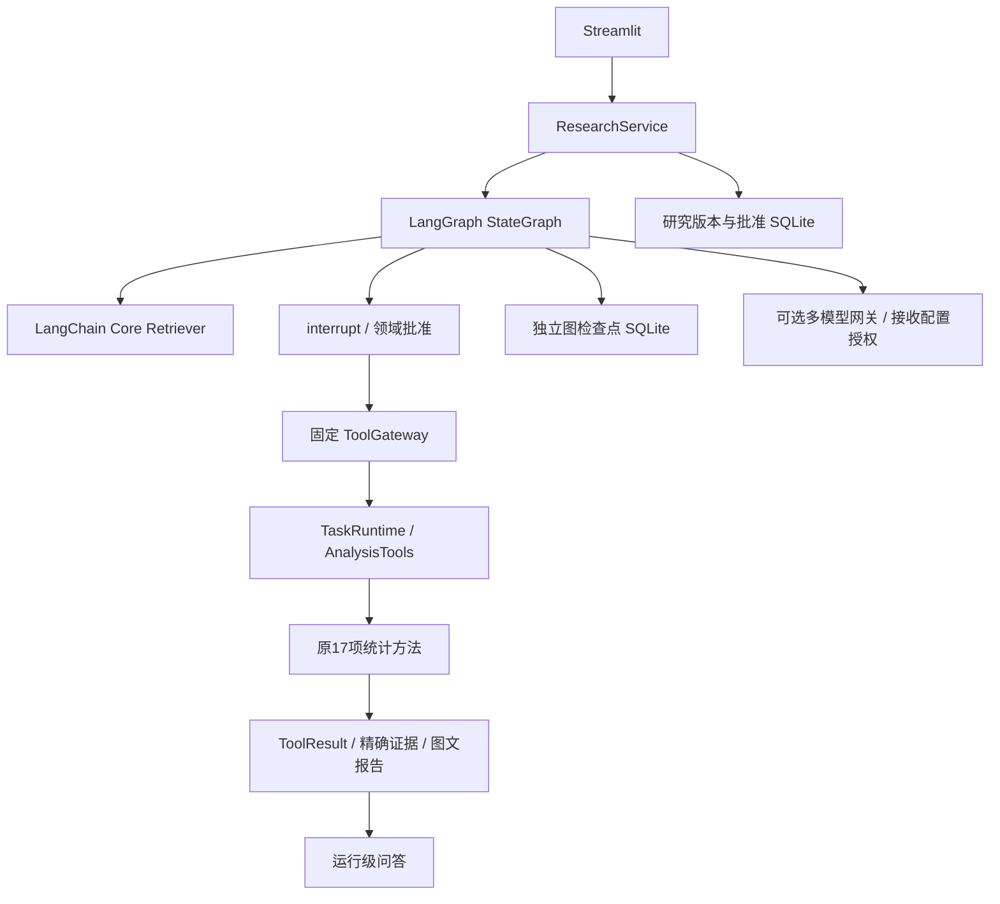
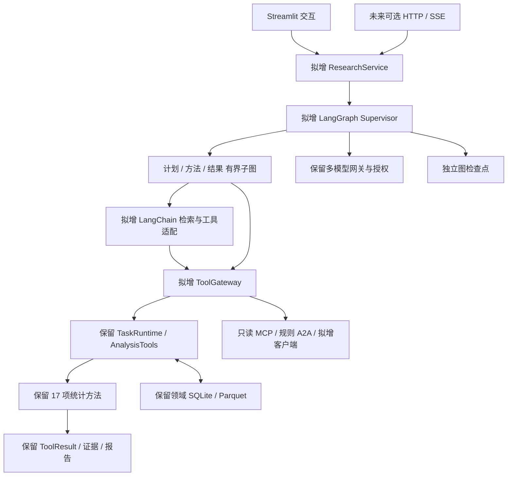
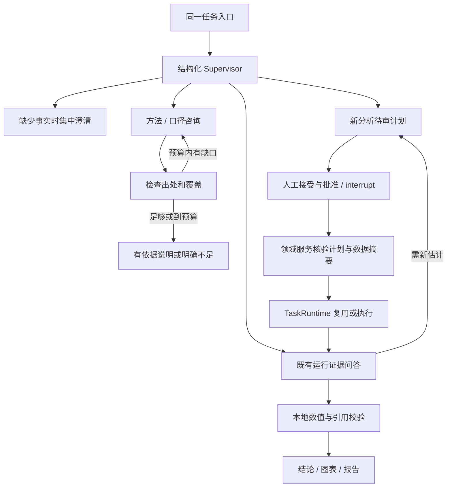
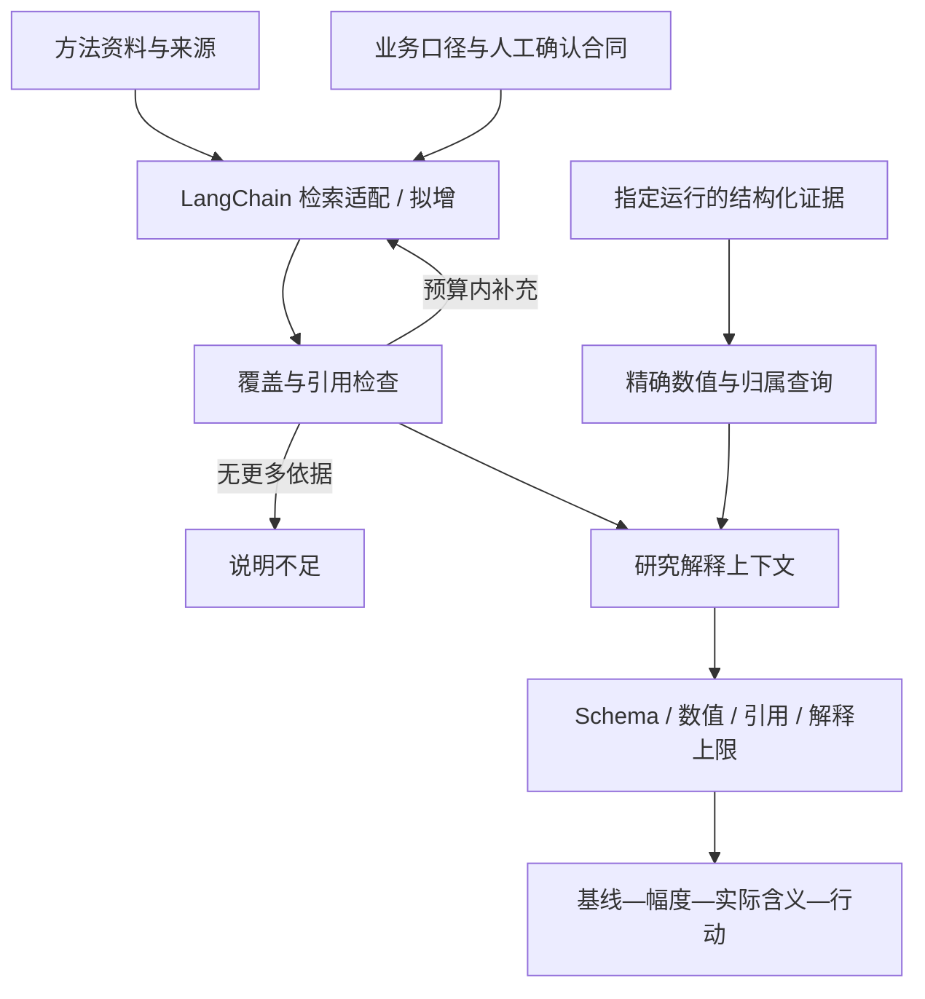
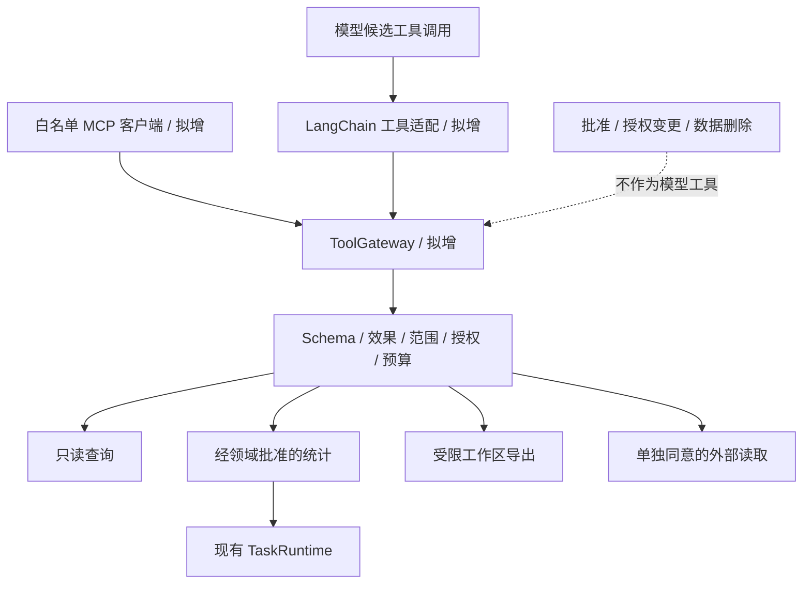
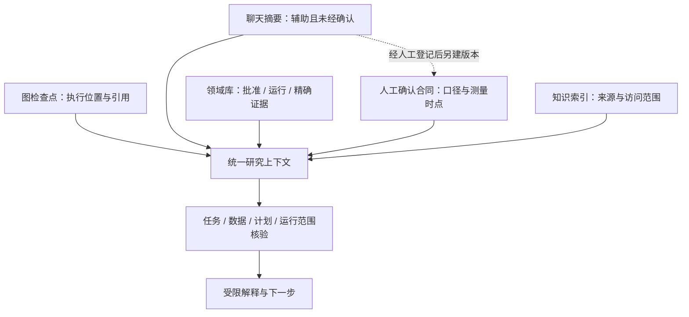
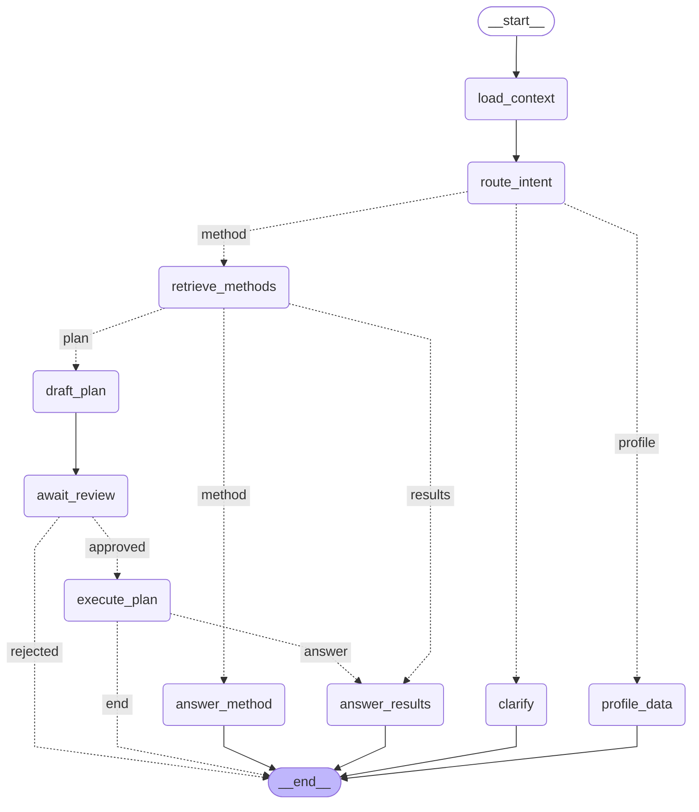

# 架构图源

0.8.0首个闭环已实现；当前实现与完整目标图明确分开。完整目标中的后续条目尚未全部运行，版本依据见[架构核查](../ARCHITECTURE_REVIEW_0.7.0.md)。所有图为CausalOps原创，不复制飞书图示。

## 当前实现

## 目标职责

## 研究工作流

## 检索与精确证据

## 工具调用边界

## 记忆与事实

## 从实际编译图生成的流程

