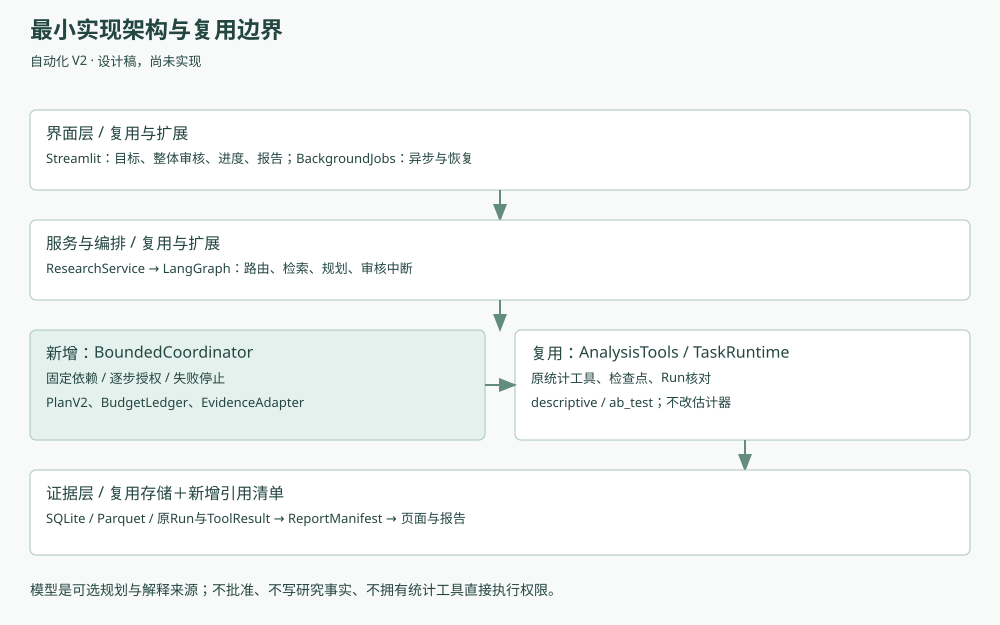

# 自动化 V2 源码可行性核查与最小实现设计
**2026-11-05｜只读核查｜代码基线5ac788f｜接口建议尚未实现**

本次核查的是本地文档基线所含产品代码，不声称这些后续代码都已公开至Beta远端。未运行评测或调用模型。行号是本基线定位辅助，文件链接为相对仓库路径；源码指纹见 SOURCE_MANIFEST.json。

## 1. 七个核心问题的结论
| 问题 | 真实现状 | V2所需变化 |
|---|---|---|
| 多个真正独立的统计执行？ | **有**。Step含tool/config/reason；Plan最多5步。accept为每个ordinal建assistant_tasks，execute逐项调用工具，能够生成多个Run | 不再笼统称“当前只有单步”；新增显式step_id、类型、依赖，V2上限6，与旧schema版本隔离 |
| 引用上游真实结果？ | **没有通用合同**。execute每步使用同一upload和自己的config/facts，未解析上游输出引用 | 新增有类型EvidenceRef；gate读取已保存Run及hash，不传任意表达式 |
| 按上一步结果决定执行？ | 现有执行循环捕获异常将该步记blocked后仍可继续下一项；只有取消检查会break。图在整个execute返回后判断是否全部完成 | 新协调器先检查依赖并fail-stop；旧循环不能直接作为V2调度器 |
| 步骤身份和持久化？ | **已有**UUID任务、ordinal、计划hash、result、checkpoint、attempt及所有权token | 增加稳定逻辑step_id、上游证据hash和gate结果；无需复制统计结果数据库 |
| 程序重启安全恢复？ | **部分已有**。TaskRuntime进程出生身份，AssistantWorkspace.recover和Tools.reconcile；BackgroundJobs识别中断；Graph使用SQLite checkpoint | 扩展依赖、预算与任务状态恢复。跨文件/DB未保证原子性，不承诺任意故障恰好一次计算 |
| 批准固定整份计划？ | **已有基础**。plan_sha覆盖步骤配置，审批还绑定data、contract、knowledge、code、facts、scope；verify在Gateway及execute入口调用 | 原循环内部未逐步调用完整verify；V2每步派发前重核依赖/授权/预算，绑定新合同字段 |
| 营销必要计算能否完成？ | **能**。descriptive支持grouped样本与均值；ab_test输出ITT均值差、独立组标准误与正态近似95%区间 | 不改估计器。需新增结构化gate和两Run报告整合；原表三组需预先生成已审核两组分析表 |

## 2. 真实调用链与源码定位
| 源码（基线行号） | 调用者 → 主要函数 | 输入、输出与状态 | 复用分类 |
|---|---|---|---|
| [UI营销入口](../../../src/causalops/ui/marketing_case.py) render | Streamlit → cohort/ResearchService | 固定公开包、用户事实确认 → 创建任务、保存合同、start(mode=plan) | 可复用导入入口；V2新增完整计划视图 |
| [公开数据适配](../../../src/causalops/sample_data/hillstrom.py) cohort/contract，14/27附近 | UI调用 | 包hash检查、选两组、源行index为entity_id；输出CSV与合同模板 | 直接复用，补来源/转换收据；不能把源行index当随机化证据 |
| [BackgroundJobs](../../../src/causalops/application/background.py) submit_start30 / submit37 / reconcile95 / resume107 | UI → 后台队列 → ResearchService | 单worker、持久Job、内存凭据、重复job索引、进程恢复 | 可复用，增加V2投影/预算接管 |
| [ResearchService](../../../src/causalops/application/research_service.py) begin104 / graph192 / review322 / verify_approval363 | UI/Jobs → 主图与批准 | flow/data/contract绑定；SQLite图checkpoint；批准收据 | 需修改接入V2，保留旧入口 |
| [研究主图](../../../src/causalops/orchestration/research_graph.py) build_graph29 | ResearchService._drive → 节点 | load→route→retrieve→draft→interrupt→execute→answer；节点是业务阶段而非统计依赖图 | 主框架复用；execute节点内部接协调器 |
| [方法研究子图](../../../src/causalops/orchestration/method_research.py) build_method_graph95 | retrieve_methods | 候选方法、检索、条件评估，输出引用/缺失事项；不是工具结果依赖执行 | 直接复用知识来源，模型请求须纳入预算 |
| [DataContract](../../../src/causalops/application/data_contracts.py) DataContract33 / save96 / bound127附近 | 服务/审核 | 单表版本口径、metric_window、measurement、method_facts，人工明确保存 | 直接复用主体；增加可追溯来源收据引用 |
| [研究审计](../../../src/causalops/application/research_quality.py) audit_research10 | 服务/页面 | frame+body→checks/count/action；assumptions_verified=False | 复用，适配成新AuditEvidence |
| [计划就绪](../../../src/causalops/application/task_readiness.py) plan_readiness44 | 生成、审核 | 字段/语义/顺序/schema检查及必要人工事实；不等同于识别假设证明 | 复用并扩展V2合同校验 |
| [Plan与助手](../../../src/causalops/assistant/service.py) Step33 / Plan38 / propose202 / accept265 / execute320 | 服务、Gateway | 提案和候选校验、版本化、每步执行、结果持久化 | Step/Plan版本扩展；V2不能直接复用旧顺序循环 |
| [TaskRuntime](../../../src/causalops/assistant/runtime.py) claim62 / checkpoint80 / finish85 / cancel105附近 | execute/recover | SQLite事务、所有权token、input_sha、attempts；默认最多3次 | 保留底座；V2配置首次＋1次，加入依赖/预算一致性 |
| [工具合同](../../../src/causalops/assistant/contracts.py) REGISTRY24 / ToolResult32 / AnalysisTools46 | 助手执行器 | method、prepare、execute、reconcile、envelope；Run/hash/claim | 复用原工具；外围gate，不改估计器 |
| [探索统计](../../../src/causalops/general/exploration.py) ExplorationDesign16 / describe76 / run180 | AnalysisTools | numeric/group配置→summary.grouped；JSON输出、SQLite路径hash | 直接复用descriptive |
| [通用研究](../../../src/causalops/general/service.py) GeneralDesign23 / prepare85 / save185 / execute | AnalysisTools → 原研究域 | 两组、单位、缺失规则、metric→版本化研究及运行 | 直接复用ab_test；原引擎门禁必须保留 |
| [随机实验估计器](../../../src/causalops/estimators/randomized.py) estimate_ab_test73 / _difference_in_means38 | 统计执行器 | 差值=treated.mean-control.mean；SE为两组样本方差/n之和开方；CI=差±1.96SE | 直接复用；非新增Welch t区间、非聚类实验 |
| [持久研究域](../../../src/causalops/research/repository.py) approve_revision501 / assert_execution_authorized606 / bind_analysis_run564 | 原统计执行链 | 数据版本、方案修订、批准、Run绑定与证据 | 直接复用，不以任务收据替代内部授权校验 |
| [结果解释](../../../src/causalops/results/interpretation.py) interpret_run133 | 报告/答案 | 保存数值、指标及解释输入→标准化解释 | 复用；跨步骤Manifest新增 |
| [事实和问答](../../../src/causalops/assistant/service.py) facts367 / ask454 | Gateway.answer | 指定任务的最多3个Run→数值事实、来源；本地回答或授权模型解释 | 两个统计Run可复用；需避免默认只选最后主Run |
| [模型客户端](../../../src/causalops/llm/providers.py) ProviderConfig20 / complete_json115 | AssistantWorkspace._call134 | provider绑定、schema、HTTP/输出验证、telemetry、物理attempt观察 | 复用；全任务预算为新增，不把局部retry当全局 |
| [N06状态](../../../src/causalops/ui/report_target.py) report_target20 / report_request45；[预览入口](../../../src/causalops/ui/onboarding.py) preview_actions87 | UI | 区分预览、正式目标、版本、当前Run；新指标产生候选 | 直接继承状态原则，V2页面为新设计 |

行号用于定位而非API兼容承诺。所有文件的内容hash和关键符号实测行号由本轮文档校验输出，见[源码清单](SOURCE_MANIFEST.json)。

### 新研究路径
UI → BackgroundJobs.submit_start → ResearchService.begin/continue_flow → LangGraph.load/route/retrieve → propose_researched → AssistantWorkspace.propose/validate/store → plan_readiness → interrupt。
人工review写真实收据，resume仅唤醒图，不自带批准 → ToolGateway.execute.verify_approval → AssistantWorkspace.execute再次验证 → TaskRuntime.claim → Tools.prepare/checkpoint/reconcile/execute → 原统计域批准与Run → ToolResult → 执行清单 → answer_results。

### 已有结果路径
选择明确任务和Run → 服务results路由 → Gateway.answer验证所有权 → AssistantWorkspace.facts/load/envelope核对来源 → ask的scope/数值/语义校验 → 本地确定性回答或模型解释。它不是新统计授权；V2只扩展整合报告的明确证据清单，不把只读追问转成自动研究。

### 当前与V2的关键差异
现有answer_results为执行后优先选择最后一个非descriptive主Run；虽然facts支持显式多个Run，却没有自动汇总依赖完成状态与全任务报告合同。V2必须传明确S02/S04清单，不能把主Run的回答当作整项任务所有步骤的完整报告。

## 3. 17项注册接口范围核对
注册来自三类设计模型和REGISTRY循环，不是17个独立HTTP接口。
- exploration / ExplorationDesign：descriptive、correlation、ols、logit、poisson。
- research / GeneralDesign：ab_test、cuped、regression_adjustment、psm、ipw、double_ml、did、aipw。
- advanced / AdvancedDesign：iv_2sls、rd_sharp、rd_fuzzy、staggered_did。

本轮通过源码静态清单核对5＋8＋4，未重新运行注册测试或统计估计。统计验证深度不相同。V2仅复用前述两项；不会因为有17项注册就让模型任意选择全部方法。

## 4. 数据与统计可行性
已核实原发布者说明随机分配三组、两周访问指标；本仓库cohort额外核对固定压缩包hash及两组计数。前者支持设计事实，后者支持数据版本一致，不能互相替代。

当前GeneralDesign要求恰好两组、不自动排除其他组；ExplorationDesign支持group但无通用任意筛选表达式。首版因此必须复用已知两组导入适配器，不承诺处理任意原始营销表的自动过滤。

S02输出真实grouped rows/finite_n/mean/std_ddof1。S03条件建议：两组正确、每组finite_n=rows且≥2、总数≥10、样本与审计一致、方差和有限且>0、指标/窗口/指纹相同。它只判断接口是否可执行，不做统计功效证明。常量一组且另一组有变异并非必然失败，条件应与原引擎一致。

S04无协变量时不会执行基线协变量平衡检查。报告必须明确“未实施”，不能根据有分组描述就写“基线平衡已验证”。首版不自动添加协变量或CUPED来充实报告。

## 5. 需新增的最小数据模型
不新增全局业务字典或独立统计事实库。建议在现有工作区数据库添加有版本的任务侧表：
- automation_plans：plan_id/version/schema/body/hash、parent、data/contract/source refs。
- automation_tasks：task_id/session/plan/status、approved_scope、budget_policy、stop_reason。
- automation_steps：task/plan/step唯一键，状态、input_hash、output_ref/hash、原assistant_task_id映射。
- automation_budget_events：请求预留/开始/回执/未知、revision、attempt、token/cost估算；只追加事件。
- automation_reports：manifest_id、各原Run引用、报告hash和完成性；不复制/改写原Run。

可复用assistant_tasks/checkpoints保存统计步骤，由automation_steps引用；audit/gate/report的非统计输出同样有版本与hash，但**不能伪装成统计Run**。Graph checkpoint只保存ID与小状态，正式授权/预算以领域记录为准。

## 6. 拟新增接口（设计，不是已实现API）

| 拟议接口 | 输入→输出 | 责任及边界 |
|---|---|---|
| compile_bounded_plan | goal、contract_ref、registered候选→PlanV2 | ≤6步、无环、无未批准工具、完整scope；失败给具体问题 |
| review_automation | plan_id、expected_hashes、human_confirmed、facts→receipt | 一次整体批准；复用原研究校验 |
| verify_step_authorization | task、step、receipt、upstream_refs→bound_inputs或阻断 | 每次claim/派发检查；只允许预声明输入 |
| advance_one | task→新step状态/任务状态 | 持久预算预留、claim、工具适配、输出落盘；每次至多推进一步 |
| read_step_evidence | task、producer_step、path、schema→typed value | 验证同任务、同计划、来源hash；不能凭自然语言路径读取任意文件 |
| reconcile_automation | task→已完成/可重试/需人工核查 | 先用现有tools.reconcile；不确定即停止 |
| assemble_report | task、全量完成证据→ReportManifest | 结构化比对样本口径、数字、完整性；不触发额外统计 |
| reserve_model_attempt | task、用途、载荷计量、max_output→reservation | 物理请求前执行；把HTTP和schema修复归入一个总账本 |

工程建议模块可为application/automation_contracts.py、automation_coordinator.py、automation_evidence.py和automation_budget.py；**本轮不创建这些源码**。ResearchService作为对外门面；LangGraph继续处理路由与审核中断，Coordinator处理固定计划内部推进。避免Graph、UI、旧助手循环各自拥有一套V2调度状态。

## 7. 可复用与需修改的技术边界
- 通用能力：注册工具/schema、版本hash、显式用户批准、结果指纹、进程所有权、两组统计、模型结构化通信。
- 需要修改：Plan版本适配、逐步授权位置、失败后停止依赖、物理模型调用计数、整合报告选择、恢复调和、UI投影。
- 全新增：类型化依赖合同、封闭gate、任务资源账本、整体报告manifest。
- 不在范围：新统计估计器、任意代码执行、并行通用DAG、多表转换、云端调度。

## 8. 核查限制
本轮为代码阅读和设计校验，没有运行产品回归、模型接口或新场景。过去成功案例可证明底层能力存在，不能代替V2新合同、预算与重启恢复验收。外部价格仅是检索时点快照；实施时需重新核实。公开数据说明不授予私人研究数据外发权限。
