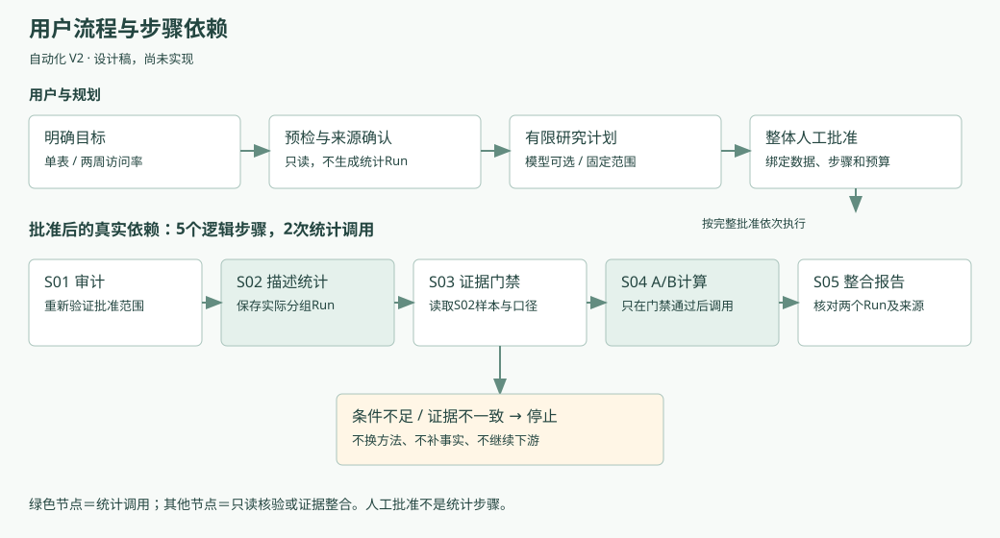
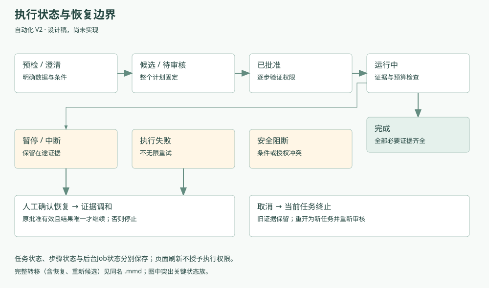

# CausalOps 自动化 V2：多步骤自主研究规划专项 PRD
**V1.0 专项设计候选 · 2026-11-05 · 待负责人确认后另行授权开发**

本文件是未来功能的正式专项设计，不是已实现功能或验收通过证明。核查基线为文档提交 `5ac788f`，对应当前产品源码；本轮不修改业务代码、不调用模型、不运行研究评测。当前 Beta 仍为单用户本地产品，存在解释与答案交付限制。

配套材料：[源码可行性与调用链](FEASIBILITY.md) · [步骤合同示例](plan-example.json) · [低保真交互原型](prototype.html) · [流程与状态图源文件](README.md) · [设计取舍](DECISIONS.md)。

## 1. 用户与问题
主用户是有明确数据分析目标的业务分析人员，科研人员为专业扩展用户。首个场景限定为 Hillstrom 男装营销邮件与未发邮件的两周访问率比较。

用户输入：“评估男装邮件相比不发送邮件，对两周访问率是否有影响。请检查数据和研究条件，完成统计分析，并生成有依据的研究报告。”

希望解决的问题：用户目前需要理解预览、方案、审批和结果之间的关系，并手动组织研究步骤。V2 在明确授权内协调多个步骤，保留必要人工判断。减少操作负担是**待验证价值假设**，没有真人提效数据。

现状证据：V2.2 N06 固定流程完成，但最终自由探索完整终点 0/3；V2.3 开发集本地 9/30、DeepSeek 15/30；保留集每模式实跑13题、已确认正确处理0/13，另7题未执行。这些历史分母、模式不同，不能据此宣称 V2 已可靠。详见[现状指标账本](../draft-v1/04_产品指标体系与版本路线图.md)。

## 2. 产品目标和非目标
当前 Beta 是“可审核、可追溯的 AI 数据科学 Agent”；下一代 V2 是“受控自动化的数据科学 Agent”；长期方向是“自动化数据分析与研究工作台”。

首版目标：
- 单表、明确目标、现有工具，形成有限且可审核的依赖计划。
- 完整计划批准一次，范围内的步骤自动推进，执行前逐步复核权限。
- 实际上游结果决定下游是否执行；数值由原统计工具生成。
- 中断后核对证据再恢复；旧计划、旧运行不可覆盖。
- 用户能看到理解、依据、计算、适用范围、缺少内容。

不支持任意代码执行、自动改目标、自动添加方法、追逐显著性、多表连接、无限迭代、定时研究、云端协作。首版不开放任意 DAG 编辑器。注册17项方法不意味着本入口开放17项：**V2首条自动化路径仅开放 descriptive 与 ab_test**；其他方法保留原入口。

## 3. 产品价值与设计取舍
采用“受限计划结构＋确定性协调器”，继续复用 LangGraph 和现有研究服务，不建设新多智能体系统。

| 取舍 | 首版决定 | 原因 |
|---|---|---|
| 依赖形式 | 有序、无环的固定链；条件仅允许继续或停止 | 足以建立真实依赖，不提前引入任意分支 |
| 统计任务 | 分组描述统计＋A/B；不追加CUPED或亚组检验 | 回答原问题且便于核对样本一致性 |
| 原始三组数据 | 复用已验证的导入适配器，预先确认两组纳入规则 | 原A/B接口要求恰好两组；不能在执行时偷偷删组 |
| 报告文本 | 确定性事实摘要为必需；模型润色可选 | 模型失败不抹去已完成计算，不编造数字 |
| 停止 | 步骤边界安全停止；在途结果保留 | 不承诺能立即杀死任意统计计算 |
| 恢复 | 用户点击恢复；原批准有效时无需再次逐步批准 | 恢复授权与新的研究批准不同 |

公开数据原发布者明确说明三组随机分配及两周响应。[Hillstrom 原始设计说明](https://blog.minethatdata.com/2008/03/minethatdata-e-mail-analytics-and-data.html)。本轮已读取该页面；它是设计来源，不是从样本均衡推导随机化。匹配文件指纹后，用户仍需核对来源、对象与字段含义。

## 4. 端到端用户流程
1. 选择公开案例并导入固定版本原始包；确认两组纳入规则和来源。复用 `cohort()` 产生一个分析表，不增加多表功能。
2. 提交完整研究目标。只读预检展示结构、缺失、组别、指标口径和来源，不产生正式统计Run。
3. 模型辅助提出完整有限计划；无模型时仅允许明确标记的本地受限模板候选。两者均不能确认研究事实。
4. 用户查看全部步骤、范围、资源上限和阻断条件；补充必要事实后批准整份计划。
5. 协调器执行 S01—S05，逐步验证授权、依赖和证据；发现冲突则暂停或阻断。
6. 用户查看整体报告、逐步结果和来源；追问只读结果不新建计划，修改指标或窗口则新候选、重新审核。

**六个用户阶段不等于六次工具执行。**模型规划和人工审核不计入执行步骤；本方案有5个逻辑执行步骤，只有S02、S04调用统计工具。审批前预检不是已批准S01证据，批准后必须重新绑定并核验。

## 5. 功能需求与优先级
下表全部为 V2 待实现要求；“复用”仅指底层已有能力。

| ID | 优先级 | 要求 | 可检验行为 |
|---|---|---|---|
| F01 | P0 | 数据、来源、指标及范围绑定 | 任一指纹变化，原批准不得启动下一步 |
| F02 | P1 | 有界计划候选 | ≤6步，唯一ID、依赖无环、工具白名单；不合规候选不得审核 |
| F03 | P0 | 整体批准＋逐步授权复核 | 修改配置、输入、依赖后旧许可失效；模型无批准权限 |
| F04 | P1 | 自动顺序推进 | 无人工逐步点击；仅满足依赖、权限和预算才能调工具 |
| F05 | P0 | 上游证据门禁 | 上游失败、未持久化或来源不符时阻止下游 |
| F06 | P0 | 幂等与恢复 | 重复点击/重启不得生成重复逻辑Run或覆盖旧报告 |
| F07 | P1 | 任务预算与停止 | 物理请求上限、修订上限、重试上限在发出请求前检查 |
| F08 | P1 | 统一结果与来源 | 数字、单位、组别、窗口、审批和步骤可逐项追溯 |
| F09 | P1 | 工作台状态可见 | 预览、候选、批准、实际执行四者明确分离 |
| F10 | P0 | 数据外发单独授权 | 批准统计不等于批准外发；原始数据行和密钥不进模型载荷 |

持续P0是安全底线，不要求所有开放问题全部解决才建设首版。复杂主动诊断为P1后续；多表和RAG专项为P2；定时/外部工作流/协作为P3，均不纳入本版。

## 6. 关键页面与交互原型
[打开可切换状态的低保真原型](prototype.html)。该文件是设计稿，不连接统计、模型或数据库；任何点击只切换示意状态，不能作为真实页面测试证据。

| 状态 | 主要内容与操作 | 禁止的歧义 |
|---|---|---|
| 目标与预检 | 目标、数据来源、两组纳入规则、只读预检；“生成研究计划” | 将预检称为正式结果 |
| 待审核 | 左侧完整步骤与依赖；右侧必要事实、阻断原因、预算、整体批准 | 隐藏某一步配置；自动勾选；用“已通过”表示研究假设被验证 |
| 执行中 | 当前步骤、已完成x/5、统计调用x/2、证据；请求暂停/取消 | 显示虚假时间进度；把排队称为已执行 |
| 暂停/失败 | 具体原因、已保存内容、未执行步骤；核查后恢复/修改计划/接管 | 只显示通用错误；恢复时偷偷改配置 |
| 报告与历史 | 当前计划、版本、数据、指标、窗口、两个Run和整合报告；历史只读 | 新Run编号配旧报告正文；不同单位混拼 |

N06原则：预览字段变化不能改写正式指标；正式候选变化不能继承旧批准；批准不表示已经执行；执行完成必须有真实证据。选中计划版本是持久化引用，页面只渲染同一个报告清单快照；切换时旧正文先移除或明确标注旧版本，不能先更新编号。

用户可在待审阶段询问“新旧方案有什么区别”，消息与答复必须保存，候选和授权状态不变。暂停在途步骤时显示“已请求暂停，当前步骤结束后停止”。人工接管指补充事实、确认恢复或生成新计划，不是给予任意执行权限。

## 7. 步骤结构与真实依赖合同
### 7.1 合同字段（拟新增，非当前Plan格式）
| 字段 | 定义 |
|---|---|
| step_id / kind | 计划内稳定ID；audit / statistical / gate / report |
| purpose | 对研究目标的必要贡献；不作为执行配置的替代 |
| inputs | 同一任务的数据/合同引用，或上游输出路径及schema版本 |
| tool / config | 注册方法与严格结构化参数；系统步骤使用封闭处理器 |
| depends_on / preconditions | 必须成功的上游、白名单谓词、证据完整性 |
| authorization | 整体批准引用、范围摘要、执行前需核验的字段 |
| status | pending/ready/running/succeeded/blocked/failed/interrupted/cancelled/skipped |
| output / evidence_refs | 持久化输出、内容哈希、Run/审计ID及来源 |
| success / failure_policy | 成功判据、可重试类别、停止及接管方式 |

静态定义与动态记录分开：状态、实际Run、耗时写入步骤记录，不修改已批准计划。依赖不接受模型生成Python、SQL或表达式字符串；使用程序白名单谓词及有类型的字段引用。

### 7.2 Hillstrom 首版五步
| 步骤 | 类型与输入 | 工具/配置及真实输出 | 依赖与结果 |
|---|---|---|---|
| S01 数据与设计复核 | 本地只读审计；已绑定分析表、合同、来源收据 | 复用profile/audit及方法条件校验；新增规范化AuditEvidence | 验证两组、visit为0/1、实体标识与缺失、来源/窗口；不声称程序验证随机化。失败阻止S02 |
| S02 分组描述统计 | 正式统计；同一分析表 | exploration/descriptive，numeric=[visit]，group=assigned，categorical=[assigned]；持久化Run及grouped统计 | S01成功。输出两组rows、finite_n、mean等，供S03实际读取 |
| S03 样本与口径门禁 | 只读证据运算；S01与S02输出 | 新增封闭gate处理器；不新增统计估计器 | 校验组别全集、每组有效数=记录数、有限且足够变异、总量与审计一致、目标与窗口未变；通过才允许S04 |
| S04 两组访问效果 | 正式统计；原分析表＋S03通过证据 | research/ab_test；entity_id、assigned、visit、0/1组、概率指标；分配事实由合同审核提供 | S03成功且逐步批准有效。输出原引擎差值、区间、诊断和Run |
| S05 结果核对与整合 | 只读整合；S01—S04证据 | 新增报告清单，复用interpret_run/事实目录；模型解释可选 | 比较S02分组均值/样本与S04实际口径，完整引用后保存整体报告 |

**真实依赖**：S03读取S02已保存的grouped.rows、finite_n、mean、std_ddof1，而不是读取模型描述。若某组有缺失或样本、指纹不一致，S04不被派发。S04的统计样本仍是原批准分析表；它不把S02均值当作伪造个体数据。原A/B接口不能直接接收此gate输出，需要新增协调器把该证据作为授权前置条件。S05再读取两个实际Run核对结果。这就是跨步骤证据依赖，不是新增估计方法。

首版采用严格缺失策略：目标/组别/实体缺失、重复实体或来源不充分即停止，不自动删行、填补或转为其他方法。合法相同数值记录不等于重复实体。S03不以p值或是否显著决定继续，也不把样本量达最低接口要求当成功效充分。

### 7.3 数据范围与配置约束
现有导入适配器从三组固定包选取两组，创建entity_id为源行索引，assigned为0/1。索引是记录技术标识，客户独立性来自来源和人工核对，不能凭索引唯一证明独立。预处理必须记录原包哈希、适配器版本、两组筛选规则、排除女装组数量与派生表指纹。

所有步骤消费同一分析表。窗口是来源定义的“分配后两周”，表中没有可据此重构的新时间窗口；不虚构calendar_start/end。要换四周、利润、女装比较或删样本必须生成新计划；若数据不支持则澄清。不得把DataContract研究范围文字当成实际筛选权限。

[结构化计划示例](plan-example.json)仅定义新合同，不可直接投喂现有Plan执行器。示例末尾的runtime_record_templates_NOT_in_plan_hash为独立运行记录模板，不进入批准计划哈希。完整配置哈希包含默认值，编译时必须展开；不得在执行时使用可变默认参数。

## 8. 状态机与数据流

任务状态：prechecking → needs_clarification / drafting → awaiting_review → approved → running → completed。
running可进入pause_requested → paused、blocked、failed、interrupted、cancel_requested → cancelled。取消为该任务终态；重开应创建显式后继任务并重新审核，不能自动恢复已取消许可。paused/interrupted恢复先进入reconciling，完成权限、输入、依赖及已有输出核验后回到running；失效则回awaiting_review的新版本。

blocked代表确定性条件不满足；failed代表执行异常；interrupted代表结果可能不明，不能当作“没有结果”。流程状态、步骤状态、后台Job状态分别保存，UI投影不能反向赋予权限。

数据流：原始公开包 → 适配器与来源收据 → 单表Parquet及DataContract → Plan V2不可变版本 → Approval快照 → 协调器 → 原统计工具 → Run/ToolResult → gate与整合清单 → UI/报告/结果问答。模型只看到授权的字段、汇总与必要对话，不接收原始行、技术实体ID值或凭据。

## 9. 审批及权限机制
审批快照至少绑定：session、upload/data/frame hash、合同ID/版本/hash、目标、分析单位、指标定义、两组值与标签、纳入规则、观察窗口、完整步骤/依赖/条件、工具/方法/展开配置、事实来源、代码版本、资源策略版本和可执行范围。

审批前：所有必需配置完整、无未决冲突；程序可检验条件与用户事实声明分别展示。数据来源事实与程序检查不能统一变成“通过”。

每一步claim之前及真正派发前，统一verify_step_authorization：
1. 当前计划与审批hash一致，未撤销，用户与任务作用域一致。
2. 数据/合同/代码/知识版本与批准相符。
3. 步骤及tool/config在完整计划内，上游证据符合预先批准的生产者与字段引用。
4. gate真值来自已持久化输出；input_sha包含上游output hash。
5. 资源余额和停止状态允许推进，且没有其他owner。

中途数据、指标、分组、参数、依赖或允许分支变更，停止并生成新候选。即使数值恰好相同也不能沿用许可。普通勾选不能覆盖已记录冲突事实。审批后的模型文本不参与参数更改。结果追问可以只读，不消耗统计执行权限。

## 10. 自动执行、恢复和幂等
首版为单工作进程、顺序调度，不并行运行步骤；复用现有SQLite、后台任务、TaskRuntime所有权令牌。新增协调层调用已存在工具，不复制估计器。

- 步骤键：任务ID＋计划hash＋step_id。尝试ID与逻辑步骤ID分开；最多2次临时故障尝试，不生成两个“成功逻辑步骤”。
- claim用事务检查状态与input_sha；存预分配运行身份/准备检查点后才调用工具。
- 成功必须同时拥有可加载的完整输出和内容哈希；没有证据不能靠状态字符串宣布完成。
- 进程重启后先判断旧owner确已退出；无法判断则等待/人工处理。先reconcile既有Run，唯一匹配则补齐步骤记录，不再计算；无匹配且确认未产生有效Run才能按预算重试。
- 多个匹配、数据库与文件不一致、孤立输出无法唯一归属时转人工核查，禁止挑选最有利结果。现有文件写入与数据库记录不是跨资源事务，首版不能承诺所有故障“恰好一次”物理计算；目标是防止重复发布逻辑结果，并对不确定状态停止。
- 不对权限错误、参数错误、研究条件不足进行自动重试。临时网络或已确认可恢复的I/O异常最多一次；重试前不重新审批、不重播已成功文件提交或工具调用。
- 页面刷新只重建状态视图，不触发执行。重复批准/恢复点击返回同一有效任务。
- 当前计算无法安全硬中断时，保存其结果但不启动下一步；取消不删除已完成证据。
- 密钥不持久化；重启需要模型时重新输入相同服务配置并核验任务外发许可。不得静默换模型。

## 11. 资源与费用预算
本节限额为首版设计政策，不是当前已实现全局预算。

| 限额 | 定义与实施位置 | 触发处理 |
|---|---|---|
| 最多6个逻辑执行步骤 | 静态Plan校验，含audit/gate/report；本例5步、2次统计调用 | 拒绝过大候选，不拆成隐藏循环 |
| 最多2次计划修订 | 初版加最多2个后继候选；自动语义修复及用户改范围均记账；纯JSON结构修复不新增语义版本 | 保留草案，人工接管；不得新建子任务清零 |
| 最多12次模型物理请求 | 任务级持久账本；规划、检索子图、结构修复、语义重拟、解释、任务触发的连通性探测及HTTP重试均计数，发请求前原子预留 | 拒绝第13次；已有结果仍可只读导出 |
| 单步临时故障重试≤1 | 同一输入的首次＋1次；所有层共用重试额度 | 超额停止，不让HTTP、服务、协调器层叠加重试 |
| ¥1预估预警 | 按模型、时段、价格快照和用量估算；发下一请求前预检 | 预计越线暂停后续模型调用，人工决定；不是准确人民币扣费硬截断 |

当前ProviderConfig有输出上限5000（可配256—8192）、60秒超时及0/1次HTTP重试；助手另有JSON修复、候选修复循环。**不能把这些局部限制当作任务总预算。**拟统一物理请求账本，防止双重重试。

令牌策略：暂建议每次输出上限沿用5000；总输出预留上限60,000与12次相配。输入候选上限建议每次20,000、任务累计240,000，需负责人确认且必须接入经过验证的该模型计数器才能称硬限制。未知分词模型采用载荷字节上限和请求硬限，并明确“输入token预估”；用量缺失时保留预留不退还，不声称精确token或费用。已发在途请求无法撤回账单。

本轮查询[DeepSeek官方价格](https://api-docs.deepseek.com/zh-cn/quick_start/pricing/)：deepseek-flash高峰未命中输入2元/百万token、输出8元/百万token。按上述建议的240,000输入和60,000输出上界，不考虑缓存的计算示例为0.96元；**这是设计算例，不是实测成本、报价承诺或硬扣费保证**。价格/时段/模型变化需新快照；网络失败无用量回执则标未知，不按0计费。记录requested/resolved model、物理请求ID、token回执、时间及估算区间。本轮没有付费模型调用。

暂停后允许继续确定性报告导出；新外发请求需要预算/授权满足。用户扩大预算必须产生新的资源授权记录，不能自动绕过12次首版硬上限；超出首版范围需独立决策。

## 12. 统计结果及证据整合
统一ReportManifest绑定automation_task、plan/version/hash、approval、data/contract、各step、审计与两个Run、metric/单位/窗口/来源、报告schema和生成版本。实际数值只从已核对Run读取，保留全精度用于比较，格式化仅用于展示。

报告顺序：研究问题 → 两组访问率、绝对差与区间 → 同尺度组间图 → 样本与方法 → 适用范围与限制 → 步骤证据与复现。
- 访问率为概率，差×100为百分点；相对增长用对照概率为分母，为0时明确不可定义。
- S02与S04样本/均值在预定浮点容差内一致才汇总；容差建议1e-10（概率尺度），样本数量必须精确相等，最终以既有数值精度核定，不能按显示四舍五入掩盖口径差异。
- 区间来自原引擎；不重新发明或修改估计器。工具版本、标准误方式和区间来源一并读取。
- 不把两周访问解释为长期利润或所有人群的效果。诊断通过不证明无干扰等所有识别假设。
- S04被阻断时可导出“部分完成说明”，列已完成描述和具体缺失条件，不能冠以完整因果研究报告。
- S05可确定性完成必要事实与限制。若模型解释失败，允许交付明确标记的本地证据摘要；必要内容不足则部分完成，不能因模型回执存在而宣称完成。
- 后续新增研究、改窗口不覆盖已发布manifest；历史选择按manifest取证，跨任务引用拒绝。

## 13. 三个核心验收场景
本轮仅设计，**全部尚未执行**。不新建50题任务集。验收记录需保存输入hash、步骤事件、审批、Run、页面、最终报告及实际资源；工程、统计、交付三层独立打分。

| 场景 | 起点与注入 | 完整/正确阻断 | 部分/失败 |
|---|---|---|---|
| A 正常完成 | 固定Hillstrom包与已核验设计；用户只批准完整计划一次 | 5步真实推进、2个统计Run、S03读取S02；报告数值/单位/对象/窗口/来源完整；历史保留 | 部分：统计正确但报告缺少必要项；失败：无依赖却宣称自动化、样本错配、数值错误或需逐步代操作 |
| B 条件不足 | 在独立公开/合成测试副本分别设置缺组、非二元visit、缺设计依据；不改原始包 | 指明具体不足，审批前澄清或S03安全阻断，无S04调用，无虚构；这是正确处理，不是正常研究完成 | 部分：安全停止但提示不具体；失败：猜随机化、自动删组/填值、以描述替代因果结论 |
| C 中断恢复 | A的独立会话；分别在模型响应、统计提交临界点、页面关闭处注入中断 | 唯一Run调和、无重复逻辑Run、批准仍有效才继续，旧结果不覆盖；含用量未知记录 | 部分：证据保留但需人工定位；正确阻断：所有权/数据/授权不确定时停止；失败：重复执行发布、跳审批、覆盖历史或无法说明失落结果 |

A统计核对：沿用现有测试与参考实现核查两组样本和差值/区间，历史样本计数只作为固定数据验收对照，不作为生产硬编码输出。B的样本结构检查与研究假设检查分别记录。C模型故障可用受控注入验证恢复，真实接口连通性另记，不能混称真实模型故障或真人行为。

验收通过必须同时满足核心安全不变量；不要求模型每次文本相同。出现未经批准执行、跨运行混数、虚构数值、历史破坏即为阻断。分别记录计划有效率、自动推进步数/已批准可执行步数、正确停止/需停止事件、必要接管/需接管事件、报告完整性与实际操作次数；没有新实测值。

## 14. 现有架构复用分析
结论：**可行，但当前不是已完成的依赖工作流。**现有Step只有tool/config/reason；Plan最多5项；任务按ordinal顺序执行，缺少依赖字段和上游输出输入。现有步骤身份、检查点、恢复和整体审批不是从零建设，需扩展而非替换。

详细源码位置、输入输出、七项能力结论和真实调用链见[可行性核查](FEASIBILITY.md)。重点差距是依赖合同、失败后停止下游、每步授权复核、全任务预算与多Run整合，不是统计方法数量。

## 15. 最小新增模块与接口
拟新增设计名称，不表示目录或接口已存在：
- PlanV2/StepSpec：类型化依赖、条件、工具配置和预算；旧Plan仍按旧入口处理，不自动迁移已批准计划。
- BoundedCoordinator：严格顺序，统一before_step、gate、dispatch、checkpoint、reconcile。
- EvidenceAdapter：把现有审计/ToolResult的选定字段映射成有版本的输出schema，不建立第二套统计事实数据库。
- BudgetLedger：复用SQLite存请求预留、attempt、回执与修订计数，重启不清零。
- ReportManifest：引用原始Run与审计，统一整体报告及页面选择。

接口建议及持久化字段见[工程接口设计](FEASIBILITY.md#interfaces)。在ResearchService暴露单一受控入口；UI、Graph不得直接绕过协调器执行V2步骤。任务域收据约束原统计域的批准，原统计域门禁保留，不引入两套互相可替代的权限。

## 16. 工程实施拆分建议（最多三阶段）
| 阶段 | 独立交付 | 验收与停止条件 |
|---|---|---|
| 1 最小真实依赖闭环 | 固定单表5步合同、整体审批、S02→S03→S04、原工具适配、报告清单；先服务层和薄审核入口 | A/B场景；未批准/变更/上游失败不能进入S04；至少两个真实统计Run。不先建设完整新页面 |
| 2 持久恢复与资源控制 | 步骤前授权、所有权与Run调和、持久预算、暂停取消接管 | C场景、故障临界点、重复点击和层叠重试；无法确定结果时明确阻断 |
| 3 工作台集成与交付 | 完整计划/进度/报告/历史、只读问答绑定和可复现教程 | 三场景全链路、页面/证据/回答分别验收；原Beta核心门禁及历史不回归 |

第一阶段也必须保留既有安全门禁和基础检查点，不得把安全延迟至第二阶段。每阶段单独审查差异与测试证据，不把计划拆分当作排期承诺。开发须另行授权。

## 17. 已知风险、限制和后续边界
- 当前开放问答质量仍有限；V2不能靠多步骤掩盖已有解释风险，首版固定问题范围与确定性事实校验必需。
- 原Plan顺序与新依赖语义不相同；新旧版本不能混用批准。
- 当前统计工具结果schema与UI事实提取不完全一致，适配层必须用真实结构做测试，不仅检查文字。
- 源行ID不证明自然实体独立；换任意营销表不能沿用Hillstrom随机化事实。
- 输入缺失、模型无法规划、用途超范围可以安全停止，这不等于完成研究。
- 本地单进程恢复不等于云端高可用；SQLite与文件的跨资源不确定状态需人工接管。
- ¥1是预警，不是实时报价或保证账单；12次请求必须覆盖每一层。
- 复杂主动诊断、方法扩展、任意分支、多表、RAG优化、周期性研究属于后续需求，本轮没有开发或验证。

本专项方案完成后停止，等待[最终设计取舍](DECISIONS.md)审阅和独立开发授权。
