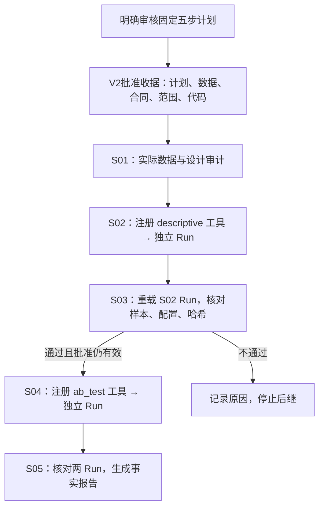

# CausalOps 自动化 V2 第一阶段实施与验收报告

状态：**受限五步执行原型；已完成服务层闭环，未建设通用自主规划或完整工作台。**

本轮基于设计提交 `be3c61b`，开发分支为 `feat/automation-v2-stage1`。产品冻结提交为 `2d0efb28b0a69534697720b23275dc07dd3bfb71`。仅本地提交，未推送、未合并 main、未创建 Release。

## 1. 实施结论与边界

公开 Hillstrom 两组分析已经实际完成 S01 → S02 → S03 → S04 → S05。S02 与 S04 分别产生真实统计 Run，S03 读取 S02 已持久化的结构化结果，校验其来源、样本和内容哈希后才允许 S04 执行。一次整体批准覆盖固定计划；每个步骤仍重新核对绑定和授权。报告直接使用两个 Run 的事实与原工具区间。

这是确定性案例编译和受限执行能力验证，**不是通用自然语言自主研究能力证明**。本轮模型调用为 0，未进行真实用户测试、浏览器自由探索或旧 V2.3 任务复测。测试控制器根据授权显式提交一次审核确认，用于检查审批流程，不冒充独立真人审核体验。

第一阶段已完成：固定计划合同、逐步依赖、整体审批、两次真实统计、失败即停止、重复提交保护、步骤证据和确定性报告。

第二阶段尚未完成：任意进程中断后的核查与恢复协议、持久资源账本、模型请求预算、完整暂停控制与工作台交互。当前不允许不确定结果直接重试，也不开放模型自主规划。

## 2. 基线核查与最小设计调整

开始时工作区干净，HEAD 为 `be3c61bcced8a88b33a157927ff4c44215251374`，位于设计分支。从该提交创建独立开发分支，没有改写历史。

[设计源码清单](SOURCE_MANIFEST.json) 中的 20 个现有源码文件，经本次验收脚本逐项核对，只有 `ResearchService` 文件发生变化：新增 5 行工厂入口。统计引擎、原执行器、LangGraph、ToolGateway、审批库和数据适配器未修改。

本轮按负责人确认采用以下收缩，不改变产品方向：

- 从 PRD 的最多 6 步收敛为严格固定 5 步；只有 S02、S04 是统计工具调用。
- 暂不接入 LangGraph/UI 新执行节点；通过 `ResearchService.automation_v2()` 和 CLI 验证服务闭环。
- 不开放计划修订 API；如需范围变化，创建后继候选并重新批准，旧任务保留。
- 暂不自动重试任何统计步骤。相比设计中的最多一次临时重试，本阶段采用更保守的单次派发，避免不确定 Run 被重复计算。
- 暂停只支持步骤边界；取消为终态。运行中持有单任务锁，不能声称支持实时中断正在执行的统计工具。

设计依据：[PRD](PRD.md)、[源码可行性](FEASIBILITY.md)、[设计取舍](DECISIONS.md)。历史设计文档保持不变，本报告记录本阶段实际实现。

## 3. 实际修改的源码与职责

| 文件 | 类／函数 | 实际职责 |
|---|---|---|
| [automation_contracts.py](../../../src/causalops/application/automation_contracts.py) | EvidenceRef、StepSpec、PlanV2、fixed_steps、scope | 固定工具白名单、类型化依赖和证据、版本及范围；拒绝任意表达式、替换方法或改写依赖 |
| [automation_coordinator.py](../../../src/causalops/application/automation_coordinator.py) | BoundedCoordinator.create_hillstrom | 核验公开包、两组派生表、来源收据和 DataContract；用请求 ID 防止重复建任务 |
| 同上 | approve、_binding、_verify | 整体人工批准；绑定数据、合同、来源、代码、目标、范围、步骤与计划哈希 |
| 同上 | advance、run、_stat | 顺序派发、任务锁、逐步授权、复用 TaskRuntime 与注册工具；失败即停止后继 |
| 同上 | evidence、_load_stat、_gate | 从持久化 Run 重载事实，验证任务、配置、样本、批准、上游哈希；S03 不读模型解释 |
| 同上 | _audit、_report | 数据／设计审计；两个 Run 一致性检查和事实报告 |
| 同上 | pause、cancel、resume | 边界暂停核查；取消终态；不恢复未核清的在途状态 |
| [research_service.py](../../../src/causalops/application/research_service.py) | ResearchService.automation_v2 | 无模型受限入口，不改变旧服务流程 |
| [automation_v2_stage1.py](../../../scripts/automation_v2_stage1.py) | main | create／approve／run／show／export，便于独立复现 |
| [test_automation_v2.py](../../../tests/test_automation_v2.py)、[test_automation_v2_safety.py](../../../tests/test_automation_v2_safety.py) | 42 个参数化测试实例 | 真实工具链、合同、审批、依赖、故障、重复操作和历史保持 |

现有 [AnalysisTools](../../../src/causalops/assistant/contracts.py)、[TaskRuntime](../../../src/causalops/assistant/runtime.py)、[GeneralWorkspace](../../../src/causalops/general/service.py)、[ResearchRepository](../../../src/causalops/research/repository.py) 均复用原实现。

## 4. PlanV2、步骤合同与持久化

PlanV2 的格式标识为 `automation-v2-stage1`，计划版本为 1，模型请求上限为 0。计划包含稳定 ID、目标、数据身份、DataContract 引用、来源哈希、固定范围和五个 StepSpec。

每个 StepSpec 记录步骤 ID、类型、工具／完整配置、依赖、输入证据类型、输出类型、前置条件、授权策略和失败策略。PlanV2 校验器仅接受登记的固定链和配置，不接受模型生成的 SQL、Python、条件表达式或动态方法扩展。

静态计划与动态状态分开保存于**现有工作区 SQLite**：

- `automation_v2_tasks`：不可原地修订的候选、计划哈希、来源与任务状态。
- `automation_v2_approvals`：V2 专用整体批准收据。
- `automation_v2_steps`：步骤身份、输入哈希、状态、时间、输出及输出哈希。
- `automation_v2_events`：有序事件，包括授权派发、成功和停止原因。
- S02/S04 同时复用 `assistant_tasks`、TaskRuntime 检查点，以及原 `exploration_runs`／`analysis_runs`。

新增表保存编排元数据和可核对的证据投影；统计事实仍以原 Run 文件／记录为准。读取投影时必须重载原 Run 并核对 ToolResult 内容指纹，不能将投影当成可独立修改的第二套统计结果。

步骤具有稳定身份，但持久记录不等于已经具备任意中断恢复。代码指纹变化、数据变化或未核清执行状态都会停止自动推进。

## 5. 真实依赖及审批调用链



S04 使用的是**同一获批分析表**，不是将分组均值当作客户级原始样本。真实跨步骤依赖表现为：S03 必须消费 S02 持久化分组结果；其样本完整性和一致性决定 S04 是否可以执行。S04 保存 S03 哈希，派发前重新计算门禁结论。显著性不参与放行条件。

具体授权链：

1. `create_hillstrom` 要求确认公开来源；该确认仅登记来源和研究事实，不批准执行。
2. `approve` 要求显式确认整份计划及精确 plan_sha，产生唯一 V2 收据。
3. `advance/_stat` 校验整个计划、数据实际指纹、合同、代码版本和上游证据，再领取步骤。
4. `AnalysisTools.prepare` 只创建登记工具对应的具体设计；检查点保存 V2 任务、批准和步骤来源。
5. S04 经 `AnalysisTools.execute → GeneralWorkspace.execute` 再次核对研究设计、数据与识别路由。它依据本次明确整体审核在原研究域生成具体 revision 的批准记录。
6. `run_versioned_workflow → ResearchRepository.assert_execution_authorized` 仍核对精确会话、数据和批准版本，之后才进入原 A/B 引擎。
7. 结果 ToolResult 及步骤输出记录整体批准 ID；A/B Run 还保留原研究域 revision 和 approval。

旧 `ToolGateway.execute` 调用旧 Plan 循环，故本轮**没有伪装旧 flow 或复用其失败后继续的循环**。V2 在同一 ResearchService 下使用专用协调入口，承担 V2 逐步授权，再下接同一 AnalysisTools 和原研究域门禁。新旧计划和批准格式隔离；旧 accept／execute 不能授权 V2 plan_id。没有将 V2 收据直接当成原研究域 ApprovalRecord。

原域门禁反例测试显式令 `assert_execution_authorized` 拒绝，验证该函数确实被调用，且未创建 A/B Run。不能仅凭 V2 批准绕过该门禁。

## 6. 独立实际运行记录

实测产品提交：`2d0efb28b0a69534697720b23275dc07dd3bfb71`。

产品源码指纹：

`b6614d02740abbee68c459b1731252fe3d181aca1c43c6f06e83886b17905c6c`

| 对象 | 实际标识 |
|---|---|
| 自动化任务 | `cdfb10e2e0eb48bba80853499cbb073f` |
| PlanV2 | `e2fd6828843b4e24b52de82d82b6b4c4`，v1 |
| 计划哈希 | `a3cc6d65369077ac110d4bcb87dba75878774148b6035361995ab0d66badbc45` |
| 整体批准 | `6613dd670fa84c56853d4a4ba899e704` |
| S02 描述统计 Run | `7bbb06e6de8048178c8cd9ce25747a51` |
| S04 A/B Run | `8ef5a406320f4dca80b06b3014f58ed0` |
| 原域批准 | `approval_10a1b446cbae408fbad9ced6f21b250d` |
| 原域 revision | `revision_d872103bf73b475f8a3dfec74eb7728a` |

S02 输出哈希为 `204e7e413f7cb2397da7631ffb6ef261f2095d68d662f3f0a3f53ad81503fb95`，S03 的 `descriptive_evidence_sha` 与其相等；S03 哈希为 `619b363fbef8832d0130eca6045d0b9e78f084b4a9258687261d15e9c46405b8`，S04 的上游引用与其相等。验收脚本对这些等式进行了实际断言。

完整、可公开的标识／哈希摘要见 [STAGE_ONE_EVIDENCE.json](STAGE_ONE_EVIDENCE.json)。原始工作区、批准、事件、统计文件与报告保存在本机独立证据目录，不纳入 Git。

## 7. 真实统计结果与依据

| 指标 | 实测结果 |
|---|---|
| 未发邮件组 | 21,306 名客户，访问率 0.10616727682343002 |
| 男装邮件组 | 21,307 名客户，访问率 0.18275684047496127 |
| 合计 | 42,613 名客户，两组有效记录数等于记录数 |
| 访问概率绝对差 | 0.07658956365153125，即 7.6589563651531245 个百分点 |
| 原 A/B 工具 95% 区间 | [6.995322354054364, 8.322590376251885] 个百分点 |
| 推断方法 | 原独立组均值差、原标准误及 1.96 正态近似区间 |
| Run 数量 | 描述统计 1、A/B 1；不是 5 次统计计算 |

公开来源：[Hillstrom 原研究说明](https://blog.minethatdata.com/2008/03/minethatdata-e-mail-analytics-and-data.html)。作者说明客户随机分配至邮件／无邮件组，并跟踪之后两周；访问指标是此期间是否访问网站。本轮再次核对了原始说明。随机分配依据来自该资料及显式确认，不是由组别存在或样本均衡推断。

实际数据包 SHA-256 为 `bab6578f60db5d792f1c2372c502f029152a5249cf5ea84390f3b7f885d7234f`。复用已有公开数据适配器筛选男装邮件和未发邮件两组，源行索引用作稳定客户记录身份。适配器已有计数校验用于确认数据版本；统计结果仍由本次真实工具计算，没有将参考值写入报告。

报告说明访问率不是次年净利润，未检查基线协变量平衡，程序也不证明无干扰等全部识别假设。该闭环只验证登记案例及合同，不推广至任意实验。

## 8. 阻断、重复操作和历史保持

新增测试覆盖：

- 无整体批准、旧格式收据、直接跳至 S04：不执行。
- 必要字段缺失、缺失值、重复客户、分组不全、非二元指标：不进入下游统计。
- S02 工具异常、输出缺失、哈希损坏、错误 Run、样本或指标／窗口变化：不产生新的 S04 Run。
- S03 后合同变化、批准撤销、S02 原文件损坏或门禁结论被改写：停止 S04。
- 跨任务替换上游、重标批准来源：阻断。
- 原研究域拒绝批准：停止，不替换或直接调用估计器。
- 稳定 request_id 的重复提交只返回原任务；步骤锁与条件更新阻止并发重复领取。
- 已完成步骤再次请求只验证并返回原证据，不重算。
- 工具已落盘但返回前异常：保留检查点及可能存在的 Run，状态为 interrupted，禁止盲目再次派发。
- 取消后不能恢复；边界暂停只有在全部已完成证据及原批准复核通过后可继续。
- 新任务不覆盖已有任务、计划、报告或 Run。

验收另在完整工作区重复调用已完成 S02／S04／S05、整任务 run 和同 request_id 创建入口：前后均为整体批准 1、exploration_runs 1、analysis_runs 1，报告哈希一致。

故障注入属于定向工程测试，部分单元测试修改隔离证据或模拟工具异常；正常完整验收使用真实包、真实工具和真实持久化输出。未用模拟 S02 JSON 代替完整链路证明。

## 9. 实际测试记录

环境：Windows 10 build 19045、Python 3.11.5；pandas 2.3.3、numpy 2.4.6、pydantic 2.14.1、scipy 1.15.3、pytest 9.1.1。统计方法注册数量复核为 17，没有增加估计方法。

| 批次 | 实际结果 | 说明 |
|---|---|---|
| 实现前 red | 缺少 automation_v2 接口，测试报错 | 保留初始失败，先建立关键测试再实现 |
| green01 | 27 通过，27.42 秒 | 首批合同与真实链路 |
| green02 | 41 通过，42.88 秒 | 补充原域门禁、在途变化及历史保持 |
| affected01 | 84 通过，57.36 秒 | 最终 42 项新增测试，加受影响现有模块 |
| full01 | 928 通过、2 失败，374.17 秒 | 两个旧子进程测试缺少 PYTHONPATH，均报 ModuleNotFoundError |
| subprocess02 | 2 通过，17.22 秒 | 只补当前源码路径后原失败测试通过，未改产品或判据 |
| full02 | **930 通过、0 失败、0 跳过，411.35 秒** | 相同冻结产品，显式向子进程提供源码路径；JUnit 确认 930 项，其中新增 42 项 |

完整回归包含旧评测运行器的工程测试和自造 fixtures；**没有解封或重新执行历史 V2.3 研究题集**。

日志、JUnit、真实工作区与人工审核命令输出均保留。工程测试通过不等同于所有方法全面验证，也不等同于真人使用成功率。

## 10. 可复现操作

在该产品提交的项目根目录，使用已安装项目依赖的 Python 3.11 环境。公开压缩包必须与上述 SHA-256 一致。工作区使用新建独立目录，不要指向正式研究数据。

PowerShell 示例，下面占位路径需替换：

```powershell
$env:PYTHONPATH = (Resolve-Path src).Path
$env:PYTHONDONTWRITEBYTECODE = "1"
$env:PYTHONUTF8 = "1"
$env:CAUSALOPS_HILLSTROM_ARCHIVE = "<公开 hillstrom.csv.gz 的位置>"
$workspace = "<新建的独立工作区>"

python scripts/automation_v2_stage1.py --workspace $workspace create --archive $env:CAUSALOPS_HILLSTROM_ARCHIVE --request-id hillstrom-review-001 --confirm-source
# 阅读完整输出，核对研究事实、步骤、配置及 plan_sha 后才执行下一条。
python scripts/automation_v2_stage1.py --workspace $workspace approve --task "<任务ID>" --expected-plan-sha "<完整计划哈希>" --confirm-review
python scripts/automation_v2_stage1.py --workspace $workspace run --task "<任务ID>"
python scripts/automation_v2_stage1.py --workspace $workspace show --task "<任务ID>"
python scripts/automation_v2_stage1.py --workspace $workspace export --task "<任务ID>" --output "<新的报告目录>"

python -m pytest tests/test_automation_v2.py tests/test_automation_v2_safety.py
python -m pytest
```

CLI 的业务结论以输出中的 status、reason 和步骤状态为准，不能只依据进程正常退出认定完成。export 使用独占创建文件，避免覆盖原验收证据。未设置公开包环境变量时，新数据验收测试会明确跳过；本次实测已设置，不以跳过代替通过。

审核 flag 是可信本地调用方的明确确认，非多用户身份认证或防恶意本机进程机制。新计划没有自动注入旧 UI 的历史列表，当前使用 show／export 查看 V2 集成报告。

## 11. 当前限制、风险与第二阶段前置事项

| 项目 | 当前状态／处理 |
|---|---|
| 任意研究目标、指标和数据 | 不支持；严格只接受已登记公开包和固定案例 |
| 通用依赖图、动态分支 | 不支持；仅固定链，S03 通过或停止 |
| 概率差以外的推断 | 不新增；原 A/B 工具统计限制继续适用 |
| 完整跨进程恢复 | 未实现；不确定结果停止，保留 TaskRuntime 检查点供人工核查 |
| 数据文件与 SQLite 的事务一致性 | 不是跨文件原子事务；异常采用保守停止，不承诺任意故障恰好一次 |
| 暂停／取消 | 仅步骤边界控制；运行中的统计工具不抢占 |
| 完整 UI 和 LangGraph 接入 | 未实现；现有页面不宣称已有 V2 自动执行入口 |
| 任务级模型预算 | 未实现，所以明确拒绝携带模型的 ResearchService；所有步骤 model_calls=0 |
| 本机身份与对抗性修改 | 沿用单用户可信本地环境；哈希用于内容一致性，不是防管理员重写数据库的签名系统 |
| 存储兼容性 | 添加表；不修改旧记录。V2 计划不进入旧 assistant_plans，旧批准不能继承 |
| 注册方法数量 | 仍为 17；只有描述统计和 A/B 在本阶段组成链路 |
| 下一阶段 | 优先建立未完成步骤的核查恢复、受控预算和任务接管，再接入完整交互；不直接发展通用工作流平台 |

**阶段判断：第一阶段满足结束条件，可以在另行授权后进入第二阶段。** 真实五步链、两个统计 Run、S02→S03→S04 持久证据依赖、一次整体批准及逐步授权、失败停止、重复操作与历史保持均有实测证据，最终完整回归 930 项通过。该结论仅针对受限服务原型，不是通用自主研究或生产发布判断。第二阶段能力仍未实现，本轮到此停止。
