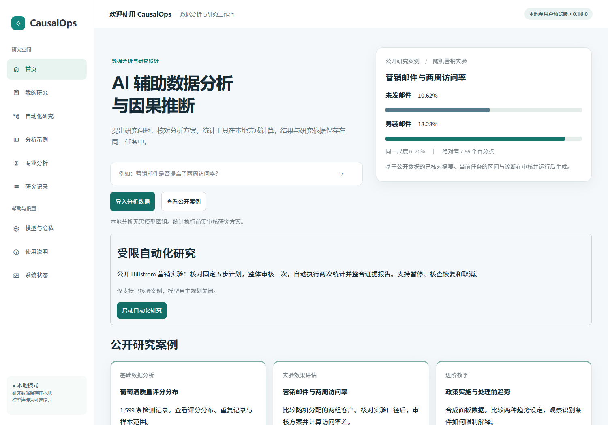
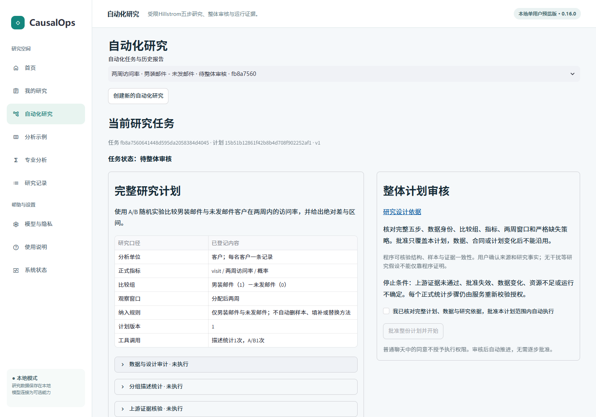
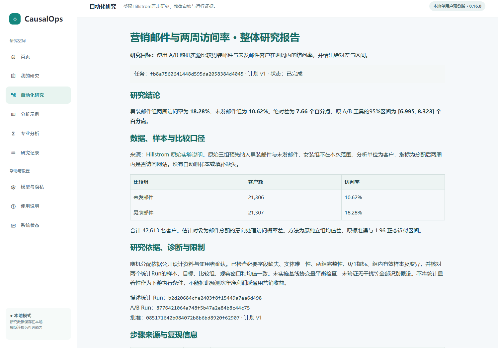
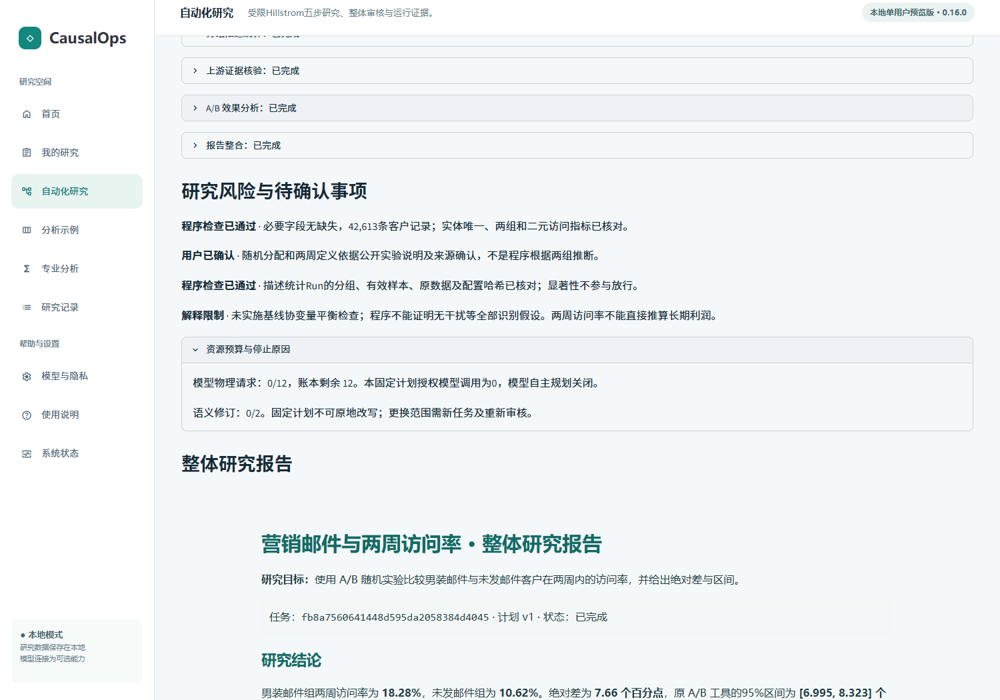
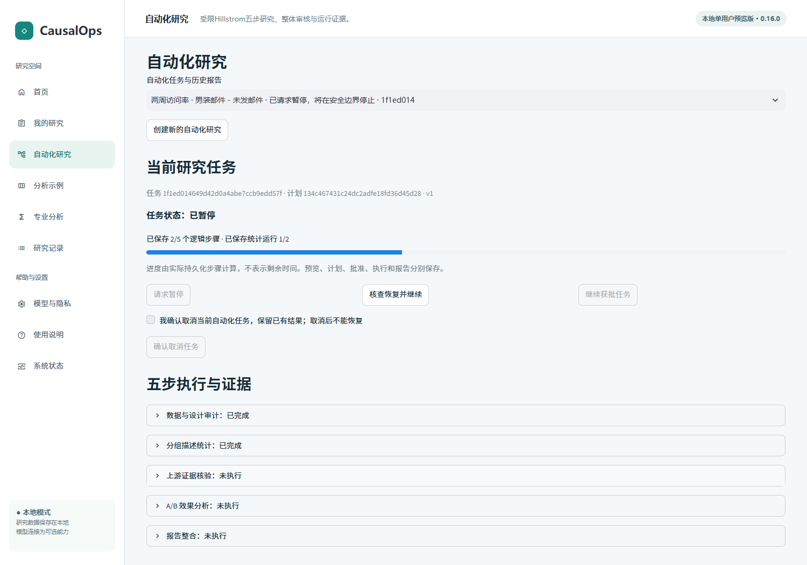
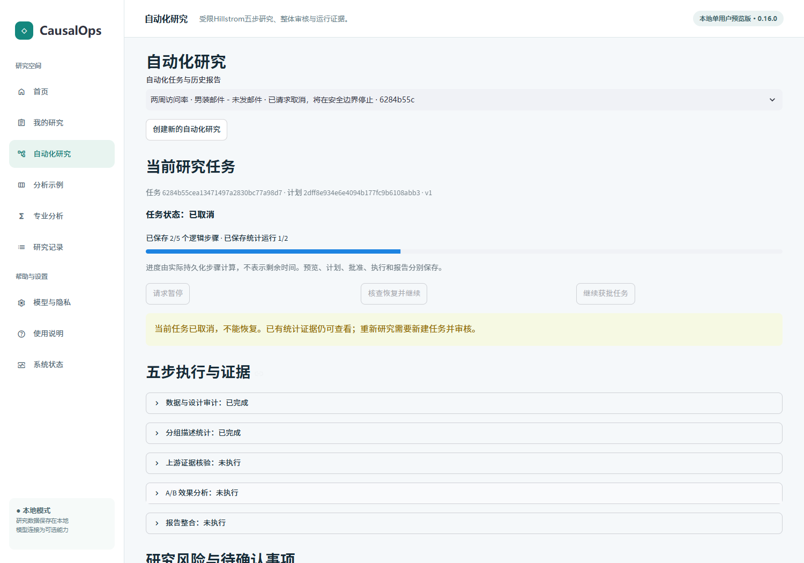
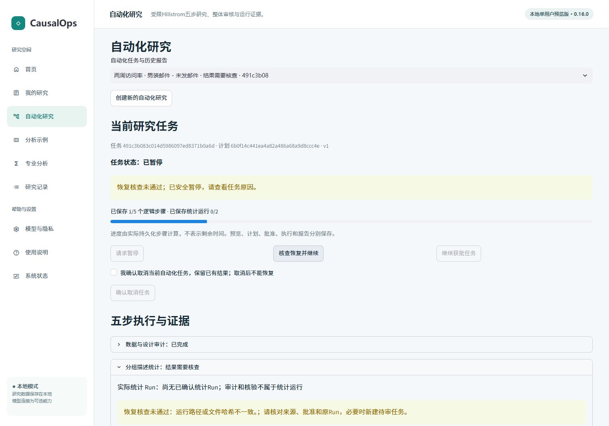
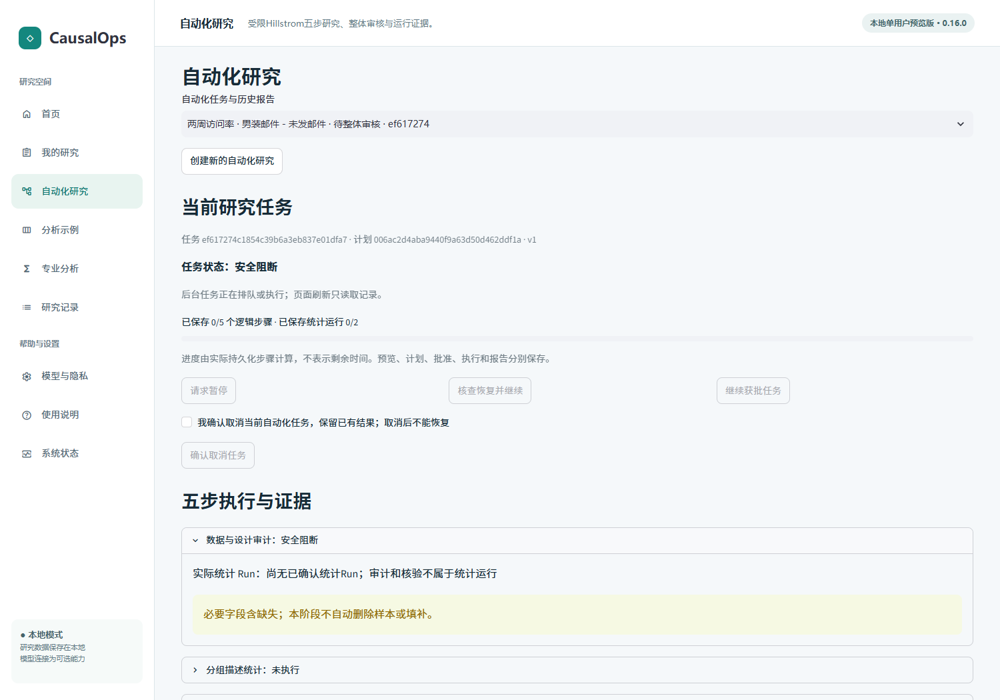

# CausalOps 自动化 V2 第三阶段：研究工作台与完整结果交付

2026-11-06。范围：固定公开 Hillstrom 两组、五个逻辑步骤、两次统计调用。当前为本地单用户受限自动化工作台，不开放任意自然语言自主规划。

## 1. 基线与交付结论

从干净的第二阶段交付 `87601b8`（产品 `a9f02ce`）建立 `feat/automation-v2-stage3`。本轮增加真实 Streamlit 入口、整体审核、持久状态投影、后台派发、暂停/取消/核查恢复、风险摘要、完整事实报告和导出。统计估计器、方法数量、原审批门禁、冻结 V2.3 题目及评分器保持不变。

最终产品提交：`e566f24885cc764c93c5de2c2dcaa4a4fdcc9bdd`；源码指纹：`8ef7398e836dbd3a31c418b96d9ea112a4f8f20baaa82464d3e7c782897f9a9c`。

完整工程成绩、浏览器逐步记录及历史批次差异见 [机器证据](STAGE_THREE_EVIDENCE.json)。没有推送、合并 main 或创建 Release。

**核心产品结论：用户可以从真实首页进入受限自动化场景，审核一次完整计划，自动完成两个真实统计 Run，查看整体报告和证据；可以在安全边界暂停、刷新后核查恢复、取消或在不确定时进入人工核查。** 该结论来自固定浏览器脚本与工程测试，不是自由探索模拟或真人体验证明。

## 2. 实际修改的源码

| 源码 | 主要接口／变化 |
|---|---|
| ui/automation_app.py（新增） | render、_create、_plan、_live、_budget：数据来源确认、任务历史、整体审核、真实进度、控制、风险、预算与报告 |
| application/automation_results.py（新增） | snapshot：有界重读避免组装时跨提交；report_html、export_json：从真实结构化证据生成完整或部分交付 |
| application/background.py | AutomationJobs：复用原单工作线程池，增加V2后台派发与中断标记；不把V2任务伪装成旧LangGraph Flow |
| ui/workbench.py | 首页、侧栏及研究记录加入入口；旧记录区分自动化与单次流程 |
| ui/showcase_support.py | 注册 automation 路由 |
| ui/marketing_case.py | 保留旧流程，增加进入五步研究的明确按钮 |
| ui/assistant_app.py | 自动化会话指向对应工作台，避免被当成旧版无计划任务继续编辑 |
| application/automation_coordinator.py | 修复统计已提交后异常被二次finish覆盖的问题；保留原异常和Run，交由原调和机制核查 |
| scripts/automation_v2_browser.cjs（新增） | 真实Streamlit＋Playwright／Edge固定浏览器验收、控制器故障注入及独立只读核对 |
| tests/test_automation_v2_workbench.py（新增） | 9项：审批、只读快照、刷新、证据损坏、后台幂等与提交后异常反例 |

没有创建新的统计事实数据库。唯一新增后台表 automation_v2_jobs 记录排队、进程、源码与结束原因，属于调度元数据；统计事实继续位于原 exploration_runs／analysis_runs 和原结果文件。

## 3. UI 与后台调用关系

```text
首页／营销案例／侧栏“自动化研究”
  → ResearchService.automation_v2()
  → create_hillstrom：固定公开包、来源确认、候选，不执行

“批准整份计划并开始”
  → co.approve(expected_plan_sha, human_confirmed=True)
  → AutomationJobs.submit_task
  → 原单工作线程池
  → 新ResearchService，无模型
  → co.run → co.advance → 原逐步授权／依赖门禁
  → TaskRuntime／原注册工具／原研究域审批 → 真实Run
  → S03真实读取S02 → S04 → S05

页面读取
  → snapshot(task + steps + verified evidence + budget + events)
  → report_html（同一块HTML包含任务、计划、两个Run和结果）
  → 查看／HTML下载／JSON证据下载

暂停／取消 → co.pause / co.cancel（短事务）
恢复按钮 → AutomationJobs → co.resume（所有权、批准、输入和Run调和）
        → 核查通过才 co.run
```

刷新、切换历史及轮询均不调用统计执行入口。只有显式批准、继续获批任务或核查恢复触发后台派发。恢复不是新批准，也不会继承失效批准。已取消任务没有可用恢复按钮，服务层仍拒绝再次授权。

## 4. 用户可以实际使用的流程

1. 在首页点击“启动自动化研究”，也可从侧栏或营销案例进入。
2. 查看公开来源、客户单位、两组纳入规则、两周窗口和固定工具范围。提供原始公开压缩包，或由部署者配置该公开包位置；页面不显示开发机路径。
3. 明确确认来源和研究定义，点击“生成五步研究计划”。这里只建候选，不批准、不统计。
4. 在左右两栏核对目标、数据合同、五步依赖、方法、计划版本及停止条件，勾选完整审核后点击批准。
5. 后台自动推进，页面展示已保存步骤、工具尝试及可核对Run。只有描述统计和A/B是统计调用，审计、门禁和整合不伪装成Run。
6. 查看两组访问率、概率差、原区间、来源与限制，导出完整HTML或结构化证据。
7. 请求暂停时等待安全边界；刷新后仍为同一任务。需要恢复时由服务核查；取消后只读保留。数据、批准或证据冲突时查看原因，不能直接强行执行。

当前固定计划的模型自主规划关闭，不因页面连接过DeepSeek就自动外发。本轮无收费模型API请求。

## 5. 实际页面

以下均来自最终源码的实际程序，使用公开数据；不是低保真原型。

### 首页与整体审核



### 报告与预算



### 安全控制





## 6. 报告与风险摘要

报告默认确定性生成，数值来自 snapshot 重载的 S01—S05 证据和原ToolResult，不从模型文本提取。报告包括目标、数据来源、纳入规则、客户样本量、两组率、百分点差、原工具区间、两次独立Run、研究设计依据、实际检查、未验证假设、计划／批准和步骤内容哈希。

正常实际结果：
- 未发邮件：21,306客户，访问率10.62%。
- 男装邮件：21,307客户，访问率18.28%。
- 原工具差值7.6589563651531245个百分点。
- 原95%区间[6.995322354054364, 8.322590376251885]个百分点。
- UI报告显示差7.66，区间[6.995, 8.323]；导出的结构化证据保留原精度。

快照组装前后核对任务与步骤身份；中途变化时有限重读。完整报告的标题、指标、运行编号和正文在同一HTML中渲染。证据损坏或不完整时只导出部分完成说明，不能因数据库状态写着completed就生成完整结论。

风险摘要按规则给出“程序检查已通过”“用户已确认”“尚未执行”“执行不可用”“阻断”和“解释限制”。不生成模型风险评分：
- 结构、缺失、实体、两组与二元值来自实际审计。
- 来源和随机化属于公开资料及用户确认，不称为程序证明。
- S03来自描述Run的样本、配置和哈希，不以显著性放行。
- 仍提示未做基线协变量平衡、未验证无干扰、不能推断长期净利润。

预算展示真实请求、修订、工具尝试和未知用量。当前模型请求0，不冒充真实DeepSeek调用。共用账本上限12与本计划授权模型调用0分别说明；价格未配置时不显示伪造费用。

## 7. 真实浏览器验收

测试环境为Windows、Python3.11、Playwright驱动实际Edge与Streamlit。每个固定流程使用新工作区及浏览器会话；创建、批准、暂停、恢复、取消、下载、刷新和历史重开均通过实际控件。控制器只负责测试启动、故障注入和结束后读证据，不代替用户执行ResearchService来冒充浏览器成功。

| 场景 | 最终结果 | 实际浏览器操作 | 后台核对 |
|---|---|---|---|
| A 正常完整任务 | 通过 | 首页→来源确认→完整方案→明确批准→自动运行→下载HTML/JSON→刷新→历史重开 | 1整体批准、1描述Run、1 A/B Run；文件哈希与数值不变 |
| B 条件不足 | 正确阻断 | 同样从首页建立与审核；显示必要指标缺失、S01失败及部分完成 | 测试夹具只对审计帧注入1个visit缺失；描述与A/B均为0，不自动删行或填补 |
| C 暂停/恢复/取消 | 通过 | 在S02真实提交边界请求暂停；刷新；核查恢复；新任务取消；再开原报告 | 恢复后同一个描述Run，没有重算；取消任务保留描述Run、不产生A/B；原报告不变 |
| C 不确定结果接管 | 正确停止 | 工具提交后证据被受控损坏，点击核查恢复，显示暂停及具体原因 | 存在1个原描述记录但不可确认，不重算、不产生A/B、没有完整结论 |

最终批次 browser04 的固定操作记录：A为11次、B为6次、C暂停取消为17次、C接管为7次。它们是脚本记录的点击／导航／下载次数；截图定位滚动和测试夹具释放不作为用户操作成本。耗时包含应用启动、渲染、控制器取证与受控等待，因此不能解释为用户完成研究所需时间或真人效率。

C暂停夹具在真实S02 Run已保存后等待控制器释放；它没有修改批准或增加运行。B不向生产入口开放任意数据，本入口仍只接受已核验包；缺失场景通过明确标注的隔离审计数据夹具验证。该受控结果不等于支持任意表自动分析。

另外完成旧版单次营销实验的真实浏览器回归：原数据入口、待审方案、人工审核、原统计执行、报告下载与刷新保留运行。它与自动化入口分别计数。

## 8. 首次失败、修复与复验记录

保留 red、所有browser01—04与legacy01—02，不覆盖首次失败：

1. 初始3项定向测试失败，缺少快照、导出和后台入口；实现后通过。
2. browser01 B首次脚本只等待顶部状态，过早读取未渲染完的正文。改为同时等待具体阻断原因和部分报告，不修改任务目标或产品标准。
3. C证据损坏夹具暴露真实产品边界：TaskRuntime.finish已提交释放令牌后，后续异常处理再次finish，覆盖原异常为“令牌失效”。新增失败测试复现后，按令牌是否仍属本次尝试决定是否记录interrupted，保留原异常与Run；没有改估计器或放宽审批。
4. browser03 C暂停场景启动端口被占用，浏览器未进入任务。列为基础设施失败，改用非系统动态客户端端口范围并及时报告服务退出；原失败保留。
5. legacy01脚本点击了被自定义控件覆盖的原生radio输入。使用可见“人工审核”标签重新运行通过，不强行点击、不修改旧产品。
6. 自动轮询仅在活动后台存在时开启；结束后重绘页面，完成报告不再持续轮询。导出报告CSS限定在报告组件内，不改变整个工作台样式。

本轮没有通过调整评测答案、调用后端代替浏览器或把失败从记录中删去来获得通过。

## 9. 工程测试与复现

| 批次 | 实际成绩 | 实际耗时 |
|---|---|---|
| 初始 red | 3项失败，接口尚未实现 | 保留原日志 |
| green02 | 8项通过 | 31.291秒 |
| 提交后异常 red | 1项稳定失败，暴露二次finish覆盖 | 保留原日志 |
| affected01 | 83项通过，0失败/跳过 | 199.203秒 |
| full01 最终完整工程回归 | **971项通过，0失败、0跳过** | **617.549秒** |
| browser04 | 4条自动化固定流程全部到达判据，含正确阻断与接管 | 45.059／28.923／61.905／36.418秒 |
| legacy02 | 旧版单次营销流程通过 | 43.429秒 |

最终完整回归包含全部新增测试及原审批/执行安全测试。受影响批次之后仅调整报告CSS作用域，最终全回归及browser04在同一最终源码指纹上验证。新增工作台测试9项，包括页面刷新不执行、未审核禁用批准、口径变化禁用批准、证据损坏拒绝完整报告、后台重复提交及提交后异常恢复。原第一、第二阶段五步、预算、审批和原研究域门禁测试继续运行。

```powershell
$env:PYTHONPATH = (Resolve-Path src).Path
$env:PYTHONUTF8 = "1"
$env:PYTHONDONTWRITEBYTECODE = "1"
$env:CAUSALOPS_HILLSTROM_ARCHIVE = "<已核验公开包>"
python -m pytest tests/test_automation_v2_workbench.py tests/test_automation_v2_stage2.py tests/test_automation_v2.py tests/test_automation_v2_safety.py
python -m pytest
```

浏览器脚本需要Node与Playwright包，并设置正确的Python依赖环境和Edge路径。ROOT为新建独立证据目录，不使用正式用户工作区：

```powershell
$env:CAUSALOPS_TEST_PYTHON = "<Python3.11环境的python.exe>"
$env:CAUSALOPS_BROWSER_EXECUTABLE = "<本机Edge或Chromium可执行文件>"
# NODE_PATH 指向已安装playwright包的node_modules目录。
node scripts/automation_v2_browser.cjs "<新建独立证据目录>"
# 可另设 CAUSALOPS_BROWSER_CASES=legacy-single，仅测试旧单次流程。
```

本轮无新模型收费调用、无V2.3任务重跑、无多角色模拟或真人研究。完整工程通过不能代表Agent开放研究准确率。

## 10. 已知限制与首版验收建议

- 仅支持固定Hillstrom两组访问率。任意自然语言规划、多表、方法扩展、复杂主动诊断和长期记忆未开放。
- 完成报告为确定性事实交付，不意味着一般开放问答能力已经改善；原Beta研究解释限制仍适用。
- 暂停不强杀工具；未知所有权、孤立／损坏证据仍需人工核查，不承诺跨SQLite与文件物理恰好一次。
- 页面选择器里的状态摘要可能在后台快速结束时短暂滞后；当前任务区、报告自身任务ID与两个Run来自绑定快照，手动刷新可同步摘要。不能把摘要滞后解释为已授予执行权限。
- 进度中的Run数表示已关联并通过读取校验的步骤Run；未调和或损坏的物理记录不计入成功进度，会保留核查原因。
- 风险区只解释现有规则与来源，不能验证全部因果识别假设。
- 后台在同一个进程中的所有权无法证明失效时仍保守拒绝接管；页面不提供强制绕过。
- 完整浏览器场景依赖固定脚本和受控故障，尚无真人独立完成率或提效数据。

**建议：可以进入自动化V2受限首版的验收整理与负责人审阅。** 当前目标是可操作、可核查和可安全停止的固定链，不能升级表述为生产级通用自主研究。后续上线、分支整合或其他功能须另行决定。本轮完成后停止，不推送、不合并、不创建Release，也不自动启动大规模评测。
