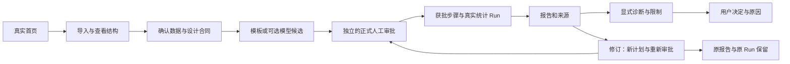

# P3 受限研究可用性试用协议

目标是观察实际用户的学习成本、任务完成和理解边界。计划邀请3—5名自愿成年人，至少覆盖分析经验较少的业务使用者、熟悉表格的数据分析人员和熟悉统计的研究者。画像是招募配额，不是已证实的用户构成。尚未招募时不填写参与者或成绩。

## 版本与功能审计

已验收开发源码为 `9dc0954`；本材料适用于0.20.0b1受限Beta快照。原试用准备无真人参与，不能据此认定已验证可用性。研究主体仍为本地单用户工作台。

| 用户旅程 | 当前真实能力 | 限制与观察点 |
|---|---|---|
| 首页选择自有数据 | CSV/Parquet预览、字段类型和缺失数 | 上传不是计划；受限单表、两个组、二元结果 |
| 配置研究合同 | 分析单位、记录键、组值及含义、结果编码、单位、窗口、来源 | 独立性和设计来源由人核对；技术行号不证明独立性；不自动按日期切片 |
| 候选计划 | 模板；可选模型在两条允许路径中提议 | 模型不创造方法、字段、随机化事实或执行权；默认关闭 |
| 采纳与审批 | 候选可形成新计划版本；正式整体人工批准一次 | 合同确认、候选采纳、正式批准是不同状态；每一步仍重新授权 |
| 执行及报告 | 随机化依据已登记：五逻辑步骤、两Run；未知：四逻辑步骤、一描述Run | 原工具适用条件与严格缺失门禁保留；未知不被认定随机化或自动违规 |
| 显式证据诊断 | 六规则、五状态、三层报告、有限建议 | 八规则未实现；核对来源声明不等于证明实验设计真实发生 |
| 保存研究决定 | 用户主动提交原因、追加历史、同任务确定性关联 | 决定不是事实证据、研究计划或批准；不跨任务模糊迁移 |
| 修订与历史 | 新范围形成新任务/版本并重新审核；旧结果可查 | 窗口改变须实际新数据，不能只换文字；旧批准失效不等于旧Run被覆盖 |

依据为 `src/causalops/ui/configurable_app.py:editor`、`ui/constrained_planning_app.py:render`、`ui/automation_app.py:render/_plan/_live`，服务为 `configurable_research.create/binding/revise`、`CandidatePlanning`、`BoundedCoordinator`、`DiagnosticWorkbench` 和 `ResearchDecisionService`。完整历史证据见 [第二阶段](../PUBLIC_SUMMARY.md)；本期不重新实现这些能力。

## 试用组织

每人建议45—60分钟：同意与背景5分钟、任务A约15分钟、B约10分钟、依赖B的C约15分钟、复述和反馈5—10分钟。时间为主持安排建议，不是已测完成时间。A/B可对调，C必须在B完成后进行；若B失败，C标记起点不可建立，不能假造前置成果。需要主持提供受控起点时另记介入与实际起点。

只记录匿名编码及分析经验档位，不收集姓名、单位、研究数据或账户。产品开发者、负责人预览和脚本预演可用于环境核对，不纳入独立参与者。已有数据熟悉程度单独记录；不能自动把熟悉案例称为陌生任务。

默认只用 `dataset-A.csv` 和 `dataset-B.csv`。A是先前已核对版本的OpenIntro公开教学数据；B是本期可重现的虚构记录。C复用B的第二个实际二元字段，选择指标变更，不增加时间切片能力。任务不是新的通用Agent评测题库。

从用户读完任务说明、明确表示开始起计时；截至其宣布完成/放弃并提交结果复述，或达到主持预先说明的单任务上限20分钟。不中途暂停总计时；页面等待和外部中断分别记录，可另列净操作时间但不替代总时间。C从已完成B的报告页面起计，不能称作完整研究端到端时间。

## 结果类别

完整研究目标须同时满足功能终点、来源正确、必要解释正确。完成操作但不能说明比例/百分点/区间或未知条件，不能标为完整研究成功。

- 完全独立完成：目标完成、理解核对通过、无任务方向性帮助或代操作。
- 少量协助下完成：目标完成，接受过分级帮助；保留帮助内容和次数。
- 部分完成：完成部分有效成果或只完成操作而理解不足。
- 未完成：未得到所需成果、错误结论、放弃或超时。

独立性、功能完成与理解分别记录，不以一个总分替代。安全阻断可为正确系统行为，不能为了用户完成率放宽研究条件。

## 模型对照

主试用默认模板，模型请求预算为0。选做对照仅在参与者另行同意、主持确认允许的公开/合成合同及有效预算后进行；使用相同研究事实、不同隔离任务，次序交替并记录练习效应。当前最多为每人一次候选请求、超时60秒、自动重试0；外发前必须使用产品原有完整摘要预览和任务授权，正式审批不能省略。

比较的是操作数、人工帮助、等待、候选理解、额外确认负担与最终正确处理，不做显著性推断。不把模型返回顺畅等同于方法正确。拒绝、超时和失败保留；回退需用户明确选择模板。令牌来自真实台账；未登记可核实价格时费用为未知，不记为免费。没有真实用户对照时，相关结论保持“未验证”；第二阶段2次官方调用仅为技术验收证据。

## 隐私与证据

录屏、录音、逐字访谈、自由文字和外部模型发送分别征得同意。默认关闭录屏/录音，不自动记录输入框值、文件名、上传行内容或密钥。观察标签需脱敏；自由反馈只记经参与者确认的必要摘要，原话引用需额外确认。联系人另由负责人保管，不进入项目或Git。

本地工作区、操作原始记录和身份对应表均不提交Git。推荐经负责人确认后在汇总完成30天内删除可识别的试用原始材料；这是待确认保留策略，不是已经执行的删除。参与者可跳过、暂停或退出；不因退出删除其失败分母，报告注明撤回与可使用范围，按同意处理原始材料。

## 问题优先级与修复门槛

P0包括错Run/错单位/越权执行/无依据因果结论/混显；一例可信证据即可暂停试用并隔离，保留任务、Run、页面、时间及版本。P1为阻碍任务的配置、审批、恢复或报告定位；记录实际影响和出现次数。P2为非关键可读性与层级问题。代码审查风险、脚本故障和真人观察分别标注，不虚构频次。

只有有证据的高影响问题才做最小修复。产品源码有变更则按要求做定向、受影响、一次完整回归和相关真实浏览器；仅材料/运行器变化不重复全套1,137项或旧17条。不得以脚本通过替代真人可用性结论。
