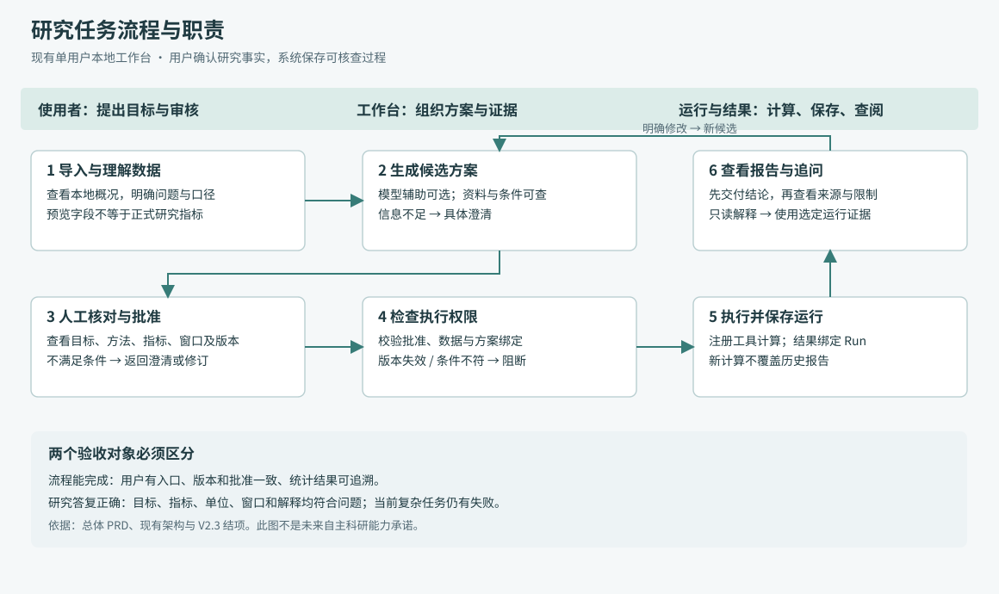
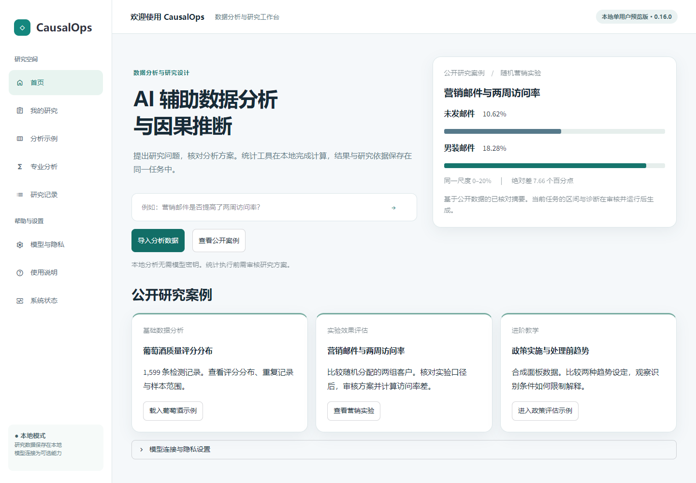
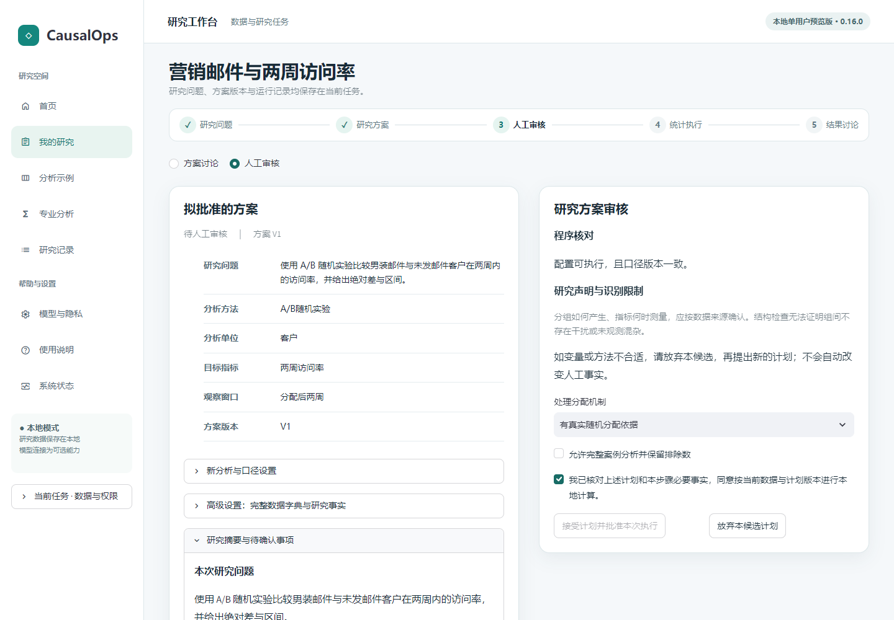

# CausalOps Beta 总体 PRD
**V1.0 候选｜基于已实现版本整理的现状 PRD｜待最终确认**
依据：1737c9c 归档及 b8f5758 产品源码。公开快照为 5f350ab，N06 等后续本地迭代不自动等于已公开版本。本文件不虚构立项前评审或真人调研。证据编号见[索引](00_材料核查与证据索引.md)。

## 1. 背景、目标与非目标
当前定位：**可审核、可追溯的 AI 数据科学 Agent**。主要服务具有一定数据分析需求的业务分析人员，科研人员为专业扩展用户；公开营销实验是首要演示场景。产品目标是帮助使用者从单表形成可回答的问题，审核研究方案，执行已支持的统计分析并查验结果来源。具体痛点与收益仍待真人验证。

当前交付形态是**单用户本地 Beta**。模型可选。目标不等于已达成的通用能力：开放式研究语义、复杂指标和最终解释仍有失败。不能把“有门禁”理解为“模型不会给出错误建议”。

本文件是基于已实现产品整理的现状 PRD，不是开发前需求文档。当前功能范围不包含多表自主研究、云端多人协作、无人审核统计执行或任意代码生成执行。

**规划说明：**下一代定位为“受控自动化的数据科学 Agent”，长期定位为“自动化数据分析与研究工作台”。方向及优先级已获负责人认可，但不代表排期或开发授权。持续 P0 是研究正确性、证据约束、审批与执行安全；P1 为有界多步骤自主规划，P1 后续为基于证据的主动诊断，P2 为多表数据与指标管理、RAG 专项评测与必要优化，P3 为定时任务、外部工作流和多人协作。P0 不要求所有开放问题全部通过才启动新功能。

本 PRD 不加入未实现的自动化功能规则。建议边界见[需求概要](06_自动化方向需求概要.md)，正式开发前另行编制[《多步骤自主研究规划专项 PRD》](06_自动化方向需求概要.md#special-prd)（目前仅设编制入口，正文尚未编写）。

## 2. 用户输入与责任
| 阶段 | 用户需要知道/输入 | 可以暂时不知道 | 系统不能替用户确认 |
|---|---|---|---|
| 导入 | CSV/Parquet 文件及来源 | 先选哪种统计方法 | 数据授权与业务真实性 |
| 理解数据 | 每行对象、目标字段、单位 | 可先浏览概况再定问题 | 字段名是否等于业务含义、重复是否应删除 |
| 制定方案 | 研究目的、样本范围、窗口、分组 | 不确定的设计事实需留空/澄清 | 随机分配、无干扰、处理前测量、因果识别 |
| 审核 | 检查方案与自身目的相符 | 不满足条件时暂不批准 | 用普通勾选覆盖已确认冲突事实 |
| 解读 | 知道自己查看的报告及口径 | 可询问术语与结果含义 | 从统计显著性直接推导业务收益或因果成立 |

用户确认应与程序检查分栏表达。程序能检查字段、版本和结构，不等于证明研究假设。

## 3. 用户流程

[流程源文件](diagrams/user-flow.mmd)。实线表示现有主流程；澄清、失败与修订回到可操作的状态。新研究与已有结果追问使用不同路径。

- **新研究：**导入 → 数据概况 → 明确问题与口径 → 候选方案 → 审核 → 批准版本 → 执行 → 报告。
- **已有结果：**选择历史运行 → 提问 → 读取该运行证据 → 回答或说明不足；只读请求不应创建新计划。
- **研究修改：**明确修改 → 候选差异 → 新版本审核 → 新运行；旧报告保留。
- **能力限制：**上述为产品规则和设计目标；V2.3 已记录部分只读误建候选、方案约束与答案不足，不能宣称全场景达标。

## 4. 页面与状态组织
| 用户区域 | 用户应看到的核心对象 | 主要动作 | 禁止误导 |
|---|---|---|---|
| 首页 | 数据导入、公共案例、可选模型连接 | 上传、载入案例、配置连接 | 连接配置不能等同任务外发授权；示例预览不能等同用户新运行 |
| 数据概况 | 行列、字段、缺失、重复及当前预览字段 | 看分布、补口径、选问题 | 本地预览不能称已批准正式报告 |
| 研究工作台 | 当前问题、候选方案、状态及历史 | 询问、明确修改、查看差异 | 方法咨询不能仅因提及方法名就转计算 |
| 方案审核 | 目标、方法、变量、样本/窗口、版本、阻断原因 | 核对、批准可执行版本 | 不自动勾选，不将全部假设显示为程序通过 |
| 报告 | 当前运行、结论、目标指标、图、限制及来源 | 导出、追问、切换历史 | 新运行编号不得与旧报告正文混显 |
| 恢复与诊断 | 错误原因、保留内容、可操作下一步 | 改文件、补条件、重试或本地模式 | 不静默换模型、不覆盖历史、不宣称恢复未验证内容 |

现状截图示例（来自已有验收，非本轮重新拍摄）：

*图 P-1：公开营销案例与导入入口。历史公开版本页面，用于说明入口结构；不证明 N06 后续迭代已发布。*

*图 P-2：营销实验审核状态。截图表示审核页面状态，不因勾选可见就推断已批准执行。*

## 5. 功能规则与验收条件
下表是**可验证规则**，不是本轮测试通过声明。已实现依据及缺口分别列出。

| ID | 功能/规则 | 可验证验收条件（给定—操作—结果） | 依据与状态 |
|---|---|---|---|
| FR01 | 文件导入 | 给定支持格式和限额内文件，导入后产生任务与概况；给定非法/重复字段文件，显示拒绝原因且不冒充成功 | E01/E05，已有固定流程；上传上限以配置为准 |
| FR02 | 概况与正式结果分离 | 仅切换预览字段，正式 Plan/批准/Run 不变；页面说明预览字段与正式指标 | S01/S02，V2.2 本地已实现 |
| FR03 | 问题与必要口径 | 仅有表而无问题时允许先看分布；需要的分析单位、窗口或设计事实缺失时，具体澄清 | E03/E09，复杂语义有已知失败 |
| FR04 | 方法建议与来源 | 可查看适用条件、诊断和来源；找不到依据不编造文献或声称假设成立 | E04，方法检索已实现；检索质量未全面专项验证 |
| FR05 | 结构化计划 | 明确新分析进入待审；字段、方法和实际支持的样本/窗口约束应一致；不能只在理由中写约束 | S03/S04，V2.3 存在条件落实不足风险 |
| FR06 | 解释与修改分离 | “解释当前报告”不改变 Plan；明确换指标创建新候选，并显示差异 | S01–S04，既有通过案例与复杂只读误路由同时保留 |
| FR07 | 审核门禁 | 缺少必要事实/无效字段/版本不符时拒绝批准或执行并说明原因；模型答复“已批准”不构成权限 | E04、S03，核心工程验证；不等于所有语义冲突已识别 |
| FR08 | 版本化执行 | 有效批准只适用于绑定的数据、方案及配置；新指标/窗口需要新校验与批准；后台直调也受检 | E04/E07，审批与历史保留已有验证 |
| FR09 | 工具计算与证据 | 注册工具产生数值，保存 Run 和复现材料；回答不能凭空补数或把建议当已运行 | E04，17 项入口；验证深度不一 |
| FR10 | 报告选择一致 | 切换报告时指标、窗口、运行编号、正文同源；加载中不能把旧正文标为新运行 | E07/S05，N05 定向采样验证 |
| FR11 | 结果交付 | 对“数值+含义”分别交付数值、单位、比较对象、窗口、来源与限制；缺少证据应说明 | E09，当前仍有遗漏/解释错误，不宣称已全面满足 |
| FR12 | 输出与历史 | 可导出已有报告和证据；重新计算保存新 Run，不覆盖旧报告；刷新可恢复正式任务上下文 | E02/E07，有限流程通过；不承诺任意浏览器状态永久保留 |
| FR13 | 模型与外发 | 配置连接独立于任务授权；未授权任务内容不发模型；不将密钥、原始私有行作为默认模型上下文 | E03/E04，现有边界；实际发送受任务与连接配置控制 |
| FR14 | 本地模式 | 不连接模型仍可走支持的本地研究流程；复杂问题能力不同，不能借用模型成绩 | E08/E09，分别计分 |
| FR15 | 故障恢复 | 保存已存在的任务/报告；提示下一步；涉及批准、执行的失败不能盲目重放 | E05/E06，受控恢复验证；无真人自主恢复率 |

当前 README 登记文件限额：50 MB、100,000 行、200 列、解码后 256 MB（E01）。这不是“大数据分析”承诺，部署实际限制应与配置一致。

### 方法范围与审核含义
现有方法合同覆盖描述/相关/非因果关联模型、随机实验与调整、观察性效果方法及进阶研究设计，共17项注册入口。完整机器生成清单继续以[方法合同](../../METHOD_CONTRACTS.md)为准，本PRD不另行维护第二套注册表。

“研究工作台对新Plan的批准”与“某方法需要哪些因果设计声明”是两个层次。描述统计不需要无依据填写随机化或无干扰声明，但本轮所述工作台正式报告入口仍先生成待审方案。专业/历史程序入口的具体要求遵循对应方法合同，不能将N06局部流程概括为所有入口完全相同。PSM等方法的已知推断限制仍须在方法说明中保留；注册可调用不等于已全面验证。

## 6. 研究状态及权限
| 状态 | 含义 | 允许行为 | 禁止行为/退出条件 |
|---|---|---|---|
| 尚无任务 | 只有首页/文件选择 | 导入、看说明、连接模型 | 不展示虚构运行 |
| 已载入、未明确问题 | 有数据概况 | 看预览、补口径、提出问题 | 预览不写入已批准方案 |
| 需要澄清 | 必要条件不充分 | 回答具体问题、撤回请求 | 不把猜测视为业务事实 |
| 待审候选 | 方案已生成未获批准 | 看差异、问原因、修订 | 仅“看看新版”不批准、不执行；问答需保存 |
| 已批准 | 指定版本有有效批准 | 按该版本执行 | 数据/关键配置变化后不能沿用旧批准 |
| 执行中 | 后台处理该版本 | 查看进度、按现有停止机制处理 | 不重复提交改变状态操作 |
| 已完成 | 有保存运行与报告 | 只读追问、导出、选历史 | 新要求不能被旧数值冒充 |
| 阻断/失败/中止 | 未完成当前动作 | 看原因、补条件或重新提交 | 不删除失败证据，不把旧成功当本次成功 |

DataContract 提供业务字段、时序及口径；Plan 是待执行设计；Approval 是特定版本许可；Run 是已发生计算；Report 是该运行的展示。不能互相替代。现有配置无法表达的研究约束，应明确限制，不以模型文字补足可执行能力。

## 7. 异常与恢复要求
| 情况 | 用户提示应说明 | 正确下一步 | 当前证据/边界 |
|---|---|---|---|
| 文件拒绝 | 失败字段/格式及未创建成功任务 | 用修正文件替换 | N08 为预置修正文件的受控恢复，不是自行修复数据 |
| 口径缺失 | 缺少哪个分母、单位、时间或设计依据 | 补充事实或选可支持问题 | V2.3 仍可能泛化澄清/解释不充分 |
| 模型连接失败 | 请求失败、已有记录保留 | 明确重试或显式本地模式 | 不静默替换服务，不把模拟响应当真实 |
| 已有待审方案 | 当前候选与版本、仍需确认项 | 查看/解释/明确修订 | 不自动生成冲突候选或丢失本轮问答 |
| 批准失效 | 哪个数据/方案条件改变 | 返回审核新版本 | 不复用旧批准 |
| 新指标/新窗口无运行 | 当前报告不能回答新问题 | 生成待审方案或澄清 | 不用旧窗口数值替代 |
| 报告切换 | 正在加载或显示的完整同源报告 | 等待一致状态 | N05 修复有采样证据，不宣称所有时序已穷尽 |

## 8. AI 的权限边界
- 可辅助：理解请求、检索方法资料、提出候选、解释已保存证据。
- 不可自行确认：随机分配、处理前测量、无干扰、数据许可及缺失业务定义。
- 不可自行批准或绕过：新方案审批、版本绑定、工具执行门禁。
- 数值应来自本地运行/有依据的确定性换算；模型推断需与计算事实分开。
- 只读问题和新分析的判别仍有限。安全停下是可接受结果；错误建议仍需记录，不能因最终没执行就算建议正确。

## 9. 完整公开案例的产品验收
**场景：**比较男装邮件组与未发邮件组的两周访问率（Hillstrom 公开实验；E02）。
1. 从教程指定来源导入数据；确认分析是两臂比较，非全部三组混合。
2. 明确客户级样本、分配来源及两周访问定义，检查访问指标是二元结果。
3. 生成结构化方案，人工核对目标、组别和必要声明。
4. 批准并执行，报告、导出及后续回答绑定同一 Run。
5. 核对对应教程运行的控制组 2,262/21,306、男装邮件组 3,894/21,307；访问率约 10.62% 与 18.28%，差 7.66 个百分点，非 7.66% 相对增长。该运行相对变化约 72.14%。
6. 追问利润或新窗口时不得拿访问率回答；更换指标需新方案。
7. 核对运行来源、报告和历史保留。

这些是已有案例数值，**不是产品本身提高了客户访问率**。新用户应使用自己的实际 Run，不预填历史运行编号作为新计算。置信区间、配置与样本以真实运行为准。

## 10. 指标与验收状态
“可完成一次固定流程”“模型能正确理解开放问题”“真人能独立使用”分别验收，不能互换。详细口径见[指标体系](04_产品指标体系与版本路线图.md)。

现状：V2.2 固定八题 8/8，N06 自由探索最终 0/3 达到全部终点；V2.3 保留执行子集两模式均已确认 0/13。当前 PRD 因而是**含已知缺口的现状说明与验收基线草稿**，不是全面验收通过证明。

## 11. 本稿待审事项
主用户、营销演示和三阶段定位已由负责人明确。待最终确认本稿文案与展示版本；自动化首个任务、审批颗粒度、步骤/费用/失败限额与验收阈值留待专项 PRD。真人研究方案和远程发布仍未授权。见[决策清单](05_负责人决策与作品集结构.md)。
