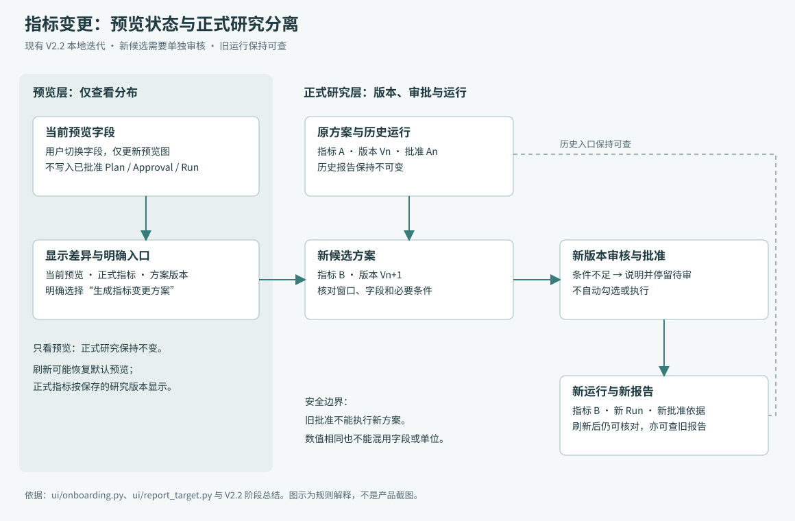
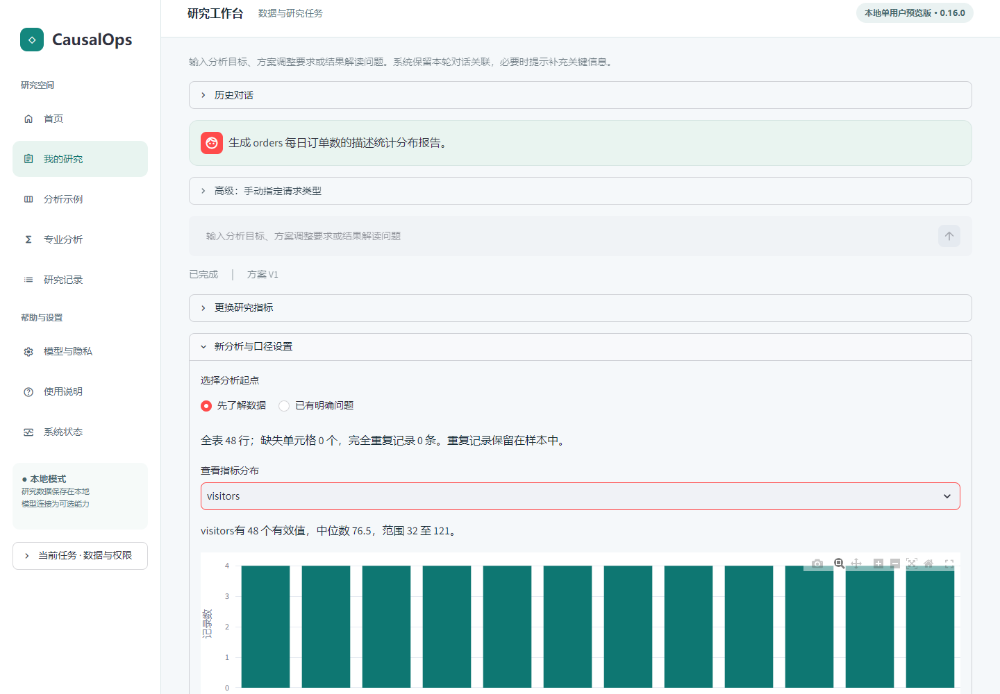
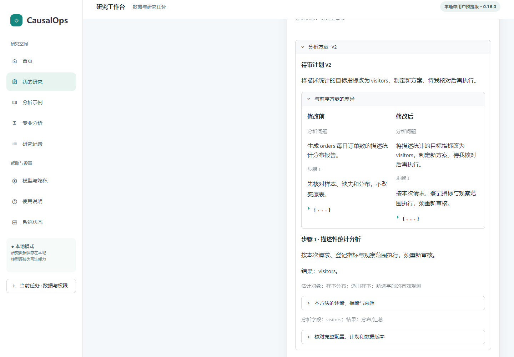
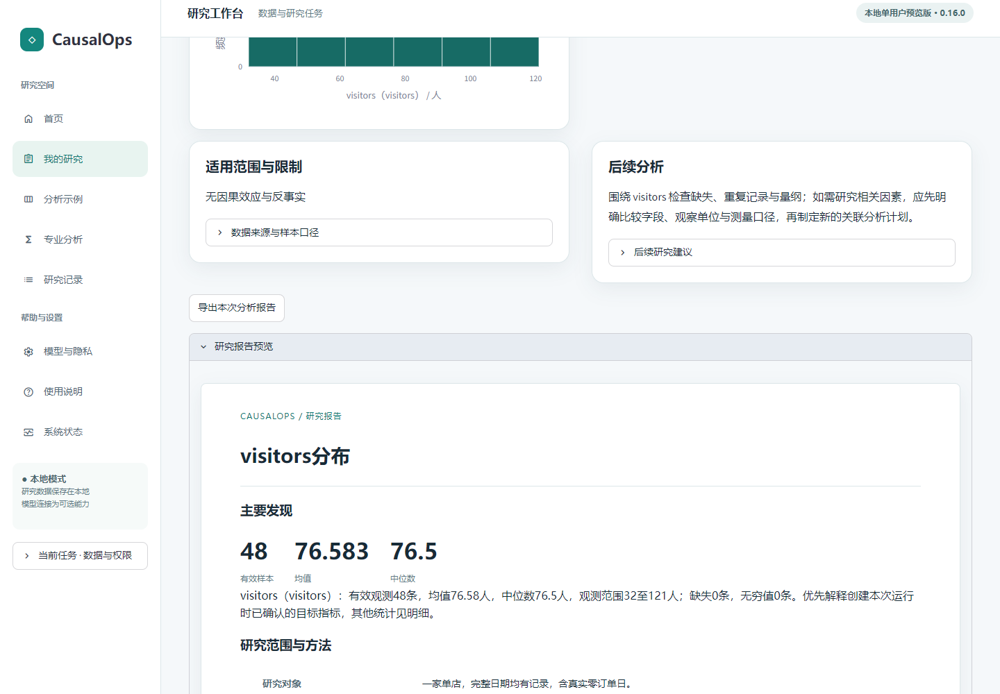
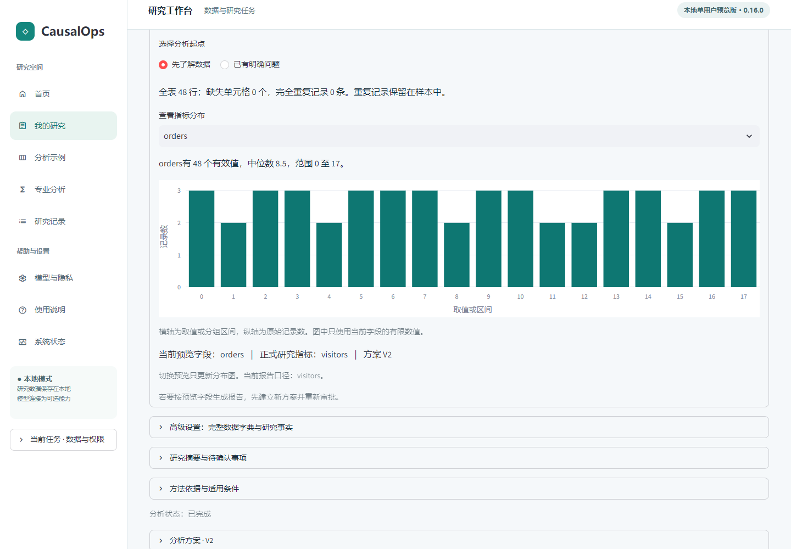

# N06 指标变更专项 PRD 与产品方案
**V1.0 候选｜历史迭代复盘与现状规则｜待最终确认**
对象：V2.2 产品 152b410、交付 863b017；当前归档 1737c9c 的 UI 与该产品提交无差异。主要来源：[阶段总结](../../evaluation/v22/STAGE_SUMMARY.md)、[第四期报告](../../evaluation/v22/FOURTH_PHASE.md)、[冻结协议](../../evaluation/v22/PROTOCOL.md)。本方案不是虚构的开发前评审记录。

## 1. 问题来源与影响
受限模拟操作者在预览中选择 visitors 后，点击“生成完整描述统计报告”，实际仍按已登记的 orders 生成方案与报告。预览字段和正式结果指标原本是**独立状态**：预览选择只影响图表，报告请求依据 DataContract/当前 Plan。

当两个状态没有清楚说明时，按钮文字容易让人以为“当前看见的字段就是要计算的指标”。这属于界面承诺与操作含义不清，并不等于统计内核算错；当时批准与运行记录合法，不能把它写成越权执行事故。实际来源是模型浏览器评测，不是真人投诉或访谈。（E06、E07）

用户价值假设：让使用者在创建方案前看清正式指标，减少不必要的错误候选和后续返工。此价值尚未通过独立真人研究验证。

## 2. 目标与非目标
**目标：**让用户可核对当前预览、正式指标、方案版本和将采用的执行指标，并能通过明确入口创建新的指标方案。

**非目标：**预览自动改变已批准方案；自动勾选审核；为减少点击跳过批准；改变统计估计器；保证模拟用户必定完成。

## 3. 需求与对象
| 对象 | 含义 | 何时变化 |
|---|---|---|
| 当前预览字段 | 本地概况图显示哪列 | 用户选择；刷新可能重置预览默认值 |
| 正式研究指标 | 当前方案/口径绑定的 outcome | 明确的新候选，经校验形成新版本 |
| 方案版本 | 当前待审或已批准设计身份 | 创建/修订方案 |
| 批准 | 对特定版本的许可 | 使用者核对后提交；新版本不得继承旧许可 |
| Run | 真实计算及其证据 | 合法执行后产生；历史 Run 不覆盖 |
| 当前报告 | 用户当前选择的运行展示 | 选择新结果或历史报告 |

必须以指标身份、单位和版本核对，不能只看数值是否相同。

## 4. 备选方案与取舍
以下是**基于现有实现的事后方案比较**，没有证据证明当时曾召开包含这些选项的评审会议。

| 选项 | 预期收益 | 主要问题 | 本稿判断 |
|---|---|---|---|
| 预览选择立即改正式指标 | 操作少 | 隐式改变研究目标，可能破坏批准语义 | 不采用 |
| 只增加说明，保留原按钮含义 | 改动小 | 用户仍需寻找正式修改路径 | 说明必要但不足 |
| 区分两类状态，提供明确新候选入口 | 意图显式、审批保留、可追溯 | 控件增加，用户仍可能导航失败 | **现有实现采用此方向** |
| 合并为全新任务向导 | 可能减少概念切换 | 范围大、需新设计与真人验证 | 未来候选，非本轮已实现 |

## 5. 当前交互规则
| ID | 条件 | 页面与行为 | 不允许的行为 |
|---|---|---|---|
| N06-R01 | 预览与正式指标一致 | 显示预览字段、正式指标、版本；报告按钮说明按正式指标生成待审方案 | 不把预览当批准 |
| N06-R02 | 预览与正式指标不同 | 明示两者未同步；已有可用运行且预览为适用数值字段时，提供“以该字段为研究指标，生成待审方案” | 不静默写回原方案 |
| N06-R03 | 用户明确换指标 | “更换研究指标”区域选择其他适用数值字段，创建新候选 | 不自动批准或执行 |
| N06-R04 | 有待审候选/口径过期 | 阻止不适用的重复报告请求，提示先核对当前候选或更新口径 | 不复用失效版本 |
| N06-R05 | 首次任务无已有运行 | 不把任意预览差异当已定义研究；按现有口径确认路径处理 | 不假定首次目标已经确认 |
| N06-R06 | 有明确既定窗口 | 指标修改请求保留可确认的窗口；范围不明确时澄清 | 不顺便修改窗口 |
| N06-R07 | 新方案审核 | 展示旧/新指标、版本、必要确认及阻断原因 | 不把查看候选理解为批准 |
| N06-R08 | 新方案运行成功 | 新报告标明新指标与独立 Run，可继续追问 | 不用旧指标标记新结果 |
| N06-R09 | 打开历史/刷新 | 历史报告不被覆盖；正式指标按保存记录恢复；预览可能恢复默认值并清晰标识 | 不把预览回退误作正式方案回退 |
| N06-R10 | 相同数值、不同字段或单位 | 按字段、单位、方案与 Run 绑定 | 不以数值相等判定报告相同 |

这些规则来自 S01/S02/E07，不代表任意复合研究请求均已支持。当前目标提取与运行选择仍受既有单任务、计划结构限制；涉及多输出/复杂依赖时不可从此方案外推全面支持。

## 6. 流程与关键状态

[图源](diagrams/n06-state.mmd)。只有用户明确创建候选才进入方案修改路径；只看预览保持正式研究不变。新 Run 和旧 Run 并存。

### 状态一：预览不等于正式指标

*图 N06-1：实际 V2.2 页面，预览 visitors；当时正式指标为 orders。截图视口未包含下方全部状态提示，提示全文“当前预览字段：visitors｜正式研究指标：orders｜方案 V1”来自对应页面文本及源码，不能假称图中全都可见。*

### 状态二：新方案等待审核

*图 N06-2：右侧待审 V2 的差异区呈现 orders → visitors。当前阶段只是候选，仍需人工核对并批准。左侧留白是当时真实截图状态，未以设计稿替换。*

### 状态三：新指标报告

*图 N06-3：实际合成测试报告，visitors 48 条记录，均值约 76.5833 人。该数值仅用于状态与字段绑定验收，不是现实营销提升。*

### 状态四：刷新后的两个状态

*图 N06-4：预览字段恢复 orders，但正式指标保持 visitors、方案 V2；独立状态在页面上明确显示。正式研究未因图表默认值变化而撤销。*

图片为原始验收文件的原样副本，见[来源与哈希](assets/provenance.json)。标注在图题中，不改变页面控件或数值。

## 7. 正常与异常流程
正常：打开 orders 历史报告 → 查看预览 → 明确换 visitors → 查看新候选差异和窗口 → 人工核对并批准 → 执行 → 查看 visitors 新 Run → 追问/导出 → 刷新 → 再查 orders 历史报告。

异常处理：
- 字段已删除：提示重新选择，不能提交不存在字段。
- 口径/方案已过期：回到审核，不能沿用之前批准。
- 后台忙碌：报告请求入口禁用或提示，避免重复提交。
- 没选新指标：不能把空值猜成默认业务目标。
- 请求中隐含额外样本/时间范围：校验明确范围；无法表达时澄清，不悄悄忽略。
- 候选存在但用户只想看差异：读取和保存对话，不运行统计。
- 执行失败：旧 Run 保留；错误原因可查，失败不伪装为新成功。
- 模拟器点击控件失败：区分派发/可见性与产品逻辑，不直接记作统计执行失败。

## 8. 源码与调用关系
1. `render_first_look` 返回预览字段，未把该选择写入正式研究。
2. `report_target` 从当前会话、口径、Plan 和已完成运行确定正式目标，校验待审及过期状态。
3. `preview_actions` 和 `render_metric_change` 根据两类目标展示说明与候选入口。
4. `report_request` 构造明确修改请求，保留可确认窗口，拒绝缺失字段或不明确范围。
5. `report_plan_button` 调用 BackgroundJobs 的 `submit_start(mode="plan", ...)`，携带父流程及运行上下文。
6. 后续沿用 ResearchService/原审批执行链，新方案批准后产生新 Run。
7. 工作台及历史报告组件读取指定 Run；预览不会覆盖报告。

源码：[onboarding](../../../src/causalops/ui/onboarding.py)、[report_target](../../../src/causalops/ui/report_target.py)、[工作台](../../../src/causalops/ui/graph_app.py)、[后台任务](../../../src/causalops/application/background.py)。旧程序式基础报告快捷入口仍存在，但此工作台按钮不再使用它；不将局部调整夸大为全架构重写。

## 9. 验收标准与实际证据
| 验收项 | 判据 | 已有记录 |
|---|---|---|
| 预览隔离 | 仅选字段不改变正式 Plan/批准/Run | 定向测试与页面检查 |
| 新候选 | visitors 成为新 Plan 的正式 outcome，原窗口按规则保留 | 专项实际 V1→V2 |
| 审批安全 | 新版本有新批准，无批准请求被阻断 | 既有审批/证据测试 |
| 新旧并存 | 旧 orders 与新 visitors 各有 Run；单位正确 | 专项两份报告核对 |
| 刷新 | 正式指标与报告身份可恢复，预览不同明确显示 | 图 N06-4 |
| 相同数值不同指标 | 不按数值合并来源 | 定向工程测试 |
| 固定任务终点 | 按冻结协议完成新报告并保留历史 | N06 固定流程通过 |
| 自主发现与完成 | 不给固定路径，达到全部任务条件后正确停止 | **最终 0/3，不通过** |

专项页面验收保存的旧 Run 为 `6cff851d57f141aab98785aa2981ead7`，新 Run 为 `6ea6a71d6f7644319c801667160566f1`。它们只是历史验收定位符，不能作为新用户会话的默认数据。

## 10. 实际结果与解释
最终 V2.2 固定八题 8/8，N06 固定流程 13 次有效操作、31.34 秒。起点是协议规定的已有研究状态，**不是从安装到研究完成的时间，更不是真人效率**。

同一已冻结模拟器下，N06 最终三次自由探索：
| 尝试 | 有效/无效操作 | 重复操作（可能与有效重叠） | 秒 | 实际结果 |
|---|---|---:|---:|---|
| 1 | 21 / 3 | 16 | 116.36 | 建立 visitors 候选，未在预算内完成审批与全旅程 |
| 2 | 19 / 6 | 10 | 98.38 | 已运行新指标并看到报告，未完成刷新与旧报告核对终点 |
| 3 | 24 / 0 | 19 | 130.84 | 字段选择困难，未建立所需新候选，主动结束为失败 |

三个尝试均找到相关入口，2/3 创建候选，1/3 批准并生成新运行，0/3 完成全部判据及正确成功停止。行为日志不足以证明操作者“真正理解”两个指标状态。主动求助和外部操作员介入均记录为 0；不能据此推导真人无需帮助。93 次真实模型请求、75 次有效动作、18 次结构恢复等为该批模拟器表现，不是产品研究准确率。（E07）

第四期同一改进模拟器：原页面 4/9，最终页面 3/9。不能把按钮修改宣称为已证明提高成功率；随机输出、页面操作与终点复杂度均影响结果。本次没有新复跑。

## 11. 剩余问题与下一步
- 正式指标入口虽可找到，多控件选择、待审流程与长任务停止仍困难。
- 有完整新报告不等于用户完成刷新及历史核对；应分别报告里程碑和全任务。
- 固定脚本通过证明可操作路径存在，不能代替真人可发现性。
- 当前采用最小修复，是否合并入口或重新组织任务向导需后续前置 PRD 和真人验证。
- 不继续对同一 N06 无限调试后声称泛化改善。作为长期回归保留即可。

**结论：**该专项交付了可核对的状态和安全修改入口，保留审批与历史；自主导航的有效性尚未证实。产品负责人需审阅是否接受此体验边界，而不是将其包装成已完成的普遍易用性提升。

## 12. 对受控自动化的产品启示（规划推论）
N06 的实际问题说明，**预览状态、正式研究计划、审批状态和执行状态必须明确分离**：用户看到某字段，不意味着正式目标已经更改；候选已生成，不意味着获得批准；批准了方案，不意味着统计已经完成。这一原则应延续至有界多步骤自主规划。

未来即使系统协调多个工具，也应逐步说明采用哪个获批目标、输入和窗口，哪些结果已有证据，哪些步骤尚待审核；计划变更不能自动扩大执行权限。达到步骤、费用或失败边界时，应清楚停止或请求接管，而非继续隐藏迭代。此处是对既有失败证据的产品推论，不是已实现的自动化状态机、真人反馈或效率改善证明。

方向和建议边界见[自动化需求概要](06_自动化方向需求概要.md)。本专项原始问题、备选方案、截图、验收规则及全部成绩保持不变。
