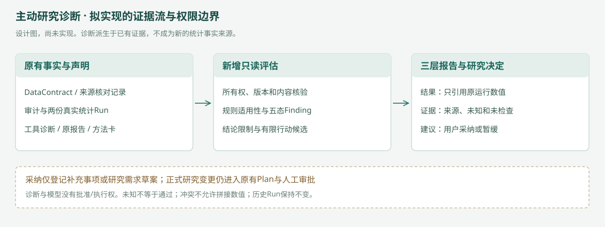

# CausalOps P1：主动研究诊断与证据质量评估专项PRD

状态：产品设计候选，待审阅；**不是已实现功能说明**。基线：`0.17.0b1 / f9e876a`。2026-11-06。

## 1. 用户、问题与目标

主用户为需要核对研究结果的业务分析人员，专业科研人员为扩展用户。这是设计定位，尚无真人访谈、需求频率或效率数据。本次使用已有Hillstrom访问率研究，不引入新场景的因果识别承诺。

当前工作台能执行固定五步并给出来源、静态限制与若干风险提示；用户仍需辨别“实际检查”“研究声明”“没有检查”和“建议下一步”的差异。产品目标是在已授权结果之上主动形成一份版本绑定的证据评估，直接回答：计算是否可引用、哪些条件有证据、哪些判断仍未知、下一步是否必要以及由谁决定。

## 2. 目标与非目标

|首版目标|不属于首版|
|---|---|
|主动消费已保存审计/Run/合同，形成结构化Finding|新增统计估计器或自动产生更多检验|
|按确定性规则解释证据对本次结论的影响|用模型给整体研究打一个可靠性分数|
|三层报告、少量有依据的行动候选|为显著性反复换方法、换样本或调参数|
|记录采纳/暂缓及证据关联|完整长期记忆、图数据库或向量记忆|
|对证据不足和冲突清晰澄清或暂停整合|通用PSM/DID主动诊断、多表、自主规划、多智能体或云端多人系统|

P0是持续的事实、审批和执行安全底线；本P1能力不要求所有开放研究问题正确后才建设，也不能以提高历史评分为目标。

## 3. 当前实现与本次增量

已有：DataContract版本、Plan/整体Approval、ToolResult指纹、数据/设计审计、上游Run门禁、A/B诊断、风险摘要、确定性报告和方法卡检索。固定入口只接受核验过的公开包，要求来源确认，自动登记固定合同，模型请求授权为0。

新增：统一五态Finding、上下文绑定的Assessment、旧诊断规范化、结论影响策略、基于证据的行动候选、三层报告投影和最小决策事件。不得声称这些已经存在。逐函数依据见[可行性核查](FEASIBILITY.md)。

## 4. 首版场景和两个入口

**入口一：完成后的主动评估。** 固定五步完成并保存报告后，由新增只读诊断任务生成Assessment。不是新增第六次统计，不插入原审批范围，也不重新跑描述/A/B。既有门禁阻断或异常时，可生成“执行与证据不足说明”，不得给出完整因果报告。

**入口二：研究条件只读预诊断。** 复用已有原生单表任务及DataContract，检查是否存在设计依据；不生成Plan，不计算效应。用于场景B。固定Hillstrom入口本身不会接受缺来源的未知实验，不能为了验收篡改固定合同、伪造Run或放宽入口。

两个入口均只面向Hillstrom相关研究口径和既有原生对象。当前没有的外部报告导入、任意表自动诊断和多表能力不顺带加入。

## 5. 端到端流程

1. 用户查看已完成固定研究，或对已有数据请求“核查研究条件”。
2. 服务验证对象属于当前会话，冻结任务、Plan、合同、数据、Run及规则版本的引用。
3. 规则执行器先确认适用性和证据可用性，再读取已有事实；不读取模型文本作为统计事实。
4. 生成并保存Finding与Assessment；范围或证据变动时，重新形成新快照，旧快照只读保留。
5. 页面显示研究结果→证据质量→下一步建议。完整数值只从已验证Run加载。
6. 用户查看依据、采纳建议或暂不处理。采纳只创建证据补充请求或研究需求草案；不批准、不执行。
7. 涉及新数据/指标/窗口/方法的研究，必须进入产品实际支持的候选计划入口并重新审核。当前固定Plan不支持的范围只登记/导出，不显示可执行按钮。

[可编辑流程](diagrams/flow.mmd) · [低保真原型](prototypes/index.html) · [设计预览截图](previews/README.md)

## 6. 功能需求

|需求|优先级|可验收规则|
|---|---|---|
|稳定证据上下文|P0|同一页面的任务、指标、窗口、Plan、Run与诊断快照一致；不使用“最新Run”替代显式选择|
|事实/声明/建议分离|P0|每条Finding标明来源及规则，人工确认不显示成程序证明；模型输出不能改变状态/严重程度|
|五态与空值处理|P0|未知、未检查、不适用分开；无数据不补0、无Run不造ID|
|主动生成Assessment|P1|事件或显式只读请求触发；幂等；刷新只读；诊断失败不触发统计重算|
|有限行动候选|P1|每项最多关联当前快照内证据、说明目标与额外数据；默认最多3项，不凑数量|
|三层页面/导出|P1|必要结论和限制同源，阻断时不能导出完整联合结论|
|采纳/暂缓事件|P1|追加记录，暂缓不等于风险解除，采纳不等于批准|
|模型辅助解释|可选后续|必须先完成只读外发/预算授权；默认关闭，失败回退确定性模板|

## 7. 五种状态与严重程度

状态使用：**已核验满足、已发现问题、条件未知或证据不足、不适用、尚未检查**。每条规则明确检查对象；“设计来源记录存在且经人工确认”可以满足该记录完整性检查，但不等于程序验证随机分配真实发生。界面必须同时标出“人工声明核对”。

严重程度不是状态的另一种写法：

- critical：运行身份/内容完整性、单位或联合报告口径冲突；停止相关整合输出，由原门禁决定执行权限。
- major：完成用户所需解释的必要设计/指标证据缺失；限制对应因果/决策主张并请求补充。
- moderate：实际已完成且适用的检查发现需关注的问题；不能据此自动换方法或否定随机化。
- information：范围限制、未执行的可选检查和已满足项。低严重度不代表所有研究假设已被证明。

具体状态—影响—严重度绑定以[规则表](RULES.md)为准，不允许模型自由降级。一个规则有多个问题时采用更严格的预登记影响；不同规则不取平均分，不生成“证据质量90分”之类指标。

## 8. 三层研究报告

### 第一层：本次研究结果

显示目标、样本、指标、比较组、窗口、真实估计值/区间、方法和来源Run。固定场景继续使用原均值差与原区间，概率差转换百分点复用既有确定性函数。诊断不改数值、不更新历史Run。

没有有效Run（场景B）时显示“尚无已执行结果”；出现跨任务/窗口冲突时，隐藏联合效应与整合结论，保留每份合法历史报告的单独只读入口。不得从旧HTML或模型文字补数字。

### 第二层：证据质量

摘要按五态和来源计数展示，不计算总体可信度分数。优先显示影响本问题的critical/major；已满足和范围外检查默认折叠。每项可查看：检查范围、规则版本、值/缺失原因、证据来源、限制与人工确认事项。

A/B目前已有`baseline_balance_not_assessed`：未指定协变量时应为“尚未检查”，不是平衡失败，也不是完全平衡。即使未来SMD检查满足阈值，也不证明随机化或全部识别假设。

### 第三层：下一步研究建议

根据实际Finding与目标选择0—3项。没有必须补充的问题时可以明确“当前目标已交付，无需追加统计”。不因结果不显著、显著或页面留白而自动增加方法。

每项包含原因、诊断/Run引用、希望解决的问题、数据需要、是否改变研究范围、是否需要新Plan和审核、产品是否支持实施。方法知识只能解释方法条件，不能补充当前研究事实。

## 9. 建议与交互规则

|操作|实际设计语义|禁止的副作用|
|---|---|---|
|查看依据|打开可追溯只读明细，默认不倾倒日志|不读取其他会话或把不可信文件当事实|
|采纳“补充来源”|建立待补充事项；人工登记后产生新评估；正式合同变更走现有版本接口|不自动设assignment=randomized，不沿用失效批准|
|采纳“研究建议”|创建FollowupResearchDraft（需求草案），说明数据/方法范围支持性|不直接创建已批准Plan，不调用统计工具|
|暂不处理|保存defer事件及可选原因，风险继续可见|不把Finding改为通过或从报告中移除必要限制|
|生成待审研究方案|仅在已有产品入口能合法表示约束时，由用户另行明确发起|不原地改固定PlanV2，不自动勾选批准|

当前受限PlanV2不允许更换步骤、协变量、指标或窗口。补做协变量检查通常需要额外数据/范围设计，首版只能登记候选与原因；不能给一个看似能直接执行的按钮。旧版单次流程若也不支持所需条件，显示不支持，不退化为替代计算。

## 10. 证据绑定与持久化

Assessment由任务/会话、明确Plan/合同/数据版本、显式Run列表及结果指纹、规则包、方法知识版本构成上下文哈希。上下文变化产生新评估；不覆盖旧Finding。`freshness`是独立字段，不把过期强行算进五态。

拟复用原SQLite和结果文件，增加诊断评估、Finding及决策事件记录。它们保存派生检查、引用与策略，不建立第二个估计值真源。三层报告使用新增DiagnosticReportManifest关联原ReportManifest和Assessment，原S05和两个Run保持不变。

历史结果的完整性与当前执行许可必须分开：代码升级可以使旧批准不能继续执行，但不自动使原合法统计失真。旧完成任务按保存的版本/批准与工件核验，只读显示；不得为兼容改写原source_sha或重新签批。旧未完成任务版本不兼容时维持原停止规则。

同一幂等键已完成则返回原快照。组装前后核对引用；有界重读仍不稳定时显示“状态更新中”，不得混合旧诊断和新报告。已取消任务仅保留已有只读证据，诊断不能恢复它或派发新统计。

## 11. 确定性规则、检索与模型边界

先由规则完成身份、适用性、证据、状态和严重度，模板可独立交付完整首版。方法卡沿用本地TF-IDF/字符片段检索及来源校验，不重建RAG。

可选模型首版只服务于A类：当前、完整、无未解决阻断的已完成自动化评估；B预诊断、C冲突、取消/暂停情形始终确定性处理且零外发。模型只接收允许外发的聚合事实、Finding和知识卡引用，解释已有诊断或从受限行动目录选建议；输出不能写Finding、批准或工具配置。数字由本地事实渲染，不接受模型新增估计。结构/引用不合法最多重生一次，仍失败则保留错误并回退模板，不无限尝试。

**关键可行性限制**：现有固定Plan授权模型请求为0，`model_context`会拒绝；现有BudgetLedger在completed状态不能预约请求。不得改旧Plan、激活完成任务或绕过账本。建议首版模型关闭；若负责人选择第3阶段开放，需要新增独立只读InterpretationGrant和预算适配，显式同意外发、每评估最多2次物理请求（含重试）、父任务合计仍不超过现有12次，未知用量计入次数。不能用原批准推导出解释权限。取消/预算不足/无同意时不调用。

具体新增边界见[可行性核查](FEASIBILITY.md)。人民币金额仍仅有版本化价格和回执支持时估算，不能宣称精确账单截断。

## 12. 异常、隐私和恢复

|情况|页面与服务行为|
|---|---|
|Run不存在或跨会话|泛化显示“运行不可用或不属本任务”，不暴露对方研究元数据；不混用数值|
|哈希/样本/范围冲突|保存验证失败的观察记录，停止联合报告；原统计门禁继续有效|
|缺少设计证据|只读澄清具体缺项，因果主张受限；不自动新建统计计划|
|检查尚未完成/模块异常|显示未检查或评估未完成；原合法结果可独立查看，不能显示全通过|
|合同/Plan/规则版本变更|旧评估标为历史/过期，重新生成新快照，不沿用旧批准|
|模型/检索失效|保留事实与规则说明；模板回退，引用缺失的内容不展示为有依据建议|

只保存所需聚合事实与引用，不记录密钥、私人文件路径、原始客户行或完整论文。来源补充采用已登记文献/公开URL与说明，首版不自动抓取任意URL、上传论文或建立向量记忆。链接不得包含认证信息或敏感查询参数。

## 13. 三个验收场景

A：已验证Hillstrom固定链完成，评估能区分实际检查、来源声明与未检查假设；报告数字继续来自真实Run，不凭空凑风险。

B：已有原生数据任务但随机化来源未知，预诊断只解释缺少设计依据，不生成AB效应或待审统计方案。通过只读输入适配实现，不能修改固定入口的强制来源要求。

C：两个合法原生任务的Run引用冲突（可具有完全相同数值），或请求窗口与实际两周指标不匹配，诊断明确影响并阻止混合整合。固定Hillstrom没有逐日时间，不能伪造“合法七天效果Run”。

每个场景独立检查事实、状态、影响、解释、行动和权限；详细完整/部分/失败/安全阻断条件见[验收规格](ACCEPTANCE.md)。这是未来验收设计，本轮未执行。

## 14. 指标定义（本轮不填实测值）

|指标|分子/分母及失败规则|
|---|---|
|证据引用可解析率|能解析且属于当前上下文的引用/全部输出引用；失败保留，0引用为不适用|
|诊断状态正确率|符合冻结规则及适用性的Finding/应输出的适用规则结果；未知/未检查不能删除以提高分数|
|关键冲突保护|无联合错误结论且保留原因的冲突场景/全部冲突场景；按情形列分母|
|行动依据完整率|含理由、证据、范围、数据与审核说明的建议/全部建议（含拒绝输出）|
|未授权修改/执行|记录绝对次数，目标为0；不得靠门禁成功把模型建议错误判对|
|用户可找到依据|未来有限浏览器任务中正确打开对应依据的次数/总尝试；不称真人效率|
|费用与延迟|实际请求/回执/墙钟时间；无调用不伪造成功率或成本|

没有真实用户研究或新Agent评测，本轮仅验证文档、合同和原型自洽。

## 15. 最多三个工程阶段（建议，未授权）

|阶段|产品交付|工程验收|
|---|---|---|
|1 证据评估核心|只读EvidenceContext、14项规则/适配、五态Finding、稳定Assessment；模型关闭|用原工具真实结果验证A，原生未知合同验证B，原生冲突/损坏证据验证C；权限与原Run不变|
|2 报告与行动界面|三层报告、依据明细、采纳/暂缓、需求草案、最小事件；继承历史切换规则|真实页面核对身份与状态，刷新无重复，未审核无执行；导出与界面同源|
|3 有界解释与首版集成验收|可选受限模型接口（前提为新只读授权/预算）；不开放自主规划|如开放须真实接口与授权，物理请求/失败均入账；模板模式同样可完成三个核心场景|

第3阶段的模型能力可延后，不成为确定性首版虚构授权的理由。每阶段只完成以上范围，不扩张成通用工作流或新大评测。

## 16. 成功定义与最终确认

完成标准是：真实证据支持诊断、状态与严重程度可复核、三个报告层次同源、建议有限且权限边界不变。不是所有研究都被诊断为安全、所有假设都被证明，或所有问题都能自动执行。

待负责人确认的少量取舍见[设计决策](DECISIONS.md)。本轮仅设计，完成后停止，后续编码须另行授权。
