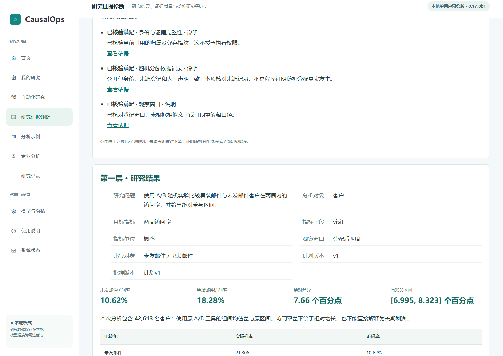
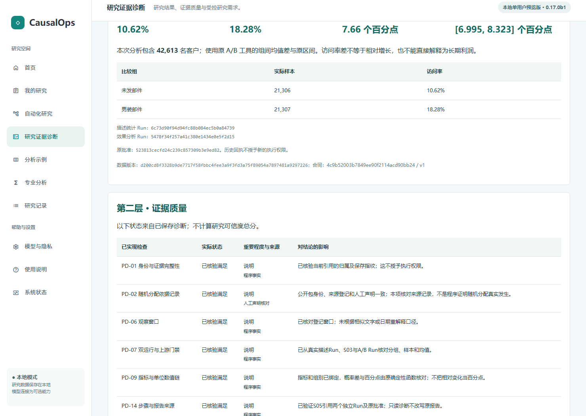
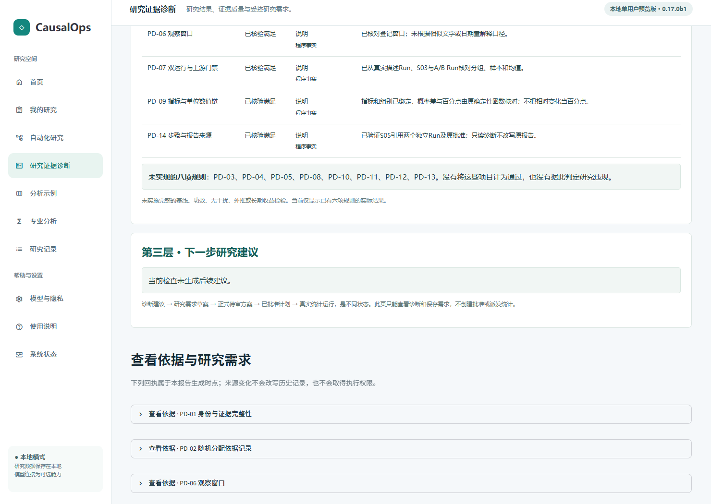
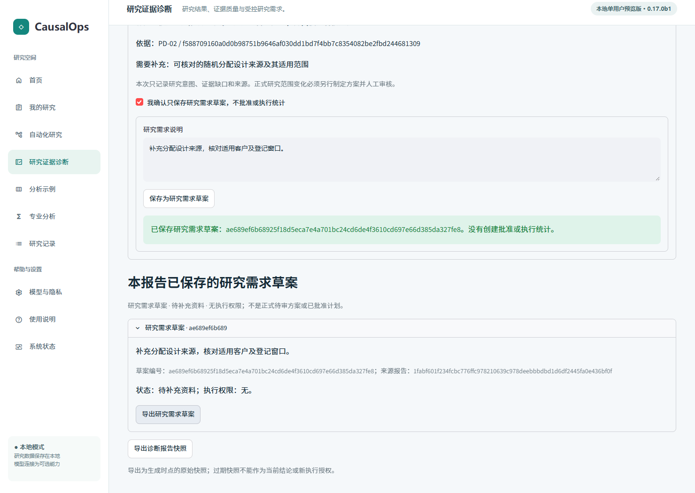
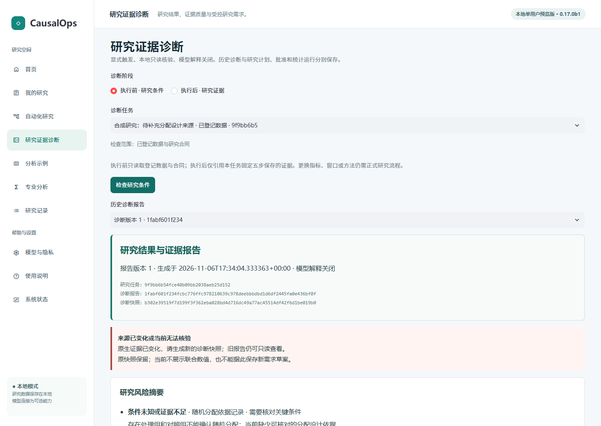
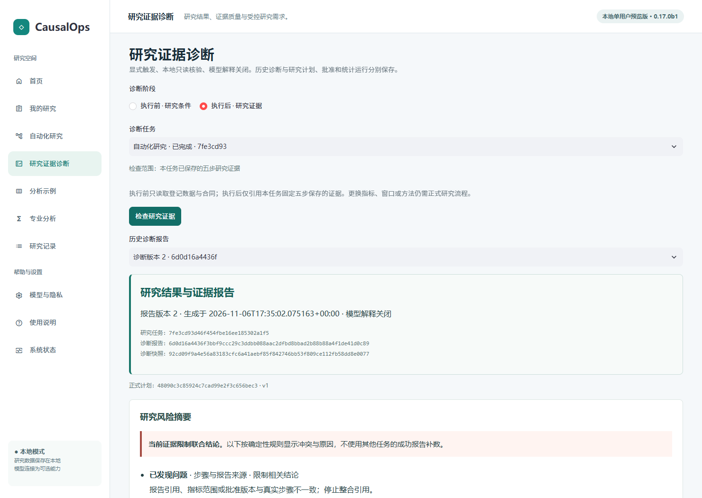

# P1 第三阶段：主动研究诊断工作台与交互验收

本阶段完成现有诊断事实层和报告服务的 Streamlit 集成。用户可以显式触发执行前／执行后诊断、阅读同源三层报告、查看证据、保存无执行权限的研究需求草案，再打开历史版本。没有增加诊断规则、统计方法或模型调用。

## 版本与验收范围

- 独立开发分支：feat/proactive-diagnostics-stage3。
- 起点：第二阶段交付 b4b3a02（包含产品 4cc6559）；公开 Beta f9e876a 及其他阶段分支未改动。
- 主体集成：43947af；最终产品源码修复：f25daae；冻结浏览器运行器：e053747。后者仅修订测试等待与选择器，产品源码与 f25daae 相同。
- 被测完整提交：e0537479e9e81c69beea24617a7bda3c42141bd3。
- 实际执行源码指纹：5c80c4911234d13632fab7be2e71e2f1fff5571e1c391d1a507b891577fd6038。
- 固定真实浏览器 A、B、C 三类验收展开为 8 条子流程，最终 8/8；另行复验原自动化正常研究和旧版单次研究，2/2。
- 定向 UI 工程测试 16 项、受影响模块 149 项通过；完整工程回归：1,040 项通过、0 失败、0 跳过，实际 779.563 秒。
- 本轮真实模型调用 0 次；没有执行 V2.3 题集或模拟用户自由探索。以上不是模型研究正确率，也不是真人完成率。

[源码及环境收据](stage3-evidence/source-and-environment.json) · [浏览器逐次结果与事件](stage3-evidence/browser-results.json) · [工程逐测试结果](stage3-evidence/engineering-results.json)

## 实际修改与调用关系

|文件与入口|本阶段职责|
|---|---|
|application/diagnostics/workbench.py：DiagnosticWorkbench|对现有服务提供按任务限定的目录、历史、读取、证据和草案操作；不另存统计事实|
|同文件 ReportView、load、_binding|报告与模式、任务、研究会话绑定；读取原评估快照，再检查来源当前是否仍一致|
|同文件 create、evidence、original_evidence|显式调用原预诊断／运行后诊断；读取原诊断回执及原 S02、S03、S04、S05 证据|
|同文件 save、drafts|显式确认、来源复核、稳定请求标识及已保存草案回读|
|ui/diagnostics_app.py：render、open_diagnostics、_select|真实页面、明确选择、URL 定位、历史版本、加载／错误状态|
|同文件 report_html、ordered_findings、_forms|同源结果与风险排序、六项检查和八项未实现规则、证据详情、草案确认与导出|
|ui/workbench.py、ui/showcase_support.py|首页、侧栏及 evidence 页面路由；既有诊断演示路由保留|
|ui/automation_app.py|所选自动化任务的执行前、执行后诊断入口|
|ui/assistant_app.py|单次研究任务的只读研究条件检查入口|
|tests/test_diagnostics_stage3_ui.py|16 个页面状态、绑定、损坏、草案和权限反例|
|scripts/diagnostics_stage3_fixture.py|独立公开／合成工作区、受控冲突与只读验收核对|
|scripts/diagnostics_stage3_browser.cjs|真实 Streamlit + Playwright 固定浏览器操作、页面采样及证据记录|
|scripts/automation_v2_browser.cjs|仅限定旧流程审批复选框的已有审核面板选择器，避免重复旧控件误定位|

以上路径均相对项目根目录的 src/causalops（测试与 scripts 除外）。没有修改诊断引擎、统计估计器、原有审批、LangGraph、RAG 或模型接口。19 个实际存在的保护源码范围与第二阶段逐项比较均无差异；17 项注册方法保持不变。

~~~mermaid
flowchart TD
  H[首页／自动化研究／我的研究] --> U[研究证据诊断页面]
  U --> SEL[明确选择阶段、任务、历史报告]
  SEL -->|用户点击检查| W[DiagnosticWorkbench.create]
  W --> DS[DiagnosticReportService.preflight / post_run]
  DS --> E[原 NativeEvidenceReader 与六项确定性规则]
  E --> P[原不可变评估快照与三层报告仓储]
  SEL -->|只读打开／刷新| L[load：任务绑定与当前来源复核]
  P --> L
  L --> V[一个已核验报告的三层页面]
  V -->|查看依据| R[原诊断回执／原生双Run与S05]
  V -->|用户明确确认及提交| D[原 save_draft 再次核对来源]
  D --> N[无执行权限的研究需求草案]
~~~

统计执行不在这条调用链内。只读诊断不取得原工具网关的执行权限。页面没有直接调用估计器、原 accept、approve 或统计派发。

## 执行前与执行后入口

执行前可选择当前工作区已登记数据的研究会话，不要求正式统计 Run。只有点击“检查研究条件”才写入诊断自身的评估及报告；数据合同不完整时保留未知与具体缺项，不创建正式研究 Plan、Approval 或 Run。

执行后从已有自动化任务进入，点击“检查研究证据”使用原服务读取该任务的 S02 描述统计、S03 门禁、S04 A/B 和 S05 ReportManifest。任务不存在、报告不属于所选会话或来源不完整时，不选择“最近成功报告”替代。

历史列表仅按明确任务及会话列出报告。刷新和打开历史只读取，不重新生成评估、不运行统计。同样的证据再次显式检查，复用原服务的稳定快照与报告版本机制。

## 三层报告、风险与证据

第一层读取已保存结构化报告中的目标、数据、分析对象、合同和计划版本、原批准回执、指标、窗口、组别、样本、估计、区间、两个 Run 与原 S05 引用。概率差以百分点呈现；数值不来自模型文本。

第二层使用源码已有五态：verified（已核验满足）、issue（已发现问题）、unknown（条件未知或证据不足）、not_applicable（不适用）、not_checked（尚未检查）。状态与严重程度分别展示。六项已实现检查仍为 PD-01、PD-02、PD-06、PD-07、PD-09、PD-14；其余 PD-03、04、05、08、10、11、12、13 单独标为未实现，不计入通过。

第三层只显示报告已保存的确定性建议，最多三项；无适用问题时明确显示未生成后续建议。未为填充页面产生新建议。来源已变化时隐藏联合数值并禁止新草案，旧快照仍作为历史资料保留。

风险顺序依据既有状态（问题、未知、已核验等）、严重程度和规则 ID 确定。程序事实、人工声明核对与模型建议不能互换；当前模型解释关闭。每项可查看原诊断回执、缺失项目、规则版本和原因码。已完成双 Run 报告另有原生步骤证据按钮。

**source_current 只表示报告仍与当前来源吻合，不表示所有研究假设都通过。** 随机化来源一致属于已登记来源和人工声明的核对，不是程序证明真实随机分配过程。页面明确保留这一限制，不生成整体可信度分数。

## 草案交互及执行权限隔离

每项建议展示对应诊断、来源、待补事实和新范围需重新审核的说明。用户先明确勾选“只保存研究需求草案，不批准或执行统计”，再提交需求文本，才调用原 save_draft。

确认控件位于表单外，提交按钮的启用状态随真实服务端重绘更新。请求身份由报告、建议及去除首尾空白的需求文本确定；刷新后回填已保存需求，重复相同提交返回同一有效草案。修改需求文本属于不同请求。

页面保存前做当前来源复核，原服务保存时再次校验。过期建议不获新草案；历史草案保留但不赋权。草案、待审正式方案、已批准计划及完成 Run 在页面明确区分，没有“立即执行建议”按钮。草案不能通过原单次研究 accept 入口，原执行安全回归继续覆盖未批准执行。

## 页面状态一致性：发现、修复及复验

首次浏览器采样发现真实页面缺陷：历史选择清空或切换期间，上一报告仍短暂可见，虽然其内部标题与正文同源，但已不符合当前选择。首批 1,105 个采样中有 15 个可见选择／报告身份不匹配，未忽略这项失败。

修复在读取任何选择控件前建立固定的“控制区”和“报告输出区”，先清空旧输出；核对期间显示加载提示，只有完成任务、报告、快照和来源检查才在同一输出区呈现报告及其交互。错误路径清除加载提示，展示具体失败和恢复方向。已过期的 Streamlit 区块隐藏且不可操作。

最终浏览器每约 30 ms 采样已渲染报告元素的可见性、任务／报告标识及 URL 当前选择，1,127 个状态样本中可见身份错配为 0；包括成功任务和窗口冲突任务之间 6 次切换。第三批同一最终产品源码采样 1,095 次也为 0。采样不是对所有瞬间的穷尽证明，不据此估计异常持续时长。

[最终页面采样](stage3-evidence/state-samples.json) · [原始各批汇总](stage3-evidence/browser-attempt-history.json)

未完成的前三批没有删除。第一批另有真实标签遮住原生 input 的派发问题；第二批模式切换尚未服务端确认就展开旧任务菜单；第三批原生证据尚未渲染即滚动、以及新任务历史控件尚未就绪即选择。运行器据实际可见标签、已绑定控件和实际 stJson 内容等待，不放宽判据或简单加长超时。

## 真实浏览器验收

所有操作均通过真实 Streamlit 页面及 Edge / Playwright 执行。控制器仅准备独立数据、注入明确反例及在操作后只读核对；不代替用户点击诊断、保存草案或导航。

浏览器每条子流程有新上下文，但使用同一隔离验收工作区，包含 6 个真实完成的自动化研究与 1 个无随机化依据的合成研究。A 与五个 C 研究各自均有独立的描述统计及 A/B Run；这些是验收准备阶段通过原审批实际计算的结果，不是浏览器阶段新运行统计，也不是硬编码结果。

|子流程|最终结果|有效操作|实际秒数|起点与核对|
|---|---|---:|---:|---|
|证据完整|通过|13|18.169|首页→已有自动化任务→诊断；双 Run、三层、六项状态、八项未实现、无额外建议、刷新同版|
|设计依据不足|通过|13|29.521|首页→合成无 Run 任务；设计未知、显式草案、重复及刷新幂等、来源过期拒绝|
|跨任务引用|通过|9|5.802|首页→指定冲突任务；原成功报告已过期，新诊断限制数值并可查依据|
|指标冲突|通过|9|8.848|同上，S05 目标字段冲突|
|单位链冲突|通过|9|8.770|同上，概率差与百分点链不一致|
|观察窗口冲突|通过|9|9.015|同上，S05 窗口与原任务不一致|
|内容哈希冲突|通过|9|5.832|同上，S02 内容指纹不一致|
|任务与历史切换|通过|31|24.384|首页开始；六次交替明确选任务和历史报告，无新报告生成|

共 102 次已记录有效操作，子流程计时合计 110.341 秒。计时从创建独立浏览器上下文前至关闭前的测试处理结束，包括截图、页面等待、部分只读控制器核对及受控过期注入；不含公开数据准备、应用启动及前置统计计算。下拉框展开与选项选择各计一次，页面滚动和断言不计操作。该固定脚本数据不能解释为用户研究耗时或真人效率。

### 证据完整：实际数字和来源

- 当前研究任务：3b0c40cd031a46af8f9fee7c9dc663fd。
- 描述统计 Run：6c73d90f94d94fc88b084ec5b0a84739。
- A/B Run：5478f34f257a41c380e1434e0e5f2d15。
- 合同 v1、固定计划 v1；原批准回执 523813cecfd24c239c857309b3e9ed82。
- 样本 42,613：未发邮件 21,306，男装邮件 21,307；登记窗口为分配后两周。
- 页面未发邮件访问率 10.62%，男装邮件访问率 18.28%；原结构化值分别为 0.10616727682343002、0.18275684047496127。
- 原 A/B 均值差 0.07658956365153125；页面绝对差 7.66 个百分点，原工具 95% 区间显示 [6.995, 8.323] 个百分点。保留原数值精度，不改写估计器。
- 诊断报告 02e77f700c6696ffa27004a25c5002a8ca59d5b57b111e6c3d2f71bdbe987736。刷新、重复检查及明确重开历史后 ID 不变。
- 六项适用检查 verified；未实现的八项独立显示。无适用建议，未强行生成。

[保存的真实报告与草案](stage3-evidence/reports.json) · [当前原生步骤证据](stage3-evidence/A-native-evidence.json)

### 设计依据不足：无 Run 也能检查

独立四条客户记录，实际有两组，DataContract 未登记可核对的随机化来源。页面显示设计事实未知、尚无正式统计运行，提示补充设计来源与适用范围，没有借用 Hillstrom 事实。用户保存需求后仅产生一条草案 ae689ef6b68925f18d5eca7e4a701bc24cd6de4f3610cd697e66d385da327fe8；两次重复（包括刷新后）不增加草案。控制器更新其合同窗口后，页面来源检查与保存拒绝均生效。

### 来源冲突：限制结论并保留历史

分别在 5 个独立任务副本注入外部 S02、错误指标、错误百分点链、错误窗口和哈希。每例先打开原历史成功报告，显示来源变化并隐藏联合数值；再显式检查得到独立受限版本，展示具体问题及依据，不从原成功报告补齐数值。

所有 5 个原成功报告仍保存，新版本为 restricted。**当前快照能准确记录冲突，不意味着冲突来源获认可。** S02/S04 原统计文件、历史 Plan、Approval 和任务表均保持浏览器操作前后的逐项哈希一致。

## 研究历史、安全与原流程回归

[历史与保护摘要](stage3-evidence/history-and-preservation.json)记录原生表及统计文件的前后指纹。

|项目|操作前|操作后|
|---|---:|---:|
|A/B 统计 Run|6|6|
|描述统计 Run|6|6|
|自动化整体批准|6|6|
|单次研究 Plan|0|0|
|单次研究批准|0|0|
|诊断报告|5|12|
|研究需求草案|0|1|

5 个原报告来自冲突注入前；新增 7 个报告分别是 A、B 和五个 C。后续只读历史切换没有增加报告。原生研究表与全部统计文件指纹未变；B 的合同变更是显式受控测试注入，不归因于用户诊断操作。

原五步服务层和权限回归涵盖未批准拒绝、逐步授权、损坏上游阻断、恢复／取消、历史保持。另行真实浏览器 original-browser02 执行自动化 A-normal 与 legacy-single，两条通过，包括人工审核、实际计算、报告导出及刷新不重复运行。前一次 legacy-single 在重复旧控件上定位失败保留为首次记录；仅限定已有审核面板选择器后通过，没有变更产品审批或统计逻辑。

[原流程真实浏览器结果](stage3-evidence/original-workflows.json)

## 工程测试与可复现运行

先增加 UI 状态及权限测试，未实现前的导入失败保存于本地验收日志；加载失败仍留加载提示的反例也先确认失败，再修复。最终定向 16 项覆盖空工作区、明确点击、刷新、跨任务／模式绑定、来源过期、确认与重复草案、真实双 Run、冲突、五态排序、无合同、损坏版本／回执、选择切换和错误加载清除。

受影响模块 149 项，0 失败、0 跳过；包含诊断两阶段、自动化执行、安全、持久恢复和工作台。完整工程回归：1,040 项通过、0 失败、0 跳过，实际 779.563 秒。三组测试范围重叠，不能相加为独立功能数。实际各测试用时、状态及原始日志／JUnit 哈希见机器记录。参数化用例只收录测试基名和参数名称哈希，避免把路径型测试输入带入文档；完整原名保留在独立原始 JUnit 中。工程通过不意味着开放研究问答均正确。

环境：Windows、Python 3.11.5、Streamlit 1.66.1、Edge 156.0.4314.58；使用已有项目测试 Python 环境及源码安装路径，不声称完成清洁环境独立安装。所有数据、数据库与原始截图／日志存储于独立 QA 目录；未使用正式用户研究工作区。公开 Hillstrom 压缩包 SHA256 为 bab6578f60db5d792f1c2372c502f029152a5249cf5ea84390f3b7f885d7234f。

以下命令在项目根目录执行；先安装当前工程的开发依赖，并在环境变量中指定已核验公开归档及真实浏览器路径。结果目录必须是新的独立路径。

~~~powershell
$env:PYTHONPATH = (Join-Path (Get-Location) 'src')
$env:PYTHONUTF8 = '1'
$env:PYTHONDONTWRITEBYTECODE = '1'
Remove-Item Env:DEEPSEEK_API_KEY -ErrorAction SilentlyContinue
Remove-Item Env:OPENAI_API_KEY -ErrorAction SilentlyContinue
# CAUSALOPS_HILLSTROM_ARCHIVE：经核验的公开 hillstrom.csv.gz 的路径
# CAUSALOPS_TEST_PYTHON：当前测试 Python 可执行文件
# CAUSALOPS_BROWSER_EXECUTABLE：已安装 Chromium / Edge 可执行文件
python -m pytest tests/test_diagnostics_stage3_ui.py -q -p no:cacheprovider
python -m pytest -q -p no:cacheprovider
node scripts/diagnostics_stage3_browser.cjs ./local-qa/diagnostics-stage3-new
~~~

浏览器脚本通过当前 NODE_PATH 查找 Playwright，自动使用空闲本机端口，启动真实工作台。fixture.py 的 prepare／stale 只供独立测试控制器使用，不是产品入口，也不是模拟用户能读取的隐藏路径。实际页面操作、可见文本、截图、时间戳、状态采样、原生保护指纹和所有初次失败／最终复验已归档；原始数据库、服务器日志和失败 DOM 不提交 Git，也没有覆盖历史评测数据。

## 当前能力边界与风险

|等级|事项|本阶段处理|
|---|---|---|
|非阻断限制|执行后目前仅支持受限固定 Hillstrom 自动化证据结构，不是任意统计方法的通用诊断工作台|页面说明范围，其他研究会话只做现有预诊断|
|非阻断限制|八项规则未实现，六项检查不证明全部识别条件或随机化过程|单列未实现；无总分；限制因果解释与长期外推|
|非阻断限制|需求草案不是可执行 Plan；无自动转换、接受／拒绝理由记忆|保留显式无权限合同，未来另行设计|
|维护优化|页面加载／核验需要重绘，查看依据或提交后阅读位置可能变化|固定输出区保证同源，体验优化留待后续|
|维护优化|只读来源复核复用第二阶段 _verify_inputs 内部接口；目录使用原仓储结构查询|未重写引擎；未来可提升为稳定公开只读接口|
|使用限制|本地单用户工作台，没有生产级多用户或真人效率验证|未增加权限模型或对外发布|
|测试限制|页面采样有间隔；固定脚本不等于自由探索和真人测试，未验证所有故障组合|记录样本及失败；不推广成总体可靠率|

没有在本轮验收范围发现新增统计越权、历史覆盖或跨任务数值补齐。该结论仅适用于已执行反例和实际浏览器路径；不等于系统所有研究解释都已可靠。

## 受限首版结论与停止边界

在上述范围内，用户可以通过真实页面查看可追溯结果及证据、区分未知／冲突／未实现检查、明确保存无权限需求，并重开同一历史报告；真实浏览器和原流程回归支持进入 **P1 首版受限验收**。

仍关闭模型解释、收费调用、后台自动诊断、剩余规则、复杂建议、长期决策记忆、通用多表与自动执行建议。既有研究解释限制不因页面接入而消除。

[本阶段文件及保护范围检查](stage3-evidence/review-checks.json)未发现新增密钥、私人路径或数据产物。模式扫描的 8 处既有命中经逐行核对，属于原页面的普通词语或标准浏览器安装位置，均未被本轮新增。没有把这次范围检查描述为完整 Git 历史的发布安全认证。历史 Beta、第二阶段和 main 指针保持不变。

本阶段结束；不推送 GitHub、不合并 main、不创建 Release，不自动启动下一阶段开发或发布。负责人可先审阅报告、实际页面及边界，再决定后续动作。
