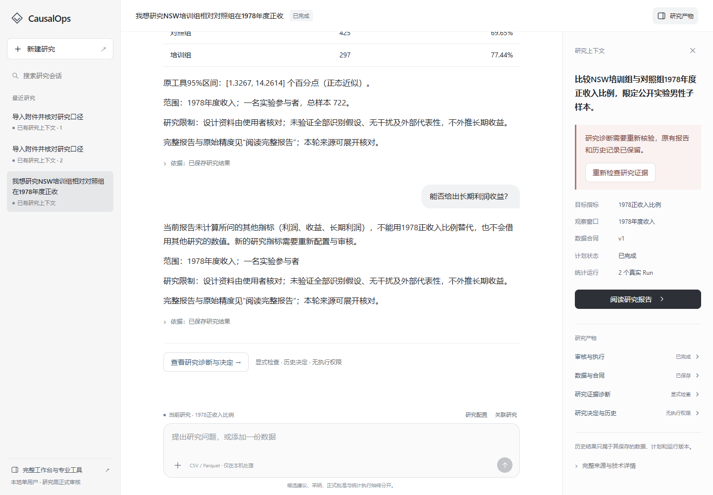
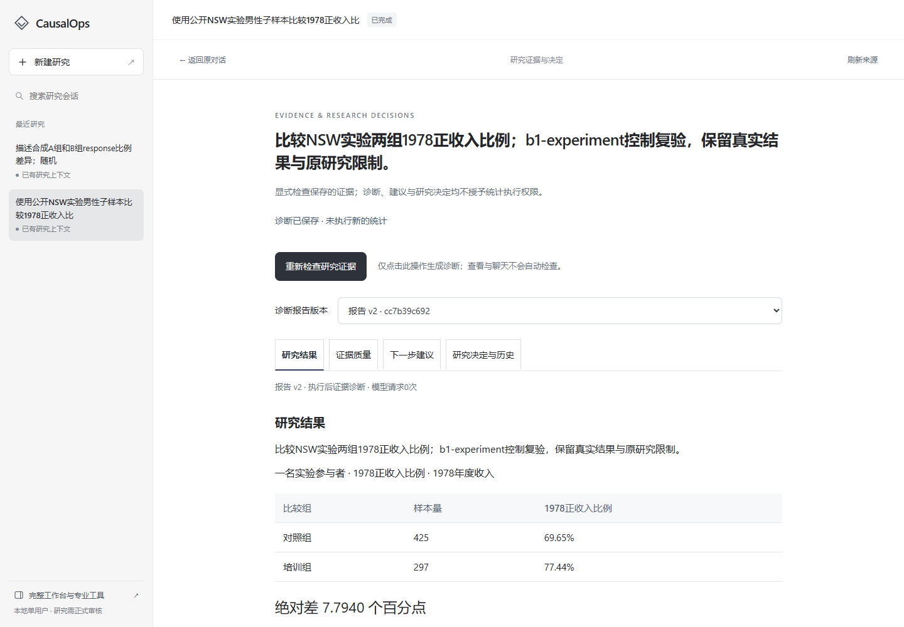
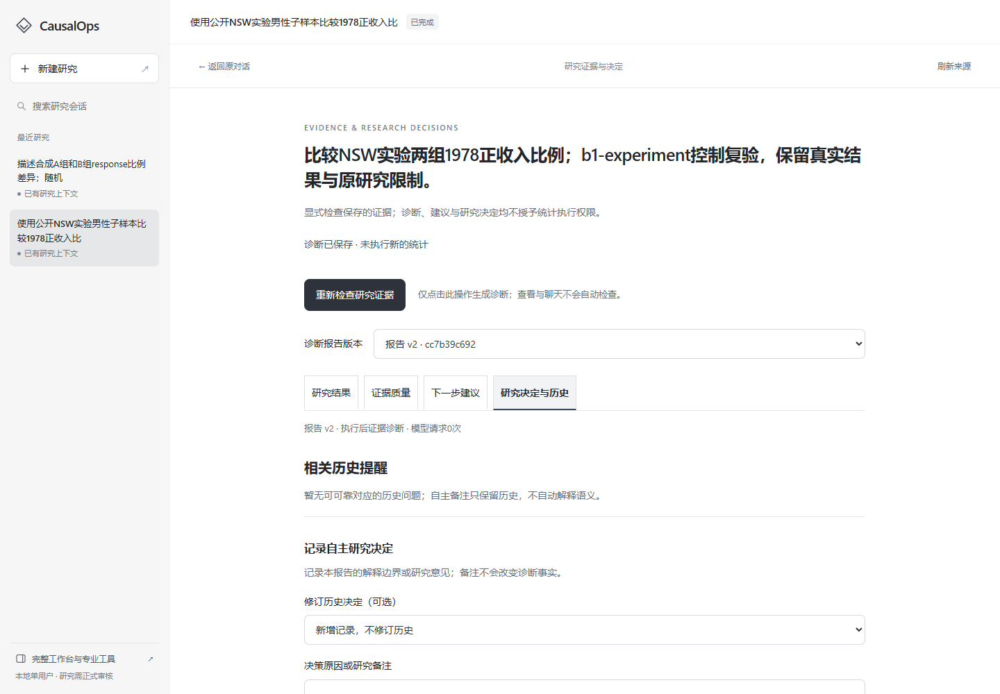

# CausalOps 0.21.0b2 可信交付维护候选

0.21.0b1是已公开的React Beta；本0.21.0b2为独立本地候选，未授权推送。

## 本版维护

- 描述性报告明确没有执行推断区间；A/B报告保留实际独立组均值差和原工具正态近似区间。
- 已采纳候选显示“已转为待审方案”，真正过期或跨任务来源仍拒绝。采纳不等于批准。
- 聊天分别交付实际效应估计方法和区间估计方法，未知元数据不猜测。
- 已完成研究的暂停/取消请求显示确切未生效回执，不改变领域终态。
- 明确100000行交互上传限制及操作建议，保留20MB React预检和其他读取边界。
- 旧诊断来源过期时，保留合法研究阅读与重新检查入口；显式检查生成新版本，旧诊断和研究决定/修订历史保留。

## 升级

先停止b1、备份工作区，再升级wheel并使用同一工作区路径启动。无需迁移数据库路径，不自动重算统计。旧批准仅保留历史，不自动拥有新版执行权限。诊断需重新核验时，从研究面板进入“重新检查研究证据”，在诊断阅读页再次显式提交。真正的来源损坏继续拒绝。

[安装与升级教程](../../current/INSTALLATION.md) · [React使用教程](../../current/REACT_WORKSPACE_GUIDE.md) · [候选验收](ACCEPTANCE.md)

## 保留的能力边界

本地单用户、单表双组二元受限研究；六项已实现确定性诊断规则，其余八项未实现。专业统计方法、模型连接与部分功能仍通过Streamlit。无通用自主研究、多表或跨任务语义记忆。没有真人独立使用的正式验收数据；自动浏览器模拟不是效率或满意度证明。

## 实际安装版页面

此图来自独立冻结样本副本的真实过期状态，不代表所有原地升级都会过期。同路径升级中的原诊断经服务核验仍可兼容读取。

