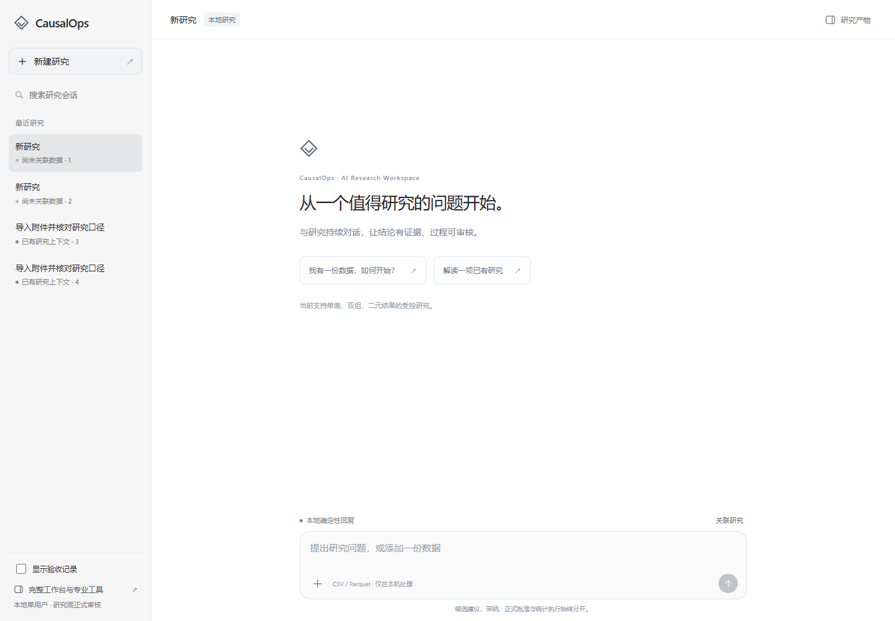
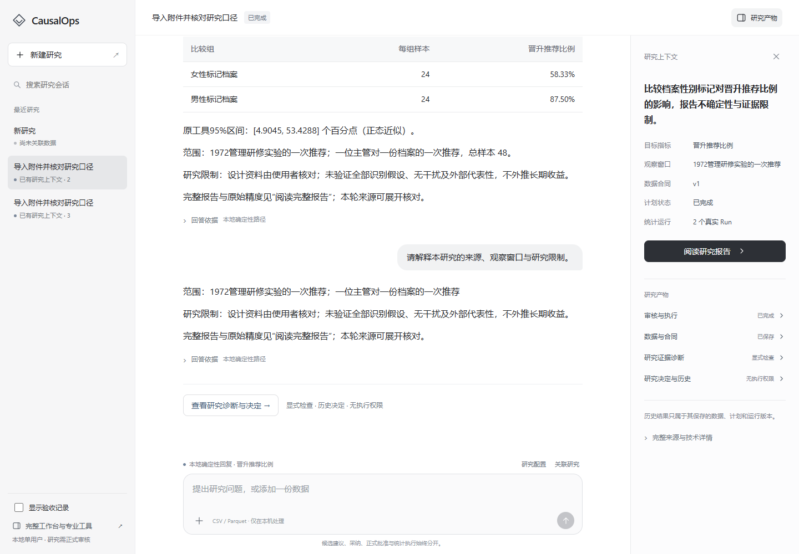
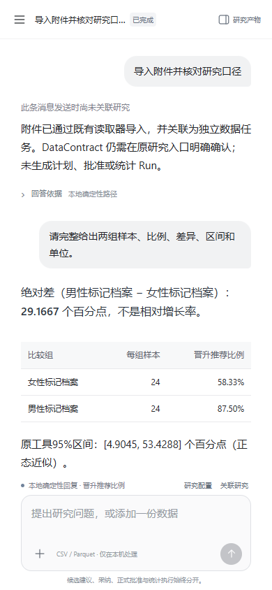

# CausalOps 0.21.0b1 本地 Beta 候选验收

## 结论与候选范围

本地候选通过发布包定向验收。React作为默认入口，原Streamlit完整兼容入口保留，共用一套Python领域服务和同一CAUSALOPS_HOME。仅准备本地候选，未推送、未修改远程main、未创建Release或标签。最终提交与发行文件SHA-256以独立交付清单为准；本文件不构造自引用提交哈希。

已验收产品源为`3ef325e5c12e9530f698fcb446f30124597c3117`；清洁候选沿用已公开`9327eb300b6150aae50f4dcb9c7da193bf8587bc`历史，将已验收产品文件及必要发布调整作为新的清洁增量，不合并原始开发历史。统计估计器、DataContract、审批、Run、诊断规则与研究决定语义未改动。

## 本轮实际安装与启动

- Windows / Python 3.11.5，分别新建wheel环境与源码安装环境，依赖按138项公开固定版本安装；没有继承旧环境site-packages。
- 两种安装均通过pip check；版本0.21.0b1、17项方法注册、pywintypes导入和包内React资源校验通过。
- wheel内含TypeScript/Vite生产产物，运行时PATH移除Node与npm后，React及Streamlit仍可由一个标准命令启动。源码包同样携带生产资源。
- 实际检查同工作区重复启动复用、不同工作区端口冲突拒绝、依赖缺失提示、静态资源损坏拒绝、单个服务退出联动关闭，以及监督进程退出后两个子服务关闭。
- 单端口占用时不留下另一半服务；不连接、不终止未知进程。两个服务就绪与身份核验成功后才打开浏览器。

## 新安装包真实研究

完整身份、原始精度、批准时间、Run及诊断/决定引用见[EVIDENCE.json](EVIDENCE.json)。

|场景|本轮实际结果|
|---|---|
|公开实验|React新会话、CSV上传、合同、候选采纳、正式批准、单独开始、五步执行、两个真实Run、报告导出、显式诊断、研究决定及刷新恢复通过|
|设计依据未知|独立合成Parquet，描述性4步/1个Run；无A/B Run、无推断区间，诊断设计事实未知，合法暂缓及追加修订通过|
|同源对照|同一任务在React/Streamlit读取的task、steps、evidence、report与budget逐项相等；诊断和决定身份一致|
|重复与权限|完成后重复请求未新增逻辑统计运行；诊断和研究决定前后受保护统计、批准、计划与步骤记录不变；决定execution_authorized为false|
|暂停与恢复|本轮新增验证为已批准、尚未派发时请求暂停，刷新后核查恢复，最终两个Run的工具尝试均一次；取消后恢复被拒绝|
|运行中安全边界|首次捕获时任务完成过快，未作为本轮新证据；运行中安全边界暂停和进程退出后研究调和复用已通过的综合验收，不冒充再次观察|
|升级边界|同路径独立旧版夹具：旧批准在新版执行核验被拒绝，已完成旧报告仍可合法只读查看；原正式记录不变|

公开实验来源为[OpenIntro随机化推断案例](https://openintro-ims.netlify.app/foundations-randomization)：48位主管各作一次推荐。女性标记14/24（58.3333%），男性标记21/24（87.5%）；后者减前者29.166666666666664个百分点。原注册工具正态近似95%区间为[4.904536377189303, 53.42879695614402]个百分点。这里使用原工具近似区间，不声称复现教材的随机化检验；小样本近似、代表性、无干扰及实际长期结果均有局限。档案推荐不等于实际晋升。

## 测试范围必须区分

|证据|范围|
|---|---|
|本轮Python相关回归|144项通过，包括新启动/资源/打包、会话、配置、审批执行、诊断适配及自动化相关测试；13项发布定向测试是其中子集，不重复累加|
|本轮前端|22项组件测试通过；npm ci、TypeScript与Vite生产构建通过|
|历史完整工程回归|已验收提交的1259项通过，本轮未完整重跑；本轮没有修改统计/研究业务语义|
|本轮真实浏览器|安装后的wheel提供API和静态资源；公开/合成研究、来源核对、长对话、控制与兼容入口验证；不是静态原型|
|模型及真人|本轮模型请求0；真人独立使用正式验收数据仍为0，不将脚本测试称为真人试用|

保留了先失败后复验记录：开发源码与旧安装包混用被健康检查拒绝；只读健康入口原先401；旧README版本断言；浏览器辅助脚本路径及字段错误；过快完成导致暂停运行态未捕获；初次扫描误纳入本地node_modules；首次首页截图尚在加载后重新截图。没有为复验修改研究事实、冻结评测或统计答案。

## 最终视觉材料

真实安装包、浏览器100%缩放、DPR=1。1440×1000、1180×820、390×844分别检查长对话、面板、合同、候选、审批、执行、报告、诊断与决定；未发现页面水平溢出。来源见[截图清单](assets/PROVENANCE.json)。演示使用既有会话过滤开关隐藏异常测试会话，没有删除合法历史。截图包含公开/合成数据，不是真人信息。

视觉方向保持现有极简中性色，没有新一轮重设计。最终主观视觉质量仍需负责人审阅；工程通过不等于审美评审通过。

## 公开安全与剩余边界

检查当前文件、全部可达Git对象及新增对象、wheel和源码包解压成员、教程资源与截图。新增真实敏感信息为阻断；三个既有公开历史风险和五个复核提示继续单独列明，见[安全说明](SECURITY_AND_LIMITS.md)。模式扫描不是绝对无风险证明。私人数据库、密钥、原始私有会话、验收工作区和完整机器日志不进入公开候选。

React仅本地单用户、单表双组二元受限确定性研究；六规则已实现、八项未实现。专业方法完整配置、需求草案、原单次研究与受约束模型规划仍通过Streamlit。[覆盖矩阵](COVERAGE.md)准确区分入口。没有公网多人安全、通用自主规划或真人效率验证。

建议负责人确认最终SHA与真实截图后，再单独授权定点公开Beta。本轮到此停止，不自动推送。
