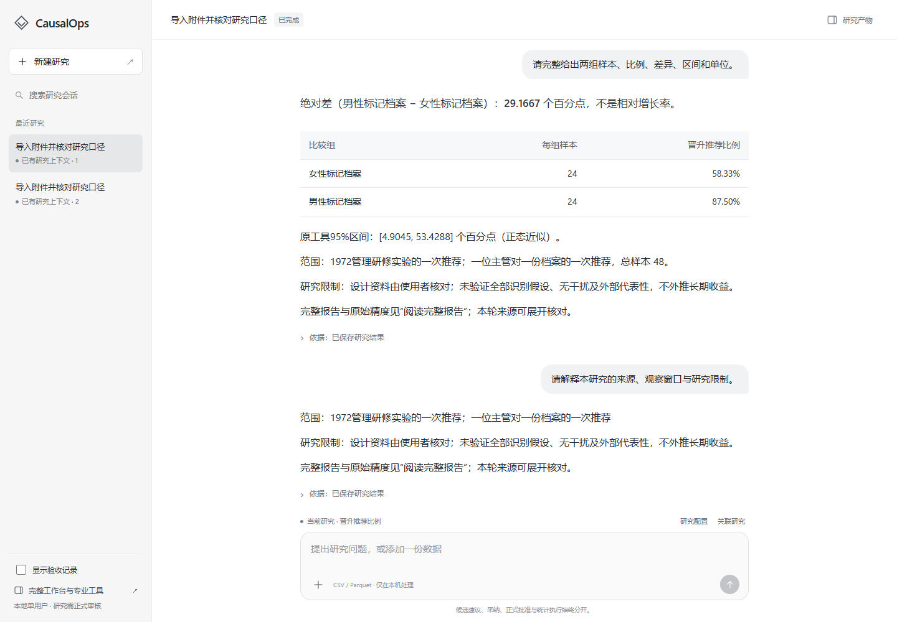
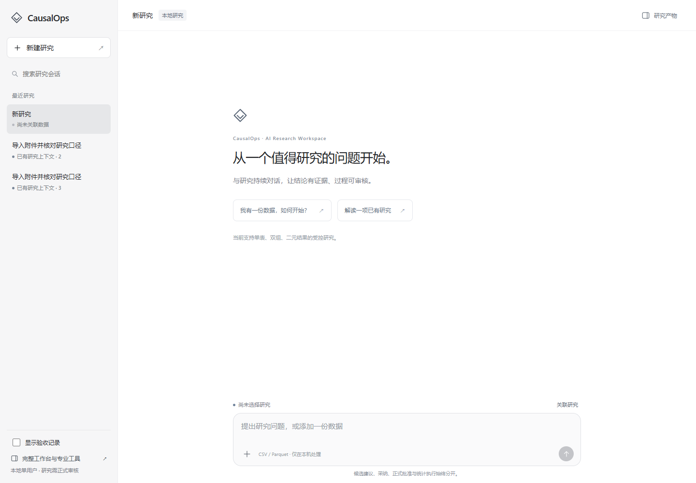
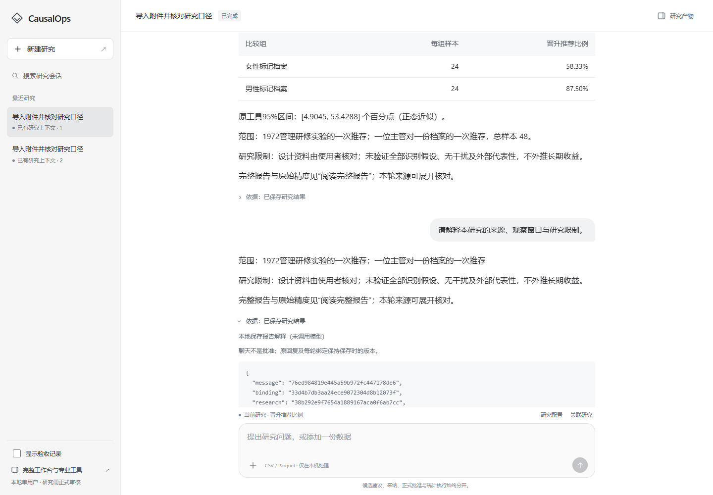

# 0.21.0b1 候选修订：研究上下文与回答依据

本次仅在原候选`24db6847d90f9919905e9574ec153796a52742c0`上追加显示层修订。版本仍为0.21.0b1，修订后的完整提交与发行文件SHA-256以本次独立交付清单为准，不沿用旧提交声称已包含修改。

## 用户可见文案

- 关联合法研究：输入框上方显示“当前研究 · 实际指标”，指标缺少时使用该研究实际名称。
- 未关联研究：显示“尚未选择研究”，不从遗留名称推断研究已关联。
- 回答确实引用已保存结果：折叠摘要显示“依据：已保存研究结果”。
- 没有有效Run、来源不可用、回复未完成、引用不属于冻结研究或没有相应结果范围：保留中性“回答依据”，不展示结果可信标签。
- 附近候选页“确定性路径 · 模型调用关闭”改为“研究模板 · 未使用外部模型”，能力边界不变。

技术来源原文保留在展开内容；没有改写历史消息。任务后来产生Run，不会使早期未引用Run的消息自动变成结果回复。

## 显示条件和业务边界

显示标签使用原服务已返回的available、完成状态、冻结研究归属、Run清单和结果范围；自动化报告另需已保存报告指纹，单次运行解释需实际事实引用。它不重新计算统计、不将模型的来源自称当作核验结果，也不授予执行权限。

211个Python文件与原候选逐字节一致。ChatService、统计事实、模型调用、Plan/Approval/Run、来源绑定、诊断与决定机制均未修改。没有CSS改版、新依赖或新研究能力。

## 本次验证

- 前端31项通过：原22项及新增9项文案/来源正反例。
- 发布相关Python6项通过；TypeScript检查和Vite生产构建通过。
- 安装修订wheel后的26个真实浏览器检查通过：关联研究、空会话、真实历史无Run回复、来源异常、保存结果标签、展开技术详情、候选说明、1440/1180/390视口。
- 浏览器操作为只读；25张受保护表前后所有行哈希一致，包括会话与绑定、审批、Run、步骤、诊断及决定。
- 本次不重复历史1259项完整回归，不进行模型调用或真人验证。

首次记录保留：初次测试从错误目录启动；修改前4个文案断言失败；首个wheel因构建目录残留旧JS被资源检查拒绝，清理生成目录后重新打包；浏览器最初错误假设描述任务已有结果就必然已有结果追问，修正为按该条消息真实Run来源检查。没有为通过测试修改服务、研究事实或历史。

## 真实页面

使用安装后的真实React、公开/合成研究和原尺寸截图。没有新增统计执行，未推送GitHub、未修改main、未创建Release。既有公开历史风险继续见[安全说明](SECURITY_AND_LIMITS.md)。
